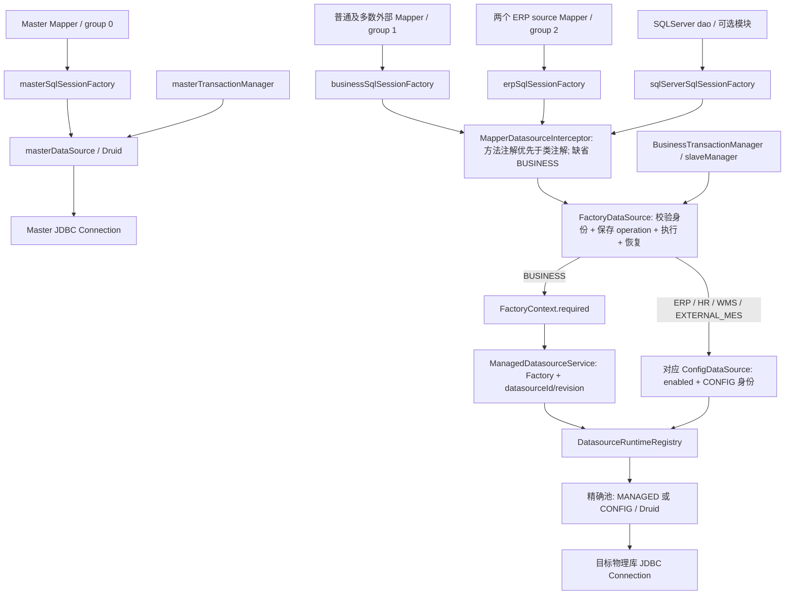
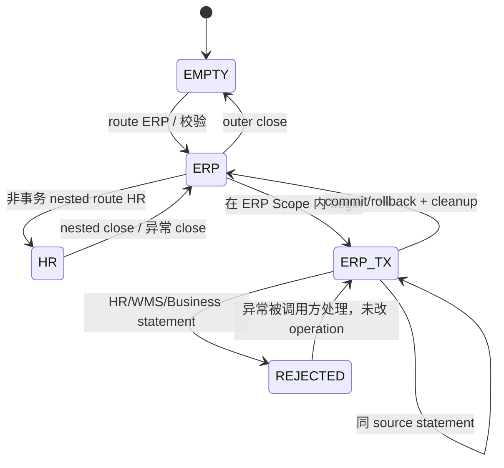

# ktg-mes External Datasource Architecture Audit

日期：2026-10-06。审查对象：`/Users/user/work/heri/ktg-mes`，分支 `feat/multi-factory-isolation`，HEAD `bdc299dade855177a3e275199ffde6e72310e393`。这是当前分支调查，不代表早期 master 的实现。源仓库审查前后均 clean；不改生产代码、不迁移包、不重构。报告放在 mes-base，供架构讨论使用。按源项目规则排除 ktg-wheel，未借其代码或测试证明结论。未连接真实数据库、未启动服务、未读取或输出连接凭证。

## 1. 结论：C，处于 external manager 与 persistence 仲裁之间

**一句话：Master 独立直连；Business 和四类外部源共用一个 FactoryDataSource 路由器，Mapper 注解决定用途，Scope 保存/恢复路由，统一本地事务管理器固定实际连接身份；Mapper 又分散在两个常驻和一个可选非 Master SqlSessionFactory 中。**

不能把代码压成“MASTER/BUSINESS/EXTERNAL 三个 owner”，也不能说它正式定义了“MASTER/BUSINESS/ERP/HR/WMS 五个 persistence owner”。当前没有这一套统一 owner 枚举/管理器。存在三个不同维度：

| 维度 | 当前事实 |
|---|---|
| 会话注册组 | group 0 Master；group 1 默认组；group 2 两个特定 ERP Mapper；另有可选 SQLServer 模块工厂 |
| 路由用途 | BUSINESS、ERP、HR、WMS、EXTERNAL_MES；MASTER 不经此路由器，历史 MASTER/SLAVE 注解值在此反而归 BUSINESS |
| 池来源身份 | MANAGED 与 CONFIG，加 datasourceId/revision；这是加载来源，不能等同表数据 owner |
| 本地事务资源 | 一个直连 Master 管理器；一个路由管理器，轮流管理 Business 或某一个外部源 |

语义上 ERP/HR/WMS/外部 MES 是集成对象；外部物理库选择不依赖 Factory。基础设施上它们参与与 Business 相同的事务身份校验，并与 MANAGED 池共用注册表。**B 描述了仲裁的一部分，A 描述了外部连接管理的一部分，完整结论为 C。**

## 2. 证据入口与真实拓扑

下列路径均属于上述源码快照；行号为本轮读取结果。

| 证据 | 支持的事实 |
|---|---|
| [MfDataSourceConfig](/Users/user/work/heri/ktg-mes/ktg-framework/src/main/java/com/ktg/framework/factory/MfDataSourceConfig.java:37) | Master、四个 ConfigDataSource、两个事务管理器、三个工厂、XML 分组 |
| [MfMapperScanConfig](/Users/user/work/heri/ktg-mes/ktg-framework/src/main/java/com/ktg/framework/factory/MfMapperScanConfig.java:10) | 同一个包模式扫描三次，以 catalog 排除其他组 |
| [MfMapperCatalog](/Users/user/work/heri/ktg-mes/ktg-framework/src/main/java/com/ktg/framework/factory/MfMapperCatalog.java:8) | Master 外置名单；ERP 名单仅两个类；其余默认 group 1 |
| [FactoryDataSource](/Users/user/work/heri/ktg-mes/ktg-framework/src/main/java/com/ktg/framework/factory/FactoryDataSource.java:14) | 真实路由、Factory 解析、operation ThreadLocal、事务身份和 Connection 边界 |
| [MapperDatasourceInterceptor](/Users/user/work/heri/ktg-mes/ktg-framework/src/main/java/com/ktg/framework/factory/MapperDatasourceInterceptor.java:32) | 在 Executor/cache/连接复用之前确定方法/类用途并进入 Scope |
| [BusinessTransactionManager](/Users/user/work/heri/ktg-mes/ktg-framework/src/main/java/com/ktg/framework/factory/BusinessTransactionManager.java:15) | begin/suspend/resume/cleanup 与 JDBC resource 同步绑定身份 |
| [ConfigDataSource](/Users/user/work/heri/ktg-mes/ktg-framework/src/main/java/com/ktg/framework/factory/ConfigDataSource.java:18) | enabled、精确身份解析；拒绝活动事务中的独立直连旁路 |
| [DatasourceRuntimeRegistry](/Users/user/work/heri/ktg-mes/ktg-framework/src/main/java/com/ktg/framework/factory/DatasourceRuntimeRegistry.java:15) | CONFIG/MANAGED 池加载、配置不可变、关闭和加载失败退避 |
| [ManagedDatasourceService](/Users/user/work/heri/ktg-mes/ktg-framework/src/main/java/com/ktg/framework/factory/ManagedDatasourceService.java:36) | Factory 对应 Business metadata/版本和池加载，配置管理使用 Master TransactionTemplate |
| [SqlServerAutoConfiguration](/Users/user/work/heri/ktg-mes/ktg-sqlserver/src/main/java/com/heri/ktg/sqlserver/config/SqlServerAutoConfiguration.java:21) | 第四个可选工厂也绑定同一 businessDataSource |
| [DataSource 注解](/Users/user/work/heri/ktg-mes/ktg-common/src/main/java/com/ktg/common/annotation/DataSource.java:12) | 当前约定仅 Mapper 选库，不用于 Service 切库 |



图中 Interceptor 是各工厂分别安装的插件，不是单个插件实例。Registry 的 DynamicRoutingDataSource 在当前路径用作池容器/生命周期实现，**实际路由由 FactoryDataSource 显式完成**，没有依赖 dynamic-datasource 的 lookup ThreadLocal。FactoryDataSource 继承 AbstractDataSource，不能仅因 dynamicDataSource 别名就称为标准 AbstractRoutingDataSource。

JDBC 路径：MyBatis-Spring Session → SpringManagedTransaction/DataSourceUtils → 若已有同路由器绑定连接则复用，否则 FactoryDataSource.getConnection → 目标 ConfigDataSource 或 MANAGED Druid → Druid.getConnection。正因为前半段可能直接复用旧连接，后半段 getConnection guard 不能代替 Executor 前的 statement guard。

## 3. erpSqlSessionFactory 与 Mapper 分组

`scan(registry, factory, group)` 通过 ClassPathMapperScanner 扫描 `com.ktg.**.mapper`，按 catalog 排除非本组接口。XML namespace 同样计算组，避免接口与 XML 分离。

| group | 工厂 | 实际接口范围 | 工厂 DataSource |
|---|---|---|---|
| 0 | masterSqlSessionFactory | mf-master-mappers.txt 名单，含系统、平台及部分同步 metadata Mapper | 固定 masterDataSource |
| 1 | businessSqlSessionFactory | 所有未命中 Master/ERP 名单的 Mapper；包含 ERP、HR、WMS 外部 Mapper | 同一 FactoryDataSource |
| 2 | erpSqlSessionFactory | **ErpItemSourceMapper、ItemLotSourceExtraMapper 两个** | 同一 FactoryDataSource |
| 模块独立扫描 | sqlServerSqlSessionFactory | com.heri.ktg.sqlserver.dao；enabled 时创建 | 同一 FactoryDataSource |

因此：

- A“所有外部 Mapper 共用 erpSqlSessionFactory”：**否**。
- B“它绑定路由器，再选 ERP/HR/WMS”：绑定路由器这一部分**是**，但它注册的两个 Mapper 当前声明 ERP，不等于承载全部外部源。
- C“每个 ERP system 对应一个工厂”：**否**。工厂分组与物理池数量不一一对应。
- `erpSqlSessionFactory` 是否实际上是 `externalSqlSessionFactory`：**NO**。它是当前专列两个 ERP source Mapper 的会话组，不能用一个更宽名字解释其余 Mapper 的真实归属；是否将来统一外部工厂属于设计选择。
- Mapper 包名不证明物理库。ErpModMapper 同一个接口的默认方法读写 MES 本地 `erp_mo_d`，带 ERP 注解的方法读外部 `MO_D`；它属于 group 1。

## 4. source、配置、切换与状态机

| 路由用途 | 默认 CONFIG id | 配置前缀 | 默认启用 | Factory 决定连接？ |
|---|---|---|---|---|
| ERP | erp | spring.datasource.druid.erp | true | 否 |
| HR | hr | spring.datasource.druid.hr | false | 否 |
| WMS | wms | spring.datasource.druid.wms | false | 否 |
| EXTERNAL_MES | external-mes | spring.datasource.sqlserver | false | 否 |

`mf.external.<name>.datasource-id/revision` 可覆盖身份，revision 默认 1。用途枚举、四个字段及 switch 固定在 Java；**不是任意新增配置 sourceId 就能接入的通用 map API**。ERP/HR/WMS 既表达外部系统用途，也用于定位固定配置；CONFIG id 才是底层池标识。不能把 HR 在 group 1 的事实说成“HR 属于 Business”，也不能把 SQLServer JDBC 驱动说成独立业务 owner。

| Mechanism | 谁设置 | 谁读取 | 生命周期 | 谁清理 |
|---|---|---|---|---|
| Mapper 方法/类 @DataSource | 开发者声明 | Interceptor 根据 statement.id 反射，缓存用途 | 类/配置生命周期 | 无可变上下文需清理 |
| operation ThreadLocal | Interceptor 或显式 router.route | resolveCurrent/getConnection | 一个 Scope；可嵌套 | Scope.close 恢复前值/移除 |
| 事务 Selection / TSM resource | BusinessTransactionManager.doBegin | statement guard、Connection guard | 本地事务；挂起时解除 | resume 恢复；cleanup/failure 解除 |
| FactoryContext | 请求或任务入口 | 仅 Business resolver；部分 ERP 参数生成 | 请求/显式快照任务 | 入口清理；显式 wrap 隔离 |
| DynamicDataSourceContextHolder / 旧 DataSourceAspect / @DS | 当前受审生产链无使用 | 不参与当前选库 | 不适用 | 不适用 |
| Registry identities/pools | 启动 CONFIG 注册、MANAGED 加载 | Config resolve/Managed resolver | 应用/池生命周期 | 注册表 PreDestroy；MANAGED 可移除 |

普通调用者只执行 `mapper.xxx()`；自动机制确实包含“选用途 → execute → restore”，但前后都有身份/配置校验，且事务先借连接。没有 ERP 专用 ThreadLocal，只有统一 operation ThreadLocal。显式外部 TransactionTemplate 必须先进入正确 Scope 再 begin；只在 Service 上加旧 @DataSource 不会改变 begin 的默认 BUSINESS。这是仍存在的时序依赖。



EMPTY 表示 operation 空；默认解析 BUSINESS，不是“没有可访问数据库”。缺 Factory 时默认 Business 必须失败。非事务的 ERP→HR→ERP 支持；事务中不同源进入即拒绝。try-with-resources 异常同样恢复；普通 ThreadLocal 不自动传线程池。现有两线程测试证明经 Scope 正确使用不污染；**手工 route 后遗漏 close 仍可残留**，不能因自动入口安全就证明所有手工调用安全。注解 Mapper 会重新确定用途，外部手工 Scope 也不能劫持未注解的 Business Mapper。

## 5. 事务：真实解决的是什么

这里只有 `masterTransactionManager` 和 `businessTransactionManager`（别名 slaveManager，Primary）；未发现 ERP/HR/WMS 独立生产 transaction manager。后者可以管理一个外部源的本地事务，但前提是 begin 前已经选择它。默认 @Transactional 先启动 BUSINESS；随后调用 ERP Mapper会在 Executor 前因 Selection 冲突拒绝，**不是两个库加入同一个事务，也不是自动开第二个 ERP 事务**。

当前受审模块及配置中未发现 XA/JTA/Seata 协调。外部库事务不属于 MES 本地业务事务；共用管理器类不等于跨库原子性。外部 HTTP/OAPI 是另一种 transport，JDBC 本地回滚更不能撤销其请求。

所谓“ERP owner”没有独立 enum/bean，而是 `Selection(purpose, externalIdentity)` 在共用路由事务内与 BUSINESS/HR/WMS 平等比较。它解决的是：同一个 DataSource resource key 下 Spring/MyBatis 已有连接时，后续不同用途 Mapper 不得悄悄复用旧连接；事务身份还比较 Business binding 或 external CONFIG identity。不同 SqlSessionFactory 并不能解决同 DataSource 的连接绑定冲突。

| 场景 | 当前行为 / 证据 |
|---|---|
| Business tx → ERP/HR/WMS | statement guard 拒绝；现有 integration test |
| ERP Scope → begin → ERP | 同源连接复用，补充 H2 测试证明本地 commit/rollback |
| ERP tx → HR 或其他源 | 拒绝；四源组合现有测试 |
| Master tx → 路由 Mapper | actualTransactionActive 且没有路由身份，拒绝；现有测试 |
| 路由 tx → Master DataSource | **反向无相同 guard**。补充 H2 测试用 JdbcTemplate 证明 Master 写入不随 ERP 回滚；Master Mapper 也无此插件，但本轮未额外运行其业务写入 |
| 事务中直接另建 Config session/直连 ConfigDataSource | ConfigDataSource 活动事务检查拒绝；现有测试 |
| REQUIRES_NEW | 管理器 suspend/resume 同步身份；Business 身份恢复有测试；不能推导“先 route 另一源再 REQUIRES_NEW”可用，因为 route 在挂起之前已经拒绝 |
| 配置/Factory 变化 | Mapper 即使缓存命中也先检查；Business binding 变化拒绝；未见独立 commit 时统一版本再验 |

Master 仲裁不是统一且对称的 owner 仲裁。它保护了“Master 已在事务中再进 router”的方向，没有保证“router 在事务中再访问 Master”的方向。也不应把 Master 用于读取连接 metadata 的独立访问自动定性为错误；实际风险是把独立写入误认为可一起回滚。

涉及外部命名 Service 的有效事务注解包括 ErpItemServiceImpl.insertOrUpdateItem、ErpWorkOrderServiceImpl.saveWorkOrder、PersonnelFilesServiceImpl.saveOrUpdatePersonnelFiles。前两者主要是 MES 本地镜像/工单保存，不能仅因类名把它们记为 ERP local transaction；HR Service 的注解也不能自动证明同类调用经过事务代理。ErpWorkOrderServiceImpl/PlanServiceImpl 留有被注释的切库声明，当前不生效。ManagedDatasourceService 的 Master TransactionTemplate 用于 MES 管理配置，不是外部库执行器。仓储 Controller 有默认 @Transactional，但需按具体外部 Mapper 路径判断是否触发上述拒绝，不能从注解列表声称跨库流程已验收。

## 6. 从 Service 到物理库的抽样

抽样覆盖至少三条 ERP 和两条其他外部链路。以下是源码调用链证据，除第 8 节指定代表查询外，不声称完整业务流程已执行。

| 入口 | Mapper / SQL | SessionFactory → pool | 调用者真实看到什么 |
|---|---|---|---|
| [ErpItemServiceImpl.selectERPItem](/Users/user/work/heri/ktg-mes/ktg-mes/src/main/java/com/ktg/mes/erp/service/impl/ErpItemServiceImpl.java:127) | ErpItemSourceMapper.selectERPItem；ITEM/ITEM_PLANT/ITEM_PURCHASE | erpSSF → interceptor ERP → router → CONFIG erp → JDBC | 直接注入 Mapper；Factory.erpPlantCode 是查询参数，非选连接 |
| [ErpSupplierServiceImpl.updateERPSupplierToMysql](/Users/user/work/heri/ktg-mes/ktg-mes/src/main/java/com/ktg/mes/erp/service/impl/ErpSupplierServiceImpl.java:22) | ErpSupplierMapper.selectErpSupplierList；SUPPLIER | businessSSF → 方法 ERP → 同一 router → CONFIG erp | 直接 Mapper 查询，再写本地 MdVendor；不是一个跨库事务 |
| [ItemProductionSyncService.synchronize](/Users/user/work/heri/ktg-mes/ktg-mes/src/main/java/com/ktg/mes/erp/production/service/ItemProductionSyncService.java:22) | ItemProductionSourceExtraMapper；ITEM_PRODUCTION；目标是本地 ErpItemProductionExtraMapper | businessSSF → 类 ERP → CONFIG erp；目标另走 BUSINESS | 同步 Service 内直接 source/target Mapper 调用 |
| [ErpWorkOrderServiceImpl](/Users/user/work/heri/ktg-mes/ktg-mes/src/main/java/com/ktg/mes/erp/service/impl/ErpWorkOrderServiceImpl.java:72) | ErpModMapper.selectErpModList；MO_D | businessSSF → 方法 ERP → CONFIG erp | 同接口含默认 BUSINESS 本地方法，不能按包整体换库 |
| [PersonnelFilesServiceImpl.updatePersonnelFilesToSysUser](/Users/user/work/heri/ktg-mes/ktg-mes/src/main/java/com/ktg/mes/hr/service/impl/PersonnelFilesServiceImpl.java:47) | PersonnelFilesMapper；人事档案 | businessSSF → 类 HR → CONFIG hr | 直接 HR Mapper；之后是 MES 用户写入调用 |
| [TransferDocServiceImpl.selectTransferDocByDocNoList](/Users/user/work/heri/ktg-mes/ktg-mes/src/main/java/com/ktg/mes/print/service/impl/TransferDocServiceImpl.java:26) | TransferDocMapper ERP 查询，随后 SrmBarcodeNoPropMapper WMS 规则查询 | businessSSF → ERP Scope → restore → WMS Scope → CONFIG wms | 一个 Service 先后访问 ERP/WMS；没有手动 set/clear |
| SrmBarCodeDetailServiceImpl / SrmBarCodeDetailMapper | srm_barcode_detail 查询、INSERT、UPDATE；[XML](/Users/user/work/heri/ktg-mes/ktg-mes/src/main/resources/mapper/print/SrmBarCodeDetailMapper.xml:57) | businessSSF → 方法 WMS → CONFIG wms | 外部库允许写，不是统一只读 manager |
| [TblWIPContPcsNoServiceImpl.getLotNoByPcsNo](/Users/user/work/heri/ktg-mes/ktg-sqlserver/src/main/java/com/heri/ktg/sqlserver/service/impl/TblWIPContPcsNoServiceImpl.java:41) | TblWIPContPcsNoMapper；tblWIPCont_PCSNo | sqlServerSSF → 类 EXTERNAL_MES → CONFIG external-mes | Service→Mapper，模块专用工厂但物理选库仍共用 router |

语义判断：ERP 来源表与 MES 镜像 Mapper/表明确分开，调用方向多为外部读取→MES 同步，存在 ERP Service 和独立 OAPI 客户端；HR 是人员来源，WMS 又有直接写入能力。MES 配置连接和执行外部 SQL，不自动取得外部表所有权。受审 SQL 目录可见本地 `erp_item_lot`、`erp_item_production` 等镜像迁移，未找到上述外部源表对应的 MES 自动建表/迁移路径；这只是仓库范围内的否定搜索，不证明 DBA/真实部署中从未建过外部表。总体更接近模式 B“外部系统”，但多数 JDBC Mapper 直接暴露给 MES Service，尚不是统一 Port/Adapter 边界。

## 7. 池生命周期、动态配置和能力边界

CONFIG 外部池启动注册，配置 enabled/url/driver 检查，无主动连库探测，Druid 首次借连接初始化。id/revision 需精确匹配；未知/禁用/缺配置不回退 Business、Master 或首池。CONFIG 与 MANAGED key 的前缀隔离，避免同名误用。所有池由 Registry shutdown 关闭，fixture context close 验证外部池关闭。

CONFIG 注册同 key 拒绝替换，代码明确“修改配置后重启”。它有 revision 字段，**没有外部热更新，也没有 Business lease/退休池排空机制**。MANAGED 才具有运行时加载/替换、拒绝旧 revision、加载失败退避和移除；共享 registry 是实现耦合，不等于外部池执行全部 Business 生命周期政策。注册表托管替换关闭给 dynamic-datasource，源码没有本项目 lease/refcount；本轮不把它称为活跃事务安全 drain，也未压测热替换。

目标 ExternalDatasourceManager 若移走仲裁但仍共用原 router/resource key，会失去 statement identity 防错并可能复用错误连接。若真正拆为独立外部 DataSource/Session/本地 TM，该风险可以通过新的资源绑定边界解决；需保留 source 固定、statement guard、异常恢复、pool close 和缺配置失败。独立外部事务与 MES 事务可以同时存在但不原子，外部写入/HTTP 须另定幂等、UNKNOWN、恢复；不能保留“整个方法本地回滚就一起撤销”的错觉。

## 8. 本轮验证收据

源仓库不写入 target：在 `/tmp/ktg-external-audit` 编译当前 common/system/framework/mes/quartz/generator/sqlserver 源码与选定测试；使用本机 Corretto Java 8、缓存依赖、JUnit 4.13.2、H2 1.4.200。排除 ktg-wheel；未运行其所在全套 ErpRuntimeTest，仅提取该测试的纯 fixture Properties helper 供 ExternalRoutingTest 使用。没有加载生产 application profile 或真实连接值。

| 检查 | 实际结果 | 证据级别 |
|---|---|---|
| 隔离 javac 当前源码及选定测试 1993 文件 | 通过；18 个已有 Lombok 警告 | 编译，非 Maven 全仓 verify |
| JUnitCore BusinessDatasourceIntegrationTest + ExternalRoutingTest | **OK (20 tests)** | Mock resolver + 实际配置/MyBatis XML/Druid/H2；[日志](/tmp/ktg-external-audit/tests-h2.log) |
| 新 TEST ONLY ExternalBoundaryAuditTest | **OK (2 tests)** | 实际 H2/JdbcTemplate；[源码](/tmp/ktg-external-audit/ExternalBoundaryAuditTest.java)、[日志](/tmp/ktg-external-audit/boundary-tests.log) |
| 外部 statement inventory | ERP=187、HR=2、WMS=18、EXTERNAL_MES=3；每个以 absent/Factory A/B 检查用途 | Mock Executor + 真目标池 probe；不是 210 条原业务 SQL 全执行 |
| 代表真实 Mapper XML 查询 | ERP AQKC、HR 人事档案、WMS barcode rule、EXTERNAL_MES lot 查询 | 四个不同 H2 池；无 Factory/A/B 结果一致 |
| 嵌套异常、两个工作线程、禁用无回退、各 source 事务拒绝其他 source、缓存前 guard、事务 suspend/resume、begin 失败清理 | 20 个测试覆盖并通过 | Fixture，不是真实多厂部署或外部数据库联调 |
| ERP commit/rollback；ERP rollback 不撤销独立 Master 写入 | 两个补充用例通过 | 基础设施边界 proof，不是完整业务操作 |

复跑命令（classpath 与 fixture 工程为本轮临时文件）：

```sh
JAVA8=/Library/Java/JavaVirtualMachines/amazon-corretto-8.jdk/Contents/Home/bin/java
AUDIT_CP="$(cat /tmp/ktg-external-audit/classpath.txt)"
"$JAVA8" -Dlogback.configurationFile=/Users/user/work/heri/ktg-mes/ktg-admin/src/test/resources/phase0/logback.xml \
  -cp "$AUDIT_CP" org.junit.runner.JUnitCore \
  com.ktg.factory.BusinessDatasourceIntegrationTest com.ktg.factory.ExternalRoutingTest \
  com.ktg.factory.ExternalBoundaryAuditTest
```

初次运行缺 H2 jar，fixture setup 全失败；补齐本地缓存 H2 后 20 个通过。补充 Master 用例初次 fixture 未设置 Master URL，修正测试用 H2 URL 后两个通过。均不是生产故障。临时文件可能被系统清理；保留本节结果，但不能把以后不存在的 `/tmp` 链接当作持续 CI。未运行源项目完整 Maven verify、未做 SQLServer/MySQL/HR/WMS 真库验证，也未证明网络故障、真实驱动分页/方言、连接断开及池热替换行为。

## 9. 对比矩阵

Proposed model 在本轮只是一份设计意图；没有代码的能力只能列为需保留/未定义。

| Concern | ktg-mes current | Proposed model | Difference | Which is simpler | Capability lost? |
|---|---|---|---|---|---|
| Mapper ownership | Master 名单 + ERP 两类名单 + 缺省组 | MES 两域，外部 Adapter 自有 Mapper | 从混组到边界隔离 | 固定边界更易理解 | 不应丢范围校验；混合 Mapper 需拆源/镜像 |
| source selection | 固定用途枚举→CONFIG id/revision | sourceId→DataSource/Session | 任意 source 配置意图更通用 | 当前实现小；目标扩展简单 | 缺配置失败与服务端受控来源需保留 |
| DataSource registry | CONFIG/MANAGED 共用容器 | 外部 registry 独立 | 生命周期依赖分开 | 目标语义简单，代码未必更少 | shutdown/重复注册防护不能丢 |
| SqlSessionFactory | 三常驻 + 一可选；外部分散 | 未强制一个工厂；Adapter 选择 | owner不再由历史 group 暗示 | 统一外部映射后更直观 | 每工厂插件/分页状态隔离需保留 |
| ThreadLocal | operation + Spring事务resource + FactoryContext | 外部可 Scope 或直接持有明确源 | 可以消除隐式路由，也可保留 | 显式 source Adapter 最易追踪 | 嵌套恢复需等价能力 |
| AOP | 无旧选库 Aspect；Mapper MyBatis插件 | 优先 Service/Adapter API | 不要求照搬 Service切库AOP | 当前 Mapper入口简单 | 必须确保 begin 前选源 |
| transaction | 共用路由 TM，身份固定，跨源拒绝 | 外部独立 local tx，不参加MES owner仲裁 | 混用从拒绝改为独立非原子 | 目标责任清晰；一致性工作仍在 | 若删除guard而未换资源键会丢防错 |
| nested source | 非事务支持任意四源嵌套；事务跨源拒绝 | 未定义 | 不能默认目标有嵌套事务 | 普通嵌套当前简单 | Scope栈/异常恢复可能丢 |
| pool lifecycle | CONFIG启动到关闭；MANAGED动态替换 | 外部独立生命周期 | 解耦同一容器 | 静态外部池当前已简单 | close/惰性初始化保留；无外部lease可丢 |
| runtime refresh | 外部无，需重启；Business有 | 未定义 | 无法称目标回退外部热更新 | 两者静态都简单 | 当前无此外部能力可丢 |
| Factory relation | 外部选库无Factory；部分查询需plantCode | 外部管理不参与Factory | 连接关系已符合；领域参数仍需输入 | 当前已简单 | 不能丢ERP业务范围参数 |
| error cleanup | Scope finally、事务begin失败/cleanup、挂起恢复 | 未定义 | 需移植相同保证 | 有结构化Scope都可简单 | 不能丢清理与原异常 |
| business API visibility | MES Service直接用外部Mapper，部分外部Service | Erp/Hr/Wms Service/Port→Adapter | 领域与JDBC分离 | 当前调用行少；目标边界更清楚 | SQL能力可保留，无需重写业务 |
| statement guard | cache/连接复用之前校验 | 未明示 | 是真正有价值的旧能力 | 保留最小guard比复杂owner框架轻 | 直接删仲裁可能错库 |
| Master arbitration | 正向拒绝、反向独立连接，无全局对称owner | Master/Business MES仲裁，外部独立 | 策略要显式 | 目标可更对称 | 不应继承误以为统一回滚 |
| fault recovery | MANAGED建池失败退避；CONFIG无热恢复协议 | 未定义 | 外部重试/幂等另设计 | 当前机制小但覆盖有限 | 不得宣称已具备外部自动恢复 |

## 10. 十个专项回答与最小迁移建议（仅比较）

1. **erpSSF=externalSSF？NO。** 两个 ERP Mapper 的组，HR/WMS在 businessSSF，另有 SQLServerSSF。
2. **ERP/HR/WMS 共享 routing mechanism？YES。** 同一 FactoryDataSource、注解解析、Scope 和 registry。
3. **共享一个 SqlSessionFactory？NO（作为全部外部的集合）。** HR/WMS及大部分ERP共享 businessSSF，两个ERP接口另组，EXTERNAL_MES可选第四组。
4. **只通过 source key？PARTIALLY。** 固定用途定位CONFIG identity，附 enabled/id/revision和事务校验；不是任意字符串set后裸调用。
5. **必要的 ERP ThreadLocal？无专用 ERP ThreadLocal。** 自动 Mapper 路由目前需统一 operation；明确源Adapter也可用不同实现保留作用域语义。
6. **ERP transaction owner？无命名owner/独立TM；有ERP Selection事务身份。** 实质参与统一路由资源仲裁。
7. **参与 Business/Master 仲裁？Business YES，Master PARTIALLY且非对称。** 共享资源内跨用途拒绝；Master→router拒绝，router→Master仍可独立写。
8. **只保留ExternalManager会丢什么？** 若机械删身份guard，会丢cache/复用连接前防错、事务固定source、旁路拒绝及挂起恢复。真正分离资源后可重建同等保证；外部热更新/lease当前没有，不能算损失。
9. **值得继承的简单设计？** 外部固定受控配置，不由Factory推导连接；单一注册表接口；声明式Mapper入口/结构化Scope；禁用明确失败；生命周期关闭；一个source本地事务。可以继承行为而不继承混合FactoryDataSource。
10. **最小迁移路径？** 先列清外部source/镜像Mapper和表；将ErpMod这类混合接口分离成source与MES mirror；保留Service业务调用，外部JDBC收口到Adapter；再为外部配置独立资源键/工厂绑定和local TM，明确非原子事务边界；最后移除与Business router/owner/registry策略的耦合。每步验证调用参数、物理连接、source固定、跨源拒绝或明确独立事务、异常恢复、池关闭与权限范围。不要先删guard再补架构，不为迁移重写整个业务。

与 mes-base 当前实现对照见 [Persistence Architecture Deep Audit](/Users/user/work/lixin/mes-base/docs/architecture/persistence-architecture-deep-audit.md)。Base 的三工厂固定包扫描、独立ERP选源AOP/具名TM、显式owner仲裁及Business lease是不同策略组合，不是ktg-mes外部机制的原样复刻。ktg-mes没有证明“外部必须作为MES同等级owner”；它证明的是**共用JDBC路由资源时必须防错复用**。目标若采用独立integration资源，可以移除MES owner耦合，但需用更清楚的source本地事务边界承接该保证。

## 11. 全部有效外部 Mapper 注解入口索引

全局文本命中曾包含两个被注释的Service声明；去除注释并纳入静态导入及全限定注解后，当前受审模块共 **57 个有效外部注解接口文件**。下表是声明入口与工厂归属，不代表每个接口所有方法都外部，也不代表每条SQL都执行过。未注解方法默认Business；后续修改需同时检查方法级覆盖与XML。源名单与扫描以生产路径为准，TEST ONLY不计入。

| Mapper | 声明用途 | SessionFactory |
|---|---|---|
| [AQKCMapper](/Users/user/work/heri/ktg-mes/ktg-mes/src/main/java/com/ktg/mes/pm/mapper/AQKCMapper.java:8) | ERP | businessSqlSessionFactory |
| [AdminUnitMapper](/Users/user/work/heri/ktg-mes/ktg-mes/src/main/java/com/ktg/mes/wm/mapper/WmTransferRelatedMapper/AdminUnitMapper.java:16) | ERP | businessSqlSessionFactory |
| [BarRuleBodyMapper](/Users/user/work/heri/ktg-mes/ktg-mes/src/main/java/com/ktg/mes/print/mapper/BarRuleBodyMapper.java:11) | WMS | businessSqlSessionFactory |
| [BarRuleHeadMapper](/Users/user/work/heri/ktg-mes/ktg-mes/src/main/java/com/ktg/mes/print/mapper/BarRuleHeadMapper.java:9) | WMS | businessSqlSessionFactory |
| [BarSerialNumMapper](/Users/user/work/heri/ktg-mes/ktg-mes/src/main/java/com/ktg/mes/print/mapper/BarSerialNumMapper.java:9) | WMS | businessSqlSessionFactory |
| [BigdataMonthlyForecastMapper](/Users/user/work/heri/ktg-mes/ktg-mes/src/main/java/com/ktg/mes/dashboard/mapper/BigdataMonthlyForecastMapper.java:11) | ERP | businessSqlSessionFactory |
| [BomMapper](/Users/user/work/heri/ktg-mes/ktg-mes/src/main/java/com/ktg/mes/pm/mapper/BomMapper.java:13) | ERP | businessSqlSessionFactory |
| [BomQueryResultMapper](/Users/user/work/heri/ktg-mes/ktg-mes/src/main/java/com/ktg/mes/wm/mapper/WmTransferRelatedMapper/BomQueryResultMapper.java:16) | ERP | businessSqlSessionFactory |
| [EmployeeMapper](/Users/user/work/heri/ktg-mes/ktg-mes/src/main/java/com/ktg/mes/wm/mapper/WmTransferRelatedMapper/EmployeeMapper.java:17) | ERP | businessSqlSessionFactory |
| [ErpBomMapper](/Users/user/work/heri/ktg-mes/ktg-mes/src/main/java/com/ktg/mes/erp/mapper/ErpBomMapper.java:9) | ERP | businessSqlSessionFactory |
| [ErpIssueReceiptMapper](/Users/user/work/heri/ktg-mes/ktg-mes/src/main/java/com/ktg/mes/erp/mapper/ErpIssueReceiptMapper.java:11) | ERP | businessSqlSessionFactory |
| [ErpItemSourceMapper](/Users/user/work/heri/ktg-mes/ktg-mes/src/main/java/com/ktg/mes/erp/mapper/ErpItemSourceMapper.java:9) | ERP | erpSqlSessionFactory |
| [ErpItemWarehouseBinMapper](/Users/user/work/heri/ktg-mes/ktg-mes/src/main/java/com/ktg/mes/erp/mapper/ErpItemWarehouseBinMapper.java:10) | ERP | businessSqlSessionFactory |
| [ErpMoMapper](/Users/user/work/heri/ktg-mes/ktg-mes/src/main/java/com/ktg/mes/erp/mapper/ErpMoMapper.java:10) | ERP | businessSqlSessionFactory |
| [ErpMoReceiptDMapper](/Users/user/work/heri/ktg-mes/ktg-mes/src/main/java/com/ktg/mes/erp/mapper/ErpMoReceiptDMapper.java:10) | ERP | businessSqlSessionFactory |
| [ErpMoReceiptRequistionDMapper](/Users/user/work/heri/ktg-mes/ktg-mes/src/main/java/com/ktg/mes/erp/mapper/ErpMoReceiptRequistionDMapper.java:11) | ERP | businessSqlSessionFactory |
| [ErpModMapper](/Users/user/work/heri/ktg-mes/ktg-mes/src/main/java/com/ktg/mes/erp/mapper/ErpModMapper.java:14) | ERP | businessSqlSessionFactory |
| [ErpSupplierMapper](/Users/user/work/heri/ktg-mes/ktg-mes/src/main/java/com/ktg/mes/erp/mapper/ErpSupplierMapper.java:14) | ERP | businessSqlSessionFactory |
| [ErpWorkOrderMapper](/Users/user/work/heri/ktg-mes/ktg-mes/src/main/java/com/ktg/mes/erp/mapper/ErpWorkOrderMapper.java:11) | ERP | businessSqlSessionFactory |
| [InventoryDetailMapper](/Users/user/work/heri/ktg-mes/ktg-mes/src/main/java/com/ktg/mes/wm/mapper/WmTransferRelatedMapper/InventoryDetailMapper.java:15) | ERP | businessSqlSessionFactory |
| [ItemLotSourceExtraMapper](/Users/user/work/heri/ktg-mes/ktg-mes/src/main/java/com/ktg/mes/erp/lot/mapper/ItemLotSourceExtraMapper.java:9) | ERP | erpSqlSessionFactory |
| [ItemMapper](/Users/user/work/heri/ktg-mes/ktg-mes/src/main/java/com/ktg/mes/pm/mapper/ItemMapper.java:9) | ERP | businessSqlSessionFactory |
| [ItemProductionSourceExtraMapper](/Users/user/work/heri/ktg-mes/ktg-mes/src/main/java/com/ktg/mes/erp/production/mapper/ItemProductionSourceExtraMapper.java:7) | ERP | businessSqlSessionFactory |
| [ItemWarehouseMapper](/Users/user/work/heri/ktg-mes/ktg-mes/src/main/java/com/ktg/mes/pm/mapper/ItemWarehouseMapper.java:8) | ERP | businessSqlSessionFactory |
| [MoReceiptDTimeEntityMapper](/Users/user/work/heri/ktg-mes/ktg-mes/src/main/java/com/ktg/mes/timedtask/mapper/MoReceiptDTimeEntityMapper.java:11) | ERP | businessSqlSessionFactory |
| [MoReceiptRequistionDTimeEntityMapper](/Users/user/work/heri/ktg-mes/ktg-mes/src/main/java/com/ktg/mes/timedtask/mapper/MoReceiptRequistionDTimeEntityMapper.java:10) | ERP | businessSqlSessionFactory |
| [MoReceiptRequistionMapper](/Users/user/work/heri/ktg-mes/ktg-mes/src/main/java/com/ktg/mes/print/mapper/MoReceiptRequistionMapper.java:15) | ERP | businessSqlSessionFactory |
| [PersonnelFilesMapper](/Users/user/work/heri/ktg-mes/ktg-mes/src/main/java/com/ktg/mes/hr/mapper/PersonnelFilesMapper.java:9) | HR | businessSqlSessionFactory |
| [PlanMonthMapper](/Users/user/work/heri/ktg-mes/ktg-mes/src/main/java/com/ktg/mes/pm/mapper/PlanMonthMapper.java:19) | ERP | businessSqlSessionFactory |
| [PurchaseArrivalMapper](/Users/user/work/heri/ktg-mes/ktg-mes/src/main/java/com/ktg/mes/print/mapper/PurchaseArrivalMapper.java:15) | ERP | businessSqlSessionFactory |
| [SimulationPurchaseCompletionMapper](/Users/user/work/heri/ktg-mes/ktg-mes/src/main/java/com/ktg/mes/dashboard/mapper/SimulationPurchaseCompletionMapper.java:10) | ERP | businessSqlSessionFactory |
| [SimulationWipMapper](/Users/user/work/heri/ktg-mes/ktg-mes/src/main/java/com/ktg/mes/dashboard/mapper/SimulationWipMapper.java:85) | ERP | businessSqlSessionFactory |
| [SrmBarCodeDetailMapper](/Users/user/work/heri/ktg-mes/ktg-mes/src/main/java/com/ktg/mes/print/mapper/SrmBarCodeDetailMapper.java:10) | WMS | businessSqlSessionFactory |
| [SrmBarSerialNumMapper](/Users/user/work/heri/ktg-mes/ktg-mes/src/main/java/com/ktg/mes/mapper/wms/SrmBarSerialNumMapper.java:17) | WMS | businessSqlSessionFactory |
| [SrmBarcodeNoPropMapper](/Users/user/work/heri/ktg-mes/ktg-mes/src/main/java/com/ktg/mes/mapper/wms/SrmBarcodeNoPropMapper.java:10) | WMS | businessSqlSessionFactory |
| [TblWIPContPcsNoMapper](/Users/user/work/heri/ktg-mes/ktg-sqlserver/src/main/java/com/heri/ktg/sqlserver/dao/TblWIPContPcsNoMapper.java:13) | EXTERNAL_MES | sqlServerSqlSessionFactory |
| [TransferDocMapper](/Users/user/work/heri/ktg-mes/ktg-mes/src/main/java/com/ktg/mes/print/mapper/TransferDocMapper.java:14) | ERP | businessSqlSessionFactory |
| [WMBOMMapper](/Users/user/work/heri/ktg-mes/ktg-mes/src/main/java/com/ktg/mes/wm/mapper/WmTransferRelatedMapper/WMBOMMapper.java:19) | ERP | businessSqlSessionFactory |
| [WMTransferDocDTOMapper](/Users/user/work/heri/ktg-mes/ktg-mes/src/main/java/com/ktg/mes/wm/mapper/WMTransferDocDTOMapper.java:14) | ERP | businessSqlSessionFactory |
| [WmBinMapper](/Users/user/work/heri/ktg-mes/ktg-mes/src/main/java/com/ktg/mes/wm/mapper/WmTransferRelatedMapper/WmBinMapper.java:16) | ERP | businessSqlSessionFactory |
| [WmDocMapper](/Users/user/work/heri/ktg-mes/ktg-mes/src/main/java/com/ktg/mes/wm/mapper/WmTransferRelatedMapper/WmDocMapper.java:17) | ERP | businessSqlSessionFactory |
| [WmEmployeeDMapper](/Users/user/work/heri/ktg-mes/ktg-mes/src/main/java/com/ktg/mes/wm/mapper/WmTransferRelatedMapper/WmEmployeeDMapper.java:15) | ERP | businessSqlSessionFactory |
| [WmItemLotMapper](/Users/user/work/heri/ktg-mes/ktg-mes/src/main/java/com/ktg/mes/wm/mapper/WmTransferRelatedMapper/WmItemLotMapper.java:14) | ERP | businessSqlSessionFactory |
| [WmItemMapper](/Users/user/work/heri/ktg-mes/ktg-mes/src/main/java/com/ktg/mes/wm/mapper/WmTransferRelatedMapper/WmItemMapper.java:15) | ERP | businessSqlSessionFactory |
| [WmItemWarehouseBinMapper](/Users/user/work/heri/ktg-mes/ktg-mes/src/main/java/com/ktg/mes/wm/mapper/WmTransferRelatedMapper/WmItemWarehouseBinMapper.java:15) | ERP | businessSqlSessionFactory |
| [WmItemWarehouseMapper](/Users/user/work/heri/ktg-mes/ktg-mes/src/main/java/com/ktg/mes/wm/mapper/WmTransferRelatedMapper/WmItemWarehouseMapper.java:15) | ERP | businessSqlSessionFactory |
| [WmMOMapper](/Users/user/work/heri/ktg-mes/ktg-mes/src/main/java/com/ktg/mes/wm/mapper/WmTransferRelatedMapper/WmMOMapper.java:19) | ERP | businessSqlSessionFactory |
| [WmPlantMapper](/Users/user/work/heri/ktg-mes/ktg-mes/src/main/java/com/ktg/mes/wm/mapper/WmTransferRelatedMapper/WmPlantMapper.java:15) | ERP | businessSqlSessionFactory |
| [WmTransferDocDMapper](/Users/user/work/heri/ktg-mes/ktg-mes/src/main/java/com/ktg/mes/wm/mapper/WmTransferRelatedMapper/WmTransferDocDMapper.java:20) | ERP | businessSqlSessionFactory |
| [WmTransferDtoMapper](/Users/user/work/heri/ktg-mes/ktg-mes/src/main/java/com/ktg/mes/wm/mapper/WmTransferRelatedMapper/WmTransferDtoMapper.java:16) | ERP | businessSqlSessionFactory |
| [WmUnitMapper](/Users/user/work/heri/ktg-mes/ktg-mes/src/main/java/com/ktg/mes/wm/mapper/WmTransferRelatedMapper/WmUnitMapper.java:16) | ERP | businessSqlSessionFactory |
| [WmWarehousesMapper](/Users/user/work/heri/ktg-mes/ktg-mes/src/main/java/com/ktg/mes/wm/mapper/WmTransferRelatedMapper/WmWarehousesMapper.java:15) | ERP | businessSqlSessionFactory |
| [WmsItemMapper](/Users/user/work/heri/ktg-mes/ktg-mes/src/main/java/com/ktg/mes/print/mapper/WmsItemMapper.java:11) | WMS | businessSqlSessionFactory |
| [WmuserMapper](/Users/user/work/heri/ktg-mes/ktg-mes/src/main/java/com/ktg/mes/wm/mapper/WmTransferRelatedMapper/WmuserMapper.java:17) | ERP | businessSqlSessionFactory |
| [WorkOrderLotAllocationMapper](/Users/user/work/heri/ktg-mes/ktg-mes/src/main/java/com/ktg/mes/wm/mapper/WmTransferRelatedMapper/WorkOrderLotAllocationMapper.java:15) | ERP | businessSqlSessionFactory |
| [WorkOrderRequestionMapper](/Users/user/work/heri/ktg-mes/ktg-mes/src/main/java/com/ktg/mes/print/mapper/WorkOrderRequestionMapper.java:10) | ERP | businessSqlSessionFactory |
| [bomDTOMapper](/Users/user/work/heri/ktg-mes/ktg-mes/src/main/java/com/ktg/mes/wm/mapper/WmTransferRelatedMapper/bomDTOMapper.java:18) | ERP | businessSqlSessionFactory |

## 12. 2026-10-07 追问：为什么两个 Mapper 单独放 erpSqlSessionFactory？

追查当前源 HEAD `2b2a85195e0b3ad12a6018ce1f3730a094e15cbd` 及 Git 历史：

- `df2bf92f`（2026-09-23）引入 MfMapperCatalog 时已有这两个名字。当时 `erpSqlSessionFactory` 是 `session(erpDataSource(), env, 2)`，直接绑定 ERP 池；Business 工厂则绑定 FactoryDataSource。因此原分组将品号与批次同步的纯来源 Mapper 从 Factory Business 会话中分离，具有实际 DataSource 边界。
- `845ffd34`（“数据源改造”）将 ERP 工厂改为 `session(businessDataSource(), env, 2)`，统一 Mapper 注解、路由与事务身份校验，但保留两个类的 catalog 分组。
- 源项目阶段记录明确说明 ERP 独立工厂当前“仅保留 Mapper/XML/别名配置边界”；参见 [阶段记录](/Users/user/work/heri/ktg-mes/docs/experiments/2026-09-23-multi-factory-phase0-diagnostics.md:2043)。

因此单独分组有历史来源，当前不再承担独立 ERP 连接或事务管理器职责。两个 Mapper 已有 ERP 注解；按当前机制放入 Business 工厂仍可由同一个拦截器选择 ERP，正如其他 ERP Mapper。未发现它们必须独立工厂的当前业务/驱动要求。保留分组仍会产生独立 MyBatis Configuration、会话缓存及插件实例，但这不足以证明必要性。合并需同步调整接口扫描/XML分组、工厂归属测试，并验证分页/缓存/事务；本轮没有执行合并或合并后的验收，不能声称删除一定无影响。未改生产代码。
