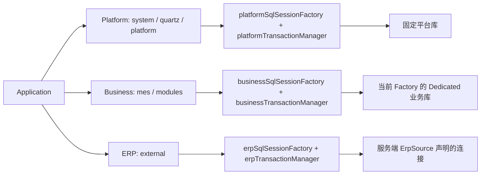
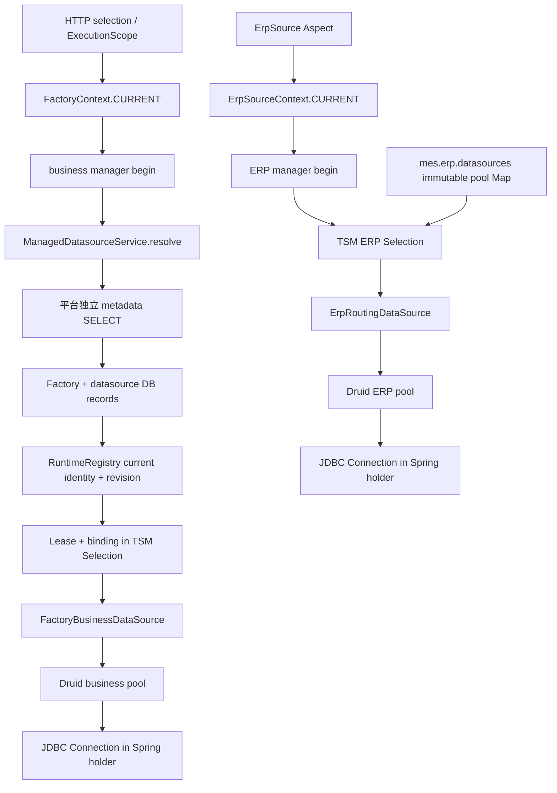
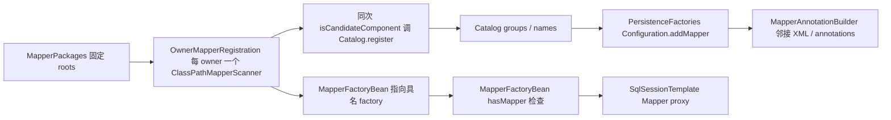
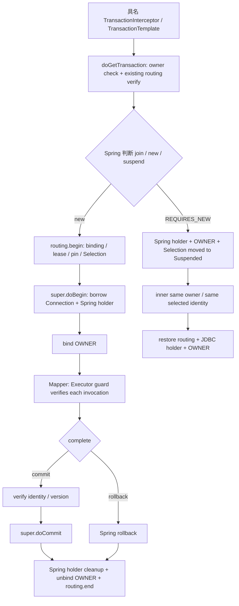
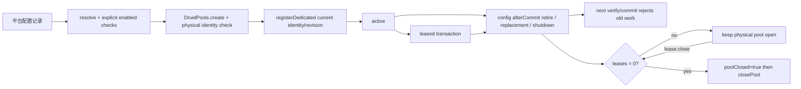

# Persistence Architecture Deep Audit

审查日期：2026-10-06（Asia/Shanghai）。对象：`mes-base` 当前工作区，HEAD `1c881fe0d56bc625841817652e0c5fcbd6eb4ecd`，**包含审查前已有的未提交修改**，不是该 commit 的纯净快照。

范围：`mes-framework/src/main/java/dev/mesbase/infrastructure/persistence` 全部生产类型，以及直接相关的装配、Factory/ERP Context、管理数据源、Mapper 注册、Quartz/同步/CLI/生成器持久化入口。仅追踪消费者如何使用持久化，不审查其业务规则。本轮未修改任何生产代码，也未重写已有审查、ADR 或用户修改。新增一个 TEST ONLY characterization test。

证据标签：**S**＝当前源码；**T**＝本轮执行的 H2/Fixture/本地测试；**I**＝推理或建议。H2/Hikari 测试不证明生产 Druid/MySQL/SQL Server 行为，更不证明线上多节点状态。测试断言缺陷的当前行为，不是为缺陷背书。

与已有文档的关系：本报告按本轮要求独立重新追踪，补充 [architecture-slimming-audit](architecture-slimming-audit.md)，不覆盖其时间线；[ADR-002](ADR-002-factory-runtime-binding.md) 中“所有业务必须 OwnedSqlSession/逐 Mapper 注解”的早期描述不代表当前生产入口；[ADR-004](ADR-004-business-persistence-topology.md) 的 Dedicated/Shared 边界仍适用。尤其不能沿用旧报告的 Mapper 数量或“双重 classpath 扫描”判断。

## 1. Inventory

以下路径简称均指该目录内同名 `.java`，外部路径另列。目录有 **21 个顶层类型、6 个具名嵌套类型、2 个显式匿名 TransactionSynchronization 实现**。编译器生成的 lambda 类不当作源码声明类型。没有发现整个顶层类型可直接判定为 Dead。

必要性表示当前功能下的必要性，不等于必须保留当前实现。`Questionable`/`Possible Redundancy` 是下一轮有条件候选。

| Class | Type | Responsibility | Created By | Direct Consumers | Runtime Path | State | Necessary? |
|---|---|---|---|---|---|---|---|
| [BusinessPersistence](../../mes-framework/src/main/java/dev/mesbase/infrastructure/persistence/BusinessPersistence.java) | interface | scoped callback 契约 | 无实例；Dedicated 实现 | PersistenceConfiguration、FoundationConfiguration、RuoyiTemplateRenderer 生成 Service | 生成/兼容业务工作单元 | none | Probably Necessary：生成器仍输出此契约；并非直调 Mapper 必需 |
| [BusinessPersistenceResolver](../../mes-framework/src/main/java/dev/mesbase/infrastructure/persistence/BusinessPersistenceResolver.java) | interface | 将 Scope 解析为绑定 | 装配方法引用/Configured resolver | FactoryBusinessDataSource、Dedicated 构造器、装配 | begin/每次 verify | none | Clearly Necessary：厂身份不能直接等于连接 |
| [BusinessRuntimeBinding](../../mes-framework/src/main/java/dev/mesbase/infrastructure/persistence/BusinessRuntimeBinding.java) | record | 表达绑定版本身份 | ManagedDatasourceService.resolve、Configured resolver 配置 | Routing DS、Registry | pool acquisition/验证 | configuration：FactoryId、identity、revision | Clearly Necessary：Registry.acquireDedicated 依此拒绝错厂/旧版本 |
| [ConfiguredBusinessPersistenceResolver](../../mes-framework/src/main/java/dev/mesbase/infrastructure/persistence/ConfiguredBusinessPersistenceResolver.java) | class | 解析内存受控绑定 | FoundationConfiguration（runtime 关闭时）、fixtures | FactoryBusinessDataSource 经 resolver 接口 | 无 runtime 默认拒绝入口/fixtures | FactoryCatalog、volatile Map | Probably Necessary：生产 disabled-mode bean 有调用；可收窄角色，不是活动 DB resolver |
| [DatasourceIdentity](../../mes-framework/src/main/java/dev/mesbase/infrastructure/persistence/DatasourceIdentity.java) | record | 表达受控池标识 | ManagedDatasourceService.identity、配置/fixtures | binding、Registry、管理服务 | config→pool key | configuration：String | Clearly Necessary：与 FactoryId 分离，限制标识格式 |
| [DedicatedDatabasePersistence](../../mes-framework/src/main/java/dev/mesbase/infrastructure/persistence/DedicatedDatabasePersistence.java) | class | Multiple Responsibilities：callback 适配及独立 fixture factory 装配 | PersistenceConfiguration、FoundationConfiguration、fixtures | BusinessPersistence 消费者/生成 Service | TransactionTemplate→OwnedSqlSession | template、manager、mapper whitelist | Questionable：callback 有调用，构造装配与服务 API 可分离 |
| [ErpRoutingDataSource](../../mes-framework/src/main/java/dev/mesbase/infrastructure/persistence/ErpRoutingDataSource.java) | class | ERP 事务连接路由 | PersistenceConfiguration.ErpPersistence | ERP manager/factory、监控配置池观察 | source id→Selection→pool | immutable Map、TSM Selection key | Clearly Necessary：多源共享单工厂，缺源失败 |
| [ErpSource](../../mes-framework/src/main/java/dev/mesbase/infrastructure/persistence/ErpSource.java) | annotation | 声明 ERP 访问单元 | 编译期使用 | Aspect、Spring transaction interceptor | 先选源再事务 | configuration：source id/事务元注解 | Clearly Necessary：当前生产约定的声明入口 |
| [ErpSourceAspect](../../mes-framework/src/main/java/dev/mesbase/infrastructure/persistence/ErpSourceAspect.java) | aspect class | 建立 ERP 选择作用域 | ErpPersistence bean | Spring AOP proxy | select→proceed→restore | none（状态在 Context） | Clearly Necessary：必须先于事务取连接；AnnotationTest 实测 |
| [ErpSourceContext](../../mes-framework/src/main/java/dev/mesbase/infrastructure/persistence/ErpSourceContext.java) | package-private class | 建立源选择作用域 | 静态 ThreadLocal | Aspect、ERP DS | CURRENT/PINNED | 2 ThreadLocal | Questionable：CURRENT 必需；PINNED 是重复选择状态，可改为事务资源查询 |
| [FactoryBusinessDataSource](../../mes-framework/src/main/java/dev/mesbase/infrastructure/persistence/FactoryBusinessDataSource.java) | class | 业务事务连接路由 | PersistenceConfiguration/fixture Dedicated 构造 | manager、business factory | resolve→lease→pool→Connection | resolver、Registry、TSM Selection key | Clearly Necessary：单工厂下按厂多库；resume 有缺陷 |
| [OwnedSqlSession](../../mes-framework/src/main/java/dev/mesbase/infrastructure/persistence/OwnedSqlSession.java) | class | 限定 callback Mapper 使用寿命 | PlatformPersistence/Dedicated | callback 消费者 | whitelist→二次 Mapper proxy→delegate | thread、expired flag、delegate、verify、Set | Probably Necessary：平台 callback 的跨线程/过期能力是独有的 |
| [OwnedTransactionManager](../../mes-framework/src/main/java/dev/mesbase/infrastructure/persistence/OwnedTransactionManager.java) | JdbcTransactionManager subclass | 管理事务数据库身份生命周期 | 三 owner 装配/fixture constructors | Spring interceptor、TransactionTemplate、StatementGuard | get/begin/suspend/resume/commit/cleanup | manager identity、TSM OWNER、Routing 引用 | Clearly Necessary：至少需等价跨 manager owner 仲裁；不是池生命周期所有者 |
| [OwnerMapperCatalog](../../mes-framework/src/main/java/dev/mesbase/infrastructure/persistence/OwnerMapperCatalog.java) | class | 保存已发现 Mapper 的验证结果 | OwnerMapperRegistration | PersistenceConfiguration、FactoryRuntimeConfiguration | 同次扫描→groups→factory/whitelist | EnumMap&lt;kind,Set&lt;Class&gt;&gt;、names Set | Questionable：为 callback/手工 addMapper 保存全量 class，不是单纯 package ownership |
| [PersistenceFactories](../../mes-framework/src/main/java/dev/mesbase/infrastructure/persistence/PersistenceFactories.java) | static utility | 装配 MyBatis factory | 装配/fixture 调用 | 三 factory、Platform/Dedicated 构造器 | configuration→plugins→addMapper→FactoryBean | none | Probably Necessary：统一安全配置；手工 addMapper 可迁标准注册 |
| [PersistenceReadContext](../../mes-framework/src/main/java/dev/mesbase/infrastructure/persistence/PersistenceReadContext.java) | package-private class | 标记独立平台读取窗口 | PlatformPersistence.readOnly | platform manager verifyAccess、StatementGuard | ACTIVE manager→restore | ThreadLocal&lt;manager&gt; | Questionable：解决真需求，但权限窗口不是 session-scoped |
| [PersistenceStatementGuard](../../mes-framework/src/main/java/dev/mesbase/infrastructure/persistence/PersistenceStatementGuard.java) | interceptor class | 执行前验证持久化访问边界 | PersistenceFactories.create | MyBatis Executor proxy | query/update/queryCursor→verify | verify Runnable | Clearly Necessary：已有 Connection 不会每 SQL 重新经过 DS |
| [PlatformPersistence](../../mes-framework/src/main/java/dev/mesbase/infrastructure/persistence/PlatformPersistence.java) | class | Multiple Responsibilities：programmatic UoW、独立原始会话读取及 fixture factory 装配 | PersistenceConfiguration、CLI、fixtures | 管理、同步、Quartz、注册、生成器 | run/transaction/readOnly/effects | sessions、template、manager、whitelist、effects | Questionable：能力有真实调用，宽 API 与 session-independent window 值得收窄 |
| [RuntimeRegistry](../../mes-framework/src/main/java/dev/mesbase/infrastructure/persistence/RuntimeRegistry.java) | class | 管理版本化业务池生命周期 | FactoryRuntimeConfiguration/默认 Foundation/fixtures | ManagedDatasourceService、business DS、监控 | register/acquire/retire/drain/close | current Map、owner Map、closed | Clearly Necessary：热失效和排空；retired tracking 存在缺口 |
| [SpringCommitActions](../../mes-framework/src/main/java/dev/mesbase/infrastructure/persistence/SpringCommitActions.java) | class | 注册事务完成回调 | bean、PlatformPersistence 内部 new | SysMessageServiceImpl、SysAttachmentServiceImpl、PlatformPersistence | TSM synchronization→completion | none | Probably Necessary：提交后效果/回滚文件回收；无自定义提交状态机 |
| [TransactionRouting](../../mes-framework/src/main/java/dev/mesbase/infrastructure/persistence/TransactionRouting.java) | package-private interface | 提供事务选择生命周期钩子 | 两 routing DS 实现 | OwnedTransactionManager | begin/verify/suspend/resume/end | none | Probably Necessary：两个真实实现；移除只会将分支搬进 manager |
| FactoryBusinessDataSource.Selection | private record | 保存业务事务选择快照 | business DS.begin/resume | 同 DS 的 verify/get/end/suspend | TSM resource | binding、lease、Pin | Clearly Necessary：稳定 physical selection；Pin 引用可简化 |
| ErpRoutingDataSource.Selection | private record | 保存 ERP 事务选择快照 | ERP DS.begin/resume | 同 DS | TSM resource | id、DataSource、Pin | Clearly Necessary：固定源；Pin 引用可简化 |
| ErpSourceContext.Pin | nested class | 恢复嵌套固定源状态 | ERP DS | suspend/end | PINNED 保存/恢复 | previous、closed | Possible Redundancy：选择已在 TSM Selection，重复状态可替换 |
| OwnedTransactionManager.Suspended | private record | 携带挂起资源 | manager.doSuspend | doResume | Spring suspend/resume | JDBC holder、owner、routingState | Clearly Necessary：自定义资源必须跟随 Spring 挂起，不是新事务框架 |
| RuntimeRegistry.Runtime | nested class | 保存池生命周期状态 | registerDedicated | Registry、Lease、business DS | active→retired→drain | identity、revision、DS、closer、mappers、leases、flags | Clearly Necessary：池拥有者；mappers 与池生命周期无独特关系 |
| RuntimeRegistry.Lease | nested class | 引用计数租借池 | acquireDedicated | business Selection、fixtures | acquire→verify→release | Runtime、released | Clearly Necessary：防提前关池；不是分布式租约 |
| SpringCommitActions.afterCommit 匿名实现 | anonymous class | 转发提交完成事件 | afterCommit | Spring synchronization | 实际 commit 后 | action capture | Probably Necessary：Spring 标准适配 |
| SpringCommitActions.afterRollback 匿名实现 | anonymous class | 转发回滚完成事件 | afterRollback | Spring synchronization | STATUS_ROLLED_BACK | action capture | Probably Necessary：Spring 标准适配 |

外部直接相关、未计入上述目录类型数：`mes-common/.../persistence/{MapperPackages,PersistenceOwner,PersistenceOwner.Kind,CommitActions}`；`FactoryContext/Pin`；`server/{PersistenceConfiguration,FactoryRuntimeConfiguration,OwnerMapperRegistration,DruidPools}`；`ManagedDatasourceService`；Core 的 FactoryId/FactoryScope/FactoryCatalog/FactorySelectionService。`MapperScannerConfigurer` 不是当前生产 bean；实际用 `ClassPathMapperScanner`。没有当前生产 `ErpTransactions`；同名类仅在 `mes-admin/src/test`，不能当第二套生产选源 API。当前实际应用扫描中 BUSINESS/ERP Mapper 集合为空（生产装配测试及源码），ERP访问行为由 TEST ONLY annotation proxy 证明；目录里ERP组件的必要性基于明确的多源接入需求，不能描述成已有生产ERP业务调用。

## 2. Current Logical Architecture

S：`PersistenceConfiguration` 三工厂/三个具名 manager；`mes.system.enabled` 开启装配，ERP 还要求 `mes.erp.enabled`。业务数据源没有默认 target。runtime 关闭时是空目录/空绑定拒绝服务，不是隐式业务首库。Shared DB 尚未实现，不能把两个 Factory 指向一个 Dedicated identity 后称为 Shared。

逻辑 owner 并不由数据库 URL 或 FactoryContext 决定。一个 PLATFORM Mapper 即使有 factory_id 字段仍归平台；ERP Source 与 Factory 身份独立。

## 3. Physical Datasource Architecture

### 3.1 逐层真实路径

| owner | 普通 Mapper 到物理 Connection（S） |
|---|---|
| Platform | scanner→MapperFactoryBean→MyBatis MapperProxy→SqlSessionTemplate→SqlSessionUtils（当前事务会话或临时会话）→platformSqlSessionFactory→Executor/PersistenceStatementGuard→SpringManagedTransaction→DataSourceUtils（复用 platform holder 或取连接）→固定 platformDataSource→DruidDataSource→DruidPooledConnection→driver physical JDBC Connection |
| Business | scanner→MapperFactoryBean→MapperProxy→SqlSessionTemplate/SqlSessionUtils→businessSqlSessionFactory→Executor/Guard→SpringManagedTransaction/DataSourceUtils→已绑定 business ConnectionHolder；首次获取：FactoryBusinessDataSource.getConnection→Selection.lease.runtime.datasource→Druid pool→DruidPooledConnection→physical JDBC Connection |
| ERP | scanner→MapperFactoryBean→MapperProxy→SqlSessionTemplate/SqlSessionUtils→erpSqlSessionFactory→Executor/Guard→SpringManagedTransaction/DataSourceUtils→已绑定 ERP ConnectionHolder；首次获取：ErpRoutingDataSource.getConnection→Selection.source→configured Druid pool→DruidPooledConnection→physical JDBC Connection |

重要顺序：业务/ERP Spring manager **在事务 begin 时已取连接**，通常先于第一条 Mapper SQL。不能画成每条 SQL 重新根据 CURRENT 借池。StatementGuard 在 Executor 执行处重新验证逻辑选择和版本，但不重新取连接。没有 SQL 的事务同样有连接和 lease。

独立平台 metadata 路径不同：`PlatformPersistence.readOnly`→平台 DS **直接 getConnection**→setReadOnly(true)→`DefaultSqlSession + JdbcTransaction(connection) + SIMPLE Executor`→同 Configuration 的插件→回调 OwnedSqlSession→MapperProxy→physical connection。它不由 Spring 将这条连接绑定为业务事务参与者。

### 3.2 Runtime selection architecture

业务真实连接参数由平台 `ManagedDatasource/ManagedFactory` 记录维护。`ManagedDatasourceService.resolve` 解密、调用 `DruidPools.create`，并核对 `SELECT @@server_uuid,DATABASE()` 防同物理库/平台库误绑定；ThreadLocal 本身没有 URL。该 physical identity 检查不包含 ERP 池，源码不能证明配置层面 ERP 一定不是平台物理库；多源 owner 隔离也不等于账号权限/物理库隔离。

## 4. Mapper Ownership

### 4.1 五个不同问题的权威

| 问题 | 权威与时机 | 保存位置 | 其他判断者及其角色 |
|---|---|---|---|
| A Mapper ownership | MapperPackages.ROOTS 固定包；启动 scanner 按 kind 绑定 factory | MapperFactoryBean.sqlSessionFactoryBeanName、MyBatis Configuration | Catalog 验证重名/旧注解冲突；callback whitelist 是防御，不能动态改变 owner |
| B request/business scope | FactorySelectionService 校验选择；FactoryContext 保存当前作用域 | CURRENT ThreadLocal；HTTP filter / withScope 负责清理恢复 | ExecutionScope 在后台建立；不负责权限或源连接 |
| C physical datasource | ManagedDatasourceService.resolve + RuntimeRegistry 的版本化 DS；ERP immutable id→DS Map | 平台记录/节点 Registry；ERP 配置及 Selection | CURRENT 是输入；TSM Selection 是事务中已选择快照；DS 负责最后取池 |
| D transaction ownership | OwnedTransactionManager 独立 identity 仲裁 | static OWNER key 下的 TSM resource | Spring 自己的 actualTransactionActive/ConnectionHolder 不是跨 manager owner 枚举；StatementGuard 调同一 verifyAccess |
| E connection pinning | Spring ConnectionHolder 固定已取 JDBC 连接；Routing Selection 固定逻辑身份 | TSM 的 DS resource + 自定义 Selection | PINNED ThreadLocal 阻止意图变化；Guard 验证 Context/binding；Registry 判定版本是否还有效 |

E 必须拆成“Connection 仍是 A”和“是否允许继续执行”：Spring 固定连接并不自动拒绝 CURRENT 改 B；这里主动拒绝，不忽略、不延迟、不切换。刷新后旧 Connection 仍来自 v1，但旧工作单元失去执行资格。

### 4.2 当前注册路径及重复扫描判断

S：当前 Catalog **没有 classpath scan**。Registration 使用 standard scanner 的候选回调填 Catalog，故“Catalog 扫一次 + Spring 扫一次”在当前工作区不成立。`MapperScannerConfigurer` 无生产引用；没有当前 `PersistenceFactories.addMapper` 方法，真实调用是 `create` 中 `mappers.forEach(configuration::addMapper)`。本机 mybatis-spring 4.0.0 `MapperFactoryBean.checkDaoConfig` 字节码表明：只有 `!configuration.hasMapper(type)` 时才 `addMapper`，不是同一 Mapper 无条件注册两遍。

Catalog 必须知道 Class 吗？**当前实现需要**：提前 addMapper、构造 callback whitelist、传给 Registry Runtime.mappers；**架构 owner 规则本身不需要**，只需固定包+scanner 绑定。现在将“发现/规则验证”和“运行时注册输入”耦合在 groups Set 中。Spring scanner/MapperFactoryBean 可承担标准 Mapper 注册；SqlSessionFactoryBean 可通过 mapperLocations 加载 XML（当前 create 未设置 mapperLocations，靠邻接 Mapper XML 自动加载）。替换方案必须先保留注解 Mapper、XML/alias、插件及启动失败语义的测试。

重名检查应保留：当前默认 Bean 名取简单类名首字母小写，重复可能被 scanner skip；仅依赖后续 Bean 冲突不可靠。可改 fully-qualified Bean name 解决命名碰撞，但那会改变注入命名契约。包归属/旧注解冲突可以增加 build-time test；**不能只靠 test 代替部署 classpath 的 runtime fail-fast**。可在同次扫描保留轻量 validation，不必为此保留全量 Class Catalog。

## 5. Transaction Architecture

### 5.1 OwnedTransactionManager 究竟增加什么

它继承 JdbcTransactionManager，不实现传播算法/commit/rollback/savepoint。`TransactionRouting` 只把选择状态跟随 Spring 生命周期。结论：**OwnedTransactionManager = Necessary abstraction（当前跨 owner 拒绝需求下）**，但不是每个字段/钩子都必须保持原样；恢复协议有缺陷，职责可收窄。

| 新增能力 | 去掉后的后果 | Spring 是否保证 | Routing DS 是否保证 | TSM 相同状态？ | 性质 |
|---|---|---|---|---|---|
| owner binding/checkOwner | 不同 manager 可同时开独立事务；开发者可能误认一个原子单元 | Spring 按 DS 管连接，没有当前三 owner 互斥政策 | 只懂各自 Selection | OWNER 是新语义；actualActive 只是布尔 | correctness requirement |
| routing.begin | 没 Selection，路由不能取连接 | 不解析 Factory/source | DS 实现选择，manager 触发 | Selection 已是资源，无须再存 URL | correctness glue |
| Factory/source pin | CURRENT 可变化、同一物理连接继续执行但语义错厂 | 固定 Connection，不限制 ThreadLocal | DS verify 能后续拦截，不能立即拦 bind | PINNED 重复 Selection 的逻辑身份 | 立即失败是 guard；固定选择本身是 correctness |
| lease | refresh 可能提前关旧池 | Spring 释放连接，不管理整个动态池 | DS.begin acquire/end release | Lease 存 Selection，不在 manager 另计数 | correctness requirement |
| version verify at access/commit | 已借连接/无后续 SQL 的 stale work 可继续提交 | Spring 不懂 config revision | DS 的 verify 已定义判断 | Registry current 为版本权威，Selection 是快照 | correctness under fail-on-refresh contract |
| suspend/resume custom resources | REQUIRES_NEW 恢复错 owner/source/lease | Spring 只挂起已知 DS/JDBC/synchronizations | DS 实现选态移出/恢复 | Suspended 保存同份 resource 的移动，不是另一个可写 authority | correctness requirement；resume 当前有漏洞 |
| begin failure cleanup | super.doBegin 取连接失败后 lease/pin 留存 | Spring 清 JDBC holder；不懂自定义 lease | routing.end 真正释放 | 应去掉 Selection/OWNER | correctness requirement；新增失败测试通过 |
| completion cleanup | Thread reuse 带旧 pin/lease/owner | Spring 不清自定义 key | end 释放 Selection | OWNER unbind + Selection unbind | correctness requirement |

不能直接替换成裸 JdbcTransactionManager/DataSourceTransactionManager：它们能够固定 JDBC 连接和正确传播，却不能满足跨 manager 拒绝、版本失效/提交前校验、动态池 lease。可以用更小 interceptor/synchronization 实现等价功能，但不能只删 wrapper。这里 manager 不创建池、不持 FactoryCatalog、不解析 ERP 配置；说它包含“路由+事务框架+pool lifecycle”会夸大真实职责。

### 5.2 Transaction lifecycle

不同 owner 在 doGetTransaction **先于传播分支**被拒绝，REQUIRES_NEW/NOT_SUPPORTED 也不会自动允许跨 owner。Business A→REQUIRES_NEW B 经正常 FactoryContext.bind/withScope 在外层 PINNED=A 时先被拒绝。Same A 可新 Connection 后恢复外层 holder（T）。内部 Spring `NESTED` savepoint 不等于允许换厂/跨库；本轮没有专门验证 savepoint 场景。

### 5.3 callback API 的所有直接生产消费者

这里统计直接引用/注入及生成模板，不按调用次数重复，不审查业务逻辑。

| API | 生产消费者 | 调用形式/分类 | 判断 |
|---|---|---|---|
| PlatformPersistence | PersistenceConfiguration | Bean 装配已有 factory/manager | 装配便利，可保留 infrastructure-only |
| PlatformPersistence | FactoryRuntimeConfiguration | 注入 ManagedDatasourceService | 管理装配 |
| PlatformPersistence | ManagedDatasourceService | mapper/run/readOnly/afterCommit | 真实管理及 resolver 基础设施；readOnly 当前必须存在等价能力 |
| PlatformPersistence | ControlledJobRunner | run + mapper，短平台事务抢占/记录；ExecutionScope 独立 | Quartz infrastructure-only |
| PlatformPersistence | SysJobServiceImpl | afterCommit | 便利转发；可直接 CommitActions，callback 不是必要 |
| PlatformPersistence | SyncCoordinator | mapper/run/readOnly | 同步协调基础设施；不等于 ERP executor 已接入 |
| PlatformPersistence | SysRegisterService | run | 普通用例事务便利封装，能迁具名 @Transactional |
| PlatformPersistence | PlatformAdminCli | 自己构造 + transaction(OwnedSqlSession) | CLI 独立装配，合理 programmatic UoW |
| PlatformPersistence | SystemConfiguration | 创建 runner/coordinator 等 bean | 装配 |
| PlatformPersistence/BusinessPersistence | RuoyiTemplateRenderer | 为 GLOBAL/FACTORY_SCOPED Service **持续生成 callback** | 不是仅历史兼容；当前开发默认在扩大该 API |
| BusinessPersistence/Dedicated | PersistenceConfiguration、FoundationConfiguration | bean 实现选择 | 装配；后者 disabled-mode |

DedicatedDatabasePersistence 没有当前手写业务直接注入消费者，BusinessPersistence 的业务使用来自生成器；`currentTransaction` 生产直接调用未发现。Configured resolver `replace` 只有构造/fixtures，生产开启 runtime 使用 `ManagedDatasourceService::resolve`。生产没有 ERP callback；`ErpTransactions` 只用于旧 fixture，真实 annotation 入口另有 AnnotationTest 验证。

同时存在两套 API 的原因：声明式 Mapper 路径服务正常后台；programmatic transaction 支持 CLI、管理、协调和曾经的 callback 骨架。判断不能一概“必须”或“历史”：平台独立 metadata read 是现实需求；run/effects 多为方便封装；Dedicated/OwnedSqlSession 是历史形态且仍被生成器主动输出。建议 **保留小型 infrastructure-only programmatic API**，但需同时迁生成模板与真实 consumers，再评估剩余 facade；本轮不实现。

## 6. Context / ThreadLocal State Machine

### 6.1 CURRENT 与 PINNED

CURRENT 表示调用者期望的选择，其寿命是 request/Aspect/ExecutionScope；PINNED 表示禁止改变的选择，其寿命主要是 transaction，但 Dedicated callback **另包一层 FactoryContext.pinned**。它们概念不同，但不意味着都必须用独立 ThreadLocal 保存。

```mermaid
stateDiagram-v2
    [*] --> EMPTY
    EMPTY --> CURRENT_A: request bind / ERP Aspect select
    CURRENT_A --> CURRENT_A_PIN_A: transaction begin
    CURRENT_A_PIN_A --> CURRENT_A_PIN_A: select B rejected; CURRENT stays A
    CURRENT_A_PIN_A --> CURRENT_A: transaction end clears pin
    CURRENT_A --> EMPTY: request / Aspect end
    CURRENT_A_PIN_A --> SUSPENDED_A: suspend removes transaction pin
    SUSPENDED_A --> CURRENT_A_PIN_A: same selection resumes
    SUSPENDED_A --> MISMATCH_B_PIN_B: Business CURRENT changed B; resume uses pinCurrent
    MISMATCH_B_PIN_B --> FAILED: next SQL / commit detects saved Selection A
```

T：普通 CURRENT=A/PINNED=A→bind/select B **立即拒绝，CURRENT 仍 A**，下一次 query 使用 A。ERP 同样拒绝。不存在正常 API “忽略换厂”或“下一事务自动改 B”。ERP `restore(previous)` 则不走 PINNED 校验，它是受信任 Aspect finally 还原机制，不能当普通选源 API。

S/T：FactoryBusinessDataSource.resume 使用 `FactoryContext.pinCurrent()`，**没有把旧 Selection.binding.factoryId 与 CURRENT 校对后再恢复**。`NOT_SUPPORTED` 挂起外层 A 后直接 bind B，恢复得到 `CURRENT=B/PINNED=B/Selection=A/Connection=A`，恢复本身成功；下一 SQL 拒绝，bind A 也因错误 pin B 被拒绝，直到回滚 cleanup。测试没有反射修改状态，使用公开 Context/Spring API。正常 `withScope(B, work)` 自己会恢复 A，所以该缺陷不是所有嵌套事务都会触发；它是恢复边界未 fail-fast，错误调用被延迟暴露。Dedicated callback 外层 pin 仍在，挂起窗口甚至不能 bind B，两种入口恢复政策不完全一致。

ERP.resume 用 `new Pin(saved.id)` 会检查 CURRENT 是否等于旧 id，比业务严格；若恢复失败，manager.doResume 尚未恢复 super JDBC holder/OWNER，异常原子清理是待验证项。本轮不通过反射造这个状态，也不宣称它已发生生产泄漏。

### 6.2 PINNED 应否搬进事务资源

I：**事务已选身份应仅由 TSM Selection 为权威**；Context.bind/select 可以查询一个只读 `TransactionSelectionGuard`，达到同样立即拒绝行为，而不再镜像一份身份。这样删除的只是可变 ThreadLocal 副本，Spring ConnectionHolder/Selection 的分离仍需保留，因为一个是物理连接，一个是业务身份/版本/lease。

但不能直接删 PINNED：Dedicated callback 的 pin 寿命比 transaction hook 长，suspend 后也继续禁止切厂。先决定此额外政策是否需求，再统一 callback/直调入口。搬迁时需测试：外层 transaction、REQUIRES_NEW、NOT_SUPPORTED、异常 begin/resume、嵌套 scope、线程边界、callback escape；不要用 Context 反向依赖 Spring 具体类污染 Core。

### 6.3 PersistenceReadContext.ACTIVE 的真实问题

真实链：业务 mapper Guard→manager.verifyAccess→business DS.verify→`ManagedDatasourceService.resolve`→`factoryRecord` 的独立平台 SELECT→datasource metadata SELECT→Registry 检查。严格跨 owner 禁止下，普通平台 Mapper 会被 checkOwner 拒绝，但这些元数据是确认当前业务绑定有效性的必要输入。因此需要一个**不参与业务原子性的、短平台读取能力**。

当前 readOnly 直接创建独立 connection/session，ACTIVE 存相应 platform manager，让它的 `verifyAccess` 跳过 owner 检查；所有 Guard 在窗口中拒绝非 SELECT MappedStatement。finally 恢复 ACTIVE 和 PageHelper。它没有暂停业务事务，也没有开启平台 Spring 写事务，不是 XA。

合理性：避免每次业务验证必须结束事务才能读取撤销/版本数据；metadata connection 的释放完整，PageHelper 不误作用元数据查询。严格政策也合理：阻止同一 service 顺手跨库写和误认回滚。

过重处：是否允许独立只读平台数据可以是显式 session capability，而非线程宽 manager 豁免。ACTIVE 当前无法证明所有平台 SELECT 真用它创建的独立 session；T 证明 callback 内改用 `platform.mapper(...)` 会加入已有平台 transaction，观察未提交的 `changed`，而 `s.mapper(...)` 观察原 `PLATFORM`。它扩大授权窗口，没有把独立性锁定在指定 session。不同读取路径因调用形式得到不同快照。

“SELECT-only”准确含义是 MyBatis SqlCommandType.SELECT，不是 SQL AST/数据库权限证明。T 的 H2 `SELECT NEXT VALUE FOR sequence` 在 readOnly window 仍推进序列；Connection.setReadOnly 是 driver 能力/提示，不能承诺所有 SELECT 无副作用。当前受控 metadata Mapper 没有证明发生恶意写入，故这是能力描述/强度边界，不是已确认生产注入攻击。

## 7. Pool Lifecycle

### 7.1 FactoryBusinessDataSource 的完整职责分配

- selector 来自 FactoryContext.required；Resolver 返回稳定 binding。生产为 ManagedDatasourceService，disabled/fixture 为 Configured resolver。
- Factory→datasource 配置来自平台表；连接池由 ManagedDatasourceService 首次 resolve 懒创建，DruidPools 统一参数；Registry 不读 DB、不解密、不造 pool。
- Registry 接受准备好的池、拥有成功注册后的 closePool；失败注册通常关闭准备池，拒绝重复已拥有的当前 DS 实例时故意不关已有池。
- version 是 datasource configuration revision，**不是 Factory record revision**。Factory 禁用/解绑/删除通过 resolve 查当前记录并通过本节点 afterCommit retire 失效；其他节点在后续 verify 读取平台 metadata 时发现变化，没有广播保证。
- lease 是 JVM 内 Runtime 的引用计数，只保护池不提前 close，不是数据库 lease、超时锁或分布式 fence。Selection 持有 lease，整个外层/挂起事务结束才 release。
- retired 是不再接受新工作且不允许旧工作继续 verify 的 Runtime。current Map 移除后只由旧 lease 间接引用；没有集中 retired pool Set。
- shutdown：RuntimeRegistry.close 设置 closed、retire current、leases=0 close；active lease 的池延后至 close；ERP close 则直接关所有 unique DataSource，无 lease drain。

这与“refresh 后旧事务继续成功、新事务 v2、旧事务自然提交”不同。T：旧池未提前关闭；v2 可被另一线程新事务使用；旧 query/commit 拒绝；旧 lease=0 后关闭。因此 **旧事务继续成功 = Unsupported by Design**；保持可回滚 Connection 与批准继续提交是两件事。

Managed resolver 是同步/全局 synchronized 方法，包含多次 metadata I/O、物理 identity I/O、Druid 初始化，意味着不同厂的冷启动或每次验证在这个 service monitor 上排队；Registry 自己也 synchronized，但主要是短状态操作和 drain。这个串行化代价为当前校验实现选择，不是 Factory isolation 的必要需求；本轮没有吞吐测量，不能以此宣称性能事故。

### 7.2 Business vs ERP

| Concern | Business | ERP |
|---|---|---|
| selection key | FactoryId→DatasourceIdentity/revision | explicit String source id |
| source of key | HTTP/ExecutionScope，经 resolver 校验平台记录 | ErpSource class/method 服务端声明 |
| context | FactoryContext CURRENT/PINNED | ErpSourceContext CURRENT/PINNED |
| pool registry | RuntimeRegistry current + dedicatedOwners；managed physical Map 辅助 | immutable configuredSources Map |
| versioning | DB revision + binding/version checks | 无 runtime revision |
| lease | per transaction Runtime.Lease | 无 |
| refresh | 懒建替换/afterCommit retire；old work invalid | 无热刷新 API，重启重装配 |
| transaction pin | Selection(binding/lease) + Spring holder + Context pin | Selection(id/source) + Spring holder + Context pin |
| close lifecycle | retired drains after leases=0 | close unique pools immediately，依赖容器 shutdown 时序 |
| invalid switch protection | bind/clear 拒绝；verify 比 factory/binding/version；resume 有错 pin 缺口 | select 拒绝；verify id；resume Pin 校验 saved id |

两套路由不等于重复池生命周期：业务需 DB 管理、热撤销、版本和排空，ERP 是静态配置一次创建。统一底层 Registry 会给 ERP 引入本无需求的 revision/lease/refresh；没有证明减少复杂度。可抽取小型 Selection lifecycle 的一致性协议，特别是恢复验证，但已有 TransactionRouting 已表达共同部分，不能再为几行相似代码创造第二个 framework。

retired 生命周期真实缺陷见 §10：当前实例去重不包含退休仍存活的池，close failure 被提前标成 closed。

## 8. Responsibility Matrix

每行规则的含义在最后一列明确；Registry 与 Spring 的物理资源权威不能被硬塞到 Context/DS 中。

| Guarantee | Context | Routing DS | Tx Manager | Statement Guard | SqlSession Proxy | 权威说明 |
|---|---|---|---|---|---|---|
| owner isolation | No responsibility | No responsibility | Primary owner | Secondary guard | Secondary guard（callback whitelist） | manager OWNER 是事务互斥权威；Mapper owner 是启动包规则的另一问题 |
| factory isolation | Secondary guard（立即拒绝 bind） | Primary owner（选择/Scope 一致） | Secondary guard（生命周期触发） | Secondary guard | Secondary guard | Factory 验证由 resolver/Selection；非权限判断 |
| ERP source isolation | Secondary guard（立即拒绝 select） | Primary owner | Secondary guard | Secondary guard | No responsibility（生产 ERP 无 Owned callback） | ERP Selection/id Map 为权威 |
| transaction pin | Secondary guard（镜像 PINNED） | Primary owner（逻辑 Selection） | Secondary guard（move/end） | Secondary guard | Secondary guard | 物理 Connection pin 的 Primary owner 是 Spring ConnectionHolder |
| version pin | No responsibility | Secondary guard（binding 比较） | Secondary guard（commit verify） | Secondary guard | Secondary guard | Primary owner 在 Registry current identity/revision；本矩阵五列无独立版本权威 |
| cross-thread protection | No responsibility（ThreadLocal 不自动禁止传对象） | Secondary guard（新线程无 Selection） | No responsibility | Secondary guard（业务/ERP需当前事务） | Primary owner（callback thread identity） | 普通平台 Mapper singleton 合法跨线程；不能宣称所有 Mapper 禁跨线程 |
| expired resource protection | No responsibility | Secondary guard（缺 Selection） | No responsibility | Secondary guard（缺/旧事务资源） | Primary owner（callback expired） | Runtime validity 的 Primary owner 在 Registry；callback lifetime 在 OwnedSqlSession |
| read-only platform access | No responsibility（ACTIVE 为另一专用标志） | No responsibility | Secondary guard（匹配 manager 时 owner 豁免） | Primary owner（非 SELECT 拒绝） | No responsibility（仅寿命） | 只保证 command type；语义只读应由受控 SQL/DB privilege 保障 |

没有把三层重复调用同一个 `verifyAccess→DS.verify→Registry.verify` 统计成三种业务权威：它们是同一规则在不同生命周期入口触发。真正重复可写事实是 Context.PINNED 与 Selection；FactoryContext callback 外层 pin 还引入另一个寿命规则。

另有重复派生状态：Registry `dedicatedOwners` 与平台 Factory binding、`ManagedDatasourceService.physical` 与实际数据库 identity、Runtime.mappers 与 Catalog.groups；这些用途不同但必须可说明同步/失效职责。physical Map 是去同物理库防御，不负责路由。dedicatedOwners 防一 identity 被两个 Factory 借用，不替代平台有效性。CURRENT/PINNED/Selection/Connection 四份信息恢复时可能不一致，T 已确认一个组合。

## 9. Scenario Verification

### 9.1 可复现证据入口

新增 [PersistenceDeepAuditTest](../../mes-admin/src/test/java/dev/mesbase/infrastructure/persistence/PersistenceDeepAuditTest.java)。TEST ONLY：真实 Spring manager/TransactionTemplate、真实 MyBatis Guard、H2 独立 marker 库/Hikari pool；不接真实 MES/ERP 数据库。ThreadLocal 反射**只读断言**，没有反射修改 CURRENT/PINNED。

| 场景 | 本轮实际观察 | 证据 |
|---|---|---|
| A begin→query→尝试 bind B→query | bind B 拒绝；query 仍 A | businessSwitchRejectedAndRequiresNewSameFactoryRestoresConnection |
| A→REQUIRES_NEW A | 新 holder/连接，结束恢复外层原 holder，结果 A | 同上 |
| A→REQUIRES_NEW B（正常选厂入口） | select/bind 阶段拒绝，未进入 B；Unsupported by Design | 同上 |
| business→普通 platform read | owner conflict 拒绝 | independentPlatformReadAllowedButOrdinaryReadAndWritesRejectedInsideBusiness |
| business→独立平台 readOnly | PLATFORM marker 可读，不加入 business | 同上 |
| business→platform write/平台 Spring transaction | 拒绝；readOnly 里的 Update 也拒绝 | 同上 |
| ErpSource A→尝试 B | 真实 annotation proxy 的 nested wms 调用被拒绝 | 本轮重跑 ErpSourceAnnotationTest；新增 erpSelectionRejectsSwitchAndBusinessOwnerEvenWithRequiresNew 断言 Context 仍 hr |
| business→ERP REQUIRES_NEW | manager owner check 先拒绝，不 suspend 后允许 | 新增 erpSelectionRejectsSwitchAndBusinessOwnerEvenWithRequiresNew |
| ERP同源 REQUIRES_NEW/rollback/并发 | 恢复 source、回滚真实 marker；多线程独立选择 | 本轮重跑 ErpRoutingTest |
| request A failure→同线程 request B | CURRENT/PINNED Factory、CURRENT/PINNED ERP、Read ACTIVE、TSM resources/flags、PageHelper 均无遗留，B query 成功 | sameThreadRequestsLeaveAllFiveStateFamiliesCleanOnExceptions；afterEach 检查 TSM/两 pin/ACTIVE |
| v1 active→register v2→old SQL→new thread transaction→old end | v1 保持 open；old SQL/commit 拒绝；new thread读 A_V2；old end 后 v1 close | refreshInvalidatesOldTransactionDrainsPoolAndNewThreadUsesV2 |
| JDBC getConnection 抛异常 | lease/pin/Selection 清理；retire 能立即 close（计数1） | connectionAcquisitionFailureReleasesPinSelectionAndLease |
| NOT_SUPPORTED→CURRENT B→resume A | 恢复成功但 pin B/selection A；next SQL 拒绝且不能 bind A；rollback后清理 | suspendedBusinessResumesWithWrongContextPinBeforeNextStatementDetectsConflict |
| retired实例再注册新revision | 被接受；旧 lease.close 把新 active pool 关掉；contains仍true | retiredPoolCanBeRegisteredAgainThenOldLeaseClosesNewActivePool |
| closePool 抛异常 | 第一次异常可见；后续 close 不重试，物理池仍open | failedPoolClosureIsMarkedClosedAndNeverRetried |
| readOnly callback 使用外部平台 Mapper | 使用外层事务连接看到未提交 change，非指定独立会话 | readWindowAllowsOtherPlatformTemplateToJoinOuterTransaction |
| SELECT-only语义 | H2序列被 SELECT 推进；不是完全无副作用保证 | selectOnlyWindowDoesNotPreventSqlSideEffects |
| callback mapper escape/跨线程 | 到期和跨线程都拒绝，平台也受保护 | 本轮重跑 DedicatedDatabasePersistenceTest 对应两 case |
| startup owner roots/重名/旧注解/ERP disabled | overlap、同名、冲突注解和关闭 ERP 的 external mapper fail-fast | 本轮重跑 PersistenceAssemblyTest、MapperRegistrationGuardTest |

### 9.2 命令及边界

执行环境：Java 21.0.4，Maven 3.9.10，MyBatis 3.5.19、mybatis-spring 4.0.0、Spring 7.0.9（本地实际依赖）。未创建私有 Maven repository/config，未修改全局 Java/Node。

- 基线：`mvn -B -ntp -pl mes-admin -am -Dtest=DedicatedDatabasePersistenceTest,PersistenceAssemblyTest,ErpRoutingTest,ErpSourceAnnotationTest,RequestStateLifecycleTest,MapperRegistrationGuardTest -Dsurefire.failIfNoSpecifiedTests=false test`：35 tests，0 failure/error/skipped，BUILD SUCCESS。
- 新测试首次编译存在 JUnit 泛型 `assertEquals` 重载歧义，只修改测试为显式 long 局部变量；10 cases 定向执行通过。后追加连接获取失败 case，最终测试总数及 verify 结果见本节后续验收记录。
- `./scripts/format-java mes-admin/src/test/java/dev/mesbase/infrastructure/persistence/PersistenceDeepAuditTest.java`：**FAILED，exit 127，脚本不存在**。`.editorconfig` 同样不存在，`.idea/codeStyles/Project.xml` 存在。未创建替代 formatter、未格式化任何已有 Java、未绕过规则安装工具。规则要求的 Git hook installer 也不存在，因此未安装。
- `git diff --check`：在新增测试后执行通过；文档完成后再次核对结果见后续验收记录。

最终验收记录（2026-10-06）：

- `mvn -B -ntp test`：BUILD SUCCESS，framework 7 / generator 3 / admin 180，共 **190 tests，0 failure/error，4 skipped**；新增11项全部通过。日志 `/tmp/persistence-audit-full-test.log`。
- `mvn -B -ntp verify`：BUILD SUCCESS，同样190项、4 skipped，包含标准打包但未做 packaged启动验收/部署。日志 `/tmp/persistence-audit-verify.log`。本任务不改变启动/打包实现，未运行 `scripts/smoke-packaged.py`，不宣称已做 jar runtime 验证。
- skip：MySqlDevelopmentTest 2、ManagedRuntimeMySqlTest 1、WorkspaceAccessMySqlTest 1；因此未新增真实MySQL证据。Surefire报告位于 `mes-framework/target/surefire-reports`、`mes-generator/target/surefire-reports`、`target/mes-admin/surefire-reports`。
- 最终 `git diff --check` 通过；新增Java无通配符导入/类体全限定类型引用，所有行不超过Project.xml的120列。此静态检查不替代 IDEA formatter。
- 本轮文件只有本报告及 `mes-admin/src/test/java/dev/mesbase/infrastructure/persistence/PersistenceDeepAuditTest.java`；所有已有未提交修改保留，未修改生产/业务代码、配置或生成模板。

格式化门禁未验证，不能把本轮新增 Java 称为已通过全部工程验收。报告内容和行为证据可以评审；真实 MySQL/Druid refresh、SQL Server、多节点撤销/分布式竞争、生产 shutdown 流量以及配置真实物理隔离不在本轮实证范围。build 成功不替代 live 联调。

## 10. Architectural Flaws

### F1 — Business resume 产生不一致的选择状态（P1，S/T）

位置：`FactoryBusinessDataSource.java:50` resume，`OwnedTransactionManager.java:57` doResume。挂起保存的是 A binding/lease/Connection，但恢复用 CURRENT=B 重新 pin，没有立即验证旧 factory。新测试公开 API 复现：`CURRENT=B/PINNED=B/Selection=A/holder=A`；直到 next SQL/commit 才拒绝。没有证明错库 SQL 已执行，现有 secondary guard 阻止了执行；已确认的是恢复协议生成非法组合并把异常延后。两套 callback/直调生命周期更使行为不一致。

I：先定义 suspend 后 CURRENT 变化的策略（恢复原 CURRENT，或 fail-fast 并完整清理），用保存 Selection 重建固定状态，不能无条件 pinCurrent。不要直接删 manager/guard 来“简化”。

### F2 — Registry 对退休池失去实例所有权跟踪（P1，S/T）

位置：`RuntimeRegistry.java:39` registerDedicated 只检查 current.values；`retire:69` 移出 current，但旧 lease 存活。退休 datasource 可再次注册为新 active Runtime；旧 lease 释放执行旧 closer，将新 active 共用 datasource 关闭，Registry.contains 仍 true。这是生命周期基础设施 API 的真实缺陷。生产 ManagedDatasourceService 每次创建新 Druid pool，因此尚无证据表明当前管理调用链会重用同一个对象；风险范围不可夸大成线上事故。

I：跟踪所有尚未释放的拥有池（active + retired），拒绝复用仍归旧 Runtime 所有的实例；不需引入 ERP热刷新抽象。

### F3 — 池关闭失败后不可恢复/重试（P2，S/T fault injection）

位置：`RuntimeRegistry.Runtime.drain:27`，先 poolClosed=true 再 closePool.run；close:85 清 current。closePool 抛出时已“逻辑关闭”，后续 close 不再尝试；新测试故障注入后 physical pool 仍 open。当前 Druid.close 通常正常，未证明生产发生此故障；但 Registry 接受任意 closer 的生命周期契约确有缺口。

I：明确 close-failed 状态和保留待清理资源；不要把一次关闭尝试等价于关闭成功。异常要保留链，避免清理异常掩盖主异常。

### F4 — independent platform read 是线程宽豁免，不是 session capability（P2，S/T）

位置：`PersistenceReadContext.independent`、`OwnedTransactionManager.verifyAccess:31`、`PlatformPersistence.readOnly:49`。ACTIVE 只绑定 manager，回调任意平台 Mapper SELECT 均可通过 Guard，无法证明用的是新建独立 session。T：同一 callback 改用外部 template mapper 可加入外层事务并观察未提交数据。“独立 SELECT window”只能对正确使用 callback参数的代码成立，没有被 API enforce。

I：独立 metadata reader 仅允许它持有的 session 执行；session-scoped verification 取代线程全局豁免。此需求仍然值得保留，不能因实现缺口删除平台 metadata read。

### 未升级为 confirmed flaw 的观察

- SELECT-only 不保证无副作用（T）；受控当前 SQL 是否足以满足 metadata read 需求需明确。不要把 H2 sequence 试验宣称 MySQL已发生写绕过。
- version verify 与 JDBC commit 之间不是原子数据库 fence（S）；并发撤销发生在最后校验之后的效果尚未实验。若要求强线性撤销，需明确定义边界，不可宣称当前 lease/version 可阻止所有已发出的SQL/提交。
- routing.begin 在 manager try 之外，resume 部分步骤失败、close cleanup 异常可能覆盖原失败（S）；正常 getConnection 异常清理已测试通过。没有注入全部异常组合，不宣称每条路径泄漏。
- ERP.shutdown 无lease，依赖 Spring关闭顺序/停流（S）；未运行并发 shutdown，不能断言早关活动池已在生产出现。
- 没发现缺 Factory/source 自动回退平台/首池/默认业务的 Hidden Fallback（S/T negative）。`mes.runtime.enabled=false` 的空绑定明确拒绝。

## 11. Duplicate Defenses

### 11.1 PersistenceStatementGuard 每次实际检查什么

S：intercepts Executor.update、两种query、queryCursor；先检查 ACTIVE 下 SqlCommandType.SELECT，再调用传入 manager::verifyAccess。**没有逐 SQL 检查 MapperPackages.owner/Mapper class ownership**；MappedStatement 只用于 command type。SQL factory 的 owner 固定，事务 owner 校验是“现在有没有另一个manager transaction”，两者不能混同。

| 检查 | 分类 | 理由/是否重复 |
|---|---|---|
| ACTIVE 禁止非SELECT | 必须每次 Executor 入口检查 | command type每次可能不同；不等于AST语义只读 |
| 当前 transaction owner一致 | 每次跨factory Mapper调用需检查 | 开始业务事务后可调用不同owner Mapper，后者不会经自己的 transaction begin |
| 当前厂与保存selection一致 | 每次执行/commit需检查；Context另立即防御 | 单靠 begin 不能捕获挂起恢复或异常状态；当前PINNED正常换厂已先挡 |
| resolve 当前Factory是否enabled/绑定变化 | 每次验证（当前fail-on-revocation契约） | 平台DB可并发修改；纯begin check不能证明整个工作单元有效 |
| Registry当前revision/runtime | 每次执行及commit | 旧pool不提前close，所以DS首次borrow不足以拒绝stale连接 |
| Mapper固定包ownership/重名 | 只需要startup/build | Guard当前未做，不要建议“删掉已有每SQL扫描” |
| immutable ERP source Map、DS key、manager identity | 理论上单bean寿命不变化 | source id CURRENT仍会改变，选择匹配需检查；配置Map不需每条重建 |

每 SQL准确是“每个被拦截Executor调用”，不是物理数据库每条语句。PageHelper分页/count、批执行或queryCursor随后取数、已发出的 JDBC SQL 都不能仅凭这个入口推广到“每一行/每条驱动SQL再认证”；缓存设 localCacheScope=STATEMENT、cacheEnabled=false 避免跨事务/长寿命缓存误路由。此处不审查分页库实现的所有内部绕过路径。

### 11.2 OwnedSqlSession 的独有价值

| 保证 | SqlSessionTemplate | manager | Routing DS | Guard | OwnedSqlSession |
|---|---|---|---|---|---|
| 安全共享模板/按线程找当前session | 提供 | Spring生命周期 | 不提供 | 不提供 | 不替代它 |
| callback跨线程拒绝 | 不提供，平台singleton Mapper合法跨线程 | 新线程无outer owner，平台可独立读 | business/ERP缺Selection可拒绝 | 平台可能允许 | 捕获ownerThread，独有 |
| callback结束后Mapper到期 | 不提供，Mapper默认可长期复用 | 不记callback lifetime | 平台无Selection要求 | 平台无transaction时仍可读 | expired flag，独有 |
| whitelist Mapper类型 | 配置含有哪些mapper | 不校验class | 不校验class | 不校验class | 显式Set拒绝错owner/未知类型 |
| owner/factory/version | 只负责当前factory/session使用 | 中央verify | 同一verify | 同一verify | 再触发verify，重复防御 |
| 底层独立session raw SQL/Connection不逃逸 | 模板自身可公开接口 | 无 | 无 | 无 | API只给mapper，有限能力边界；其他公开facade getter仍可取factory |

因此不能将整体标为 **Possible Redundant Defensive Layer**：平台callback 的跨线程与到期限制有现实测试价值（CLI/readOnly）。可标记 **其 owner/factory/version 的重复检查**为简化候选，而不删寿命能力。OwnedSqlSession 不是普通声明式Mapper路径的通用保护，不允许把其能力推广到全应用；独立session mapper whitelist若允许有副作用SELECT也不会自行阻止。

### 11.3 Duplicate Authority vs 同一规则多入口

manager.verifyAccess→DS.verify→Registry.verify 是链式校验；DS getConnection、Guard、Owned proxy、commit 分别覆盖首次取连接、已取连接执行、callback逃逸、无后续SQL提交。删掉任一层要明确哪个入口仍负责这些边界。

真正可降低状态复杂度的是 Context PINNED 与 TSM Selection 双存、Dedicated callback额外pin、pool Runtime保存与Factory无关的Mapper集合，以及Catalog为callback/class注册保留全量发现结果。Rule authority 应集中，trigger可以有多个。不要以“同一个verify被调用3次”直接判过度设计；但生产每次verify都做平台 I/O，Owned proxy再次触发导致额外查询，值得按一个真实调用单元量化。此次未测查询预算。

## 12. Simplification Candidates

### 12.1 Complexity budget

| Mechanism | Complexity Cost | Unique Guarantee | Keep? |
|---|---|---|---|
| 固定3包owner/3factory | 启动配置/aliases/plugins | 稳定Mapper归属、不因Context变factory | Keep |
| Catalog groups + 手工addMapper | 发现结果Class依赖传到factory/whitelist/Runtime | 当前callback允许列表；owner本身无独有保证 | Simplify：standard注册+轻量验证；whitelist按需获取 |
| business resolver | 每SQL查平台元数据、synchronized IO | 连接由DB管理、撤销/版本有效性 | Keep capability；验证频率与串行化须预算 |
| DatasourceIdentity/Binding | 两小值对象 | 区分Factory/池/版本 | Keep |
| Registry + Runtime + Lease | active/retired/reference-count/error paths | refresh/shutdown安全排空 | Keep，先修所有权和close failure |
| Runtime.mappers/mapperTypes | 每个pool保存相同class集合 | 对pool无独有保证；只供fallback Dedicated构造 | Candidate removal after fixture/fallback migration |
| dedicatedOwners Map | 与平台binding重复派生 | 防同一identity不同厂借用 | Keep guard，或合入Runtime，不能删除验证 |
| CURRENT | request/aspect finally | desired scope/source | Keep |
| Context PINNED | 镜像Selection+嵌套恢复 | 即时拒绝变化；并非必须由此存储 | Candidate simplification为只读transaction resource查询 |
| Dedicated外层pinned | callback与声明式生命周期不同 | 当前额外禁止suspend窗口切厂 | Questionable：先决定政策，再统一 |
| OwnedTransactionManager | Spring hook身份桥接 | 跨managerowner拒绝、资源跟随事务、commit版本检查 | Keep等价小边界；不能裸替换 |
| TransactionRouting/Suspended | 两种路由挂起恢复协议 | custom资源与Spring原生命周期同步 | Keep；明确恢复原子性 |
| StatementGuard | 每Executor入口验证 | 旧连接执行/跨ownerMapper/SELECT命令守卫 | Keep；避免复制判断逻辑 |
| OwnedSqlSession | 双层proxy、callback寿命 | thread/lifetime capability | Keep for bounded callbacks；重复verify可评估 |
| Platform readOnly raw session | 第2连接、PageHelper上下文、ACTIVE | business事务中的独立metadata读 | Keep capability；收窄为session-bound reader |
| PersistenceReadContext.ACTIVE | 宽ThreadLocal豁免 | 当前无session独有保证 | Replace候选，F4修复时审视 |
| Platform run/transaction/effects facade | 多API构造/测试兼容 | 主要是programmatic调用方便 | Narrow infrastructure/CLI；effects可直接CommitActions |
| BusinessPersistence/Dedicated facade | 第2业务入口、生成器持续使用 | scopedcallback+Mapper寿命 | 收窄；先同步迁生成器而非直接删除 |
| Configured resolver/standalone constructors | disabled-mode/fixtures第二装配形态 | 安全空绑定、隔离测试装配 | Compatibility；无活动需求的配置替换 API可收窄 |
| ERP独立静态routing Map | 与business少量hook类似 | 简单多源配置、不承诺热更新 | Keep；不引入无需求versioned Registry |
| SpringCommitActions | 一个标准synchronization adapter | aftercommit/rollback效果；框架已支持 | Convenience，值得小封装，无需自造effect framework |

### 12.2 所有目录类型最终分类

以下是**唯一主分类**，每个类型只出现一次；F1/F2/F3里的Core类型仍先修缺陷，不因发现漏洞就判为Remove。

| Class / source type | Category | 判断 |
|---|---|---|
| BusinessPersistenceResolver | A Core | Factory→binding必要边界 |
| BusinessRuntimeBinding | A Core | 版本选择值 |
| DatasourceIdentity | A Core | 非Factory连接身份 |
| FactoryBusinessDataSource | A Core | 动态业务routing |
| FactoryBusinessDataSource.Selection | A Core | 业务事务快照 |
| ErpRoutingDataSource | A Core | 静态多源routing |
| ErpRoutingDataSource.Selection | A Core | ERP事务快照 |
| ErpSource | A Core | 声明ERP连接及事务 |
| ErpSourceAspect | A Core | 先选源后事务 |
| BusinessPersistence | D Compatibility | 仍生成，不是Dead；需模板先迁 |
| ConfiguredBusinessPersistenceResolver | D Compatibility | disabled-mode/fixture受控绑定 |
| PersistenceFactories | C Convenience | 统一factory配置；能力需保留，实现可标准化 |
| SpringCommitActions | C Convenience | 标准Spring adapter |
| SpringCommitActions 两匿名实现 | C Convenience | completion callback |
| OwnedSqlSession | B Guard | callback寿命/线程界限 |
| PersistenceStatementGuard | B Guard | 已取连接SQL边界 |
| OwnedTransactionManager | A Core | 当前owner协议不可少；实现可变 |
| OwnedTransactionManager.Suspended | A Core | custom挂起资源载体 |
| TransactionRouting | A Core | 事务身份生命周期SPI |
| RuntimeRegistry | A Core | 版本化池所有权 |
| RuntimeRegistry.Runtime | A Core | 池状态载体；mapper字段是删减候选 |
| RuntimeRegistry.Lease | A Core | 排空引用 |
| OwnerMapperCatalog | E Candidate for Simplification | 减Class注册耦合，保留验证 |
| DedicatedDatabasePersistence | E Candidate for Simplification | scoped adapter与装配混合/双pin |
| PlatformPersistence | E Candidate for Simplification | metadata capability与general facade拆边界 |
| PersistenceReadContext | E Candidate for Simplification | manager宽豁免改session capability |
| ErpSourceContext | E Candidate for Simplification | CURRENT留，镜像PINNED可移 |
| ErpSourceContext.Pin | F Candidate for Removal | 移到统一transaction-resource判断后可移除；不可直接删 |

F分类只有**有前置替代条件的嵌套Pin实现**，没有证据支持直接删除整个顶层类。FactoryContext不在目录清单，其Pin同样是条件候选。任何瘦身须迁测试/调用链/生成模板，不能为了测试通过保留失真旧入口。

## 13. Minimum Necessary Architecture

### 13.1 从需求推导最少能力

保持单Core、Factory Dedicated多库、平台隔离、ERP多源、受控撤销/版本、Spring事务、callback有效使用边界：

1. 固定包的三个 MyBatis-Spring factory/mapper scanner；一个共享插件配置；启动重名/owner冲突验证。不要求全量Class Catalog驱动注册。
2. 一个请求Factory CURRENT与一个服务端ERP CURRENT scope helper，均 finally恢复；Context不保存另一份transaction selection。
3. 一个事务身份协议：owner + selected factory/source + business revision/lease。身份快照绑定TSM资源；由小型具名manager扩展或等价事务interceptor/synchronization维护，Spring继续负责传播/连接提交回滚。物理 holder仍由Spring保存。
4. 两个各适其需求的数据源：business resolver+versioned pool Registry；ERP immutable source Map。共用小型selection生命周期协议，不强行统一业务池与ERP生命周期。
5. 一个动态业务池owner：active/retired pool跟踪、borrow/refcount、fail-on-refresh、drain/close失败可观测可恢复。它不保存Mapper Class。
6. 一个SQL执行边界，验证当前transaction identity以及business撤销/版本；commit也验证。Context即时选厂校验查询同份selection，不再独立决定pin。
7. 一个独立平台metadata reader，使用自己的session capability和受控SELECT；明确不提供跨库atomicity。禁止线程宽owner豁免。
8. 仅给CLI/metadata等剩余programmatic消费者的有限Mapper handle（callback线程/寿命保护）；正常Service直接Mapper+具名@Transactional；SpringCommitActions可保留小便利接口。

这些是最少**能力**，不是承诺8个Java文件。把所有机制塞进一个大类不会降低状态复杂度。

### 13.2 Current Architecture vs Minimum Necessary Architecture

| 维度 | Current | Minimum necessary | 复杂度来源 |
|---|---|---|---|
| ownership | package→同次scanner→Catalog→addMapper→MapperFactoryBean | 固定package/scanner + validation，标准注册 | 三owner是需求；Catalog Class传播是实现选择 |
| selected identity | CURRENT、PINNED、TSM Selection、Spring holder；callback额外pin | desired CURRENT +一份事务逻辑快照+Spring holder | desired/actual分离是需求；两个pin寿命是选择 |
| business pools | DB records + physical Map + Registry +Runtime.mappers +lease | DB resolver+必要physical guard+pool Registry/lease，不含Mapper | 多库/refresh需求；pool持Mapper为选择 |
| ERP pools | immutable idMap，无lease/version | 保持静态配置map | 多源是需求；不添加未来热更新成本 |
| transactions | Owned manager→routing hooks→TSM owner/selection | 小身份协调边界保留等价政策 | Spring不能满足跨owner政策；具体wrapper可演化 |
| stale work | getConnection/Owned proxy/Guard/commit重复verify | 连接选择+SQL/commit检查，callback只寿命优先 | 旧连接不再经DS的防线是需求；多次相同I/O是选择 |
| metadata | DefaultSqlSession独立Connection + ACTIVE ThreadLocal | session-bound dedicated metadata reader | 跨owner只读是需求；线程宽豁免是选择 |
| API | Mapper/@Transactional + platform/business callback +active codegen | 正常声明式；小infrastructure/CLI callback | CLI需要programmatic；默认生成第二业务API是选择 |

不默认OwnedTransactionManager/StatementGuard/OwnedSqlSession必须同名保留；保留的是各自独有保证。版本热失效并非物理连接pin自动带来的功能，若未来需求改为“旧事务允许完成”，必须作为行为改变审查，而不是无声删除Guard。

## 14. Recommended Next Step

最高优先级：**先做一个有界的事务选择恢复协议修复**，围绕F1统一“挂起期间CURRENT变化”的policy，并覆盖直调/兼容callback/ERP、异常resume和TSM完整清理。保持三factory、owner拒绝和version/lease行为。之后修F2退休池所有权跟踪及F3关闭失败状态；这些比为了减少类数先删Guard重要。

F4 metadata能力收窄是第二个独立边界任务，保留当前生产resolver必需的独立平台SELECT，明确command-type只读与数据库语义只读。性能/复杂度任务再量化每次业务SQL导致的metadata查询数和全局synchronized等待，然后确定是否集中验证。

最后才做结构瘦身：迁生成模板及少量programmatic消费者，移除Runtime.mappers/Class Catalog注册耦合、Context PINNED镜像和重复verify触发。每步保留权限/Factory/事务/失败负例，删除或迁移无效测试与兼容入口。

**Do not touch：** 三工厂固定包归属、缺Scope/source/config明确拒绝、Spring传播及真实Connection holder、业务lease排空、版本失效/commit校验、callback跨线程/到期边界、独立平台metadata读取能力、ERP源与Factory身份分离。未经真实DB验证不能宣称SQL Server/MySQL或生产多节点完成验收。
