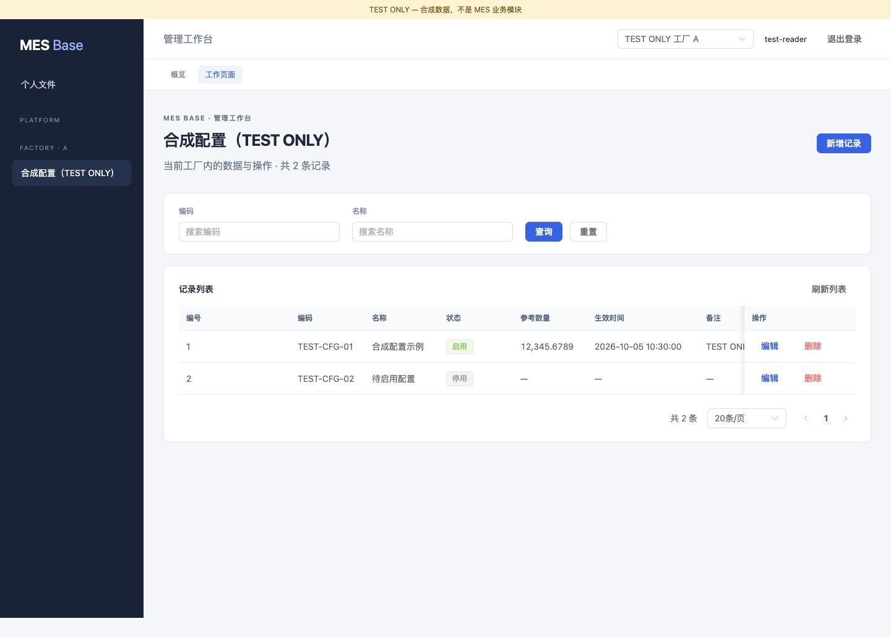
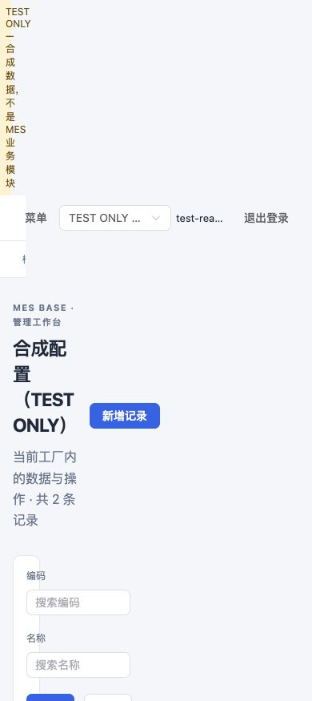

# MES Base Platform Foundation / Codegen / Skill 建设与迁移报告

2026-10-05；目标 `/Users/user/work/lixin/mes-base` 与 `/Users/user/work/lixin/mes-base-ui`。本轮是迁移执行及可复现验收，保持原 Factory Foundation，不进入正式 MES Domain。旧 ktg-mes / ktg-mes-ui / heri-uni-app 只读参考；未修改、cherry-pick 或复制公司源码、配置、数据、角色/菜单/字典/Job。

## 1. 交付结论

| 标记 | 状态 | 判定范围 |
| --- | --- | --- |
| PLATFORM_READY | YES | 本轮要求的 P0 用户/身份/角色/菜单/权限/字典/配置/审计/文件/Quartz 管理已在隔离平台库及真实 HTTP 验收 |
| CODEGEN_READY | YES | Service + CLI、默认/显式开发 profile、只读 metadata、自动放置、真实生成 Java/XML CRUD 执行与 Vue 编译成立 |
| SKILL_READY | YES | 支持的仓库 `.agents/skills` 目录、18 步流程、UI 后处理及实测 CLI，frontmatter 校验通过 |
| MES_DOMAIN_READY | NO | 尚无真实 Routing/WorkOrder/Reporting/Quality/WIP 领域，按要求停在平台与开发机制阶段 |

YES 表示本轮本地底座/脚手机制验收成立，不等于生产数据库、集群调度、外部集成或部署已通过。不存在“基本完成”替代状态。逐项限制见第 8 节；机器可读证据见 [verification JSON](2026-10-05-platform-codegen-verification.json)。

## 2. RuoYi 来源、许可与迁移矩阵

核实官方 [RuoYi-Vue 固定提交](https://github.com/yangzongzhuan/RuoYi-Vue/tree/13db1fcef36bee9ce45d2d636a1d4e8f5ed5bbc3) `13db1fcef36bee9ce45d2d636a1d4e8f5ed5bbc3` 和 [MIT LICENSE](https://github.com/yangzongzhuan/RuoYi-Vue/blob/13db1fcef36bee9ce45d2d636a1d4e8f5ed5bbc3/LICENSE)。先确认许可再导入：保留 LICENSE、官方 VelocityInitializer、service.java.vm 和 mapper.xml.vm 原件及哈希 [来源清单](../legal/ruoyi-source-manifest.json)。只改造能确认属于上游的部分；公司版本的文件不作为可复制来源。MIT 同时嵌入 JAR 的 META-INF/licenses，不只保留在源码文档。

实际复用为 Apache Velocity 引擎、官方初始化模式及 Service/Mapper XML 模板骨架；改造后的模板参与实际渲染和执行测试。不是仅保存上游文件而由另一套假生成器代替。其他 Base 专有 DTO/VO、Scope、Controller、ServiceImpl、Vue3/API 模板按新契约实现。Quartz、Spring Security/BCrypt、Flyway 复用成熟库。旧 Boot2/javax/Entity 对外契约、Redis LoginUser/权限快照与新 Boot4/Jakarta/分库/新授权结构不兼容，所以以通用能力模式重写适配，不宣称完整复制 RuoYi 平台实现。

| 能力 | 旧文件/模块参考 | 来源归属 | 方式 | Base 目标与改造 | 实测 | 状态 |
| --- | --- | --- | --- | --- | --- | --- |
| Generator engine / 初始化 | ruoyi-generator VelocityInitializer | 固定官方 MIT | MIGRATE | platform/codegen/RuoyiVelocityInitializer；实例级 UTF8、classpath、严格模板 | CodegenAcceptanceTest + CLI | MIGRATED |
| Service / Mapper XML 模板 | vm/java/service.java.vm、vm/xml/mapper.xml.vm | 固定官方 MIT | MIGRATE/适配 | resources/codegen/base；DTO/VO、Factory 谓词、PLATFORM/BUSINESS | 编译+Scoped/Global CRUD | MIGRATED |
| Metadata / Generator 契约 | generator GenUtils/GenTable/VelocityUtils 通用模式 | 旧公司版仅只读；官方模式参考 | REWRITE | JDBC metadata；MesCodegenService、Profiles、CLI、Writer | profile/type/index/default/无行查询/冲突 | REWRITTEN |
| Authentication / Token | framework/security、LoginUser、TokenService | 旧文件不复制 | REWRITE | SessionService/PlatformTokenFilter；opaque DB hash/TTL/revoke，不缓存权限 | Service + 真实 HTTP | REWRITTEN |
| User / password / status | system user、SysUserController | 通用能力；公司修改不复制 | REWRITE | PlatformService/typed contracts；BCrypt、UUID、禁用/改密撤销 | PlatformServiceTest/HttpTest | REWRITTEN |
| Role / user-role / role-menu | system role 与关联 Mapper | 通用关系；不迁旧数据 | REWRITE | kind PLATFORM/FACTORY + factoryId CHECK、原子批量授权 | A/B/平台角色负例 | REWRITTEN |
| Menu / Permission | SysMenuController/Service、前端 permission | 通用模式；旧菜单不复制 | REWRITE | 显式 EndpointAccess；navigation 分平台/当前厂，孤立授权子菜单可见 | HTTP 403、菜单/按钮差异 | REWRITTEN |
| Dict | SysDictType/Data、DictData UI | 通用能力；旧字典值拒绝 | REWRITE | clean schema、typed CRUD、DB revision cache | CRUD/跨实例失效/浏览器 CRUD | REWRITTEN |
| Config | SysConfigController/Service | 通用能力；真实配置拒绝 | REWRITE | GLOBAL/FACTORY、scope_key 唯一、环境 Secret | 范围/缓存/更新/敏感 key 拒绝 | REWRITTEN |
| Quartz engine | ruoyi-quartz timing | 公共 Quartz 库 | MIGRATE | Quartz2.5.1 引擎，时间与 DB claim 分开 | PLATFORM/FACTORY 执行 | MIGRATED |
| Quartz management / logging | SysJobController、ScheduleUtils、JobLog | 任意反射/旧任务不复制 | REWRITE | 白名单 handler、CRUD/启停/手工、scope/token/UNKNOWN 日志 | 同 DB 并发抢占、token 校验、错误传播 | REWRITTEN |
| Oper / login log | LogAspect/SysOperLog/SysLogininfor | 通用模式；旧日志不迁 | REWRITE | requestId/actor UUID/factoryId/executionScope；只存安全元信息 | HTTP audit + login + job | REWRITTEN |
| File | CommonController/FileUploadUtils | 旧公开路径不迁 | REWRITE | FileStorage/LocalPrivateFileStorage；owner/scope/resource policy | 所有者/跨厂/大小/清理 | REWRITTEN |
| Platform clean schema | 上游 sys_* 表职责 | 官方 schema 只看职责，零 seed 复制 | REWRITE | db/platform/V1__platform.sql；Flyway显式开关/独立平台库 | 隔离 H2 Flyway | REWRITTEN |
| Web shell / store / request | layout/Sidebar/Navbar/TagsView/router/store | 公司前端仅模式参考 | REWRITE | Vue3/TS/Router4/Pinia/ElementPlus；动态路由仅编译 catalog | 18 tests/build + browser | REWRITTEN |
| Web Dict/Pagination/Upload/管理页 | components、system 通用页 | 未复制 Vue2/公司页面 | REWRITE | CrudPage/DictSelect/PrivateUpload/PlatformPage | UI+HTTP+组件测试 | REWRITTEN |
| Department / Post | SysDept/SysPost | P1通用能力 | DROP | 当前无必要领域关系，不建立无用表 | 范围决策 | DROPPED |
| Notice / Online / Monitor / Cache monitor / Server monitor | 旧系统/监控模块 | P1通用能力 | DROP | 当前无明确价值；不迁旧监控地址或任务 | 范围决策 | DROPPED |
| wheel/销售/财务/工资/查号/客户 MES / ERP 单据 | 公司模块 | 公司专有 | DROP | 不进入 Base | 工作区/文件来源检查 | DROPPED |
| 旧 FactoryContext / DynamicDataSource / 兜底库 / magic admin / AjaxResult failure | 历史基础机制 | 与新 Foundation 冲突 | DROP | 保留新 Scope/Binding/真实HTTP错误 | 原 Foundation 55 tests + smoke | DROPPED |
| 公司 profile/URL/Secret/账号/角色/菜单/字典/Job/数据/部署连接 | 公司配置与数据库 | 禁止迁移 | DROP | 环境输入/空 clean schema/显式 bootstrap | 产物无连接/凭证/公司包 | DROPPED |

P1 的 DROPPED 是本轮取舍，不表示永久不能按新需求实现。没有迁公司 P0 改造源码，也没有迁历史数据。

## 3. Platform 与 Factory 融合

**身份与角色。** 无角色账号可以登录、建立启用 FactoryScope、访问 AUTHENTICATED；AUTHORIZED 按当前厂 DB 权限拒绝。无 UserFactory、factoryId=0 或 userId=1 超管。PlatformBootstrap 仅在空用户表通过受控本地工具建立新 UUID 平台角色、当前显式平台权限和全新管理菜单，不赋厂权限/通配符；正常启动无默认账号。

**Token。** 默认/demo 保留原 Basic 验收。Platform 显式启用后，随机 Bearer 的 SHA256 留在平台 DB，TTL/登出/禁用/改密可撤销，Token 仅身份，Factory/Permission 不进 Session 快照。UI 凭证只在内存，不写浏览器持久存储。有效 Scope 与数据源/ERP/权限保持独立。

**Persistence。** PlatformMapper 显式 PLATFORM，独立 SqlSessionFactory/transaction；生成业务 Mapper 显式 BUSINESS，复用 DedicatedDatabasePersistence/RuntimeRegistry。GLOBAL 生成单独 PlatformMapperRegistration 配置。原跨库事务拒绝、线程/lease/版本/池排空不被取代。默认平台关闭、FactoryCatalog/Business runtime 仍空；不从平台 CRUD 自动拼生产绑定。Shared DB 仍仅契约。

**管理与审计。** Typed request/VO 与持久化记录分离，页量100、关联批量200。Dict/Config 事务 bump DB revision、跨实例缓存失效。普通 Config 拒绝 Secret 类 key，GLOBAL/FACTORY 是明确配置语义。日志保存 requestId/actor UUID/Factory/PLATFORM-FACTORY/结果，不采集密码、Token 或请求体。错误真实400/401/403/404/409/422/500及requestId；上传超传输限额为413。

**Quartz/文件。** 时间引擎复用，任务只调用 allowlist handler，显式 ExecutionScope，DB 条件 claim + run token，运行中不可改/删，失败 UNKNOWN/异常传播，长账号解析成 actor UUID 后写日志。默认两个 heartbeat 仅底座验证。私有文件通过 UUID storage/最大大小/owner+scope+resource 再校验；默认仅 personal，未来业务附件需自己的 FileResourcePolicy。

关键代码：`server/PlatformConfiguration.java`、`platform/management/PlatformController.java`、`PlatformService.java`、`SessionService.java`、`JobService.java`、`FileService.java`、`platform/security/PlatformTokenFilter.java`、`infrastructure/platform/PlatformMapper.java`、`resources/db/platform/V1__platform.sql`。操作入口见 [平台指南](../development/platform.md)。

## 4. Web Base 决策与界面后处理

创建前选择 Vue3/TypeScript/ElementPlus/Router4/Pinia/Vite，见 [ADR-006](../architecture/ADR-006-platform-and-web-base.md)。旧 Vue2 页面不整体移植。已安装 Node22 供本任务使用，不改用户 Node16 默认值。

实际包含 Layout/Sidebar/Navbar/TagsView、平台与厂菜单、白名单动态路由、permission directive、统一 request/error/401/timeout/上下文过期拒绝、DictSelect、pagination、私有 upload/download 和系统管理页。动态路由仅授权菜单匹配 `src/views/module/entity/index.vue` 的编译模块，不能服务端随意 import，也不自动给新产物授权。

共享 CrudPage 已实现中文查询/重置/Toolbar、列宽与 tooltip、枚举标签、日期/decimal 字符串格式、创建/详情编辑、分组表单、忙碌/错误/空状态、删除确认及取消、分页与窄屏。大整数/decimal 不转 JS number；nullable 参考值展示“—”。合成后处理明确 0停用/1启用与颜色、备注 textarea、编号中文标签，业务枚举不由工具猜。

真实浏览器完成：A厂菜单/生成列表、新建、编辑、筛选/重置、完整 decimal、大数精度、取消删除保留、确认删除刷新；切 B 厂清空菜单/旧数据，返回权限错误且无写按钮。平台 Admin 查看用户页，字典类型新建/编辑/删除。1440px桌面及390px窄屏检查，最终窄屏 bodyWidth=innerWidth=390；自建测试记录均清理。

[大数/创建编辑证据](assets/2026-10-05-platform-codegen/mes-codegen-crud-created.png)、[B厂拒绝证据](assets/2026-10-05-platform-codegen/mes-codegen-factory-denied.png)、[平台用户页](assets/2026-10-05-platform-codegen/mes-platform-users.png)、[字典编辑证据](assets/2026-10-05-platform-codegen/mes-platform-dict.png)。这些均为隔离合成数据，不是生产现场。

## 5. Codegen 与合成 Demo

`MesCodegenService.generate(CodegenRequest)` + `scripts/mes-codegen` 已真实可执行；配置通过 Base ConfigData/Binder，默认开发 dev 或显式 profile。UNKNOWN/UNAVAILABLE/缺表/不支持/冲突分别返回，safe JSON 不打印密码。JDBC DatabaseMetaData 读取表/字段/类型/可空/默认/注释/PK/index/unique/FK；不读取业务行，测试代理禁止应用 Statement 调用。getIndexInfo 使用 approximate 模式。

产物 FACTORY_SCOPED 16个，GLOBAL17个：Entity、Mapper/XML、Service/Impl、Controller、Query/Create/Update、VO/PageVO、Permission、基础测试、前端 API/Vue、permission Markdown；GLOBAL 多注册配置。没有复制旧 menu SQL 或擅自写 grant。按两个根目录预检 → 临时 stage → 后端/前端发布 → manifest hash → finally清理；正常发布失败回滚，本地跨目录进程崩溃原子性未保证。

FACTORY_SCOPED SQL 的 list/count/detail/update/delete 有 factory_id 条件，create 由服务端 Scope 赋值，update 不能移厂。DTO 不收主体/厂身份；跨厂 999 ID 的 detail/update/delete 明确404。GLOBAL 使用平台 owner/permission/session；生成 GLOBAL Java/XML 已真实编译和 CRUD执行。标准单表复用生成 Mapper，当前未为了页面复制 ExtraMapper SQL；未来复杂查询才扩展 ExtraMapper。

合成表 `gen_demo_config` 仅 TEST ONLY：identity bigint id、factory_id、code/name、默认 status、decimal18,4、timestamp、nullable remark、unique(factory_id,code)。建表时无业务行；在 CLI 完成后启动合成服务才注入测试行。CLI 不指定 datasource 的默认 dev 验收、dry-run、真实生成、自动落点、状态后处理、javac/生成测试骨架、vue-tsc/Vite 构建全部执行。

实际落点：

- Backend `mes-base/target/codegen-acceptance/backend/src/main/java/dev/mesbase/modules/testonly/`：GenDemoConfigEntity、Mapper、IGenDemoConfigService、ServiceImpl、Controller、QueryDto、CreateCommand、UpdateCommand、Vo、PageVo、Permissions；XML 在相同 package 资源目录；测试和 permission 文档各一份。
- Frontend `mes-base-ui/target/codegen-acceptance/frontend/src/api/testonly/genDemoConfig.ts` 和 `src/views/testonly/genDemoConfig/index.vue`。
- Manifest `mes-base/target/validation/codegen-cli-manifest.json`；交付归档在 verification JSON。
- 后处理 GenDemoConfigStatus 是 TEST ONLY 额外枚举，不是正式业务领域。生成 fixture 路由、Server 在 target/src/test，生产 JAR 不含合成表/Server/H2。

完整用法与接入步骤见 [Codegen指南](../development/codegen.md)。`--serve` 可复现本地浏览器环境；`scripts/verify-codegen-http --test-only --port=<fixture-port>` 独立验证真实生成 Controller。

## 6. Skill 与 AGENTS 迁移

仓库 Skill 位于 `.agents/skills/mes-crud-codegen/SKILL.md`，属于 [Codex 支持的仓库 Skill 目录](https://learn.chatgpt.com/docs/build-skills)。新会话可自动发现；当前会话未刷新时根 AGENTS 提供精确可读路径，不能把目录存在冒充已刷新本次会话的 Skill catalog。工具先实现并通过测试后创建 Skill，无重复生成器脚本；Skill 调用稳定 CLI。

触发：新增表驱动业务/基础配置/标准CRUD/后台页/前后端生成。18步覆盖业务识别、适用判断、datasource/table/metadata、CLI、文件核对、Backend/Frontend自动落点、Factory/Permission/Resource/Domain/SQL、UI review/优化、两端测试与交付。20项 UI 检查强制；复杂领域 Domain First，绕过记录 CODEGEN_BYPASS_REASON。

| 分类 | 从旧 AGENTS 取舍 | Base 表达 |
| --- | --- | --- |
| A 迁移 | 第1/3/4/5/6/7/14节职责、最小实现、契约、异常、工作区/证据 | Controller不业务、Service规则/事务、Mapper仅数据、DTO/VO/Persistence隔离、不伪成功、最小改动、自检、真实证据 |
| A 迁移/补强 | 第8节优先通用Mapper、复杂扩展；第9节状态枚举；开发期授权/数量/并发底线 | 简单生成Mapper复用、复杂ExtraMapper、枚举稳定语义、SQL参数/分页/N+1、资源所属与事务 |
| B 重写 | RuoYi ktg-*依赖、Java8/Boot2、AjaxResult、生成模板Entity契约、旧目录与执行方案 | Core/Platform/Infrastructure/Integration、Java21/Boot4、真实HTTP、typed contracts、显式Mapper ownership/Scope/Binding |
| B 重写 | 原生成代码保护、普通系统权限/菜单模式 | Codegen First + Skill First，模板基础与Agent后处理分开；Platform role ≠ Factory role |
| C 拒绝 | 客户ERP单号/地址/Factory、微信检验订阅、热处理数量/设备、旧小程序分包、公司OpenAPI路径/具体表/profile | 本轮无对应领域需求；只保留授权/外部调用/状态/契约通用原则，具体业务不进Base |
| C 拒绝 | 旧动态库/FactoryContext/魔法管理者/失败HTTP200/历史补丁 | 使用新Foundation，禁止机械复制旧契约 |

根 `mes-base/AGENTS.md` 完成16类规则；UI `AGENTS.md` 只补 Vue3/目录/请求/精度/组件/测试，不大量复制公共规则。明确“所有适合表驱动的标准 CRUD 必须优先 Skill，Skill 可用不得从零手写完整 CRUD”。AGENTS 定规则、Skill定流程、Service/CLI执行，未把完整 Java 实现塞入规则。

## 7. 实际验证

使用用户 `zsh -ic` 加载的 Java21 Corretto / Maven3.9.10 和既有用户 Maven 配置/缓存；未恢复用户主动删除的项目 .m2/.mvn，未自建 mirror。前端切换已安装 Node22，不更改全局默认。

| 实际 command / 方式 | passed | failed | 证据范围 |
| --- | --- | --- | --- |
| `zsh -ic 'mvn -B -ntp verify'` | 80 | 0 | 9 JUnit suite，含原 Foundation55、Codegen6、Platform Service13、Platform HTTP6；最终JAR打包成功 |
| `zsh -ic 'nvm use 22 >/dev/null && npm run test && npm run build'`（UI根） | 18 tests + build | 0 | 5测试文件；request/CRUD/permission/组件/动态路由撤销；Vue TS/Vite |
| `zsh -ic 'nvm use 22 >/dev/null && scripts/verify-codegen-fixture'`（Base根） | 全流程、16产物 | 0 | 默认profile+dry-run+实际placement+javac+真实生成Vue TS/build |
| `MES_TEST_ONLY_PASSWORD=<合成临时值> scripts/verify-codegen-http --test-only --port=<loopback fixture>` | 21 | 0 | 真实Controller：401/400/403/404、分页、跨厂 ID、创建更新删除、Admin不带厂权、登出 |
| `/usr/bin/python3 scripts/smoke-packaged.py`（用户Java环境） | 11 | 0 | 默认/demo打包启动、基础认证/厂/ERP未配置；不冒充生产JDBC |
| `quick_validate.py .agents/skills/mes-crud-codegen`（临时PyYAML） | Skill is valid | 0 | 命名/frontmatter/placeholder；不单独冒充行为验收 |
| CUA真实浏览器人工流程 | 上述完整流程 | 0未解决 | Desktop/mobile截图、CRUD/取消/筛选/B拒绝、平台菜单/字典 |
| `git diff --check`、产物/包/路径与sources检查 | PASS | 0 | 未提交/推送/部署；旧公司工作区未改 |

认证测试涵盖正确/错误密码、disabled、无角色、logout、可控Clock expiry；Factory角色A/B授权和平台权限互不替代。Dict/ConfigCRUD与跨Service实例缓存失效，Quartz PLATFORM/FACTORY/无厂拒绝/上下文恢复/DB互斥/错误UNKNOWN，private File所有者/厂/资源/大小均有真实隔离 DB 测试。

早期执行中发现并修正了 dict保留字、Job历史日志FK阻止删除、构建符号/模板等问题；最终结果以上表为准。Skill校验的初次环境缺PyYAML，在临时目录安装后通过，未改系统Python。测试中的故意异常服务端日志不表示失败；按Surefire结果判定。临时fixture服务与Vite已停止，未停止用户服务。

## 8. 限制、风险与下一阶段

- 未联调真实 PostgreSQL/MySQL、生产catalog/账号/业务库、ERP或部署；Shared DB未实现。H2 fixture真实SQL/HTTP不是生产验收。
- Generator当前 SQL 是双引号标识符 + LIMIT/OFFSET；已验证H2，不自动宣称MySQL/其他方言兼容。只支持单PK/简单类型/无FK表；未知敏感或引用字段拒绝，不通过删除字段偷过。复杂领域、聚合/关联/状态机/cache/import/export/幂等/外部一致性需Domain设计和独立实现。
- 保留 metadata default，但CRUD参数是否采用默认需业务审查；nullable编辑使用显式null，不能把Schema默认等同每次修改默认。状态不猜数字语义。
- DB Job claim提供跨入口同时互斥，Quartz RAM时间触发不提供跨节点同一fire永久去重/集群misfire。重启不按超时释放可能仍活跃的任务；崩溃token需确认worker死亡并按原token条件恢复/记录UNKNOWN。正式长期同步必须补独立lease/heartbeat/恢复与幂等验收，当前仅heartbeat。
- UI相关授权选择器/厂选择当前获取有界100条，超大组织需要分页选择设计；尚无SSO、登录限流、生产审计/Session留存清理或对象存储适配。私有文件默认只允许personal，业务ResourcePolicy未由本轮虚构。
- 正常Codegen失败回滚/临时清理成立，但两个仓库跨目录进程崩溃不具原子性；显式overwrite会替换仍有生成标识的人工后处理，必须审查diff/manifest。
- UI build仍有>500kB vendor chunk提示（ElementPlus等），未掩盖阈值；构建通过，正式前端部署前可按实际性能需求拆包。
- 公共Bootstrap显式最初管理员工具是本机受控动作，不是匿名后台接口；平台管理员不自动拥有任意厂业务。默认平台不启用、生产RuntimeBinding不自动产生。

建议下一阶段先选择目标真实开发数据库及独立运行时装配，做平台Schema/Factory绑定的真实联调、部署配置与恢复策略验收，再由用户明确选择一个标准CRUD或Domain First领域；本轮不自动开始真实MES迁移。

## 9. 文件交付与自检

后端新增 `platform/codegen`、`platform/management`、`platform/security`、`infrastructure/platform`、PlatformConfiguration、显式Mapper注册、clean migration、模板和4个工具脚本；修改基础HTTP安全/错误以适配平台，Core只增加409错误类型，未重构Factory业务设计。新增3个JUnit类与TEST ONLY Server。前端新建Vue3工程、共享UI、系统管理、18测试及锁文件。文档新增ADR006、合法来源/许可、Codegen/Platform指南、本报告/verification/截图、仓库Skill、根及UI规则；更新README/架构索引。既有Factory报告/.gitignore用户未提交内容保留，不归为本轮新改造。

自检通过：未增加不必要业务分层；DTO/VO/Persistence分开；无业务Map替代契约；无吞异常/伪成功；Mapper不判断调用者权限；显式Factory与资源范围；未改公司/无关模块；没有为了架构设计假想MES；生成产物经过实际执行与UI后处理。没有git commit/push/deploy。

## 10. 交付完整性与收尾复核（2026-10-05）

结论：本轮 P0 Platform / Codegen / Skill 的本地功能交付和验收已完成，但不能称为“全部收尾干净”。运行现场已收尾，版本管理、临时辅助文件和一处说明仍有遗留。原 READY 标记仅表示第7节的本地验收，不表示已提交、已部署或生产就绪。

本次是交付复核：核对现有源码、构建产物、验收日志、文件哈希与进程，并重新执行 Skill 校验和 `git diff --check`；没有重新运行全套 Maven、前端、HTTP、浏览器验收，没有修改业务代码或重新生成 CRUD。

| 检查项 | 当前结果 | 证据及边界 |
| --- | --- | --- |
| 后端验收记录 | PASS | 当前 Surefire XML 合计80 tests，failure/error/skipped均为0，与第7节最终日志一致；`src/`与`pom.xml`无晚于最终JAR的输入修改 |
| 前端及HTTP验收记录 | PASS | 前端最终日志18 tests + build通过；源码/测试/构建配置无晚于`dist/index.html`的修改；HTTP结果21 passed/0 failed。属于此前隔离验收记录，本次未重跑 |
| 生成产物完整性 | PASS | 16个落点文件按manifest及2个已登记后处理hash复核，全部一致；后处理状态枚举存在 |
| 生产包边界 | PASS | JAR不含TEST ONLY Server、GenDemoConfig模块或H2依赖，内置MIT许可与源码许可文件逐字节一致 |
| 工具与规则 | PASS | 4个稳定CLI/验收脚本可执行；本次Skill校验输出`Skill is valid!`；现有文档本地链接复核未发现断链 |
| 临时运行现场 | PASS | 未发现本任务TEST ONLY Java/Vite服务运行；未发现Codegen staging或TEST ONLY数据库临时目录残留；未停止用户服务 |
| 工作区格式及Maven目录 | PASS | `git diff --check`通过；两端均没有恢复项目`.m2/.mvn` |
| 后端版本管理 | 未收尾 | `/Users/user/work/lixin/mes-base`处于`main`，13个已跟踪路径修改、66个未跟踪文件，未commit/push。其中`.gitignore`、`AGENTS.md`、`README.md`及既有Factory报告/verification在本轮建设开始前已有修改，不能把全部差异归为本轮或直接批量提交 |
| 前端版本管理 | 未收尾 | `/Users/user/work/lixin/mes-base-ui`不是Git仓库，`git rev-parse --show-toplevel`返回`fatal: not a git repository`；当前前端仅有本地文件，没有可审查的Git提交基线 |
| 临时辅助文件 | 有遗留 | `/private/tmp`仍有34个`mes-*.py`辅助脚本、`mes-codegen-upstream`下载缓存及`mes-skill-validator`临时依赖目录；脚本包含此前Factory阶段文件，未按前缀批量删除。构建`target/`、UI`dist/`与`node_modules/`是忽略的验收产物/依赖，保留以便复核 |
| 使用说明一致性 | 需修正 | UI `README.md:17`仍说需要手工在router注册生成组件；实际`src/router.ts:7`和`src/lib/dynamicRoutes.ts:4`已按授权菜单匹配编译组件并注册/撤销路由。管理员配置Menu/Role与不自动赋权仍正确，本次只记录差异 |

待收尾事项：确定前端版本管理归属；审查并区分后端既有差异与本轮交付后再提交；修正UI路由说明；确认临时文件归属后清理。当前“检查”未授权本次创建Git仓库、commit/push或删除既有临时资料，因此本次仅更新本报告与verification。

第8节真实数据库、部署、Quartz持久调度/崩溃恢复、Shared DB及正式MES领域等边界继续保留；它们不是本轮已验证能力。没有发现构建后业务源码继续变化、生成产物缺失或本任务服务仍在运行的证据。
