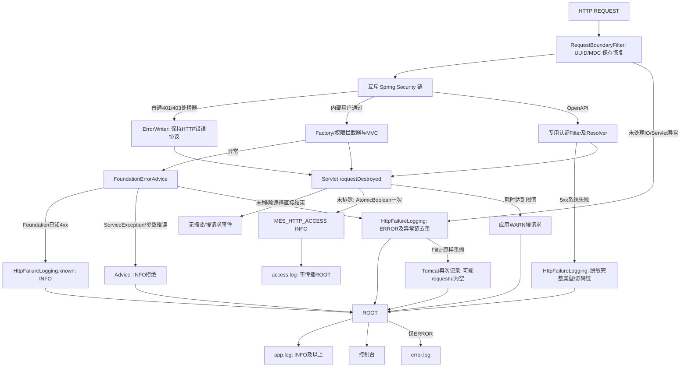

# Base MES HTTP 日志审查与 P0 改造

日期：2026-10-14；分支 main。范围：HTTP 技术日志；不改数据库、业务响应、权限、操作/登录/任务审计。不提交、推送、部署或重启用户服务。用户已有 production-chain-audit-review.md 修改不触碰。

## Phase 1：修改代码前的只读事实

### 调用链及 requestId 生命周期

`mes-framework/src/main/java/dev/mesbase/platform/web/RequestBoundaryFilter.java`（HIGHEST_PRECEDENCE+20）在 Security 外生成 UUID，存在 mes.requestId 属性时继承，忽略所有客户端 X-Request-Id；设置响应 Header 和 MDC，finally 恢复原 requestId、FactoryContext，并清理 PageHelper/请求绑定。ASYNC 派发复用属性；ERROR 默认被 OncePerRequestFilter 跳过。属性仅检验非空，尚无字符/长度限制。未恢复完整 MDC。无第二个 UUID HTTP 生成器。

`mes-admin/src/main/java/dev/mesbase/server/FoundationConfiguration.java` 普通 Security 链；`OpenApiDocumentationSecurityConfiguration` 文档链；`mes-framework/src/main/java/dev/mesbase/framework/openapi/OpenApiSecurityConfig.java` OpenAPI 链（order 0）互斥。SystemTokenFilter 的 Servlet 注册已禁用，只在 Security 链运行；Basic/Bearer、拒绝处理器保持既有响应。`FoundationAccessInterceptor` 解析 Factory/当前权限；`BusinessRequestSnapshot` 固定绑定，事务租约由基础设施负责。

`FoundationErrorAdvice` 是普通 MVC 唯一异常 Advice，ServiceException 为401/403/422，FoundationException 使用现有 ErrorCode，未预期异常500并ERROR完整堆栈。MVC异常处理器没有将异常转HTTP200。但 Source Controller 仍有主动返回 AjaxResult.error 的普通结果：SysUserController/SysRoleController/SysDictTypeController 的编码冲突，SysJobController 的Cron/白名单校验等；这些可为HTTP200且body失败。本任务保留这些响应，摘要没有businessSuccess字段。`ErrorWriter` 负责Filter/Security现有错误协议。OpenAPI专用 `OpenApiExceptionResolver` 优先接管MVC异常，`OpenApiRequestFilter` 接管Filter异常；沿用其AjaxResult/errorCode/requestId契约，不重新设计。

### HTTP 技术日志与缺口

普通HTTP无统一开始/结束日志；默认Boot Logback配置无显式MDC requestId。OpenAPI已有 finally INFO访问日志（客户端/API/时间/状态/错误码/peerIp/脱敏异常链），同步返回即记录，异步下可能提前记录。没有请求体/query/token/cookie采集。Foundation已知4xx打印WARN堆栈，5xx也为WARN；OpenAPI系统错误仅INFO截断类型/源码链。`FactoryMetadataCache.read` ERROR后包装抛出，后续Advice再打印链，存在重复。审计持久化失败/退休池清理/缓存提交后淘汰失败属于独立副作用，不删除其错误记录。业务ERP UNKNOWN捕获是业务结果处理，不作为普通异常重抛重复。

### 数据库日志（只读，不修改）

|对象/表|Entity / Mapper / Service|触发/数据源/事务|Factory与重叠|
|---|---|---|---|
|sys_oper_log|mes-system SysOperLog / SysOperLogMapper(XML) / SysOperLogServiceImpl|mes-framework LogAspect @Log，finally写入；masterSqlSessionFactory/masterDataSource；具名masterTransactionManager REQUIRED|factoryId来自FactoryContext，requestId/actorId/scope/耗时；不采集body，技术摘要不能替代操作审计|
|sys_logininfor|mes-system SysLogininfor / SysLogininforMapper(XML) / SysLogininforServiceImpl|SysLoginService成功/失败及SysRegisterService注册；中心库，插入masterTransactionManager REQUIRED|模型有factoryId/scope，登录入口通常未绑定工厂，写requestId/actorId；技术401摘要不替代登录审计|
|sys_job_log|mes-quartz SysJobLog / SysJobLogMapper及JobClaimMapper / SysJobLogServiceImpl、ControlledJobRunner|手工/Quartz执行与恢复，PlatformPersistence具名中心事务完成claim/release/log|factoryId/executionScope/runToken；手工带HTTP id，调度独立UUID，不强制后台MDC|
|mes_master_sync|mes-system/sync MasterSync / MasterSyncMapper；mes-framework/sync SyncCoordinator，既有状态表|中心库同步抢占/续期/结束；状态协调而非HTTP访问日志|factory_id+sync_key+run_token，不修改|

现有审计Service REQUIRED不宣称跨中心/业务原子审计；审计AOP自身失败为best effort，错误独立记录。Quartz ExecutionScope清理/恢复安全及Factory上下文，未普遍设置/传播HTTP MDC。ControlledExecutor显式传递ExecutionScope、不自动传MDC，队列满时可能在调用线程执行；MessageEventHub有独立SSE心跳线程。普通SLF4J MDC不自动跨线程；本任务不将不相关后台任务绑定HTTP。

### P0方案与停止条件

复用RequestBoundaryFilter与既有错误处理，不新增通用业务AOP。保留外部Header忽略策略，服务端属性限制ASCII安全字符和128长度；完整MDC保存/恢复。显式注册REQUEST/ASYNC/ERROR，处理嵌套ERROR时仅绑定MDC，不重做数据源准入。Filter保存开始时间、原路径、最终response及现有Factory/可信userId快照；ServletRequestListener.requestDestroyed一次输出最终status/耗时，覆盖异步与错误派发，不依赖数据库。排除路径通过配置管理。

OpenAPI访问日志在同一请求销毁时输出同一completed事件并保留专用字段；系统错误ERROR完整类型/源码堆栈并保留凭证消息脱敏。普通已知拒绝INFO无堆栈，5xx与未预期异常ERROR；请求内异常链去重，保留非HTTP原日志。应用console/file pattern显式输出MDC。

预计修改：RequestBoundaryFilter、完成监听器/Servlet注册、FoundationErrorAdvice、SystemTokenFilter身份快照、FactoryMetadataCache重复异常记录入口、OpenApiRequestFilter、application.yml、测试。现有响应、工厂/安全行为无修改必要；可以业务代码零侵入。未发现重大冲突，进入Phase 2。

## 非 P0 与未验证边界

不改变审计事务、Quartz业务/任务标识、SSE协议、外部ERP日志、SQL DEBUG策略或采样/日志平台。服务端完整异常可能含SQL/内部路径，受运维日志访问控制；OpenAPI保留更严格消息脱敏。HTTP200仅运输状态，不推断业务成功。生产访问量、真实用户服务热加载/部署、真实数据库审计写入不由源码阅读证明。

## Phase 2：实现与行为差异（Change Summary）

全部生产修改限于基础设施，业务Controller/Service/Mapper、数据库审计实现均未修改。无新依赖、表、SQL、迁移、数据库访问或数据源切换。HTTP错误响应、status、Factory选择/权限规则保持既有契约。

|文件（仓库相对路径）|修改前 → 修改后|
|---|---|
|mes-framework/src/main/java/dev/mesbase/platform/web/RequestBoundaryFilter.java|单个MDC键恢复 → 完整MDC恢复；服务端属性仅非空 → 安全ASCII、1–128字符校验；外部Header仍一律忽略。记录请求状态，异步/错误派发继承ID，原清理规则保留；未处理异常只记录后原样抛出|
|mes-framework/src/main/java/dev/mesbase/platform/web/HttpRequestCompletionListener.java|新增Servlet生命周期监听器，REQUEST/ASYNC/ERROR之后一次完成日志，单调耗时、实际终态HTTPstatus、原始method/path、已取得Factory/userId快照；不解析body/query/敏感Header，不查询身份/工厂数据|
|mes-admin/src/main/java/dev/mesbase/server/HttpLoggingConfiguration.java|明确现有边界Filter注册顺序、async支持和REQUEST/ASYNC/ERROR；复用原Filter Bean，不重复注册SecurityFilter；注册完成监听器和配置排除路径|
|mes-admin/src/main/resources/application.yml|Boot Logback默认level pattern → level显式包含MDC requestId（默认console/file均使用）；新增mes.http.logging.exclude-paths，空值可关闭排除|
|mes-framework/src/main/java/dev/mesbase/platform/web/HttpFailureLogging.java|新增现有异常边界共用的日志策略；4xx已知拒绝INFO无堆栈，5xx/未预期ERROR保留链，按请求内Throwable身份/原因链去重；不接管异常或改变传播|
|mes-framework/src/main/java/dev/mesbase/platform/web/FoundationErrorAdvice.java|已知Foundation WARN堆栈/Service WARN → INFO无堆栈且稳定错误码；系统异常调用共用ERROR策略；所有ResponseEntity/body映射保持|
|mes-framework/src/main/java/dev/mesbase/framework/security/SystemTokenFilter.java|只从已认证LoginUser保存userId（无新查询）；准入基础设施错误统一ERROR，响应仍既有503；预期安全拒绝只需现有完成摘要|
|mes-framework/src/main/java/dev/mesbase/framework/openapi/OpenApiRequestFilter.java|Security Filter finally提前访问日志/MDC重复绑定 → 由共用完成监听器输出一次completed事件；保留clientId/appKey/apiCode/errorCode/peerIp，系统异常另一个failed ERROR事件包含完整源码/cause/suppressed堆栈，去除可能含凭证的异常message。安全上下文清理及错误转换保持|
|mes-admin/src/main/java/dev/mesbase/server/managed/FactoryMetadataCache.java|ERROR后再次Advice打印同一异常 → HTTP记录包装异常并共享去重；非HTTP原ERROR行为保留。提交后缓存淘汰失败为独立副作用日志，不修改|
|mes-admin/src/test/java/dev/mesbase/HttpLoggingHttpTest.java|新增真实随机端口Tomcat、安全链及请求销毁测试；同步/业务/系统/401/403、多Factory、Callable、直接async.complete、超时、ERROR派发、日志次数和配置排除|
|mes-admin/src/test/java/dev/mesbase/platform/web/HttpLoggingBoundaryTest.java|新增完整MDC/Factory恢复、服务端属性/外部Header、嵌套ERROR、最终status/userId、异常去重、503准入、日志字段注入测试|
|mes-admin/src/test/java/dev/mesbase/framework/openapi/OpenApiLoggingTest.java|新增共用完成事件、400拒绝/500系统异常、完整40帧及suppressed、消息/Token脱敏测试（Mock Servlet与真实Filter）|
|mes-admin/src/test/java/dev/mesbase/HttpLoggingAuditPreservationTest.java|新增原LogAspect AOP成功/失败及原SysLoginService成功/拒绝回归，审计接收端为Mock，验证原记录数/status/requestId/actor/Factory|

### requestId与异步边界

客户端不获得控制服务端关联ID的权力；合法服务端属性可以继承，不额外建立第二套ID。HTTP REQUEST/ASYNC/ERROR派发期间绑定MDC，每次返回恢复所有原MDC字段。嵌套ERROR仅绑定/恢复MDC，不重做Factory清理/准入。完成监听器自身也保存/恢复MDC。非HTTP任务、Callable/DeferredResult/AsyncContext.start的生产者工作线程不自动继承HTTP MDC；异常回到ASYNC派发和最终完成事件仍关联同一ID。SSE只在连接结束时记完成，连接持续时间即duration。

### 日志示例（简化展示，ID/耗时为说明值）

```text
INFO  event=http.request.completed requestId=9a9f50bd-4229-4650-91ec-116510a42c1f method=GET path=/api/foundation/context status=200 durationMs=12 factoryId=A userId=42
INFO  event=http.request.rejected requestId=19f1d41b-62fc-4d16-9b36-757e6ca23a39 errorCode=BUSINESS_REJECTED
INFO  event=http.request.completed requestId=19f1d41b-62fc-4d16-9b36-757e6ca23a39 method=POST path=/api/example status=422 durationMs=5 factoryId=A userId=42
ERROR event=http.request.failed requestId=6bd00ef2-e265-4e4f-8aa9-60a4e99f4d83 errorCode=INTERNAL_ERROR
java.lang.IllegalStateException: ... [完整原始堆栈与cause，仅普通内部HTTP]
INFO  event=http.request.completed requestId=6bd00ef2-e265-4e4f-8aa9-60a4e99f4d83 method=GET path=/api/example status=500 durationMs=8 factoryId=A userId=42
INFO  event=http.request.completed requestId=532d7f6e-6fcf-4aa1-b286-0c8046e2b171 method=GET path=/api/foundation/context status=401 durationMs=2 factoryId=null userId=null
INFO  event=http.request.rejected requestId=218e9a44-8627-41ea-a71b-aa7c409afba2 errorCode=FORBIDDEN
INFO  event=http.request.completed requestId=218e9a44-8627-41ea-a71b-aa7c409afba2 method=GET path=/api/foundation/access status=403 durationMs=4 factoryId=B userId=42
```

failed/rejected和completed是不同语义事件；每个请求只有一条completed。Security原生拒绝可以只记录completed，不额外打印拒绝堆栈。OpenAPI系统错误完整源码类型/栈保留，但异常消息继续脱敏。clientId为外部身份，不伪装成内部userId。

## 验证结果与证据等级

- 工作区早期定向：`mvn -B -ntp test -Dtest=FoundationHttpTest,AsyncRequestBoundaryHttpTest,SystemTokenFilterAdmissionTest -Dsurefire.failIfNoSpecifiedTests=false`：18通过，0失败/错误/跳过；`/tmp/mes-http-log-target.log`。
- 日志新增测试最终12项：7边界、2真实Tomcat组合用例、1OpenAPI组合、2审计回归；均通过。这些数量是JUnit用例数量，单个组合用例包含多个HTTP场景。
- 本轮12个Java文件IDEA格式检查通过，最后修改的2个文件再次check通过（含最终OpenAPI Filter外系统异常脱敏分支）；`/tmp/mes-http-log-format-check.log`、`/tmp/mes-http-log-format-check-last.log`、`/tmp/mes-http-log-format-check-final.log`。`git diff --check`本轮路径通过。
- **共享工作区全量verify未通过**：最初并行编辑MesMaterialIssueEntity重复成员，`/tmp/mes-http-log-verify.log`；最终复跑时production规则仍在变更，`LocalWarehouseErpTest`导入已不存在的MaterialIssueCreateCommand，业务模块testCompile报2处找不到符号，`/tmp/mes-http-log-workspace-final-verify.log`。不是本轮日志代码错误，不修复/还原并行任务文件；未将全量工作区标成通过。
- **隔离副本最终全量verify通过**：基线`c649d2da8d5e517fc917727d9676424243e24788`的Git archive + 本轮13个代码/配置/测试文件，目录`/private/tmp/mes-http-logging-validation-20261014`；SHA-256确认这些文件与共享工作区最终版本一致。使用标准Maven/Java21，不创建私有Maven缓存。
  命令：`env PATH=/opt/homebrew/bin:/Users/user/apache-maven-3.6.1/bin:/usr/bin:/bin:/usr/sbin:/sbin mvn -B -ntp verify -Dmes.test.redis=true`。425项，总计415通过，0失败/错误，10项真实MySQL opt-in跳过，BUILD SUCCESS；`/tmp/mes-http-log-isolated-final.log`。测试用独立Redis/H2 Fixture及随机端口Tomcat，不操作用户服务。
- 初次隔离verify因测试子进程命中旧Intel Redis报Bad CPU type，重跑命令仅限定本次PATH，使用已安装ARM Redis8.10.2；不修改全局环境/项目配置。
- **隔离副本打包烟测**：`/usr/bin/python3 scripts/smoke-packaged.py`：10通过，0失败；`/tmp/mes-http-log-smoke-final.log`；自有临时隔离JAR进程，不启动/停止/重启用户服务。不将副本产物替换用户运行JAR。
- 没有改前端，未运行UI构建/浏览器验收；没有写SQL/数据库，无真实审计数据库写入验收，没有部署/生产观测。用户当前运行服务未复验，不宣称日志改动已经加载。

## 剩余风险与回滚

1. 不自动传播MDC到异步生产者或不相关后台线程；自建后台代码自行修改MDC后不清理的风险不由HTTP边界覆盖。
2. 未预期Filter异常原样继续抛给容器；应用异常链已去重，但Tomcat自身可能再次记录Servlet错误，不能为去除容器日志而吞异常/改变传播。本轮真实ERROR派发验证完成摘要只有一次。
3. 新摘要只含白名单字段，不含body/query/header/token/cookie/password；method/path/Factory及OpenAPI文本字段有界且替换空白/等号，防止日志字段注入。路径段本身若被业务设计为敏感信息，仍会出现在path；普通系统异常完整message/cause可能包含内部SQL/路径，现有SQL DEBUG也不在本轮全量脱敏范围。OpenAPI保留严格消息脱敏。
4. 每个未排除HTTP请求一条INFO，拒绝/系统异常另有语义事件；高访问量和长期SSE的量/时序需部署后观察，本轮不增加采样/日志平台。
5. 可回滚本轮13个代码/配置/测试文件及本Review；不触碰并行修改。没有数据迁移回滚需求。

## Document Created

本文件新增Phase 1调用链/requestId/审计/安全证据，以及Phase 2修改清单、示例、验证/失败和剩余风险。业务代码与数据库审计实现未修改；基础设施代码有上述P0变更。证据覆盖源码、Mock/Fixture、真实嵌入式HTTP和隔离JAR；不覆盖当前用户服务/真实MySQL/部署生产。


## 2026-10-14：普通 HTTP 完成摘要级别与 requestId 正文最小优化

本节替代前文“所有完成摘要 INFO、正文含 requestId”的普通HTTP规则；历史验证记录保留。OpenAPI专用完成事件保持原字段、INFO级别、requestId正文及脱敏，不受普通摘要慢请求阈值影响。

修改文件：

- `mes-framework/src/main/java/dev/mesbase/platform/web/HttpRequestCompletionListener.java`：普通完成摘要移除正文requestId及参数，只通过现有MDC/Logback输出；新增构造参数slowThresholdMs。级别优先级：5xx或durationMs >= slowThresholdMs为WARN，其余4xx为INFO，其余DEBUG；不传Throwable、不新增ERROR堆栈。MDC.put/restore、排除路径、AtomicBoolean、State和最终response读取均保留。
- `mes-admin/src/main/java/dev/mesbase/server/HttpLoggingConfiguration.java`：读取`mes.logging.http.slow-threshold-ms`，缺省1000L，注入监听器；原排除路径配置与Filter/Listener注册保持。
- `mes-admin/src/main/resources/application.yml`：新增`mes.logging.http.slow-threshold-ms: 1000`及中文说明；未修改全局Logback pattern。普通200摘要在现有INFO日志配置下不输出，需要查看时仅为该监听器启用DEBUG。
- `mes-admin/src/test/java/dev/mesbase/platform/web/HttpLoggingBoundaryTest.java`：更新构造调用，增加5组参数化验证（普通200/慢200/400/慢400/500），验证不附Throwable、格式化后UUID及requestId字段均只出现一次、MDC完整恢复和重复回调去重。
- `mes-admin/src/test/java/dev/mesbase/HttpLoggingHttpTest.java`：仅测试环境启用该监听器DEBUG、配置600ms阈值；通过真实Tomcat确认普通200 DEBUG、700ms慢200 WARN、400 INFO、500 WARN且完成摘要无堆栈；保留异步完成/超时/ERROR派发、安全和排除测试。
- `mes-admin/src/test/java/dev/mesbase/framework/openapi/OpenApiLoggingTest.java`：更新构造调用，阈值设为0仍要求OpenAPI完成事件INFO且正文保留requestId；原字段及脱敏回归保留，移除抛出拒绝异常之后不可达的重复断言（原返回后的有效断言继续保留）。

验证：

- 首次定向测试的5项参数化用例因JUnit无法自动转换Logback Level参数报错，已改为String参数后显式转换；不是生产代码失败，最终全量验证覆盖修正。
- 当前共享工作区：`env PATH=/opt/homebrew/bin:/Users/user/apache-maven-3.6.1/bin:/usr/bin:/bin:/usr/sbin:/sbin mvn -B -ntp verify -Dmes.test.redis=true`，443项总计432通过、0失败/错误、11项真实MySQL opt-in跳过，BUILD SUCCESS。日志`/tmp/mes-http-level-verify.log`；本次不使用隔离副本。
- 日志边界12项、真实HTTP组合2项全部通过；全部OpenAPI相关11项通过、0跳过。
- IDEA本轮5个Java文件格式检查通过，日志`/tmp/mes-http-level-format-check.log`；本轮路径`git diff --check`通过。
- 真实HTTP测试日志呈现完整UUID仅在Logback前缀出现一次。阈值600ms的测试观察到200/706ms为WARN；默认配置为1000ms。下方样例采用默认阈值、说明耗时值。

```text
DEBUG requestId=ba5e8447-3f9b-496c-8fd2-c9fe47a71352 event=http.request.completed method=GET path=/api/example status=200 durationMs=12 factoryId=A userId=42
WARN  requestId=84811a11-5d8e-461e-bdd3-93502628410d event=http.request.completed method=GET path=/api/example status=200 durationMs=1200 factoryId=A userId=42
INFO  requestId=1f4f39ee-f9de-4b20-a573-becb2e3a299a event=http.request.completed method=GET path=/api/example status=400 durationMs=4 factoryId=null userId=null
WARN  requestId=0789f437-9f54-4c02-98c6-822c947fef67 event=http.request.completed method=GET path=/api/example status=500 durationMs=5 factoryId=null userId=null
```

没有修改异常处理、OpenAPI生产实现、请求响应、数据库审计及业务代码；没有重启用户服务、写数据库、提交或部署。本节追加证据覆盖Mock Servlet、真实嵌入式Tomcat及当前工作区全量构建；未证明用户正在运行的服务已加载本次改动。回滚范围为以上6个代码/配置/测试文件及本文新增章节，保护其他已有修改。


## 2026-10-14：生产日志文件路由与滚动规范

本节替代前文完成摘要的DEBUG/WARN分级和单一默认Boot输出方案。仅调整日志配置、技术日志调用点和对应测试，不改HTTP响应、异常传播、Factory/权限、数据库Schema或审计记录。

### 修改前审查

- Spring Boot 4.1.1，Maven依赖树实测 Logback classic/core 1.5.38，无新增依赖；证据`/tmp/mes-logback-version.log`。
- 没有自定义logback-spring.xml、Appender或独立文件路由；公共application.yml只有MDC level pattern，dev/prod私有配置及公开example只定义level。默认profile dev；现有第三方及事务/后台查询level配置保持。
- RequestBoundaryFilter仍负责UUID/MDC/Factory边界；完成监听器负责requestDestroyed、State、原路径、最终response状态、AtomicBoolean和排除；异常Advice/HttpFailureLogging已经分别处理预期拒绝与系统异常并去重。
- 普通摘要此前在应用Logger，OpenAPI专用openapi.access为INFO并保留外部身份/API字段与脱敏。两个分支互斥，没有重复完成调用；原正文requestId在格式前缀中重复。
- 仓库没有可核验的systemd unit、Dockerfile、compose或实际部署定义；config生产example明确不是已部署环境。当前只有本机启动脚本和隔离测试入口，不能声称生产容器/服务账户具有写权限。

### 文件与职责变化（Change Summary）

|文件|本轮职责|
|---|---|
|mes-admin/src/main/resources/logback-spring.xml|新增Boot/Spring Logback配置：dev彩色/其他profile纯文本console，统一无ANSI文件格式，APP/ACCESS/ERROR路由与gzip滚动|
|mes-admin/src/main/resources/application.yml|移除重复logging.pattern.level；保留现有慢请求阈值与排除配置|
|mes-framework/src/main/java/dev/mesbase/platform/web/HttpRequestCompletionListener.java|普通完成摘要统一MES_HTTP_ACCESS INFO；完成后达到阈值另在原应用Logger记录一次http.request.slow WARN，不附堆栈；其他生命周期完全保留|
|mes-framework/src/main/java/dev/mesbase/framework/openapi/OpenApiRequestFilter.java|专用完成摘要改用同一MES_HTTP_ACCESS；仅移除重复requestId正文，其他clientId/appKey/apiCode/errorCode/peerIp和脱敏/系统失败处理不变|
|mes-framework/src/main/java/dev/mesbase/platform/web/HttpFailureLogging.java|技术错误/拒绝正文移除重复requestId，MDC仍由原边界绑定，原错误链去重/级别/脱敏保留|
|mes-framework/src/main/java/dev/mesbase/platform/web/FoundationErrorAdvice.java|技术日志正文移除重复requestId；响应、错误码及处理顺序不变|
|mes-framework/src/main/java/dev/mesbase/framework/aspectj/LogAspect.java|仅审计失败技术日志移除重复requestId；按既有规则显式导入/格式化。审计表字段、调用时机、Service事务和best-effort行为均不变|
|mes-system/src/main/java/dev/mesbase/system/service/impl/SysUserServiceImpl.java|仅导入catch内技术日志：ServiceException预期拒绝INFO，其他异常ERROR保留堆栈，移除重复requestId；既有导入统计/响应/持久化/事务均未修改|
|mes-admin/src/test/java/dev/mesbase/HttpLoggingHttpTest.java|真实Tomcat验证INFO访问摘要及慢请求额外WARN，原安全/多厂/异步/ERROR/排除/异常回归保留|
|mes-admin/src/test/java/dev/mesbase/platform/web/HttpLoggingBoundaryTest.java|访问日志捕获改为专用Logger；摘要与慢请求拆分断言、MDC/格式/去重验证|
|mes-admin/src/test/java/dev/mesbase/framework/openapi/OpenApiLoggingTest.java|专用Logger捕获，验证新路由和正文单ID，外部字段和完整脱敏链回归保留|
|mes-admin/src/test/java/dev/mesbase/server/ProductionLogbackTest.java|新增隔离JVM dev/prod加载真实XML；实写三类文件，验证级别/ANSI/完整堆栈/默认ID/路由；生产参数检查及缩小限额的日期/大小/gzip/启动清理/保留/总量测试|

### 最终路由

```text
ROOT（默认INFO） → CONSOLE
                 → APP：Threshold INFO → app.log（INFO/WARN/ERROR）
                 → ERROR：Level ERROR only → error.log
MES_HTTP_ACCESS（INFO，additivity=false） → ACCESS：Threshold INFO → access.log
```

每个未排除的逻辑HTTP请求只有一个访问摘要，所有HTTP status均为访问INFO，不能据此推断业务成功。OpenAPI也只走该访问Appender；其系统异常经原HttpFailureLogging进入ROOT，继续隐藏异常message、保留完整类型/源码/cause/suppressed。达到`mes.logging.http.slow-threshold-ms`（默认1000）后，保留access原摘要，ROOT另记WARN慢请求，无Throwable；非慢普通GET不进入app.log。

文件pattern包含完整时间/级别/线程/requestId/Logger/正文及`%ex{full}`。无MDC时`%X{requestId:--}`显示`-`。本轮控制的日志正文不重复requestId；没有删MDC或丢弃异常链。

|文件|单文件上限|保留|归档总量|格式|
|---|---|---|---|---|
|app.log|100MB|30天|5GB|每日+序号.log.gz|
|access.log|100MB|14天|3GB|每日+序号.log.gz|
|error.log|50MB|60天|2GB|每日+序号.log.gz|

均为SizeAndTimeBasedRollingPolicy，cleanHistoryOnStart=true。归档总量限制不含活动文件；压缩/历史清理为异步，不宣称瞬时磁盘占用严格等于上限。

### 路径、部署与权限

日志根目录：`MES_LOG_DIR`，默认`.local/logs`；实际目录为根目录下的`MES_LOG_INSTANCE`。未配置实例名时默认主机名+PID，避免多个进程意外共用滚动文件。启动/文件写入在当前本机工作区及独立临时目录实际通过。

生产必须配置稳定且唯一的实例名：例如单个systemd服务使用`MES_LOG_DIR=/var/log/mes-base`、`MES_LOG_INSTANCE=node-a`，服务账户对根目录及子目录有写权限；Docker使用可写卷根目录，每个副本使用唯一实例名。这里是部署要求示例，不代表已部署或已检查这些路径。相同实例名不能同时由两个JVM使用。稳定实例名允许重启后继续清理原归档；默认PID隔离模式产生的旧进程目录需按部署生命周期清理，不会由新目录的Appender跨实例删除。

### 验证与实际样例

- 当前工作区`env PATH=/opt/homebrew/bin:/Users/user/apache-maven-3.6.1/bin:/usr/bin:/bin:/usr/sbin:/sbin mvn -B -ntp verify -Dmes.test.redis=true`：446项总计435通过、0失败/错误、11项真实MySQL opt-in跳过，BUILD SUCCESS；`/tmp/mes-prod-log-verify.log`。
- 打包启动：`/usr/bin/python3 scripts/smoke-packaged.py`，10通过、0失败；`/tmp/mes-prod-log-smoke.log`。JAR含BOOT-INF/classes/logback-spring.xml，使用自有隔离进程，不重启用户服务。
- OpenAPI相关11项全部通过；日志边界12项、真实HTTP组合2项、原操作/登录审计回归2项、新文件/滚动3项全部通过。
- 生产XML参数逐项核对。缩小测试限额256B/文件、2天、1024B用于验证同一Logback机制；模拟日期推进后等待每轮压缩和对应日期清理，再验证下一稳定清理周期结果。测试不会创建GB级文件，也不能冒充生产30/60天长期运行观测。
- 开发ANSI与生产纯文本console均验证，文件无ANSI；requestId仅前缀一次，原始cause/suppressed完整，ERROR一次调用同时进入app/error，INFO/WARN不进入error，访问摘要不进入ROOT文件，无MDC显示`-`。
- 初次定向测试存在参数名更新漏项，已修正。早期滚动测试因模拟命名时钟与异步清理时钟未对齐出现超量读数，已用TEST ONLY的策略Future等待及同日期清理统一模拟，不放宽生产配置或业务行为。
- IDEA本轮10个Java文件格式检查和本轮路径git diff --check通过；`/tmp/mes-prod-log-format-check.log`。

隔离Probe实际文件（合成TEST ONLY日志，不含用户业务数据）：

- `/private/tmp/mes-base-production-log-evidence-fq0urfg1/TEST_ONLY_INSTANCE/app.log`
- `/private/tmp/mes-base-production-log-evidence-fq0urfg1/TEST_ONLY_INSTANCE/access.log`
- `/private/tmp/mes-base-production-log-evidence-fq0urfg1/TEST_ONLY_INSTANCE/error.log`
- 同目录scaled归档及rolling-result.txt：retention=true cap=true。

```text
app.log:
2026-10-14T16:43:48.705+08:00 INFO  [main] requestId=- TEST_ONLY_APP - TEST_ONLY_STARTUP_WITHOUT_ID
2026-10-14T16:43:48.706+08:00 WARN  [main] requestId=11111111-2222-3333-4444-555555555555 TEST_ONLY_APP - TEST_ONLY_WARN

access.log:
2026-10-14T16:43:48.707+08:00 INFO  [main] requestId=11111111-2222-3333-4444-555555555555 MES_HTTP_ACCESS - event=http.request.completed method=GET path=/test-only status=200 durationMs=1 factoryId=null userId=null

error.log:
2026-10-14T16:43:48.706+08:00 ERROR [main] requestId=11111111-2222-3333-4444-555555555555 TEST_ONLY_APP - TEST_ONLY_ERROR
java.lang.IllegalStateException: TEST_ONLY_SYSTEM_FAILURE
    ... 完整源码堆栈、Suppressed及Caused by保存在实际文件中 ...
```

### 剩余风险与完成边界

真实systemd/Docker账户、只读文件系统/卷权限、磁盘预算及实例名配置未验证；生产保留天数、GB级体量和长期负载未实测。Boot使用当前Spring profile及原第三方level配置，不改开发用户服务配置。Throwable原始内部消息可能含内部SQL/路径，运维应控制日志访问；OpenAPI消息脱敏保留。路径段不得由业务放敏感数据，访问日志本身不采集body/query/token/cookie。

应用异常链去重保留；未处理Filter异常仍原样向容器抛出，Tomcat自身可能另记错误，不屏蔽容器诊断或改变异常传播。不自动传播HTTP MDC到不相关后台工作线程。

本轮无数据库写入/迁移，不调整操作、登录、Quartz数据库日志，不启动/停止/重启用户服务，不提交/推送/部署。回滚只撤销本节列出的日志变更，保护其他并行工作。本文追加生产路由、配置、实际样例、测试及部署边界，历史结论保留。


## 2026-10-15：生产日志最终验收（只读审查）

### A. 总体验收结论：NO-GO

> 历史结论：已由文末“2026-10-15：最终授权修复与复验”取代。原证据保留；本轮按用户新确认的运行期日志 best-effort 原则重新判定，不将日志落盘故障等同于业务数据可靠性故障。

**正常路径功能通过，但不批准最终上线验收。** 当前工作区构建和既有测试通过；文件分流、完成摘要去重和Servlet线程清理有效。但运行期访问文件不可写时会丢失原始访问事件，HTTP相关Callable工作线程没有requestId；另有普通拒绝应用INFO、Filter/容器重复堆栈及默认PID目录累积问题。不能把既有测试绿色等同于这些生产保障已满足。

本判定的P0适用“重要访问记录在存储故障下降级丢失，且未证明有独立持久化副本”的严格验收口径。不是宣称正常磁盘时日志不可用，也不是宣称Logback初始化失败静默。若人工接受该故障降级，需先证明控制台持久化、告警和恢复契约，再重新验收；当前不默认部署已有这些保障。

范围：只读审查、既有自动化测试、临时Java验证驱动及证据文件。没有修改生产代码、配置、仓库测试源码、数据库或部署。源码基线main/dirty，HEAD为3c2d2dfb65a7e5cfb2eec48d6910b955462d934f；下文路径/行号引用**本轮工作区**，不把未提交/未跟踪日志代码当作HEAD已提交内容。验收前后1,048个源码、配置、测试文件SHA-256一致；见`/private/tmp/mes-log-final-acceptance-20261015-lcruy796/source-before.json`、source-after.json、source-differences.json（空数组）。仅本文新增验收章节。

证据根目录：`/private/tmp/mes-log-final-acceptance-20261015-lcruy796`。所有日志测试均写入该独立临时目录或JUnit自有临时目录；没有向用户运行目录灌测试日志。真实HTTP使用随机端口和合成身份/工厂；自建Quartz是独立RAMJobStore，不执行用户任务。未访问真实ERP或修改业务库。

### Phase 1：实际日志执行链



该图基于工作区源码与本轮运行记录；采用Mermaid而非伪造Archify提交级来源（关键文件未提交，不能提供HEAD级严格证据）。主要源码：

- `mes-framework/src/main/java/dev/mesbase/platform/web/RequestBoundaryFilter.java:47-94`：请求ID属性复用、Header、MDC/Factory/PageHelper清理；ASYNC/ERROR派发重新绑定；不查询数据库补日志。
- `mes-admin/src/main/java/dev/mesbase/server/HttpLoggingConfiguration.java:19-33`：现有Filter只注册一次，REQUEST/ASYNC/ERROR，注册最终监听器。
- `mes-framework/src/main/java/dev/mesbase/platform/web/HttpRequestCompletionListener.java:71-98`：CAS去重、排除、最终status、INFO访问事件及慢WARN；完成监听器保存/恢复MDC。
- `mes-framework/src/main/java/dev/mesbase/platform/web/HttpFailureLogging.java:22-76`：已知4xx INFO；系统ERROR；请求内异常身份/原因链去重。
- `mes-framework/src/main/java/dev/mesbase/platform/web/FoundationErrorAdvice.java:28-98`：安全错误模型、Service401/403/422、参数400和未预期500；没有把异常统一改HTTP200。
- `mes-framework/src/main/java/dev/mesbase/framework/openapi/OpenApiRequestFilter.java:57-77`：OpenAPI完成分支复用MES_HTTP_ACCESS，保留clientId/appKey/apiCode/errorCode/peerIp，系统错误用脱敏完整链。
- `mes-admin/src/main/java/dev/mesbase/server/FoundationConfiguration.java:103-129`、`OpenApiDocumentationSecurityConfiguration.java:20-35`、`mes-framework/src/main/java/dev/mesbase/framework/openapi/OpenApiSecurityConfig.java:37-53`：普通、文档、OpenAPI互斥Security链；拒绝处理器本身主要写HTTP错误，不普遍打印堆栈。
- `mes-admin/src/main/resources/logback-spring.xml:3-61`：ROOT与ACCESS严格分流；Spring Boot 4.1.1、Logback 1.5.38；application.yml默认dev，dev/prod现有level和第三方设置未改。

### Phase 2：HttpFailureLogging全部入口及职责

|入口|场景|当前应用日志|评价|
|---|---|---|---|
|RequestBoundaryFilter catch Foundation|Filter边界业务/认证/工厂拒绝|4xx INFO；5xx ERROR|普通拒绝INFO过多，P1-1|
|RequestBoundaryFilter catch IO/Servlet/Runtime|未处理Filter异常|ERROR后原样重抛|与容器可能重复，P1-3|
|FoundationErrorAdvice.known|MVC已知Foundation异常|4xx INFO；5xx ERROR|普通400/业务拒绝污染app|
|FoundationErrorAdvice.unexpected|未预期MVC异常|ERROR完整Throwable|正常工作，单次应用ERROR|
|SystemTokenFilter|认证基础设施DataAccessException或Foundation5xx|ERROR，保持原503|必要技术错误，不应删除|
|FactoryMetadataCache.read|HTTP元数据读取失败包装503|ERROR，Advice遇同链不再重复|正常；非HTTP原错误日志保留|
|OpenApiRequestFilter.logCompletion|OpenAPI保存的5xx异常|ERROR，去除message，保留类型/源码/cause/suppressed|脱敏保持；4xx不调用该ERROR分支|

Advice的ServiceException/参数错误另有直接INFO，不经HttpFailureLogging的去重；它们不是重复堆栈，但也是P1-1的噪声来源。普通Security未认证401实测app无记录；登录/业务边界抛出Foundation401则会产生INFO，不能概括为“所有401都只有access”。

安全审计职责：

- 普通401/403有访问记录、status及requestId；生产内部身份可由已认证LoginUser补userId，合成Basic测试无系统userId时为null。
- OpenAPI访问事件保留errorCode和peerIp、已核实的外部身份字段；令牌格式/失效/限流等不会因移除普通应用INFO而删除访问证据。Secret/Token不采集，测试canary未进入三类文件。
- 当前OpenAPI使用随机`oa_` Bearer+Redis记录校验，不是JWT签名协议；“非法JWT签名”不适用，不能伪造一个不存在的签名入口来做验收。
- 登录数据库日志：SysLoginService/SysRegisterService → SysLogininfor/Mapper/Service → 中心库sys_logininfor，具名master事务；记录成功/失败及requestId/actor。普通访问被401拒绝不等于执行过登录动作，不能假设每个401都有DB登录记录。
- 操作审计：LogAspect → SysOperLog/Mapper/Service → 中心库sys_oper_log，@Log动作才触发，原事务/字段/失败处理不变；不覆盖所有拒绝。
- Quartz：ControlledJobRunner/JobClaimMapper → 中心库sys_job_log，手工可带HTTP ID，调度独立UUID/run_token。真实用户任务未执行。
- 本轮仅测试原审计入口与Mock接收端记录契约，不写/清理真实审计记录。后续若调整拒绝INFO，必须保留实际登录审计、访问errorCode/peerIp及有意义的异常认证/限流信号，不能“一删所有认证日志”。

### B. 验证矩阵

|场景|预期|实际|结论|证据|
|---|---|---|---|---|
|应用INFO|仅app|符合；不进入access/error|PASS|ProductionLogbackTest dev/prod子进程实写|
|应用WARN|仅app|符合；慢WARN无Throwable|PASS|同上；http-matrix.json slow200|
|应用ERROR|app+error，单次调用|符合；完整cause/suppressed|PASS|ProductionLogbackTest及system500实际文件|
|正常HTTP200|app无自动摘要，access一次|app0/access1/error0|PASS|normal200，requestId=9487168a-7e34-48bf-8a5f-eb7f37383c41|
|普通HTTP400|原则上仅access|app1 INFO拒绝/access1/error0|FAIL|bad400，71c5ea0f-4a58-475f-8789-8f18ea8acd76|
|预期业务422|access；必要时DEBUG|应用INFO+access|FAIL|HttpLoggingHttpTest business/known；P1-1|
|普通Security401|access|app0/access1/error0|PASS|unauth401，35d91eaa-b9d3-43b1-86c6-ca76785a367b|
|边界/登录类401|避免泛化重复INFO，保留审计|临时Servlet驱动app INFO+access|FAIL|known-401，acc9dd86-3637-44e1-9dc3-00c5ca153a2d；不是实际登录服务调用|
|权限403|access及必要安全记录|access一次、应用INFO FORBIDDEN，无ERROR|PASS|forbidden403，2610eecd-cf06-4f6e-b2d0-58ceaf399502；当前安全记录保留|
|实际系统异常500|app ERROR+access+error|各一条逻辑记录；双文件ERROR允许|PASS|system500，708230e3-9c9d-4aa7-b70f-59438bfa4dcd|
|主动返回500、无异常|仅访问，不凭status伪造堆栈|app0/access1/error0|PASS|returned-500.txt及对应三文件|
|慢请求|access一次+app WARN，无额外堆栈|符合；测试控制器另主动INFO属测试业务事件|PASS|slow200，ae2117d1-318a-4a0f-8945-fdc9841600bf，707ms/阈值600|
|DEBUG默认|不进入三个文件|符合，ROOT默认INFO，APP阈值INFO|PASS|ProductionLogbackTest|
|OpenAPI正常/拒绝/系统错误|专用字段、单访问、脱敏|11项相关测试通过，secret canary未进入suite三文件|PASS|verify.log；OpenApiLoggingTest|
|requestId单次格式化|完整ID一次|77条suite摘要、77个不同合法UUID，每条1个字段，无ANSI|PASS|test-summary.json及suite/access.log|
|同一Servlet线程连续请求|不同ID，无污染|单worker连续请求及ASYNC回派发断言通过|PASS|AsyncRequestBoundaryHttpTest 2项；HttpLoggingBoundaryTest|
|不同Servlet线程|各自ID/Scope隔离|多个worker的77条不同ID，原并发权限测试通过|PASS|FoundationHttpTest并发用例、线程统计|
|ASYNC最终摘要|同ID一次|符合|PASS|async200、direct async.complete、timeout及现有测试|
|HTTP Callable工作线程日志|相关应用处理日志可关联HTTP ID|task-1为requestId=-，最终摘要/响应头有UUID|FAIL|async-worker-result.txt及app/access；P1-2|
|Servlet ERROR派发|完成一次；异常不重复|完成一次，但Filter与Tomcat各打印同一异常链，后者ID=-|FAIL（摘要部分PASS）|a001215d-c410-48c1-8d0d-7bb43f096d9b；P1-3|
|Quartz后台|允许ID为空，不继承HTTP|独立RAMJobStore工作线程requestId=-；调用者原MDC保留|PASS（线程层）|quartz-quartz.txt及quartz/probe/app.log；真实用户任务NOT VERIFIED|
|启动/无HTTP|ID=-|符合|PASS|实例Probe AUDIT_STARTUP_NO_HTTP与真实Spring启动日志|
|目录覆盖|MES_LOG_DIR生效|所有suite/驱动都写独立指定目录|PASS|本证据目录|
|默认实例重启|隔离且有清理责任|不同PID目录都保留，应用无跨目录清理|FAIL（生命周期）|instance-directories.json；P1-4|
|真实systemd/Docker权限|账户可写且实例唯一|仓库无部署定义，未修改/访问这些环境|NOT VERIFIED|仅本机/隔离权限验证|
|初始化目录不可写|明确失败，不静默启动|只读目录/路径为文件均初始化失败；实际JAR exit1，未启动应用|PASS|jar-readonly-result.json、init-readonly/blocked结果|
|运行中ENOSPC类错误|重要访问事件仍可留存/检测恢复|原401访问事件丢失，控制台只有I/O故障诊断|FAIL|runtime-access-io-access.txt、io-access/probe三文件均空；P0-1|
|应用ERROR通道运行期失败|明确诊断，保留可追踪副本|app/error文件未写入，原ERROR仍在console，另有Logback I/O诊断|部分PASS，文件FAIL|runtime-error-io-error.console.log；真实控制台持久化NOT VERIFIED|
|滚动参数|100/100/50MB，30/14/60天，5/3/2GB|真实XML参数逐项符合|PASS（配置）|ProductionLogbackTest|
|日期/大小/gzip/启动清理|正确工作|缩小256B、2天、1024B及合成日期的隔离机制测试通过|PASS（缩小验证）|ProductionLogbackTest 3项|
|重启不覆盖旧归档|旧内容不变，继续索引|.0.gz sentinel保持，后续从.1至.9|PASS（缩小验证）|additional-results.json及restart-roll/probe/archive|
|实际GB体量/长期保留|生产长期符合|未灌满磁盘或等待14/30/60天|NOT VERIFIED|不以缩小测试冒充长期观测|
|原业务/DB审计|契约不变|既有回归通过，未改src/DB|PASS（回归），真实DB NOT VERIFIED|1048文件哈希一致；审计回归2项|

矩阵中的PASS只覆盖已说明层级。完整实际数据见http-matrix.json；回放代码仅在本临时目录，没有新增仓库测试或修改被测实现。

### C. 发现的问题与最小建议（不实施）

#### P0-1：运行期访问输出失败会丢失唯一访问事件

- **源码位置：** logback-spring.xml:28-38、54-56；HttpRequestCompletionListener.java:75、85-88。ACCESS只有文件Appender且不传播ROOT，CAS在写入前已标记完成。
- **触发：** ACCESS文件输出过程中抛出ENOSPC类IOException（本轮注入到真实ResilientFileOutputStream的底层OutputStream；未真实填满磁盘）。
- **实际影响：** 普通401保持401并返回合法requestId，但access/app/error均无该请求事件，原事件没有控制台副本或重放。Logback有控制台故障诊断和内存Status，并非完全静默；这些诊断不包含原访问事件，不能替代安全访问记录。非登录401本就不保证有DB登录审计。
- **复现：** 临时LoggingAcceptanceProbe的runtime-access模式；结果httpStatus=401、callerContinued=true、Status.ERROR=2、StatusListener=1，`io-access/probe/access.log`为0字节。原事件ID为0a110d38-327a-4586-8890-7f1981ad0342，控制台仅I/O错误，未修改生产代码。
- **最小建议：** 优先复用CONSOLE为MES_HTTP_ACCESS提供不经过ROOT的独立副本，并在实际部署证明stdout/stderr持久化及磁盘/I/O故障告警、恢复检测；或提供等效可靠降级通道。不能只写一句“RollingPolicy会重试”就认为已丢的事件可补回，不应让日志故障随意改变业务HTTP语义。人工确认后再修复/复验。

#### P1-1：普通400/预期业务拒绝及部分401额外污染应用INFO

- **源码位置：** HttpFailureLogging.java:22-30；FoundationErrorAdvice.java:35-55；RequestBoundaryFilter.java:61-64；SysLoginService.java:15-18（登录审计与拒绝入口）。
- **触发：** Foundation4xx、ServiceException、参数校验异常；登录拒绝抛出Foundation401。Security EntryPoint直接写401的路径则没有该INFO。
- **影响：** 同一普通拒绝同时有应用INFO和访问摘要，降低app诊断信噪比；不是重复ERROR堆栈。已实测400、422、边界401。
- **复现：** HttpLoggingHttpTest的bad-request/business/known以及临时known-401模式；同一requestId对应app INFO+access INFO。
- **最小建议：** 普通400/已预期业务拒绝以access为主，必要诊断降DEBUG；按入口区分普通401与异常认证/限流信号，保留登录DB审计、403必要记录和OpenAPI errorCode/peerIp，不能删除所有认证日志。

#### P1-2：HTTP相关Callable工作线程缺少requestId

- **源码位置：** RequestBoundaryFilter.java:49-56、78-83；HttpRequestCompletionListener.java:79-98；没有为MVC异步生产者设置对应MDC拦截/装饰器。
- **触发：** MVC返回Callable，业务处理/日志发生在task-1，而不是Servlet回派发线程。
- **影响：** 访问摘要、响应头有正确ID，但处理过程中的应用日志为`requestId=-`，难以串联排障；不是Quartz应否继承HTTP的问题。
- **复现：** 临时AsyncMdcProbe，真实随机端口Tomcat，asyncHeader=4d455871-d595-4b55-8305-d3f5b497ca83，asyncBody中MDC=null；app.log的AUDIT_HTTP_ASYNC_WORK无ID，access有该UUID；后续同步请求ID正常。
- **最小建议：** 在既有MVC异步执行扩展点仅捕获/绑定并finally恢复MDC/requestId（例如Callable拦截器或对应TaskDecorator），不要顺带传播FactoryContext、Security身份、数据库Session/事务租约，也不要强制Quartz继承HTTP ID。

#### P1-3：Filter未处理异常与容器重复打印同一异常链

- **源码位置：** RequestBoundaryFilter.java:65-78；HttpFailureLogging.java:34-39；ROOT配置logback-spring.xml:57-61。
- **触发：** Filter抛出ServletException/RuntimeException，边界先ERROR再原样重抛；Tomcat随后记录相同根因。
- **影响：** app/error中各有应用和容器两条ERROR（不是同一ERROR路由到双文件的正常复制），容器记录因MDC已恢复显示`requestId=-`。访问摘要仍只有一条。
- **复现：** HttpLoggingHttpTest filter-error；应用ERROR时间07:40:04.044，Tomcat ERROR时间07:40:04.045，两者含TEST ONLY container error/同一根因，access在07:40:04.047只完成一次。
- **最小建议：** 明确未处理Filter异常的唯一堆栈记录责任，并验证容器边界的关联方式；不要吞异常、改HTTP响应或屏蔽所有Tomcat ERROR来换取表面去重。审批修复时只对已由应用记录的同一异常链去重。

#### P1-4：默认PID目录不能跨重启实施统一保留

- **源码位置：** logback-spring.xml:5以及各rollingPolicy.fileNamePattern；scripts/run-local-backend:13（相对工作目录为仓库根）；.gitignore中的.local/。
- **触发：** 未设置MES_LOG_INSTANCE，使用主机名+PID；进程重启或同宿主新进程。
- **影响：** 新PID生成新目录，旧目录的活动文件和归档不在新RollingPolicy管理范围；本地常驻/持久卷反复重启可累积。不能断言部署永远不清理：容器销毁/外部运维可能清理，但本轮没有相应证据。
- **复现：** 独立JVM PID29385和29387两个默认实例目录并存，见instance-directories.json；两者启动均成功。
- **最小建议：** 单实例使用稳定服务实例名，多副本用唯一稳定标识，明确同目录只能一个JVM；明确旧PID目录退役/清理Owner和保留责任；先给部署方案，未经确认不改systemd/Docker或删除日志。

#### P2：目录预算与Git边界需写清

- **源码位置：** logback-spring.xml:5、18-50；.gitignore的.local/。
- **触发/影响：** totalSizeCap只管当前实例当前policy的归档，不包含活动文件、其他实例、旧目录和异步压缩临时文件；不能把5+3+2GB当整个日志根目录绝对上限。默认.local/logs受Git忽略且本轮git ls-files无.log；自定义到相对logs/等未忽略目录可能进入工作树。
- **复现：** 本轮两实例目录和各活动文件；静态配置/忽略规则。没有注入GB数据验证根目录空间极限。
- **建议：** 部署使用绝对可写目录，按实例数/活动文件/压缩峰值制定磁盘预算及告警；验证Git忽略与外部清理责任，不在本轮擅自改配置。

### D. 本轮真实日志样例

原样摘录文件：`/private/tmp/mes-log-final-acceptance-20261015-lcruy796/actual-http-samples.md`，包含正常、401、403、500和慢请求各组app/access/error实际首行及无记录情况；完整堆栈在`/private/tmp/mes-log-final-acceptance-20261015-lcruy796/suite/acceptance-run/error.log`。以下时间均为本轮2026-10-15运行，不复用昨日样例。合成测试身份/工厂不等于生产业务验收。

#### 正常200

```text
2026-10-15T07:40:35.062+08:00 INFO  [http-nio-auto-4-exec-3] requestId=9487168a-7e34-48bf-8a5f-eb7f37383c41 MES_HTTP_ACCESS - event=http.request.completed method=GET path=/api/foundation/context status=200 durationMs=0 factoryId=A userId=null
```

#### 普通Security401

```text
2026-10-15T07:40:04.900+08:00 INFO  [http-nio-auto-1-exec-1] requestId=35d91eaa-b9d3-43b1-86c6-ca76785a367b MES_HTTP_ACCESS - event=http.request.completed method=GET path=/api/foundation/context status=401 durationMs=1 factoryId=null userId=null
```

#### 权限403

```text
2026-10-15T07:40:04.998+08:00 INFO  [http-nio-auto-1-exec-1] requestId=2610eecd-cf06-4f6e-b2d0-58ceaf399502 dev.mesbase.platform.web.HttpFailureLogging - event=http.request.rejected errorCode=FORBIDDEN
2026-10-15T07:40:04.998+08:00 INFO  [http-nio-auto-1-exec-1] requestId=2610eecd-cf06-4f6e-b2d0-58ceaf399502 MES_HTTP_ACCESS - event=http.request.completed method=GET path=/api/foundation/access status=403 durationMs=96 factoryId=A userId=null
```

#### 实际系统异常500

```text
2026-10-15T07:40:04.896+08:00 ERROR [http-nio-auto-1-exec-1] requestId=708230e3-9c9d-4aa7-b70f-59438bfa4dcd dev.mesbase.platform.web.HttpFailureLogging - event=http.request.failed errorCode=INTERNAL_ERROR
2026-10-15T07:40:04.897+08:00 INFO  [http-nio-auto-1-exec-1] requestId=708230e3-9c9d-4aa7-b70f-59438bfa4dcd MES_HTTP_ACCESS - event=http.request.completed method=GET path=/test-only/log/system status=500 durationMs=1 factoryId=null userId=null
```

#### 慢请求

```text
2026-10-15T07:40:04.882+08:00 WARN  [http-nio-auto-1-exec-1] requestId=ae2117d1-318a-4a0f-8945-fdc9841600bf d.m.platform.web.HttpRequestCompletionListener - event=http.request.slow path=/test-only/log/slow durationMs=707
2026-10-15T07:40:04.882+08:00 INFO  [http-nio-auto-1-exec-1] requestId=ae2117d1-318a-4a0f-8945-fdc9841600bf MES_HTTP_ACCESS - event=http.request.completed method=GET path=/test-only/log/slow status=200 durationMs=707 factoryId=null userId=null
```

额外关联缺口的实际输出：

```text
2026-10-15T07:49:18.316+08:00 INFO  [task-1] requestId=- AUDIT_HTTP_WORKER - AUDIT_HTTP_ASYNC_WORK
2026-10-15T07:49:18.327+08:00 INFO  [http-nio-127.0.0.1-auto-1-exec-1] requestId=4d455871-d595-4b55-8305-d3f5b497ca83 MES_HTTP_ACCESS - event=http.request.completed method=GET path=/audit-only/async-worker status=200 durationMs=29 factoryId=null userId=null
```

### E. 构建、测试及证据边界

- **命令：** `MES_LOG_DIR=/private/tmp/mes-log-final-acceptance-20261015-lcruy796/suite MES_LOG_INSTANCE=acceptance-run env PATH=/opt/homebrew/bin:/Users/user/apache-maven-3.6.1/bin:/usr/bin:/bin:/usr/sbin:/sbin mvn -B -ntp verify -Dmes.test.redis=true`。
- **结果：** 446项总计435通过、0失败/错误、11跳过，BUILD SUCCESS。跳过均为真实MySQL opt-in未开启；没有并行模块构建阻断。现有测试通过不代表本轮更严格矩阵无FAIL。
- **相关既有测试：** HttpLoggingHttpTest 2，HttpLoggingBoundaryTest 12，ProductionLogbackTest 3，AsyncRequestBoundaryHttpTest 2，FoundationHttpTest 14，RequestStateLifecycleTest 3，原审计回归2，OpenAPI相关共11均通过。
- **隔离驱动：** LoggingAcceptanceProbe.java与AsyncMdcProbe.java只保存在临时证据目录，javac编译通过。记录运行事实而非把发现的缺口改成“通过断言”。完整命令见commands.txt，参数/结果见probe-results.json、additional-results.json、test-summary.json。模式包含I/O故障、Quartz、权限、实例重启、401、无异常500、归档续号；Async驱动两个真实HTTP响应均200，捕捉到关联失败。
- **只读保障：** 1,048个src文件哈希无变化；未新增仓库测试，未改SQL/真实业务/审计记录。仅本文追加审查结果。测试生成target和独立临时证据是允许的验证产物。
- **磁盘满边界：** 用真实Logback ResilientFileOutputStream下层IOException模拟ENOSPC；没有填满真实磁盘，不能声称做过真实磁盘满/配额/卷故障或真实生产恢复演练。只读目录是真实本地权限验证，JAR实际exit1、未启动。
- **仍未验证：** 真实systemd/Docker可写路径/唯一实例策略/外部控制台持久化和告警、真实生产Quartz任务、长时间GB规模保留、已提交配置与实际用户服务加载情况；未重启用户服务/部署。

### F. 后续建议与暂停

必须先处理/落实：P0访问通道故障的原事件降级留存与告警恢复；P1 HTTP异步MDC、未处理异常唯一堆栈Owner、普通拒绝的应用INFO职责、生产实例目录及旧目录清理责任。403/异常认证的必要安全信号和数据库审计不能简单删除。

可选优化仅为文档/运维层面：统一目录空间预算、补充外部部署权限与stdout持久化验收。无需Kafka/ELK/Loki/OpenTelemetry，也不需要新增业务AOP、数据库表或日志平台。

**本轮审查到此停止，等待人工决定是否授权修复。** 不因发现问题自动改代码、配置、数据或部署。本章节是Document Updated：新增2026-10-15最终验收A-F、工作区链路图、逐项矩阵、五类问题、实际日志、命令及边界；没有修改生产代码。


## 2026-10-15：最终授权修复与复验

### A. Change Summary / 修复清单

**结论：CONDITIONAL PASS。** 日志基础设施最小修复和本地验收完成；生产部署的 stdout/stderr 采集、磁盘告警、稳定实例唯一性及退役目录清理由运维落实后投产。本轮没有部署、重启用户服务或改业务/数据库/审计。普通日志 I/O 故障采用 best-effort，不阻断已经运行的业务；不承诺丢失文件事件自动补写。该口径来自本轮用户明确授权，取代上一只读审查中将其列为 P0 的严格持久化要求。

基线：main，HEAD `4390ea130892ac6f36248073c2ab0ff8208f3f50`，执行前工作区干净。所有变更仅限下表；没有 Controller、Service、DAO、SQL、部署文件或 Logback 依赖变更。Spring Boot 4.1.1 / Logback 1.5.38；各 Profile 仍只保留原日志 level，默认 ROOT INFO。

|原问题 / 根因|修改文件|最小修复及结果|
|---|---|---|
|非 additive 访问 Logger 仅接 ACCESS 文件，无控制台出口|`mes-admin/src/main/resources/logback-spring.xml`|只加 CONSOLE 引用，保持 additivity=false、文件 pattern、阈值、滚动参数不变；普通/OpenAPI访问控制台各一次、不进ROOT|
|MVC Callable 的 worker 没有经过 Servlet Filter|新增 `mes-framework/src/main/java/dev/mesbase/platform/web/HttpCallableLoggingInterceptor.java`；`mes-admin/src/main/java/dev/mesbase/server/HttpLoggingConfiguration.java`|通过原 MVC configureAsyncSupport 注册 CallableProcessingInterceptor。worker preProcess 读取原服务器 request attribute，不生成ID，仅覆盖MDC requestId；postProcess恢复整个worker原MDC并remove ThreadLocal，成功/异常均覆盖。Factory/事务/数据源/身份不由本组件传播|
|普通Foundation 4xx均INFO；Service401/422及参数异常直接INFO|`mes-framework/src/main/java/dev/mesbase/platform/web/HttpFailureLogging.java`；`FoundationErrorAdvice.java`同目录|403仍INFO，其他预期4xx降DEBUG；普通Service401/422及绑定错误降DEBUG。5xx ERROR Throwable、异常链去重、HTTP状态/响应结构/错误码均不变|
|相关缺口此前没有回归断言|`mes-admin/src/test/java/dev/mesbase/HttpLoggingHttpTest.java`|真实随机端口Tomcat验证Foundation400/401、Service401/422、绑定400无额外应用INFO；Callable成功/失败worker日志与header/完成摘要同ID；现有异步/ERROR完成去重保留|
|拒绝级别与线程复用需可重复验证|`mes-admin/src/test/java/dev/mesbase/platform/web/HttpLoggingBoundaryTest.java`；新增同目录`HttpCallableLoggingInterceptorTest.java`|普通拒绝默认INFO不记录、显式DEBUG一次无堆栈；同一个真实单线程Executor连续两个ID、原MDC空/非空、成功/异常共4种组合，逐次恢复原MDC，不继承调用线程其他MDC字段|
|控制台和I/O恢复缺少回归|`mes-admin/src/test/java/dev/mesbase/server/ProductionLogbackTest.java`|dev/prod真实XML子JVM：INFO/WARN/ERROR/显式DEBUG/TRACE/访问事件console各一次；故障注入真实Logback流，原HTTP401未改变、console原事件一次、故障诊断可见、三个文件后续自动恢复。继续执行已有缩小滚动/压缩/留存/启动清理测试|
|稳定实例ID已有能力，但部署生命周期未说明|本文本章节|不改默认值，不删除旧目录；补稳定ID环境示例、单写者和运维清理/告警责任|

没有修改 RequestBoundaryFilter、HttpRequestCompletionListener 的 State/CAS/requestDestroyed/MDC finally，亦未改 OpenApiRequestFilter、登录/操作审计、认证授权规则及原业务响应。

### B. 最终 Logger / Appender 路由

```text
普通应用 Logger（继承；ROOT 默认 INFO）
  └─ ROOT
      ├─ CONSOLE：无 ThresholdFilter，所有已被 Logger 放行的事件一次
      ├─ APP（APP_FILE）→ app.log：INFO/WARN/ERROR
      └─ ERROR（ERROR_FILE）→ error.log：仅 ERROR

HttpRequestCompletionListener ─┐
OpenApiRequestFilter.logCompletion ─┴─ MES_HTTP_ACCESS（INFO, additivity=false）
                                      ├─ CONSOLE：同一个访问事件一次
                                      └─ ACCESS（ACCESS_FILE）→ access.log：INFO及以上

系统失败 / 慢请求WARN → 各自应用 Logger → ROOT
OpenAPI系统失败 → HttpFailureLogging脱敏链 → ROOT
```

APP_FILE/ACCESS_FILE/ERROR_FILE是用途名称；实际XML Appender名保持原有 APP/ACCESS/ERROR。没有其他additivity=false Logger。CONSOLE不设INFO门槛，因此显式开启的DEBUG/TRACE可以显示，仍不进三个文件（ACCESS文件仍有INFO门槛）。开发console颜色及毫秒保留；文件无ANSI；requestId仅pattern输出一次，无HTTP时为`-`。所有访问摘要仍INFO，慢请求另一个WARN是独立事件；没有把HTTP200自动判定为业务成功。

### C. 运行证据及验收矩阵

证据根：`/private/tmp/mes-log-final-fix-20261015`。完整命令、统计和样例见 `commands.txt`、`test-summary.json`、`http-matrix.json`、`actual-http-samples.md`；verify真实文件在 `suite/acceptance-run/{app,access,error}.log`。以下均本轮实际输出，不是模板；合成身份/工厂和临时Mock Servlet不是生产数据库验收。

|场景|实际结果|结论 / 证据|
|---|---|---|
|应用INFO/WARN/ERROR|console各一次；app含三者、error只含ERROR，完整cause/suppressed|PASS，ProductionLogbackTest dev/prod|
|明确启用DEBUG/TRACE|console各一次；不进入三个文件，ROOT仍INFO|PASS，同上|
|普通200|app0/access1/error0/console1；测试控制器主动INFO另属独立事件|PASS，http-matrix normal200|
|普通Foundation400、绑定400、Foundation401、Service401、Security401|app0/access1/error0/console1；响应状态保持|PASS，bad400/binding400/known401/business401/security401|
|预期业务422|无额外应用INFO/堆栈，访问保留|PASS，HttpLoggingHttpTest business/known；Boundary DEBUG去重|
|权限403|应用INFO FORBIDDEN + 访问各一条，各自在console一次，无ERROR|PASS，forbidden403；未删除安全记录|
|实际异常500|应用ERROR一条含完整原因链，同事件进app+error；访问一次；console两独立事件|PASS，system500及error.log|
|主动返回500无Throwable|仅访问一次，无伪造ERROR|PASS，returned-500探针|
|慢请求|阈值600ms时705ms；访问一条、WARN一条且无Throwable（测试控制器另有主动INFO）|PASS，slow200；生产阈值仍默认1000ms|
|Callable成功/失败|worker、访问、响应header相同ID；异常仍500|PASS，HttpLoggingHttpTest与async-worker-result.txt|
|复用Callable worker，原MDC空/非空，成功/失败|4组合均恢复原MDC；两次不同请求不串ID，任务新增MDC也被清理|PASS，HttpCallableLoggingInterceptorTest 4项；单线程Executor扩展点单测，与真实HTTP接线测试区分|
|Servlet ASYNC/ERROR/直接complete/timeout|最终HTTP状态正确且每请求摘要一次；Servlet线程Factory/Page清理保持|PASS，HttpLoggingHttpTest、AsyncRequestBoundaryHttpTest|
|全量访问格式及console去重|80条摘要、80不同合法UUID；每条在console一次，正文无requestId，app无completed，文件无ANSI|PASS，http-matrix.json global|
|OpenAPI|专用clientId/appKey/apiCode/errorCode/peerIp保留、3个摘要console各一次、脱敏canary无泄漏|PASS，原OpenAPI相关11项、全量文件检查；不把不存在的JWT签名协议当验收入口|
|Quartz / 启动|独立RAMJobStore worker MDC=null，调用者原MDC保留；启动pattern requestId=-|PASS，quartz.txt与实际子进程启动日志；不代表真实用户Job执行|
|运行期ENOSPC类IOException|真实Logback APP/ACCESS/ERROR底层流注入失败；原401继续返回，console原访问/ERROR各一次，故障诊断可见；文件不含失败原事件|PASS（best-effort语义），ProductionLogbackTest和production-prod.console.log|
|故障恢复|Logback原恢复流在后续事件驱动下重新打开文件，约200ms后3文件可写；未重放丢失事件|PASS，同上；自动重试有退避，不是生产恢复时限SLA|
|启动目录不可写|真实chmod0500临时目录，当前JAR exit1，Logback错误可见，未启动Tomcat|PASS，init-readonly-result.json；没有静默丢日志后继续启动|
|实例目录|显式stable-prod-01两个JVM共用同目录（顺序运行）；默认两个不同PID目录各自存在|PASS，probe-results.json及instances；没有测试无保护并发共写，也不允许这种部署|
|滚动与压缩|实际XML参数不变；缩小256B/2天/1024B验证日期+大小、gzip、启动清理、留存及cap|PASS，ProductionLogbackTest；production-prod/.../rolling-result.txt retention=true cap=true|
|重启归档/其他实例|旧.0.gz sentinel完整，后续续号；其他retired-instance文件保留|PASS，restart-roll两次独立JVM及probe-results.json|
|登录/操作数据库审计|原服务/AOP到Mock存储契约仍通过；生产实现未改|PASS（回归2项）；真实DB持久化未验证|
|真实systemd/Docker stdout持久化/目录权限/磁盘告警|仓库未找到相应受管部署定义，未访问或修改真实部署|NOT VERIFIED，上线条件|
|真实满盘/配额/卷故障、GB规模/14/30/60天观测|未填满磁盘，未等待长期留存，只有缩小与IOException注入|NOT VERIFIED；不能以fixture冒充生产观测|

#### 实际HTTP日志摘录

### normal200
```text
2026-10-15T08:08:10.948+08:00 INFO  [http-nio-auto-4-exec-4] requestId=4ad43a63-0362-45ec-a913-842e92cdbc61 MES_HTTP_ACCESS - event=http.request.completed method=GET path=/api/foundation/context status=200 durationMs=0 factoryId=A userId=null
```

### bad400
```text
2026-10-15T08:07:40.153+08:00 INFO  [http-nio-auto-1-exec-1] requestId=36526ad5-86e4-4434-8f0e-683f68ad6209 MES_HTTP_ACCESS - event=http.request.completed method=GET path=/test-only/log/bad-request status=400 durationMs=3 factoryId=null userId=null
```

### binding400
```text
2026-10-15T08:07:40.177+08:00 INFO  [http-nio-auto-1-exec-1] requestId=e1828def-611c-40c0-b04c-c60887dec01e MES_HTTP_ACCESS - event=http.request.completed method=GET path=/test-only/log-parameter status=400 durationMs=12 factoryId=null userId=null
```

### known401
```text
2026-10-15T08:07:40.159+08:00 INFO  [http-nio-auto-1-exec-1] requestId=76422061-f9ce-4d6f-bc1f-9bac96ddf144 MES_HTTP_ACCESS - event=http.request.completed method=GET path=/test-only/log/unauthenticated status=401 durationMs=2 factoryId=null userId=null
```

### business401
```text
2026-10-15T08:07:40.163+08:00 INFO  [http-nio-auto-1-exec-1] requestId=d8e45283-9a9b-4df8-aef9-5c8c06c6aa39 MES_HTTP_ACCESS - event=http.request.completed method=GET path=/test-only/log/business-401 status=401 durationMs=1 factoryId=null userId=null
```

### security401
```text
2026-10-15T08:07:40.193+08:00 INFO  [http-nio-auto-1-exec-1] requestId=7a8c654f-20b6-44b5-97ea-1363ebe11e35 MES_HTTP_ACCESS - event=http.request.completed method=GET path=/api/foundation/context status=401 durationMs=1 factoryId=null userId=null
```

### forbidden403
```text
2026-10-15T08:07:40.286+08:00 INFO  [http-nio-auto-1-exec-1] requestId=52c31023-74d2-4243-a424-997bbcf97fcb dev.mesbase.platform.web.HttpFailureLogging - event=http.request.rejected errorCode=FORBIDDEN
2026-10-15T08:07:40.286+08:00 INFO  [http-nio-auto-1-exec-1] requestId=52c31023-74d2-4243-a424-997bbcf97fcb MES_HTTP_ACCESS - event=http.request.completed method=GET path=/api/foundation/access status=403 durationMs=91 factoryId=A userId=null
```

### system500
```text
2026-10-15T08:07:40.188+08:00 ERROR [http-nio-auto-1-exec-1] requestId=6a0aa29f-9931-47fc-be66-4a31a4835725 dev.mesbase.platform.web.HttpFailureLogging - event=http.request.failed errorCode=INTERNAL_ERROR
2026-10-15T08:07:40.189+08:00 INFO  [http-nio-auto-1-exec-1] requestId=6a0aa29f-9931-47fc-be66-4a31a4835725 MES_HTTP_ACCESS - event=http.request.completed method=GET path=/test-only/log/system status=500 durationMs=1 factoryId=null userId=null
```

### slow200
```text
2026-10-15T08:07:40.142+08:00 INFO  [http-nio-auto-1-exec-1] requestId=69f3caa9-b434-42a9-b561-a44f2214538b dev.mesbase.HttpLoggingHttpTest$TestController - TEST ONLY application event
2026-10-15T08:07:40.146+08:00 WARN  [http-nio-auto-1-exec-1] requestId=69f3caa9-b434-42a9-b561-a44f2214538b d.m.platform.web.HttpRequestCompletionListener - event=http.request.slow path=/test-only/log/slow durationMs=705
2026-10-15T08:07:40.146+08:00 INFO  [http-nio-auto-1-exec-1] requestId=69f3caa9-b434-42a9-b561-a44f2214538b MES_HTTP_ACCESS - event=http.request.completed method=GET path=/test-only/log/slow status=200 durationMs=705 factoryId=null userId=null
```

### callable200
```text
2026-10-15T08:07:38.419+08:00 INFO  [task-1] requestId=aa6d2c8a-bfc2-4747-9b27-ab7cab0557ff dev.mesbase.HttpLoggingHttpTest$TestController - TEST ONLY callable work
2026-10-15T08:07:38.428+08:00 INFO  [http-nio-auto-1-exec-1] requestId=aa6d2c8a-bfc2-4747-9b27-ab7cab0557ff MES_HTTP_ACCESS - event=http.request.completed method=GET path=/test-only/log-async/normal status=200 durationMs=15 factoryId=null userId=null
```

### callable500
```text
2026-10-15T08:07:38.436+08:00 INFO  [task-2] requestId=c8382299-4ed4-4323-80d7-d9f5ac0d512f dev.mesbase.HttpLoggingHttpTest$TestController - TEST ONLY callable work
2026-10-15T08:07:38.436+08:00 ERROR [http-nio-auto-1-exec-1] requestId=c8382299-4ed4-4323-80d7-d9f5ac0d512f dev.mesbase.platform.web.HttpFailureLogging - event=http.request.failed errorCode=INTERNAL_ERROR
2026-10-15T08:07:38.438+08:00 INFO  [http-nio-auto-1-exec-1] requestId=c8382299-4ed4-4323-80d7-d9f5ac0d512f MES_HTTP_ACCESS - event=http.request.completed method=GET path=/test-only/log-async/system status=500 durationMs=3 factoryId=null userId=null
```

### filter500
```text
2026-10-15T08:07:39.305+08:00 ERROR [http-nio-auto-1-exec-1] requestId=d5800c14-1117-4b6e-9ebf-4c7a98377c7e dev.mesbase.platform.web.HttpFailureLogging - event=http.request.failed errorCode=INTERNAL_ERROR
2026-10-15T08:07:39.309+08:00 INFO  [http-nio-auto-1-exec-1] requestId=d5800c14-1117-4b6e-9ebf-4c7a98377c7e MES_HTTP_ACCESS - event=http.request.completed method=GET path=/test-only/log/filter-error status=500 durationMs=4 factoryId=null userId=null
```

系统500完整堆栈保存在error.log，未截断实现；以上仅展示事件首行。三文件ERROR复制是正确路由，console中一条ERROR加一条访问是两个独立事件。

#### I/O故障、恢复与异步额外证据

以下console行摘自production-prod.console.log；原访问事件确实被输出，而非仅凭CONSOLE配置推断。失败原事件没有写回文件，后续恢复标记在对应文件实际存在。

```text
08:08:07.795 INFO  [main] requestId=fc2788b0-98fb-4442-8461-fec678ed4d5e MES_HTTP_ACCESS - event=http.request.completed method=GET path=/test-only/io-failed status=401 durationMs=10 factoryId=null userId=null
08:08:07,796 |-ERROR in c.q.l.c.recovery.ResilientFileOutputStream@1305935114 - IO failure while writing to file [/private/tmp/mes-log-final-fix-20261015/production-prod/TEST_ONLY_INSTANCE/access.log] java.io.IOException: TEST ONLY ENOSPC simulated
08:08:07.797 ERROR [main] requestId=- ROOT - TEST_ONLY_IO_FAILED_ERROR
08:08:08.005 ERROR [main] requestId=- ROOT - TEST_ONLY_IO_RECOVERED_ERROR
08:08:08.005 INFO  [main] requestId=- MES_HTTP_ACCESS - event=http.request.completed method=GET path=/test-only/io-recovered status=200 durationMs=1 factoryId=null userId=null
```

实际独立HTTP Callable验证结果（header/body/worker）：

```text
asyncStatus=200 asyncHeader=c0325123-7dbd-4f3d-8735-0d04212275aa asyncBody=c0325123-7dbd-4f3d-8735-0d04212275aa|c0325123-7dbd-4f3d-8735-0d04212275aa|task-1
syncStatus=200 syncHeader=d85a3848-423d-4ac8-a2f1-9f8ff9940426 syncBody=d85a3848-423d-4ac8-a2f1-9f8ff9940426|http-nio-127.0.0.1-auto-1-exec-1
```

#### Tomcat重复堆栈：明确保留的非阻断噪声

准确链路：测试Filter(+30)抛ServletException → 外层RequestBoundaryFilter(+20)调用HttpFailureLogging.unexpected，记录带requestId的ERROR → finally恢复原MDC → 原异常原样抛回Tomcat StandardWrapperValve → 容器打印根因ERROR（此时requestId=-）→ ERROR派发 → requestDestroyed/CAS仅一条访问摘要。实际本轮应用ERROR在08:07:39.305、容器ERROR在08:07:39.306，完成摘要08:07:39.309；requestId为d5800c14-1117-4b6e-9ebf-4c7a98377c7e。

没有新增应用重复调用；请求内异常身份/原因链去重仍生效，但不拦截Tomcat自己的Logger。删除应用Throwable会让完整堆栈只剩无requestId的容器输出；屏蔽容器需深入依赖容器实现、例外过滤并可能漏其他错误。按本轮授权约束，保留最小边界与容器传播，不吞异常、不改状态、不全局禁Tomcat ERROR。**这属于已知、非上线阻断的日志噪声，不是业务数据可靠性故障。**

### D. 实例目录、故障告警与异步边界（部署说明；未修改部署）

生产环境变量示例：

```sh
MES_LOG_DIR=/var/log/mes-base
MES_LOG_INSTANCE=mes-base-prod-01
```

实际目录`/var/log/mes-base/mes-base-prod-01/{app.log,access.log,error.log,archive/}`。同一逻辑实例顺序重启保留该ID；并行实例必须不同稳定ID（例如StatefulSet ordinal或运维分配的实例名），同一组滚动文件严格单写者。不要让两个副本使用相同示例ID。

缺省仍是`${MES_LOG_DIR:-.local/logs}/${MES_LOG_INSTANCE:-${HOSTNAME:-local}-${PID:-standalone}}`。保留主机名+PID降低本机并行碰撞风险；它不保证跨容器/共享卷全局唯一（相同hostname/PID仍可冲突），也不是永久实例身份。默认相对工作目录；现有本地启动器cd仓库，因此`.local/logs`在仓库下且已被Git忽略，未追踪任何.log。生产使用绝对路径，先由部署负责人核对运行用户可写和实例独占。覆盖到其他源码相对目录可能进入Git，不推荐这样配置。

旧PID目录不由当前RollingPolicy清理。运维负责记录已退役实例，确认无运行写者、满足留存及备份要求后再按目录清理；本轮不删除任何日志或实例目录，不增加自动扫描/清理任务。当前policy不会管理其他实例。归档参数保持app=100MB/30天/5GB、access=100MB/14天/3GB、error=50MB/60天/2GB，gzip/cleanHistoryOnStart不变；totalSizeCap不是整个目录绝对上限，不含活动文件、其他实例、历史PID目录及压缩峰值。

运行期日志I/O故障时，保留业务继续执行；Logback状态诊断在本轮实际console可见，且新增console路由保留了被注入文件故障的原事件。但stdout/stderr若未采集、采集端也失败或同盘已满，仍会丢失持久化记录。console不构成独立可靠备份，不补写已经丢失的事件。本轮不新增日志强一致、双写存储、逐事件磁盘探测或消息队列。

部署负责人必须确认实际服务的stdout/stderr接收端、保留/轮转和权限（systemd journal或容器运行时现有机制均需实测，不能默认存在）；将磁盘容量、inode/配额和Logback `IO failure while writing to file` / 文件打开失败接入现有运维告警。可先设容量80%预警/90%升级并按现场调优；按多实例/活动文件/临时压缩预算预留空间。恢复后观察新的可关联事件能否落盘，不能将“文件存在”或“Appender仍started”当恢复成功。若console与文件在同盘，应明确共同故障域。真实部署采集/告警本轮未验证，是CONDITIONAL PASS的条件。

Callable与WebAsyncTask走MVC Callable拦截链；已实测Callable成功/异常及单线程复用。取消/超时后正在运行的Callable在实际退出执行、Spring postProcess时恢复MDC；不在另一个timeout回调线程上清除仍在工作的线程MDC。Servlet ASYNC/ERROR及完成回调仍由原Filter/Listener绑定。DeferredResult、CompletableFuture、手工AsyncContext.start、@Async任意生产者线程不通过该Callable回调，本轮不承诺传播HTTP MDC；它们最终Servlet派发/完成摘要仍由原机制关联。源码未发现其他生产端全局TaskDecorator/异步传播机制，不改所有线程池。Quartz保持独立任务标识，可无HTTP requestId；不得传播Factory、Session、数据源路由或认证信息来补日志。

### E. 构建、测试、剩余风险及停止

实际命令：

```sh
MES_LOG_DIR=/private/tmp/mes-log-final-fix-20261015/suite MES_LOG_INSTANCE=acceptance-run \
  env PATH=/opt/homebrew/bin:/Users/user/apache-maven-3.6.1/bin:/usr/bin:/bin:/usr/sbin:/sbin \
  mvn -B -ntp verify -Dmes.test.redis=true
```

结果451项：**440通过、0失败、0错误、11跳过，BUILD SUCCESS**。跳过均为真实MySQL opt-in未开启，未为日志测试写真实业务库。无并行模块阻断。Maven/Java沿用现有环境；PATH选用本机可执行ARM Redis，测试只创建和关闭自身临时Redis。日志相关当前回归27项（HTTP2、Boundary13、Callable4、Logback3、Servlet async2、审计2、OpenAPI logging1）全部通过；其他OpenAPI相关11项总计亦通过（含该logging1）。首轮定向26项也全部通过，随后新增拒绝断言纳入全量，不能把两轮相加算唯一用例数。

- `./scripts/format-java --check <本轮8个Java文件>`：通过；`git diff --check`通过。IDEA formatter诊断有插件/Gradle版本更新告警，格式检查退出0，不属于测试失败。
- `/usr/bin/python3 /private/tmp/mes-log-final-fix-20261015/smoke-isolated.py`：实际调用项目`/usr/bin/python3 scripts/smoke-packaged.py`的runpy包装，仅向其自建子进程注入临时MES_LOG_DIR/INSTANCE；没有修改项目脚本，**打包smoke 10通过、0失败**。原脚本会剔除MES环境变量，因此不能仅在外层export就声称日志隔离；本包装真实传到子进程。
- 额外11个隔离子JVM完成：实际XML/I/O恢复、独立Callable HTTP、Quartz、无异常500、Foundation401、默认/稳定实例、两次归档续号。运行程序退出均0。临时驱动初版错误地读取Logback local scope属性，得到null后断言失败；已改为核对实际Appender文件与PID目录，证据见probe-results.json。这是验证脚本断言问题，不是生产目录失效或Maven失败。
- 当前打包JAR真实不可写启动检查exit1，诊断可见且未启动；独立临时目录权限已恢复，不操作用户服务。

剩余风险只限：实际部署stdout留存/告警、实例唯一写者和旧目录运维责任尚未现场确认；任意异步生产者MDC不在本范围；Filter/Tomcat双堆栈按约定保留为非阻断噪声；真实满盘/长期留存未实测。既有系统错误堆栈可能包含内部信息，仍需原有日志访问控制；本轮不扩大采集范围或降低OpenAPI脱敏。INFO访问量与原方案一致，新增console副本会增加部署采集量，应由既有运行时轮转/留存管理，未做生产QPS容量压测。

回滚按本次五个生产文件、四个测试文件和本文变更逐项恢复即可；没有数据迁移或业务协议回滚。本轮没有提交、推送、部署或重启用户服务。Document Updated：本文新增最终授权修复与复验A–E、运维环境示例、真实日志/矩阵/测试及条件；保留历史NO-GO并标明被本轮取代；**未修改业务代码**。

**本轮修复、测试与报告结束，到此停止，不自动进入新的日志优化。**


## 2026-10-15：已知异常单行源码定位（用户后续授权）

### Change Summary

本轮按用户新要求，将 Foundation 业务异常（HTTP<500）与 ServiceException 从上一轮的 DEBUG/INFO 改为**单行 WARN**，以便生产 ROOT=INFO 时直接看到来源。该策略明确取代上一轮相应的业务拒绝降噪规则；普通 MVC 参数绑定/校验异常仍 DEBUG，Security EntryPoint 直接返回401的路径不额外制造异常/WARN。无全局Logback、业务代码、SQL或数据库审计改动；现有生产人员分配并行改动保持原样，未提交/推送/部署/重启用户服务。

|文件|修改内容|
|---|---|
|`mes-framework/src/main/java/dev/mesbase/platform/web/HttpFailureLogging.java`|复用现有known边界和请求内Throwable/原因链去重；业务异常WARN含errorCode、完整exception类型、origin；为ServiceException增加共用known入口。Foundation的5xx继续ERROR及完整Throwable链；未预期异常和OpenAPI脱敏系统链不变|
|`mes-framework/src/main/java/dev/mesbase/platform/web/FoundationErrorAdvice.java`|ServiceException只将原日志调用换成上述共用边界；保留原401/403/422映射、响应内容/消息处理和requestId。MVC参数校验调用不变|
|`mes-admin/src/test/java/dev/mesbase/platform/web/HttpFailureOriginTest.java`（新增）|10项验证实际异常创建行、源码文件内容核对、空/Native/缺文件/缺行/控制字符回退、原因链、循环原因链、Service Advice重复调用及包装去重、prod INFO子JVM实际格式/完整系统ERROR链|
|`mes-admin/src/test/java/dev/mesbase/platform/web/HttpLoggingBoundaryTest.java`|将已失效的业务DEBUG/403 INFO断言替换为INFO环境可见的WARN、无Throwable和原去重断言|
|`mes-admin/src/test/java/dev/mesbase/HttpLoggingHttpTest.java`|实际HTTP异常验证一条WARN、类型和来源文件/方法、无Throwable、正文无requestId；原响应、500完整栈及异步完成测试保留；MVC绑定错误仍验证仅访问摘要|

只读取Throwable.getStackTrace()的第一个StackTraceElement，通过getClassName/getMethodName/getFileName/getLineNumber构造`origin=at 完整类.方法(文件.java:行号)`，不解析打印堆栈、不通过Logger调用者位置猜异常来源、不跳过外层异常去覆盖origin。没有已知业务异常message或Throwable参数进入WARN，防止输出完整栈/凭证。requestId仍仅由现有MDC/pattern输出。

有cause时附加`rootCauseOrigin`，指向最深原因的创建位置；外层origin保留。按对象身份集合防止循环原因链，无终点时rootCauseOrigin=unknown。空栈、文件名缺失、行号<=0（含native）、来源字段含控制字符时输出unknown；不拼接不安全多行文本。异常创建后被复用/重新抛出时，origin仍是Throwable保存的创建位置；不宣称它是每次重新throw语句的位置。

### 真实日志与定位证据

以下源于本轮独立JVM加载**实际logback-spring.xml，prod Profile、ROOT=INFO**；requestId是测试合成ID。两类异常各重复调用known两次，实际各一条WARN；没有异常message或完整业务异常堆栈。ERROR是另一个实际未预期异常，完整链保留。

```text
10:04:53.345 WARN  [main] requestId=11111111-2222-3333-4444-555555555555 d.m.platform.web.HttpFailureLogging - event=http.request.rejected errorCode=UNPROCESSABLE exception=dev.mesbase.core.error.FoundationException origin=at dev.mesbase.platform.web.HttpFailureOriginTest$Probe.main(HttpFailureOriginTest.java:175)
10:04:53.346 WARN  [main] requestId=11111111-2222-3333-4444-555555555555 d.m.platform.web.HttpFailureLogging - event=http.request.rejected errorCode=BUSINESS_REJECTED exception=dev.mesbase.common.exception.ServiceException origin=at dev.mesbase.platform.web.HttpFailureOriginTest$Probe.main(HttpFailureOriginTest.java:176)
10:04:53.347 ERROR [main] requestId=11111111-2222-3333-4444-555555555555 d.m.platform.web.HttpFailureLogging - event=http.request.failed errorCode=INTERNAL_ERROR
java.lang.IllegalStateException: TEST ONLY unexpected
	at dev.mesbase.platform.web.HttpFailureOriginTest$Probe.main(HttpFailureOriginTest.java:182)
Caused by: java.lang.IllegalArgumentException: TEST ONLY root
	... 1 common frames omitted
```

根因附加定位的实际运行行（JUnit测试创建的真实ServiceException/cause，未伪造StackTraceElement）：

```text
10:04:05.509 WARN  [main] requestId=TEST_ONLY_ORIGIN d.m.platform.web.HttpFailureLogging - event=http.request.rejected errorCode=BUSINESS_REJECTED exception=dev.mesbase.common.exception.ServiceException origin=at dev.mesbase.platform.web.HttpFailureOriginTest.serviceAdviceUsesSameDeduplicatedBoundaryAndPreservesResponse(HttpFailureOriginTest.java:113) rootCauseOrigin=at dev.mesbase.platform.web.HttpFailureOriginTest.serviceAdviceUsesSameDeduplicatedBoundaryAndPreservesResponse(HttpFailureOriginTest.java:114)
```

真实嵌入Tomcat HTTP测试的两个例子（测试Controller抛出；不是生产用户请求）：

```text
2026-10-15T10:04:04.833+08:00 WARN  [http-nio-auto-1-exec-1] requestId=e812a641-da97-4f0a-b4fb-773bbd9f68e7 dev.mesbase.platform.web.HttpFailureLogging - event=http.request.rejected errorCode=BAD_REQUEST exception=dev.mesbase.core.error.FoundationException origin=at dev.mesbase.HttpLoggingHttpTest$TestController.log(HttpLoggingHttpTest.java:94)
2026-10-15T10:04:04.838+08:00 WARN  [http-nio-auto-1-exec-1] requestId=5c1d276f-80fc-490a-9f46-9d70fbbb51e5 dev.mesbase.platform.web.HttpFailureLogging - event=http.request.rejected errorCode=UNAUTHENTICATED exception=dev.mesbase.common.exception.ServiceException origin=at dev.mesbase.HttpLoggingHttpTest$TestController.log(HttpLoggingHttpTest.java:96)
```

IDEA跳转边界：本轮验证的是Maven/隔离JVM控制台、标准`at 类.方法(File.java:line)`片段以及编译后StackTraceElement行号对应真实源码创建语句；**没有在IDEA Run/Debug控制台实际点击链接跳转，IDEA识别与跳转标记为NOT VERIFIED**。没有以格式看似可识别或IDEA formatter成功代替实际UI验证，也没有启动/重启用户后端服务以生成IDEA日志。

### 测试及边界

```sh
MES_LOG_DIR=/private/tmp/mes-log-origin-20261015/files MES_LOG_INSTANCE=verify \
  env PATH=/opt/homebrew/bin:/Users/user/apache-maven-3.6.1/bin:/usr/bin:/bin:/usr/sbin:/sbin \
  mvn -B -ntp verify -Dmes.test.redis=true
```

- **503项，490通过、0失败、0错误、13跳过，BUILD SUCCESS**。新增定位测试10项、Boundary13项、真实HTTP日志2项全部通过；既有Logback/OpenAPI/异步/审计回归仍通过。13项跳过均为未开启的真实MySQL opt-in（包括工作区已有人员分配/路线版本测试），未修改测试条件以制造通过；无并行模块构建阻断。
- `./scripts/format-java --check <本轮5个Java文件>`和`git diff --check`通过。未格式化无关业务文件。
- 独立prod Probe再次执行退出0，实际console保存在`/private/tmp/mes-log-origin-20261015/production-console.log`；原HTTP日志在`files/verify/{app,access,error}.log`。完整Maven输出`verify.log`、计数`test-summary.json`、跳过清单`skipped-tests.json`、实际样例`actual-origin-samples.txt`均在同一临时证据根。临时日志未写用户运行目录。
- 未验证真实IDEA点击、真实数据库审计持久化或生产流量；未进行部署/重启。本任务无启动装配/全局日志配置改动，没有重复执行打包启动smoke；Maven verify已完成打包。
- OpenAPI访问专用字段/消息脱敏不变。新增WARN只含错误码、类型、StackTraceElement来源，不输出原异常或cause消息。源代码/依赖库位置属于内部技术信息，继续使用现有日志访问控制。日志量会随本轮明确的业务WARN策略增加，没有新增采样/存储架构。

回滚仅按本节2个生产Java、3个测试Java和本文追加内容逐项恢复；不涉及数据回滚，不覆盖并行工作。Document Updated：本文新增“已知异常单行源码定位”章节，记录策略变化、实现、实际日志、测试与IDEA未验证边界；未修改业务代码。任务到此完成。
