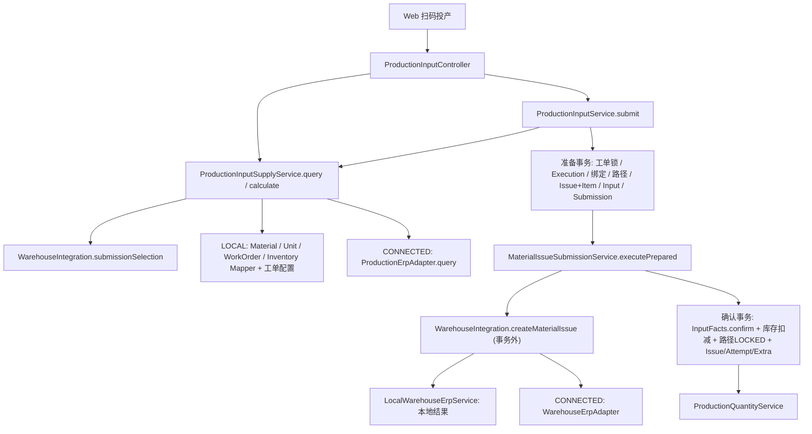
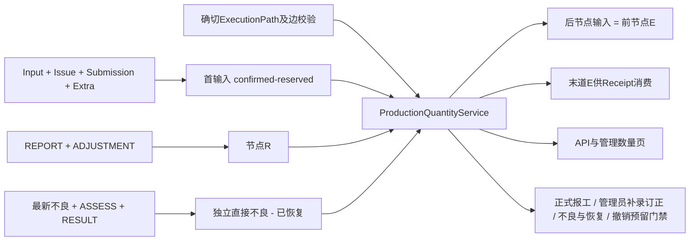
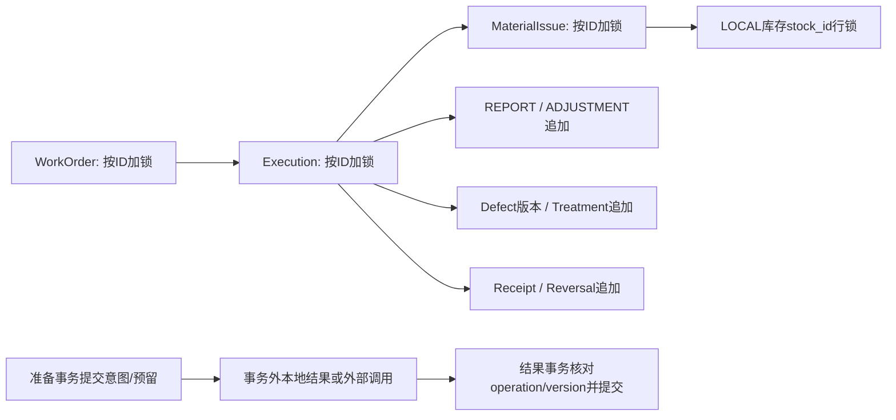

# Production Core Architecture & Business Audit V1

日期：2026-10-17。范围：Base MES 当前源码、指定数据库、现有服务只读 GET 与 Web 只读观察。状态：第一轮审查完成，**未实施整改**。

**结论：现有核心可以作为单材料加工、报工和不良处置的基础，不能认定为完整无 ERP 生产闭环。当前指定环境的扫码查询已因 101 张已下达工单触发全局 100 张上限而失败；正向 Receipt 仍主动禁止，正式完工、成品库存入账未实现。局部核心 CONDITIONAL GO，当前无 ERP 全链上线 NO-GO。**

本报告独立阅读最新实现，不把此前专项的局部 GO 合并为全系统 GO。文中的“推演”不是本轮写入复现；历史测试不是本轮重新运行结果。

## A. 审查基线、版本和证据等级

### A1. 版本与只读边界

| 仓库 | HEAD | 分支 | 开始工作区 |
| --- | --- | --- | --- |
| mes-base | `6fbbeb668827992cb6803b2539265d85a290e5e8` | `main` | 干净 |
| mes-base-ui | `94167e0c25fd9cb4dfcac5ecef369f6e8b715546` | `main` | 6 个修改文件、3 个未跟踪项，含上一轮质量功能 |

分支经本轮开始及收尾 `git branch --show-current` / `git symbolic-ref` 核对均为main。前端既有修改：`src/api/production/productionReport.ts`、`src/api/quality/productionDefect.ts`、`src/components/business/production/ProductionReportManager.vue`、`src/views/quality/productionDefect/index.vue`、`tests/productionDefect.test.ts`、`tests/productionReport.test.ts`；未跟踪：`src/api/quality/qualityTreatment.ts`、`src/components/business/quality/`、`tests/qualityTreatment.test.ts`。这些内容纳入当前源码审查，但不归为本轮改动；不能凭 Git 状态确定具体并行 Agent 归属。

读取个人 Engineering 入口、项目两仓 AGENTS、后端/前端规范、知识治理规范及相关 ADR。本轮只新增本报告，不改业务代码、测试、配置、Schema、权限或业务数据；没有运行 Codegen、Maven、前端测试、Flyway、ERP 写操作或生产命令，没有启停服务、提交、推送、部署。Source Product 保持只读，当前 Base 能力判定不依赖旧产品类名或旧流程推断。

证据分级：**S**=本轮源码；**D**=本轮真实 DB SELECT/SHOW/EXPLAIN；**G**=本轮既有服务只读 GET；**U**=本轮 Web 只读观察；**H**=既有测试源码/日志及历史验收；**R**=静态风险推理。未运行的测试只给方案。

### A2. 数据库和运行快照

- 中心库只读核实：`SIMPLE_B → datasource 8 → 192.168.18.25:3306/mes_base_dev_business_simple_b`，工厂和数据源均 ENABLED，数据源 revision=2。连接同时核对了真实主机/端口/数据库和绑定，不仅核对库名。
- 本轮连接 `DATABASE()` 正确；中心 Flyway 最新 V33（production input navigation reuse），业务 `flyway_business_schema_history` 最新 V32（quality treatment facts），均 success=1。
- 表记录快照：Execution 92，MaterialIssue 85，投产事实 53，Report 152（REPORT 121 / ADJUSTMENT 31），不良版本 127，处置事件 54，Receipt 36，旧 production_batch 20。
- 工单 DRAFT 39 / RELEASED **101**；Execution READY 66 / RUNNING 26，没有 COMPLETED/CANCELLED。不能用零终态数量单独证明缺接口，缺接口结论另由源码确认。
- 4 条永久扫码绑定；未发现孤儿绑定、重复完整编码、孤儿非空 stock_id、同库存粒度重复行或当前负库存/可用量越界。
- 53 条投产事实均关联 CONFIRMED 单据；其中 9 条 `stock_applied=true`，44 条 LOCAL 事实 `stock_id=NULL`、`stock_applied=false`。这 44 条均属于 TEST 标识 Execution，是历史测试直接构造的投入依据，**不能宣称它们经过实际库存扣减**。生产 HTTP 路径与直接 SQL Fixture 必须分开。
- Report、Defect、Receipt、Treatment 的 UPDATE/DELETE 禁止触发器存在；Receipt 还有 Execution 删除保护。没有对触发器执行写入探针。
- 8081 有既有用户服务。本轮使用已有有效会话进行 GET，不重新登录、不扩权、不启动或停止该服务。

本轮 G：Execution181 数量 GET 200；处置 `75b159d0-6709-49dd-b558-f2ba15ee3dfe` GET 200（RECOVERED，恢复2，净不良0）；工单168执行摘要 GET 200（末节点报工100）；库存来源13对应有效材料/单位/仓库均 ENABLED、余额9400，供料 GET **400/BAD_REQUEST**，requestId=`7b6eb157-2f2b-49f6-8300-1611f1ecae54`。S+D 定位到全厂 RELEASED 数量101触发 `ProductionInputSupplyService:133`，不是库存不足。

### A3. 历史证据和过时文档

历史 `.local/quality-v13-20261016/` 的 verify-final.log 记录611总计/577通过/34环境跳过；mysql-regressions2.log 记录14项真实 MySQL相关回归通过；final-v13-tests.log 记录10项定向通过；ui-test-acceptance.log 为314项通过。均为 **H，非本轮重跑**。本轮不执行可能写入永久 TEST 事实的测试。

- `2026-10-14-production-chain-audit-review.md` 后段称首输入来自 targetQty、只支持 EXE、领料仅 READY：**文档已过时**，当前已由投产事实、MES1绑定及 RUNNING追加取代。
- ADR-004 早期“业务实体也带 FactoryId / Shared DESIGNED”由后续分库决定和现行 AGENTS 取代；ADR-005 早期第三 ERP 数据库由2026-10-09决定退出。不能按旧段落判定当前应恢复第三库或业务 factory_id。
- `docs/development/production-input.md` 关于配置式用料、100张上限仍与源码一致；但其历史验收通过**不代表当前101张工单下查询可用**。
- Quality V1.3 最近 GO 只覆盖单节点质量功能；Receipt 报告明确正向 NO-GO。两者并不等于完整生产闭环 GO。

### A4. 源码证据索引

以下行号对应本轮快照，后续代码变更后应重新定位。后文以 Q/I 等缩写引用。

| 编号 | 关键证据 |
| --- | --- |
| I | [ProductionInputService:133](/Users/user/work/lixin/mes-base/mes-business/src/main/java/dev/mesbase/business/production/service/ProductionInputService.java:133)：重放、计算复核、准备事务、绑定和确认 |
| S | [ProductionInputSupplyService:79](/Users/user/work/lixin/mes-base/mes-business/src/main/java/dev/mesbase/business/production/service/ProductionInputSupplyService.java:79)：LOCAL/CONNECTED、候选、配置、公式 |
| IF | [MaterialIssueInputFacts:52](/Users/user/work/lixin/mes-base/mes-business/src/main/java/dev/mesbase/business/issue/service/MaterialIssueInputFacts.java:52)：锁库存、扣料、反向恢复 |
| IS | [MaterialIssueSubmissionService:96](/Users/user/work/lixin/mes-base/mes-business/src/main/java/dev/mesbase/business/issue/service/MaterialIssueSubmissionService.java:96)：准备/外调/确认与核实 |
| IV | [MaterialIssueVoidService:84](/Users/user/work/lixin/mes-base/mes-business/src/main/java/dev/mesbase/business/issue/service/MaterialIssueVoidService.java:84)：撤销预留和同操作核实 |
| WI | [WarehouseIntegration:24](/Users/user/work/lixin/mes-base/mes-business/src/main/java/dev/mesbase/business/integration/warehouse/WarehouseIntegration.java:24)：模式、provider、binding、历史路由 |
| Q | [ProductionQuantityService:52](/Users/user/work/lixin/mes-base/mes-business/src/main/java/dev/mesbase/business/production/service/ProductionQuantityService.java:52)：唯一数量投影和写门禁 |
| QM | [ProductionQuantityMapper.xml:17](/Users/user/work/lixin/mes-base/mes-business/src/main/resources/dev/mesbase/business/production/dao/ProductionQuantityMapper.xml:17)：首输入及摘要查询 |
| R1 | [ProductionReportService:54](/Users/user/work/lixin/mes-base/mes-business/src/main/java/dev/mesbase/business/production/service/ProductionReportService.java:54)：管理员补录/订正/冲销 |
| R2 | [ProductionReportSubmitService:67](/Users/user/work/lixin/mes-base/mes-business/src/main/java/dev/mesbase/business/production/service/ProductionReportSubmitService.java:67)：正式候选/用户资格/UUID |
| D | [ProductionDefectService:103](/Users/user/work/lixin/mes-base/mes-business/src/main/java/dev/mesbase/business/quality/service/ProductionDefectService.java:103)：版本化申报/晚申报 |
| T | [QualityTreatmentService:100](/Users/user/work/lixin/mes-base/mes-business/src/main/java/dev/mesbase/business/quality/service/QualityTreatmentService.java:100)：归属、限额和返工事件 |
| RC | [ProductionReceiptService:60](/Users/user/work/lixin/mes-base/mes-business/src/main/java/dev/mesbase/business/production/service/ProductionReceiptService.java:60)：末道产出、硬门禁、冲销 |
| EP | [ExecutionPathService:98](/Users/user/work/lixin/mes-base/mes-business/src/main/java/dev/mesbase/business/production/service/ExecutionPathService.java:98)：选路、锁路、开工 |
| ER | [ProductionExecutionRules:90](/Users/user/work/lixin/mes-base/mes-business/src/main/java/dev/mesbase/business/production/service/ProductionExecutionRules.java:90)：身份/状态/删除保护 |
| L | [ProductionChainLocks:44](/Users/user/work/lixin/mes-base/mes-business/src/main/java/dev/mesbase/business/production/service/ProductionChainLocks.java:44)：父单/执行/领料锁 |
| ST | [WmInventoryServiceImpl:124](/Users/user/work/lixin/mes-base/mes-business/src/main/java/dev/mesbase/business/wm/service/impl/WmInventoryServiceImpl.java:124)：余额CRUD和同步 |
| SR | [StockReferenceRules:47](/Users/user/work/lixin/mes-base/mes-business/src/main/java/dev/mesbase/business/wm/service/StockReferenceRules.java:47)：库存字段校验 |
| SC | [ProductionScanCode:15](/Users/user/work/lixin/mes-base/mes-business/src/main/java/dev/mesbase/business/production/domain/ProductionScanCode.java:15)：规范码及旧码 |
| ID | [ProductionIdentityService:39](/Users/user/work/lixin/mes-base/mes-business/src/main/java/dev/mesbase/business/production/service/ProductionIdentityService.java:39)：生产身份解析 |
| WO | [WorkOrderService:95](/Users/user/work/lixin/mes-base/mes-business/src/main/java/dev/mesbase/business/production/service/WorkOrderService.java:95)：工单需求、默认工艺、计划分配 |
| DIR | [BusinessDirectoryService:179](/Users/user/work/lixin/mes-base/mes-business/src/main/java/dev/mesbase/business/directory/service/BusinessDirectoryService.java:179)：批量引用与跨库窗口 |
| UI-I | [productionInput/index.vue:26](/Users/user/work/lixin/mes-base-ui/src/views/production/productionInput/index.vue:26)：供料/计算/提交、原请求保留 |
| UI-R | [productionReporting/index.vue:31](/Users/user/work/lixin/mes-base-ui/src/views/production/productionReporting/index.vue:31)：正式报工、候选和提示 |
| UI-A | [ProductionReportManager.vue:53](/Users/user/work/lixin/mes-base-ui/src/components/business/production/ProductionReportManager.vue:53)：管理员写入和重试 |
| UI-T | [QualityTreatmentPanel.vue:30](/Users/user/work/lixin/mes-base-ui/src/components/business/quality/QualityTreatmentPanel.vue:30)：处置交互与请求身份 |

## B. 当前领域模型和职责矩阵

| 对象 / 表 | 实际权威 | 调用方、保护与边界 |
| --- | --- | --- |
| WorkOrder / workorder + workorder_erp_extra | 需求、计划产出、默认工艺版本及外部来源 | WO create/update/release；DRAFT→RELEASED，无正式关闭命令；默认工艺不是所有执行的实际工艺 |
| ProductionExecution / mes_production_execution | 永久执行主键、所属工单/产品、确切routing_id、计划targetQty、READY/RUNNING状态 | I首次创建、EP开工、普通CRUD受ER约束；targetQty可作为计划调整，不进入实际首输入 |
| mes_execution_path + mes_execution_path_node | 本Execution实际选路和版本 | 节点sequence_no来自受边校验的选择路径；不是RoutingNode.display_order猜前驱；SELECTED→LOCKED |
| mes_production_scan_identity | 规范三元码→Execution永久绑定 | SHA256规范码为主键；同业务库内原码核对，终态不释放；无公开重绑/删除入口 |
| MaterialIssue / item / submission / erp_extra | 领料意图、明细、原外部操作及确认/未知/撤销状态 | IS/IV及原CRUD规则；普通行政领料没有投产快照时不贡献产出额度 |
| mes_material_issue_input | 一次投产冻结的q、材料计算、来源、库存记录与确认状态 | I创建、IF确认/撤销；与上述状态联查解释贡献，不维护Execution累计额度字段 |
| wm_inventory | LOCAL材料当前库存余额 | IF扣减/恢复；**同时有通用CRUD/同步绝对量写入，存在治理缺口** |
| mes_production_report | 正常加工事实及不可变订正 | R1/R2唯一生产写入口，按节点SUM(quantity_delta)；不是合格品计数 |
| mes_production_defect | 申报版本、原始观察量及最新有效版本 | D CREATE/REVISE/VOID，旧版本不删除；发现位置不等于影响位置 |
| mes_quality_treatment | 归属及原节点处置/重复加工/恢复事实 | T四动作，按父事件限额；不写正常REPORT，不创建新Execution/DAG |
| mes_production_receipt | 车间交接净量及原交接的冲销 | RC只读/冲销可用，正向硬阻塞；不改wm_inventory或ERP |
| production_batch / batch_route_node历史 | 旧业务引用与历史阅读 | LegacyBatchHistoryQuery及WO引用保护；未发现生产Controller可写旧Batch/BatchRouteNode，不恢复为新数量源 |

逐项判定：WorkOrder保持需求主责；Execution唯一主键成立；计划与实际额度分离成立；生产服务路径的实际额度来自可信确认投产，而非targetQty。历史事实保护涵盖领料（含作废）、报工（含净零）、任何质量版本及锁路，Receipt还有DB删除触发器。扫码绑定在当前流程中总会伴随Issue创建，因此删除被Issue历史挡住；**ER没有直接单独检查scan binding**，未来增加其他绑定建立入口时必须补保护，不能把现状间接成立当成永久通用保证。

同码重复投产复用、换材料批次建立新Execution，均由I绑定路径实现。但当前“生产批次”仅是**产出品号+材料品号+原材料批次**的定义：同三元组、同工厂不能用于另一工单或另一次独立生产活动；不同仓库/库位也不改变该生产身份。原材料lot和独立生产活动并不天然等价，这是一项适用范围限制，见G/L，不得泛化成通用汽车零件全场景模型。

## C. 实际入口、Service、Port、Adapter、DAO调用图

没有独立的LocalSupplyAdapter：LOCAL查询与计算分支直接在S里；`ProductionSupply`是中立业务契约容器，**不是另一个执行Service**。ProductionErpAdapter只负责供料查询，WarehouseErpAdapter负责领料/查询/撤销，两者存在不同消费者和职责，不因有两个Port就认定重复Adapter。

| 路径 | 真实入口与依赖 |
| --- | --- |
| 工单 | WorkOrderController→WO→生成Mapper / WorkOrderExtraMapper；显式实时检查物料和已发布适用工艺 |
| 库存 / 工单候选 / 用料 | InputController三个GET→S→本地Mapper+配置，或ProductionErpAdapter→中立Context；`T*q/P`在S计算 |
| 正式领料 | Input POST→I准备→IS；手工Issue动作→IS同一准备/执行/确认；不存在两套Execution创建规则 |
| 出库结果确认 | WarehouseIntegration→本地无外部影响结果或厂商Adapter；IS.apply→IF及原状态事务；本地余额由IF改，不由LocalWarehouseErpService改 |
| 核实 | MaterialIssueErpController POST核实→MaterialIssueErpService：读快照→事务外query→写事务核对operation_version→IS.reconcileSubmission |
| 撤销 | VoidController→IV：共同链锁+预留→事务外cancel/query→核对同operation/version→IF恢复材料+VOIDED；GET状态查询本身不确认业务 |
| 正式报工 | ProductionReportingController→R2→Identity/Q/资格→EP.start→ReportMapper.insert |
| 管理员报工 | ProductionReportController→R1→共同锁/Q/原单余额→追加REPORT或ADJUSTMENT |
| 不良与返工 | DefectController→D；TreatmentController→T；两者→Q校验，Q又通过Quality Query读取投影 |
| 交接 | ReceiptController→RC→Identity/Q/ReceiptMapper；正向在quality release前中止，无库存/ERP调用 |

Controller承担协议/权限/白名单转换，未见库存/工单业务判断下沉到Controller；Mapper XML聚合数据而不编排外部步骤。Domain没有引用具体ERP供应商Adapter；Q无ERP查询；Report无外部库存依赖；LOCAL不调用外部ERP。没有真实生产ERP厂商实现（主代码只存在Local Warehouse实现；外部Vendor仅在测试）。

**真实耦合**：Q→EP/Quality Query→T，T又→Q/EP；`@Lazy`打破装配循环但没有消除职责环。Quality `ProductionDefectErpGateway.acknowledge(Entity)`只有一个无副作用LOCAL实现，是持久化Entity穿过名为ERP的确认边界，不是已经集成ERP质量业务。建议见L/M，不能把其LOCAL成功当真实ERP成功。

## D. LOCAL / ERP支持能力矩阵

| 能力 | LOCAL当前实现 | CONNECTED当前实现 | 结论 |
| --- | --- | --- | --- |
| 工单 | 本地创建、适用工艺、下达 | Supply Context返回本地workorderId及外部sourceReference，仍需本地订单存在/RELEASED | 不支持只有ERP单号而无本地映射的凭空投产 |
| 供料查询 | 本地库存精确记录、批次/库位、有效单位/仓库；工单配置匹配 | ProductionErpAdapter接口，无真实厂商 | LOCAL有实质查询；ERP是可实现契约，非真实联调 |
| 工厂/组织/中心/仓库 | 业务分库隔离；中心配置标签；允许仓库显式配置 | Adapter负责ERP owner、release、中心与仓库映射 | 没有通用组织筛选引擎；当前本地中心不是认证组织准入 |
| 用料计算 | 工单T/P，q驱动，6位HALF_UP，单位必须相同 | 相同公式消费ERP用料Context | 单材料，无隐含换算/额外损耗；多材料明确拒绝 |
| 正式材料消耗 | 有Input事实时本地库存扣减并确认额度 | WarehouseErpAdapter正式结果再本地确认 | 不是只返回LOCAL_SUCCESS；但通用手工领料无Input时不执行扣库 |
| UNKNOWN/撤销 | 原意图本地核实、同事务恢复一次 | 原操作/绑定查询，不重复外部创建或撤销 | 有协议；真实ERP未知恢复未验证 |
| 质量/报工 | 同一本地链路 | 仍是本地质量和报工；没有ERP质量实现 | 不因切CONNECTED自动获得ERP质检/返工 |
| Receipt / 完工 / 入库 | 正向阻塞 / 无正式完工 / 无成品入库业务 | 同样；未实现5901/5A00 | 不属于已交付双模式能力 |

唯一供料模式入口实际是`mes.integration.warehouse.factories.<FactoryId>.mode`；无全局mode兜底，缺配置/无唯一Adapter均明确失败。当前`application-dev.yml`只显式给SIMPLE_B LOCAL_ONLY，工单117的材料/中心/仓库/T仍硬置开发配置。并非工厂管理页面数据。

FactoryContext只固定厂；业务事务固定数据源/租约。Integration多次即时读Spring Environment，不把provider/binding/用料版本作为同一个请求快照；当前没有本轮看到的动态配置发布机制，通常由启动加载，不应声称已实现热切换一致性。未来加热更新必须冻结选择，不让查询A来源、准备B来源。这个热切换问题是**静态风险推理，非当前运行复现**。

历史撤销CONNECTED优先原binding匹配；历史业务状态核实要求当前CONNECTED且provider等于原provider。LOCAL历史在改成CONNECTED后也不能直接走原本地核实/撤销路径。它安全拒绝而非错误选新供应商，但切换供应商/模式后的历史恢复流程不完整（L-08）。

`LOCAL_ONLY`在当前契约准确表达“没有外部执行”，**不说明有没有本地库存副作用**。无需为改名破坏状态兼容，但UI应明确“本地领料扣料成功”与“仅本地管理登记”，不能只看Mode/Success决定库存已动。

## E. 数量权威及依赖图

### E1. 字段来源矩阵

| 字段 | 唯一事实来源/计算 | 非权威来源 |
| --- | --- | --- |
| plannedQty / targetQty | workorder计划 / Execution计划 | 不作为首节点实际报工上限 |
| confirmedInputQty | QM.inputBalance：Input确认+Issue状态+Submission SUCCEEDED+Extra来源/影响联合筛选 | 单据CONFIRMED字样、材料quantity、targetQty不能独立证明 |
| reservedInputQty | 同一可信集合中VOID_PENDING/VOID_UNKNOWN的output_qty | 外部撤销成功之前不得当成功作废 |
| productionInputQty | confirmed-reserved | 不维护Execution累计投产字段 |
| R / reportedQty | 路径节点Report+Adjustment的SUM(quantity_delta) | 返工processed/recovered不进入R |
| 原始不良观察量 | 最新非VOID申报量含OVERLAP/UNVERIFIED | 不等于已核实有效直接损失 |
| directDefectQty / recoveredQty | T：INDEPENDENT原申报总量 / 对应RESULT成功合计 | 待核实和重叠不算独立损失；失败不恢复 |
| D / netDefectQty | direct-recovered | 报废6+失败1不能被独立重复再扣一次 |
| H / E / A | Q统一计算，见下 | UI、Receipt、ERP不得另解释实际产出 |
| Receipt净量 | RECEIPT+REVERSAL SUM | 不等于库存入库、不改Q末道产出 |
| WorkOrder分配摘要 | Execution.targetQty SUM及差额 | 只叫执行目标合计/尚未分配/超额分配，不叫合格产出 |
| 执行列表lastNodeReportedQty | 末节点Report净SUM | UI明确“末节点累计报工”，不是当前有效产出 |

数量类型：生产Java计算使用BigDecimal，主要业务列DECIMAL(20,6)，命令限制最多14位整数/6位小数；SQL SUM使用数据库decimal聚合，HTTP明确转字符串，前端不以浮点数重算权威数量。用料只在除法处显式HALF_UP到6位；这不等于库存维护已具备非负/可用量不变量，后者见L-03。

### E2. 统一算法与全部入口

设第一节点I=productionInputQty，后续I=实际已选前节点E；D=reviewedDirect-recovered。

`H=max(0,R-I)`；`rawAvailable=I-R`；`A=max(0,rawAvailable)`；`rawOutput=R-D-H`；`E=max(0,rawOutput)`。

在R≤I时E=max(0,R-D)；历史R>I时E=max(0,I-D)，保留H和未钳制差额，不伪造负ADJUSTMENT。E≤R且E≤I，恢复不超过原分配/START/原不良，增加成功恢复不能超过未恢复损失；末道仍受自身R限制，不能因上游恢复让未加工的末道自动增加。

实际调用已逐一检查：

| 调用方 | Q入口与目的 |
| --- | --- |
| ReportController | getExecutionQuantities/getWorkorderQuantities读取；执行摘要是专用SQL，不把它冒充完整投影 |
| R2 | context读完整投影；submit→validateReportChange |
| R1 | supplement/adjust/void→validateReportChange；page→getNodeQuantity |
| D | 单条不良≤自身R；落库后validateDefectChange重新读累计归属投影 |
| T | 追加质量事件后validateDefectChange，不允许超恢复/破坏直接不良底线 |
| IV | VOID_PENDING先存→validateInputReduction；已有历史倒挂/未核实即拒绝，事务回滚 |
| I | 返回结果读取实际投产额度及首节点剩余 |
| RC | summary/receive只读末节点effectiveOutputQty；reverse只约束原Receipt余额 |

没有找到targetQty作为新正常报工实际上限的旁路。读取和写门禁使用同一calculate；写额外限制属于命令规则，不能要求“历史读允许倒挂”就放开新写。正常写后不能扩大任一节点H，正增量还要求本节点新R≤I；负订正不能让R<已核实direct、不低于原报工余额0。已核实不良的改量需要先按质量规则纠正，不能靠冲销加工事实抹去损失。

**数量解释权已经集中，但有两项限定**：QM.workorderQuantities与inputBalance重复了投产可信筛选条件，未来需同源治理；不良的“归属可信”仍是人工业务事实，不是Q自动证明的物理去重。UI-R的`defectQty`仍标为“有效不良”，而它现在是原始观察量，需修正展示契约（L-11）。

只读运行样本181：R=[100,100,100,100,100]，B direct10/recovered4，C direct2/recovered2；E=[100,94,94,94,94]，C/D/E的H=6。工单摘要R末=100与详情E末=94均属真实GET，区别可解释；当前WorkOrder列表没有用R末冒充合格产出。

## F. Quality传播、返工、归属门禁

### F1. 已实现且可沿用的规则

D在共同执行锁下创建新版本；REVISE/VOID追加事实，requestKey+fingerprint包含操作者。晚申报不因历史下游R>I被拒绝，但仍要求本条不良≤影响节点已报加工量，独立不良累计不能越过本节点R。未提供assessment时保持UNVERIFIED，不假造独立依据。处置只能引用本申报、本版本、原节点实际路径，SAME_NODE不是回到更早节点。

T：ASSESS只核实一次；ALLOCATE的报废+返工≤未分配不良；START累计≤对应分配的返工量；RESULT处理=成功+失败、累计≤对应START。报废/失败不可恢复；实际操作人取START可信账号，确认人取当前登录用户。UUID重放只返回原事实，不同payload/actor拒绝；不改Routing，不新增正常REPORT，不自动关闭Execution。

旧ROUTING_NODE/WAREHOUSE语义仍是登记去向，不是正式返工/库存动作。实际处置前须留痕订正为SAME_NODE。原始观察、核实独立、待核实、重复观察、已恢复分别保留。当前真实样本证明6报废/4恢复后的净损失6，并未出现重复REPORT+4；另一个样本182为处理4/成功3/失败1，D剩余可报13、末道仍60（D+历史H）。

### F2. 归属和连续生产的边界

- OVERLAP只支持“这整条观察都包含在同Execution一个已核实独立原申报中”，数量≤原申报，不再增加直接损失。它不证明物理实物唯一性，也不支持自动识别跨工序同一件。
- 部分重叠必须人工拆为明确独立/完整重复记录，或保持UNVERIFIED；没有实物标识时不能自动按差额分摊。这个V1.3限制合理，**不是缺少多节点返工的缺陷**。
- 任一节点有未核实申报时，Q将整个Execution.writable=false；R1所有补录/正负订正/冲销和R2新报工均冻结，而不仅受影响节点及其下游。领料减少也被冻结；原始不良仍可继续登记、核实/处置仍可做。Receipt正向本来就始终被独立质量放行门禁阻断。
- 因而“非相关上游也停报”“纠错负订正也停”是已实现的保守业务政策，并非算法偶然失败；当前页面文案只说禁止新增报工，未完整解释管理员负订正冻结。若需要连续流生产，须明确最小影响范围与审核时限，不可在前端绕过。
- R2.context未检查quantity.writable/boundary，满足资格且available>0的节点仍可标AVAILABLE；POST却拒绝。**候选提示与真实写门禁不一致是实现缺陷**，与保守政策是否保留是两件事。

### F3. 处置错误的恢复缺口

T.assertMutable在出现任一非ASSESS事件后拒绝原申报REVISE/VOID；处置表不可UPDATE/DELETE，没有分配撤销、START取消、RESULT更正/冲抵用例。误把10全分为报废、选错START、成功数量误录后，不能通过现有管理入口纠正。已核实ASSESS但未处置时可追加申报新版本，旧assessment随版本保留；被OVERLAP引用的源也冻结。

此保护避免擦除事实，但“不可变”不等于“不可纠错”。前者正确，后者是面向车间运行的明确恢复缺口；只能在下一轮设计追加纠正事实和投影门禁，禁止直接改表解除（L-05）。

## G. 扫码身份、领料、库存一致性

### G1. 身份与并发首次建立

MES1为三字段UTF-8→无padding base64url规范编码；重编码核对、大小写/前导零/Unicode原样保留。旧码严格两段`材料品号#批次`；EXE只接受正整数。绑定主键是规范码SHA256，完整编码二次核对避免不同码因碰撞合并。各厂独立业务库可使用相同码和相同本地主键。

I.prepare在工单锁下创建Execution、绑定、路径、领料、冻结输入及Submission。不同工单竞争同一三元组由绑定主键最终裁决，失败准备整笔回滚，读取胜出绑定后仅重试一次，再按所属工单拒绝，不保留失败方Execution。同一码同工单新UUID可追加；同UUID只返回原状态，不再调用外部创建。READY/RUNNING允许，既有routing_id及selectedNodeIds必须完全相同；追加不改targetQty、path、开始时间。终态拒绝且不释放绑定。

**模型限制**：同原材料lot可被不同产出产品的不同MES1身份使用，余额锁控制材料消耗；但同产出产品+同材料+同lot不能用于两个工单、两个独立生产批次。多仓同品号lot选不同stockReference，但仍复用同Execution。旧码若有多个产出绑定，ID.resolve明确AMBIGUOUS，不任取第一个。需要允许同三元组多生产活动时，应先确定独立生产身份，不能删除永久绑定或靠改原码规避。

### G2. 用料与冻结

用户填预计产出q，材料量=`HALF_UP(T*q/P,6)`。LOCAL T、允许仓库、中心来自配置；P来自本地工单，Material/Unit来自本库；无隐含单位换算、无额外损耗比例。CONNECTED消费中立Requirement，超过一种材料明确拒绝；不是取第一种材料。

UI计算后带calculationKey，正式提交再次供料查询/计算；关键订单、材料、来源记录、单位、中心和用料摘要变化会拒绝旧计算。prepare再锁工单，检查已下达、本地产出产品/计划与计算一致。calculation_json按本次完整冻结，确认/撤销读取原快照，不重新读取后来T/P算旧单。重启配置不会改写已确认事实。

存在现实缺口：配置不是可维护的MES工单BOM；新增工单要维护配置并重新加载服务。超过100张**全厂**已下达工单在匹配物料之前就失败。当前指定库已达到101，证据见A2；不能通过关闭/删除旧事实来替代修复查询。

### G3. 本地库存扣减与逆向

IF.confirm调用者处于IS确认事务且已持WorkOrder→Execution→Issue锁；对明确stock_id用同值UPDATE取得库存行锁，再读当前余额/身份/状态，确保材料、仓库、批次、库位、库存量/可用量均允许。一次事务同时扣两个余额、stock_applied=true、confirmed_at、锁路径、Issue CONFIRMED、Attempt SUCCEEDED及Extra。库存不足回滚确认，不增加投产额度；准备意图已单独提交，可能保持SUBMITTING，需要原操作核实/处理，不应重新创建一笔解释为原单成功。

IF.voidConfirmed只在stock_applied=true时加回冻结issueQty，并改false；确认/撤销串行，不会同单重复扣或重复恢复。撤销前I额度预留已生效；本地事务失败时余额与额度状态一同回滚。对于相同库存行的两个正式投产，这个行锁可阻止读旧余额后超扣。

但ST通用库存CRUD/同步是另一路**绝对余额写入**：没有共享余额版本、不可变库存动作、投产引用冻结或删除保护；DTO只有Digits没有非负/available≤quantity校验，SR只校验状态、非空和主数据存在。后果推演：

1. 管理员开着旧库存表单，投产先扣20，旧绝对余额随后保存，可把20补回而没有逆向事实；库存行UPDATE锁只能串行SQL，不能识别旧表单。
2. 已使用库存行可删除/换material/lot/warehouse，后续撤销无法恢复；只改bin时恢复函数未核对bin，可能在另一个库位加回。
3. 直接新增负数量或available>quantity在当前服务校验未被拒绝；本轮DB未发现这种存量，且未执行写入复现。

这是ST与正式本地扣料的权威治理风险，不是IF自身缺行锁；应统一治理所有余额入口，而非只给IF再加锁（L-03）。

## H. 事务、锁、幂等、UNKNOWN及异常恢复

- L.issues先收集源/目标Order和Execution，分别distinct+排序，再锁Issue；看起来“先lockIssues再execution”不能误判锁反转，因为lockIssues内部已先父后子。IV.lock额外锁父单属于重复获取已有父锁。
- 同WorkOrder多Execution共用父锁，能保护身份/关联，但会串行化独立执行的报工、返工和Receipt；这是吞吐风险，不是已测性能瓶颈。禁止仅凭Service长或锁多宣称不能上线。
- ST库存维护另持Material→Warehouse→Inventory，不参与统一生产余额版本；主锁图并不覆盖所有库存维护者。批量Execution删除也不是统一跨工单排序的批量锁入口，可能有多行顺序死锁，尚未复现；数据库回滚不等于重复事实。
- 准备/确认使用READ_COMMITTED；外部创建/取消/query在准备事务之外，不持生产DB锁等待HTTP。DataSource租约与Factory固定，不把本地事务说成ERP原子事务。
- PENDING实际有SUBMITTING/SUBMIT_UNKNOWN、VOID_PENDING/VOID_UNKNOWN，不另造同名状态。崩溃/未知保留Submission或VoidOperation UUID和原binding，核实原操作，版本比较拒绝迟到结果；外部NOT_FOUND/仍处理中不能擅自当拒绝或重发。未知投产没有确认额度；未知撤销保留待减预留。
- 提交结果和确认事务之间失败：已有意图保留，可用受权核实入口继续；当前没有自动恢复任务/操作SLA。本地库存不足等确定性确认失败可能仍表现SUBMITTING，UI需要跳转领料核实，而非无限重试投产按钮。

| 命令 | 请求身份/串行与保证 | 缺口 |
| --- | --- | --- |
| 扫码投产 | Input UUID主键+payload hash；绑定PK；共同父锁 | 结果保留原状态，重放不会自动核实；无确认结果时UI仅保留请求、缺直达核实入口 |
| 领料提交/作废 | 原Submission / VoidOperation及Extra operation_version | 保留UNKNOWN；模式/provider迁移历史恢复仍受当前配置限制 |
| 正式报工V2 | requestId唯一查询、可信actor、执行锁后再查、payload核对 | 可重放；纯扫码定位/切换时仍可能丢内存pending，需先查原结果 |
| 管理员补录/订正V1 | 执行锁、原Report余额、Q校验 | **没有请求UUID**；响应丢失重试仍可追加第二次补录/正负订正；整笔冲销在原余额0后拒绝，不能用它证明所有V1幂等 |
| Defect版本 | requestKey唯一+actor/fingerprint，执行锁 | 后续版本不能擦除已有处置，纠错需另设计 |
| Treatment | UUID主键+actor/hash/parent budget，执行锁 | 不会重复恢复；没有取消/纠正事实 |
| Receipt/冲销 | UUID主键+actor/payload，执行锁+原余额 | 正向不可达；冲销幂等不代表新正向交接可用 |

### H1. 证据覆盖边界

**已有H-MySQL**：ProductionInputMySqlTest一项覆盖真实扣库存、累计投产300、重放、RUNNING追加、永久绑定；ProductionReportMySqlTest两项含回滚/并发额度/不可变；ProductionQualityV13MySqlTest一项含全100/部分100-80-60、同结果并发、失败部分和触发器；Receipt一项含冲销并发、原量保持/差额、质量正向拒绝。历史14项组合实际通过，不能据此宣称每个新发现都已测。

**H-H2/Mock**：同码不同工单、外部UNKNOWN/迟到核实、双业务库相同ID及归属、权限负例、前端切厂/撤权/迟到返回等有受控测试。当前ProductionErpAdapter没有真实厂商实现，不能声称CONNECTED库存、组织映射或HTTP幂等已经真实验证。

**本轮未运行/未确认**：真实多厂相同扫码并发写、两个不同WorkOrder争码的真实MySQL压力、不同Execution共同耗尽同库存的真实MySQL压力、库存CRUD与IF交叉竞争、管理员响应丢失重试、5000事件边界、真实ERP未知、真实撤权/丢包。本轮没有制造新数据来补这些证据。

## I. 多工厂、权限和信息安全

- `FoundationAccessInterceptor:78–102`校验显式X-Factory-Id、有效选厂/快照一致性及当前权限；请求头不是授权。PLATFORM业务权限与当前Factory角色业务权限按现行规则合并，无硬编码admin超级放行。
- `FactoryBusinessDataSource:30–83`在事务begin取得并固定binding/lease，verify检查Factory/租约，suspend/resume恢复原厂，end释放。`PersistenceConfiguration`只装配中心/业务两个SessionFactory及事务管理器，Mapper包归属固定；本轮未发现第三ERP数据源或业务库回退中心库。
- 指定业务库`factory_id`列计数0，按物理库路由而非行过滤；不能因业务SQL不带factory_id就报告跨厂漏洞。相同ExecutionId在不同厂是不同本地资源，GET只在当前库查。
- 角色148现为FACTORY/SIMPLE_B，仅用户100持有，含质量read/create/revise；本轮只读核对，没有新增或撤销授权。普通正式报工资格=有效业务权限+当前sys_user工序能力+存在派工时必须本人被派工；没有独立Personnel主数据。管理员历史订正资格与工人工序能力不是同一种权限。
- Receipt权限只控制入口，不替代质量放行；QualityIntegrated=true不是放行事实。带read但无revise不能确认返工，后端POST有独立权限。
- 业务引用名称统一Directory批量补齐。DIR普通中心查询走注入Mapper；业务事务内中心身份读取才使用受控独立只读窗口，并保留前后guard。没有因本轮审查建议把这种真实跨库边界换成裸中心事务。
- BusinessCacheProcessor前缀含编码Factory+resource；Directory单对象复用detail key和Entity，批量未命中IN读取，写后提交失效、事务写不发布未提交对象；中心用户仅安全字段，不缓存角色/密码/资格。没有发现生产名称缓存跨厂回退；具体Redis故障/提交后淘汰只引用历史测试，本轮没写Redis做新验证。
- 本轮未见业务Controller记录密码、Token、完整请求体。外部异常链LOG.warn仍可能包含未来厂商异常文本，接入适配器时必须落实URL/凭证脱敏；当前没有真实厂商，不能宣称已泄漏或已验证脱敏。

多工厂证据等级：S装配+当前真实绑定D、历史双H2同ID测试；此前真实单厂HTTP权限负例H。**本轮没有对第二个真实业务库做写入隔离验证，也没有重新改权限制造撤权。**

## J. Web实际生产操作路径

当前路由职责基本合理：`/production/workorder`需求/下达/默认路线；`/production/mesProductionExecution`派工/实际路径/开工；`/production/productionInput`扫码投产；`/production/productionReporting`员工报工；`/production/productionReport`管理员数量管理；`/quality/productionDefect`质量申报/处置；`/production/productionReceipt`交接查询/冲销和被阻止的正向入口。

按现场顺序：维护材料/单位、仓库/批次余额→维护工单与适用工艺→下达→**离开页面修改工单用料配置并重载**→扫码选择库存/工单/预计产出→计算→选路径并投产（或复用锁路）→开工/正式报工→质量申报/核实/处置→看末道产出→交接处遇质量未放行停止。不是只点击两个页面就能独立完成建单到入库。

良好行为：主子领料使用MasterDetailDocument；Material/Execution/用户等选择器和名称回显；数量用字符串避免JS精度损失；按Factory/revision失效请求；投产/正式报工/返工UNKNOWN保留UUID；Receipt明示“尚未执行库存入账”；只读路线图不修改路径。

需优化的实际体验：

1. 当前扫码无候选不是普通空态，而是101张全厂RELEASED触发400，页面只显示通用错误，用户不知道如何解决。
2. 新工单没有用料维护入口；“独立MES”提示容易超过可操作能力。
3. 质量待核实对整Execution停报，员工候选仍AVAILABLE，点提交才失败；UI-R还把原始defectQty标“有效不良”，返工后数字与净损失不一致。
4. 投产固定原请求后无直接跳转到领料Submission/核实；UI-I对明确4xx也一直保留pending，缺少“原请求未建立/已确定拒绝”的安全修正通道，只能离页重来。
5. 管理员数量弹窗重试没有幂等key，见L-04；页面loading不是跨重试的幂等保证。
6. 质量列表首列长期UUID，右侧固定操作宽290；窄工作区业务节点/原因需横向滚动才看见。详情/历史与处置/返工打开同一弹窗，是两个相同入口；属P2可发现性/密度优化，不构成业务错误。

本轮U：现有质量页恢复原登录态后正常显示61条最新申报，含上一轮两件返工样本、具名工序及处置按钮；仅观察/读取，没有点保存、修改Factory或权限。原先暂时503的恢复错误并非本轮制造或重启服务。其他页面主要按当前源码穿透，历史四宽截图为H，**本轮没有重做所有角色/宽度/表单业务验收**。

### J1. 无ERP单材料工厂18步与五级证据

表中API/UI“有”指当前源码入口，不等于本轮成功新建；LIVE写明本轮D/G、历史H或未验证。BUSINESS评估受已列缺口约束。

| 步骤 | 能力状态 | SCHEMA | API | UI | BUSINESS | LIVE证据/限制 |
| --- | --- | --- | --- | --- | --- | --- |
| 1 物料与单位 | IMPLEMENTED | 有 | 有 | 有 | 有引用/启用规则 | D已有主数据；本轮未创建 |
| 2 仓库/批次库存 | PARTIAL | 有 | 有 | 有 | CRUD及查询有；余额权威缺口 | D库存13=9400；无新入账验证 |
| 3 工单及用料 | PARTIAL | 工单有、用料仅快照 | 工单有、维护用料无 | 工单有、用料无 | 配置式T/P | D工单；配置117 S；当前查询400 |
| 4 发布工单 | IMPLEMENTED | 有状态/版本 | 有 | 有 | 适用已发布工艺校验 | D101已下达；本轮未下达 |
| 5 扫材料批次 | BLOCKED | 有批次 | 有GET | 有 | 查询已实现但全局上限阻塞 | G有效库存供料400 |
| 6 选工单 | BLOCKED | 有 | 候选GET有 | 有 | 配置/仓库匹配 | 同上；不能因库存查询先返回成功宣称可选 |
| 7 输入预计产出 | IMPLEMENTED | Input.output_qty | 有 | 有 | 正数/6位限制 | H真实链路；本轮不写 |
| 8 自动算料 | PARTIAL | calculation_json | 有 | 有 | 单材料T*q/P；配置限制 | H单材料测试；当前候选阻塞 |
| 9 正式扣本地料 | PARTIAL | 有 | 有 | 有 | IF原子扣料；ST旁路风险 | D9条stock_applied；H真实MySQL |
| 10 建立/复用Execution | IMPLEMENTED | 永久绑定PK | 有 | 有 | 仅三元组生产身份 | D4绑定无孤儿；H并发/重放 |
| 11 选路并锁路 | IMPLEMENTED | Path/Nodes | 有 | 有 | 确切版本/边/修订保护 | D+G样本LOCKED；H锁路写验证 |
| 12 READY/RUNNING | IMPLEMENTED | 有 | start有 | 有 | 领料确认+锁路+已下达 | D READY66/RUNNING26 |
| 13 多次投产/报工 | PARTIAL | 有 | 有 | 有 | 额度与V2幂等；当前投产阻塞/V1缺幂等 | H实际累计300/库存9400；本轮仅读 |
| 14 不良/单节点返工 | PARTIAL | 不可变事实 | 有 | 有 | 数学成立；待核实/错误恢复有运行缺口 | G恢复2；D历史事件，U列表 |
| 15 末道有效产出 | IMPLEMENTED | 从事实派生 | 有 | 有 | Q唯一实际解释 | G Execution181末道94，R末100 |
| 16 正向生产交接 | BLOCKED | 有 | receive有但必拒 | 有但禁止 | 缺放行事实；查询/冲销有 | D36历史事实不证明正向成功；H冲销 |
| 17 正式完工 | NOT_IMPLEMENTED | 枚举/字段有 | 无正式命令 | 无正式动作 | 缺完成条件与终态用例 | D无终态；S确认非仅据枚举 |
| 18 成品本地入账 | NOT_IMPLEMENTED | 有通用余额表 | 无生产入库命令 | 无生产入库闭环 | Receipt明确不入账 | 未实现；不把手改库存当生产入库 |

本轮未以完整ERP、质检放行、多材料装配尚未规划实现为由评P0；这些是完整闭环能力边界，需要单独排期。

## K. 16个业务边界场景推演

以下未新执行写入，除标G/D的读取外均为S推演；H只表示已有测试/日志覆盖。必须处理列区分“当前缺陷”与“未来准入”。

| 场景 | 预期 | 当前实现与证据 | 缺口/风险 | 必须处理与否 |
| --- | --- | --- | --- | --- |
| 1 同码首次并发领料 | 唯一Execution、合法两次投产各扣一次或同UUID一次 | I:145–151/173–197，绑定PK竞争回滚再查；H输入重放/绑定测试 | 真正跨父工单MySQL竞争未在本轮写测 | 上线前补定向并发证据，不先改绑定算法 |
| 2 同码不同工单 | 不悄悄重绑 | I:192–193拒绝，失败事务无孤儿；D绑定无孤儿 | 同三元组跨工单复用材料生产活动无法表达 | 保留拒绝；仅业务确认新身份模型后扩展 |
| 3 RUNNING追加 | 增额度不改路径/版本/target | I:194–197 + IS:143，IF确认后贡献；H真实MySQL累计300 | 当前S全厂101导致到不了准备 | 当前必须修L-01；不改锁路规则 |
| 4 本地库存不足 | 不负扣、不增额度 | S计算先查，IF:65–81行锁后再查；失败确认事务回滚 | 已准备SUBMITTING留下，缺直达核实/明确处理指引 | 扣料保护保留，恢复UX应补 |
| 5 一次ERP UNKNOWN | 不贡献不确定额度、原身份保留 | IS:224–227；QM只取SUCCEEDED；原操作query | 无真实ERP；当前provider切换可能阻断历史核实 | 真实集成准入必须补；不自动转LOCAL |
| 6 已报工后撤销额度 | 外部动作前先保护可用量 | IV:107–114持执行锁保存预留再验算；不可容纳原R即回滚 | 有历史H时即使不扩大也保守拒绝 | 按现政策正确；调整政策需用户确认 |
| 7 后续报满、上游晚报不良 | 原R保留、H可解释、不自动负订正 | D→Q；D/G181原R100、末E94，H6 | UNVERIFIED整执行停报；非写错历史 | 数学无需重写，门禁范围见L-06 |
| 8 B10、废6、返工成4 | 末E90→94，无REPORT+4 | T父预算+Q；H全100，D/G目前B净6、末94 | 错分配/错结果不能纠正 | 算法可沿用，必须补L-05 |
| 9 B/C重叠不良 | 不重复扣同一批实物 | T完整OVERLAP关联原独立申报，UNKNOWN保持待核实；H HTTP测试 | 部分重叠无自动分摊/实体追踪 | 现边界可保留，必须提示不能自动证明 |
| 10 同请求并发恢复 | 最多追加一次，恢复不超START | T:198–215/260–268，PK+执行锁+父预算；H MySQL并发，H真实HTTP重放 | 本轮没再写测 | 当前无新增缺陷证据 |
| 11 末道小于已交接 | 保留历史、不自动冲销/入库 | RC.summary output-net及excess；D181Receipt98/G末E94 | 正向本来被质量放行阻止 | 当前差额正确；不得自动改旧Receipt |
| 12 切厂同码 | 各业务库独立身份与事实 | 路由固定+本地PK；H双H2同ID，D各厂绑定 | 真实双库同码写未验证 | 上线环境验收必补，不判已跨厂泄漏 |
| 13 不同厂不同来源 | 显式每厂配置、无默认混用 | WI:24–63按Factory读；Production/Warehouse双Adapter选择 | 仅SIMPLE_B实际配置LOCAL；模式变化非快照 | 缺Adapter必须拒绝；热更/迁移另设计 |
| 14 多Execution同工单并发 | 数量各自正确、共享父规则安全 | L先WorkOrder后Execution，Q按execution汇总 | 父锁串行吞吐，未有实测TPS；执行锁足够并不意味着父锁可立即删 | P2量测后优化 |
| 15 扣库存后事务回滚 | 库存、confirmed_at、额度与确认状态一起回滚 | IS:116–127/201–229 + IF 同business事务；H输入/报工MySQL测试 | 外部已成功不能回滚，但保留SUBMITTING可核实；ST并发绝对写另算 | 当前本地事务设计正确；ST风险必须改 |
| 16 第二ERP厂商 | 同Execution/Q/Report规则，无第二套生产模型 | ProductionSupply+ProductionErpAdapter+WarehouseErpAdapter两能力边界 | 本地ID映射/历史provider迁移/真实幂等尚需设计证明 | 见O，不复制旧Batch或改Quantity公式 |

## L. 问题清单：P0 / P1 / P2

### 分级说明

本轮**没有确认到跨厂写入、自动改写不可变事实或第二套实际产出算法的P0事故/缺陷**。库存和重试问题有明确可达代码风险，但没有违反只读边界执行破坏性复现，按P1记录；不能把“没写测”说成风险不存在。未规划完整ERP/多材料/多节点返工不列P0。

### P1：上线前必须处理或明确接受的缺口

| ID | 问题与证据 | 触发、后果和证据等级 | 建议位置与影响面 |
| --- | --- | --- | --- |
| L-01 | **全厂已下达超过100即停止所有本地扫码**。S:128–134 | D已101；有效stock13的G返回400。匹配材料前按全厂RELEASED count fail，新增无关工单也使旧合法材料不可查；无关闭工单命令导致数量长期增长。**本轮运行复现**，样本含TEST，不冒充真实生产压力 | S.local查询改为按有效用料关联筛选并受控分页；InputController/API/UI候选分页与可解释超限；相关输入测试。不得删工单解锁 |
| L-02 | **本地用料只能逐工单配置，没有MES维护入口**。S:147–164、application-dev.yml:64–67 | 新工单不改配置不进入候选；需重载服务；非技术人员无法闭环。S确定，非ERP供应商未实现的问题 | 工单用料维护业务/API/UI与明确生效版本；保留现有Input快照；相应正式迁移/生成另立实施，不把BOM塞入配置或为本审查建表 |
| L-03 | **库存余额CRUD/同步绕过生产消耗治理**。ST:147–180/253–280、SR:47–57，IF:65–103 | 旧表单覆盖扣料余额；已用库存删除/换身份后无法原路撤销；负值/available越界缺业务校验。S确定入口，R为交叉运行时序；D当前无坏行，**未写入复现** | ST及同步统一版本/受控余额动作、身份/删除保护、数量不变量；IF恢复核对同库位；库存API/UI及冲销/回滚/竞态测试。不能只改IF |
| L-04 | **管理员补录/数量订正缺少请求幂等**。R1:54–108/120–123，UI-A:62–68 | 事务已提交但响应丢失，用户重试相同补录或±订正，余额尚允许就再追加。共同执行锁只防超限，不防重复意图。**静态风险推理** | Report V1命令/HTTP/UI提供稳定请求身份及payload/actor核对，复用既有事实边界；迁移及老接口兼容另审；不删除历史ADJUSTMENT |
| L-05 | **返工事实录错后没有受控更正**。T:168–177/223–269及不可变表 | ALLOCATE/START/RESULT一旦误写，原申报REVISE/VOID也被冻结；报废误分等永久影响E。S业务恢复缺口，未制造错误事实 | 在Quality现有边界设计追加纠正/取消用例和原事件剩余额，统一Q解释与审计；Controller/UI管理入口、并发与传播回归。不得直接UPDATE历史或扩成多节点引擎 |
| L-06 | **未核实门禁过粗，尚不适合无人值守连续生产**。Q:125–138/184–193 | 任一未知申报冻结全Execution及管理员负订正，包括其上游/不相关节点。S已实现保守政策，**不是越权漏洞或数学错误**；全员依赖质量管理员及时核实 | 先确认工厂质量政策、最小影响范围与纠错允许项，再调整Q命令门禁、候选原因及UI；保持未知不自动独立，不改已确认守恒公式 |
| L-07 | **无ERP完整闭环仍缺放行、完工、生产入库**。RC:98–118、ER:90–105、ExecutionActionController、WorkOrderStatus | 正向Receive必抛RECEIPT_QUALITY_UNVERIFIED；没有正式Complete/成品入账命令。S确定；D历史Receipt不能证明正向可用。这是上线能力缺口，非要求本轮顺手增加功能 | 三项分别明确业务准入/交接与库存单据边界后排期；保持Receipt不可变、不自动放行、不以库存CRUD冒充入库；不修改本轮代码 |
| L-08 | **来源模式/供应商切换后历史操作缺恢复路线**。WI:33–47/73–90 | 原CONNECTED核实要求当前provider相同，原LOCAL遇新CONNECTED也被拒绝；安全关闭但旧UNKNOWN/撤销可能无法业务处理。S确定、R切配置场景，本轮未改配置复现；ADR-007已承认V1限制 | 以原provider/binding/operation保留历史处理资格和显式迁移政策；WI/原核实服务/适配器注册配置及测试。不能用新provider或LOCAL_SUCCESS兜底 |

“生产批次身份维度”另作为**业务适配前置限制**：当前永久三元组禁止同品号lot为同产品跨工单或同工单新开独立生产活动。这与当前已实施V1约定一致，不判实现bug；若现场需要该行为，则不满足上线准入，必须先定独立生产身份，见G1。

### P2：正确性提示、维护和容量

| ID | 问题 | 证据、影响与建议 |
| --- | --- | --- |
| L-09 | 正式报工候选忽略全局质量writable | R2:72–85对available和资格给AVAILABLE，却不看Q.boundary；UI-R允许选，提交才拒绝。S确定、没有合适当前UNVERIFIED样本做新写复现。让候选和提交共用门禁结论/原因，无需新规则引擎 |
| L-10 | 质量读投影与写服务双向耦合 | Q→Quality Query→T→Q/EP；T构造器用@Lazy。SOURCE确定；改变数量来源会触及写服务/测试装配。将无副作用质量投影从写入编排中分清，保持既有Mapper和业务规则；不机械增加Facade |
| L-11 | 原始观察量、净损失与模式文案未完全收敛 | UI-R:90仍把defectQty标“有效不良”；完整重复/已恢复情况下误导。Quality列表UUID+固定操作占宽；通用Issue无Input时LOCAL成功不扣料（IF:55）。明确原始观察/净不良、当前门禁原因、生产投产与行政登记，不重造数量模型 |
| L-12 | 增长预算会把历史数量查询整体拒绝，且部分预算未对齐 | T:100–115最多5000事件/1000条最新申报（VOID在取回后才过滤）；details批量userLabels最多200个不同用户，事件预算允许更多。S静态边界；无大规模现场复现。按当前申报/当前版本有界聚合，历史分页，批量目录分块；保留明确上限不静默截断 |
| L-13 | 同父单串行与输入汇总重复谓词 | L父锁、QM两处可信贡献SQL；D小表EXPLAIN只证明现状。真实吞吐未量测，库存索引前缀中warehouse居中，不带仓库的批次查询主要先按material筛选。量测后优化查询/索引和锁，不仅凭文件长度拆Service |
| L-14 | 规划派工关系未纳入Execution删除/换工艺生命周期 | ER:90–127只保护领料、报工、质量及路径；MesProductionExecutionServiceImpl:148–158删除Execution，没有处理assignment。OperatorQualificationRules:71–80允许给确切routing内节点派工，不要求先有锁路。因此无生产事实的READY执行可先派工再删除/换工艺，留下孤儿或旧版派工。S可达关系缺口，R静态推演；D当前孤儿数0，未写入复现。ER与Assignment业务统一阻止或事务内清理可变规划关系，不能删除不可变生产事实 |

SQL安全/性能：当前读见参数化条件和受控排序；WO默认数据库`id DESC`，显式接口没有用户排序参数，因此不存在用户排序被默认覆盖的问题。D EXPLAIN工单用PRIMARY backward scan（估计140行），库存用复合索引material前缀（估计4行）；**不据此声称十万行或高并发性能已达标**。名称普遍批量IN；领料每次最多100明细`lines.forEach(rules::validate)`仍会逐条做引用检查，是有上限的数据库I/O，后续性能量测可批量校验，不能宣称全链无N+1。

## M. 建议整改顺序、文件范围与停止点

本节仅建议，未执行；没有新Facade/Strategy/Schema或权限变更。

1. **收敛本地供料与候选查询**：S、InputController、ProductionSupply契约、productionInput API/页面、工单用料维护入口，以及对应正式迁移/生成配置/测试。先解决L-01，再把L-02放到可维护的明确业务数据中；每次投产继续保存不可变计算依据，不重算历史。查询按材料/工单及允许仓库过滤、分页；普通本地工单不能要求改配置重启。
2. **治理库存所有写入口**：ST、SR、IF、库存CRUD/同步API、库存页面及关联业务测试。使初始库存、受控调整、扣料/反向恢复有可解释审计和版本，已被引用的来源身份不能删除或偷换；所有入口都检查非负、可用≤实存。复现旧表单/扣料竞争后才选择具体方案，不预建完整WMS。
3. **补齐事实安全重试和纠错**：优先R1命令/Controller/UI-A的幂等；T及Quality页面追加受控纠错；IS/IV恢复状态可发现，Q和R2/UI-R一致解释门禁。分成有独立验收的小任务，保持REPORT/Quality/Receipt原事实不变，不把“失败重试”或“取消返工”实现成删行。

L-06属于业务政策确认，不能由审查Agent自行缩小质量门禁；L-07是完整闭环的新业务前置，需单独设计放行、完工及入库；L-08在新增供应商/切模式前处理。允许继续只用已实现查询、加工和已审查质量能力，不代表可接收新ERP厂商生产写或开放Receipt。

### 下一轮可执行验收方案（本轮未运行）

- 用已配置SIMPLE_B，先核实绑定和受影响范围备份，再通过正式业务入口建立独立TEST样本；不清理已有事实、不改用户角色。任何迁移仍走正式Flyway。
- 100/101/大规模无关工单与少量物料适用工单，分页覆盖、无漏候选、无无关全厂失败；工单用料修改前后旧领料快照不变。
- 两个不同Execution争最后库存、库存编辑/同步与扣料竞争、用过的stock删除/改身份、LOCAL确认/撤销提交失败回滚、bin不同恢复，明确断言余额与贡献。
- Report V1丢失响应+同UUID重试、不同payload重用、并发正负订正；保留净量及不可变原事实。
- Quality错分配/错START/错RESULT的追加纠正，B10/废6/恢复4、部分恢复3失败1、重叠/未知、下游80/60和Receipt98差额，不能靠修改旧事实使样本通过。
- 正式报工候选对质量冻结返回与POST相同原因；Factory切换/撤权/迟到响应；两个真实业务库同码同UUID分别隔离。ERP接入另用无外部副作用的合同替身先测，真实ERP写须专门授权。
- 允许写测试后再做定向/全量Maven和UI测试/构建；当前只读审查不能把“计划运行”列为通过。

## N. 无ERP独立生产的真实结论

**有实质独立MES能力，但不是完整工厂闭环。** 本地存在材料/单位/仓库/批次余额/工单、正式单材料扣料、唯一执行/锁路、多次投产、正常报工、不良晚报、原节点返工及末道有效产出。不是只有LOCAL_SUCCESS壳子，IF有真实余额UPDATE及同事务贡献确认，既有MySQL测试和D余额也可交叉验证。

**现有边界最多到加工报工、质量处置及末道产出解释。** 本地用料尚需配置，当前101张已下达工单又使新扫码供料失败；生产交接查询/冲销可用但新正向必被质量放行阻止；没有正式完工或成品入库。质量处置错误无业务纠正口、库存维护可覆盖消耗、管理员重试无幂等，均影响可交付性。不能把通用库存CRUD手工加数量当生产入库，不能用36条历史Receipt或COMPLETED枚举证明全链可跑通。

## O. 新增ERP厂商的预期修改面

在**不改变当前单材料用例、已有本地对象映射完整**的条件下，目标修改面是：

| 部分 | 应做内容 | 对生产核心的影响 |
| --- | --- | --- |
| ProductionErpAdapter实现 | 库存/批次及ERP工单用料查询，严格owner/中心/仓库/release准入，输出中立Context | 不复制I/Execution/Q |
| WarehouseErpAdapter实现 | 正式领料、按操作键核实、取消/核实取消；明确成功/拒绝/未知 | IS/IV继续复用 |
| 厂商Gateway/DTO | HTTP认证、超时、厂商业务响应与幂等映射、安全日志 | 厂商DTO不进入MES核心，Gateway不访问MES Mapper |
| 映射及装配 | 真实ERP物料/单位/仓库/工单↔本地主键、provider/binding及Factory配置，旧provider保留 | 不能由Adapter悄悄创建Execution或新批次模型 |
| 测试/运维 | 合同、UNKNOWN、旧绑定、回滚窗口、并发、日志和可恢复性 | 增加厂商测试，不改守恒算法 |

若这些条件满足，**期望Execution/ExecutionPath/Quantity/Report正常业务规则修改数为0**；两种能力可以由两个类或一个清晰的厂商模块实现，类数量不是验收目标。不能承诺当前拿到一个ERP地址就零改动接入：生产主代码无真实厂商、稳定的本地ID映射查询/导入能力未完整落地，ProductionSupply.Order本来就要求本地workorderId。映射须复用已有业务查询/Extra并建立必要最小用例，不能让传输Adapter直查MES库绕过业务边界。

如需保留旧供应商历史核实且新厂商已切换，WI.query当前provider一致限制要调整（至少此集成选择类及配置/恢复测试）；支持热配置还需冻结来源选择。若第二厂商需求超出既有中立契约，先说明契约差异再变更，不在核心加`if vendorA/vendorB`。新增一种**不同性质的投产数量来源**则不等于新增ERP厂商：目前QM明确只认MaterialIssue Input，它需要Q来源准入/持久化语义审查，不能直接把新来源塞进targetQty或另建一个产出算法。

## P. 总结、GO判定及五个直接答案

| 范围 | 判定 | 原因 |
| --- | --- | --- |
| 数量解释、不可变报工、当前原节点返工算法 | CONDITIONAL GO | 数量关系及既有样本成立；连续生产门禁/纠错、管理重试仍需治理 |
| 当前环境新扫码投产 | NO-GO | 本轮真实GET被101张已下达工单全局上限阻塞；不能引用昨日通过代替当前结果 |
| 完整无ERP生产到交接/完工/成品入库 | NO-GO | 本地用料页面缺失、正向质量放行缺失、正式完工/生产入库缺失 |
| CONNECTED正式ERP生产 | NO-GO | 仅Port/替身，真实厂商/映射/幂等/组织及历史恢复未验收 |
| 下一轮有边界整改 | 可进行 | 按M优先级实施，保持旧事实、隔离及已确认数量规则 |

五个问题直接回答：

1. **Base是否真正具备无ERP独立生产？** 部分具备，实质可到材料扣料、执行加工/报工、质量处置及末道产出；完整交接、完工、成品入库不具备，当前新扫码还被规模阈值阻塞。
2. **LOCAL/ERP架构是否清晰，新增厂商改什么？** 单一生产核心+供料查询Port+领料命令Port边界总体清晰；LOCAL查询仍嵌在应用服务，历史provider/模式切换尚不完整。新增厂商主要是两能力实现、Gateway/DTO、明确映射/配置/验收，正常Q/Execution/Report应不变；当前不能承诺真实ERP零改接入。
3. **Q是否唯一可信数量权威？** 已是实际产出/可报数量的统一解释器，写入口共用其校验；底层输入可信过滤有重复SQL、归属事实依赖人工依据，Fixture不能当真实投产；计划和列表R不是第二个实际产出权威。
4. **Quality V1.3适合连续车间生产吗？** 不良传播和原节点恢复规则成立，保守拒绝未知重复扣减正确；但整Execution停报、候选提示不同步、误处置无纠正口，不宜据此宣布连续生产已经成熟。部分重叠/多节点返工是明示范围，不擅自扩展。
5. **停止新增功能后先修哪三件？** 本地供料和工单用料维护闭环（先解除当前101工单阻塞）；库存所有写入口的一致治理；事实的安全重试与受控纠错（先管理员幂等，再质量纠错和UNKNOWN可发现恢复）。三者直接提升可运行性、库存可信度和事故恢复能力。

本轮只读：没有实施上述建议，没有生产写入或新测试事实，没有修改权限，没有启停用户服务。报告中的LIVE严格区分本轮D/G/U与历史H，未验证事项仍为未验证。

### 审查收尾复核

两仓HEAD和分支与A1一致。后端仅新增本报告；前端仍为原6个修改文件及3个未跟踪项，未被本轮编辑。A–P章节、16场景、18步骤及本地源码链接已静态核对；本报告未包含密码/令牌。当前服务为用户既有进程，本轮未启停。没有为了证实风险而运行写测试、删除数据或变更角色。
