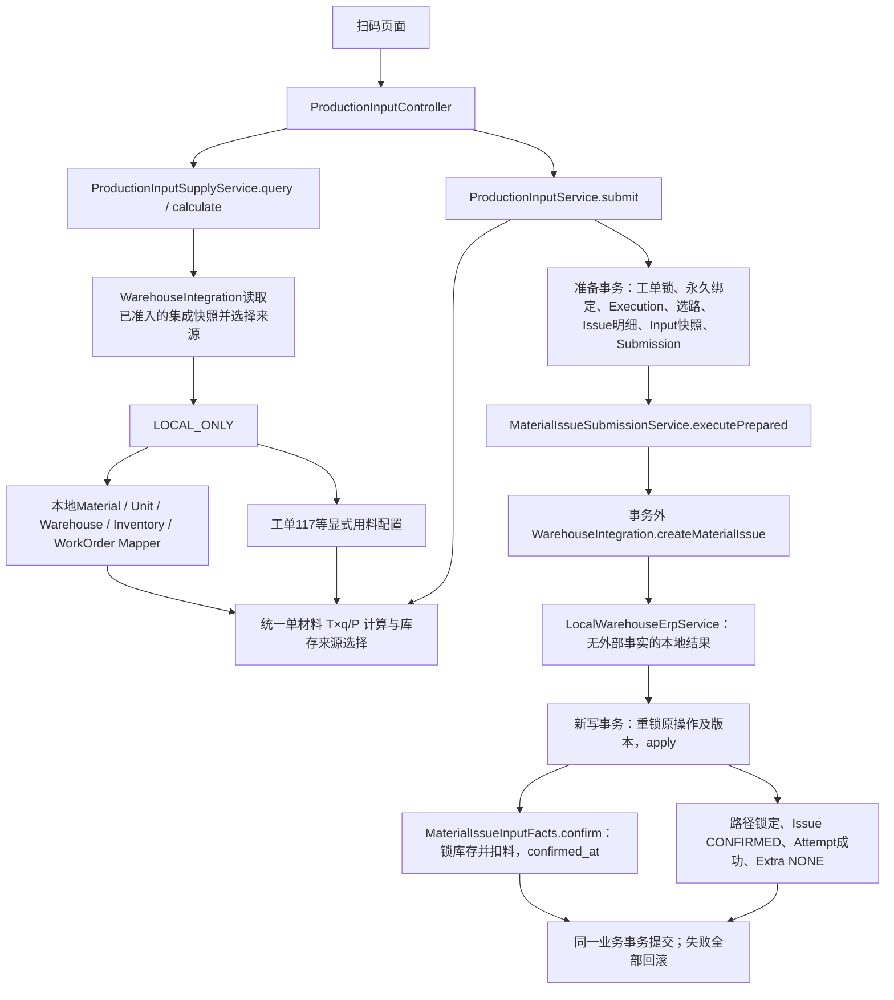
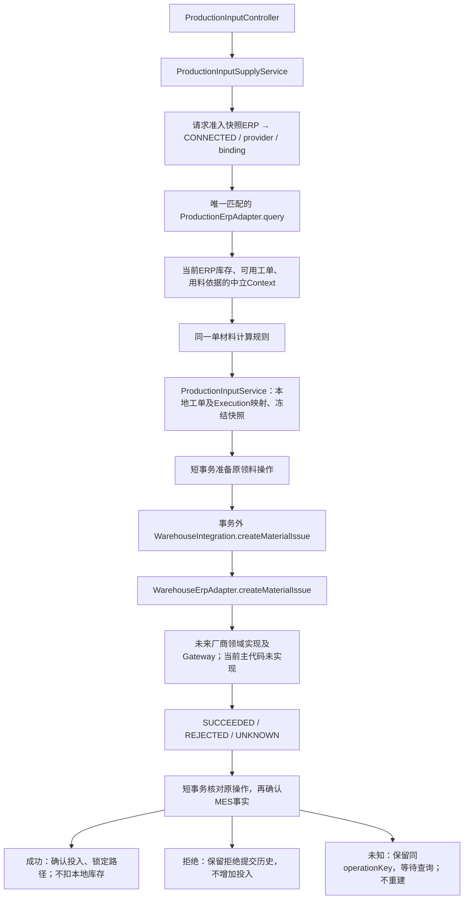
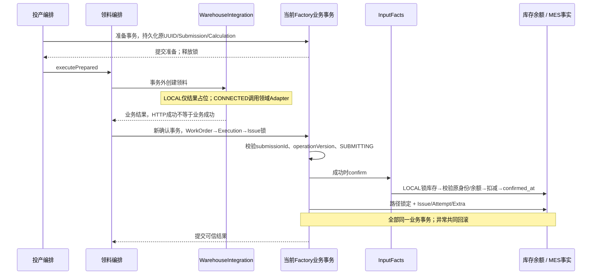
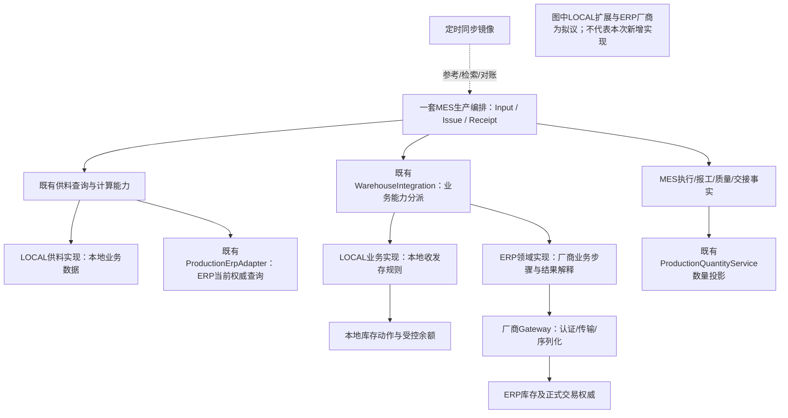
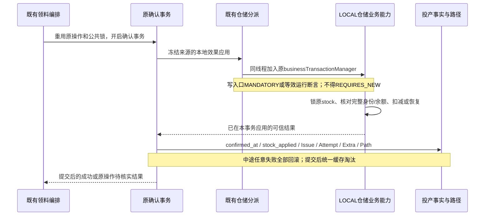
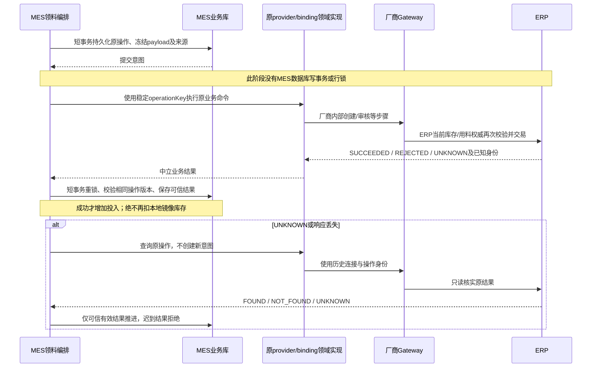

# Base MES V1.5：生产与仓储业务执行边界专项审查（Phase A）

日期：2026-10-17。结论：**最小迁移方向 CONDITIONAL GO；当前仓储写入边界及未审查生成入口 NO-GO；本轮完成 Phase A 后停止，不进入 Phase B/C。**

核心判断：保留一套 MES 生产核心、现有投产身份、数量公式和领料状态机。真正需要搬迁的是供料服务中的 LOCAL 数据读取、投产事实类中的库存变动；不能把 LOCAL 扣库搬到当前事务外执行的 Adapter 方法，也不能将同步库存镜像升级为 ERP 交易权威。

## A. 基线、指令切换与证据等级

### A1. 仓库和存量改动

- Backend：`/Users/user/work/lixin/mes-base`，main；开始为 `e908bbc6a75b725dacaf3af81b295a440e3114b1`，审查期间被外部更新为 **`b2d1229d6dbdacdf2f86e1d6ac68b523157df707`**。本报告主结论已重新对照后者；Agent未执行Git提交。
- Frontend：`/Users/user/work/lixin/mes-base-ui`，main，HEAD `94167e0c25fd9cb4dfcac5ecef369f6e8b715546`；15个已跟踪文件修改、3个未跟踪项，涉及V1.4报工/质量/投产/恢复UI。这是开始快照；随后另出现工厂模式前端修改，均未覆盖，不推定具体Agent归属。
- 已读取个人工程入口、工程原则、工作流、Java/前端规范、知识治理，两仓AGENTS，以及生产核心审查、V1.4报告第9节、当前源码、Mapper/XML、测试契约。
- V1.4第9节的123张工单查询、管理员UUID、质量纠错、D/E门禁、READY派工保护、原请求恢复属于**此前真实服务证据**。本阶段不重新实现，不把旧审查中的100张限制、全局冻结等已修问题再次判定为现存缺陷。

### A2. 收到补充指令前已经发生的变更

以下内容是先前V1.5实施授权下、补充指令到达前完成的工作，不是本次只读阶段实施：

1. `FoundationErrorAdvice` 增加缺少必填参数的400映射；新增 `HttpInputErrorContractTest`。与4组V1.4定向回归共26项通过，日志 `.local/closure-v15-20261017/phase0.log`。没有为此重启服务，未宣称运行实例已加载修复。
2. 新增并经正式Flyway执行业务V34 `local_stock_action`，执行前核对绑定并保存 `before-v34.sql`。新表 `wm_stock_action` 及禁止UPDATE/DELETE的两个触发器已存在；本次只读核对记录数为0。
3. 通过Codegen真实metadata生成该表完整基础后端（Entity/Example/Mapper/XML/基础Service/Controller/VO/骨架测试，共16个文件）。尚未接入库存事务，也尚未限制普通生成写入口；不能称为已完成库存业务。
4. 已建立 `2026-10-17-production-local-closure-v15-report.md` 实施草稿；其中“实施中”是指令切换前状态，本报告明确取代其继续实施的顺序，不据此继续Phase B/C。

**新增审查风险：** 生成 `WmStockActionServiceImpl.insert` 接受客户端提供的操作者、摘要、前后余额等字段直接入表；与 `wm_inventory` 没有原子动作关联。UPDATE/DELETE即使被DB触发器拒绝，也无法防止POST伪造“库存动作事实”。该CRUD不能发布为正式业务入口。09:36只读检查时未找到对应编译class；此后发现外部构建/提交及服务进程变化，不能据旧检查保证它未被装载；本Agent未执行新构建或重启。进入后续实施的第一步应限制这些入口。当前只读指令下不删文件、不关闭Bean、不改表、不回滚V34。

### A3. 本次只读数据库快照

核对中心绑定：`SIMPLE_B → datasource8 → 192.168.18.25:3306/mes_base_dev_business_simple_b`，工厂revision1、数据源revision2，均ENABLED。09:40只读快照：中心Flyway仍V33，业务V34，均success=1；新HEAD已含中心Java V34工厂运行模式迁移，但当时中心mf_factory尚无runtime_mode列。新代码/Schema未对齐，不能宣称新模式机制已在真实服务通过；本轮不执行该迁移。库存6行、RELEASED工单123张，负库存/负可用/可用超过实存的行数为0。投产快照76行均标LOCAL_ONLY，其中11行stock_applied=true；其余不能因此认定都经过扣库（此前已有TEST直接构造快照）。没有CONNECTED真实投产样本，不能据静态契约宣称真实ERP联调通过。

**证据等级：** S=本次源码及SQL阅读；D=本次SELECT/SHOW；H=此前测试/真实验收；P=本报告拟议方案。Phase A未运行业务写入、数据库迁移、Maven/前端测试、ERP命令或服务启停；仅生成本报告和配套图/审查证据。对1072个后端src文件建立SHA256清单，收尾发现18个既有src变动及新增集成配置相关文件，来自审查期间的外部更新；清单见 `.local/closure-v15-20261017/phase-a-parallel-changes.json`，没有以“Git干净”冒充不存在并行变化。新HEAD的模式与历史查询实现已重新审查。

### A4. 审查期间并行变更的复核（当前结论优先）

收尾时HEAD已从e908变为b2d1229，开始阶段的Phase0、V34及生成产物也已被外部提交纳入HEAD；不是本Agent提交。另有工厂模式、请求快照、历史查询及测试的并行变更；后端运行进程由73992变为80705，Agent没有启停服务。此后新增的测试修改仍在进行，静态阅读不计其通过。

新HEAD已有中心ManagedFactory.runtimeMode/erpProvider/erpConfigRef/integrationRevision/integrationLocked、FactoryIntegrationRegistry、FactoryIntegrationSnapshot/Context，以及请求准入和后台任务入口。本报告早期草稿中“配置仅来自Environment、没有请求级集成快照、历史一般查询必须跟当前mode相同”的结论已过时，下面改为新实现。**不再建议另建运行模式配置、快照、Resolver或重复实现已完成的历史query解耦。** 尚需收敛的是持久化原操作的版本来源及cancel的provider一致性、库存写Owner和尚未执行的迁移核验。

## B. 现有真实调用图

### B1. LOCAL扫码投产（S，证据E1–E6）

不是一次覆盖全部步骤的事务：准备事务已提交，LOCAL结果阶段不改库存，真正余额扣减与MES确认在后面的确认事务内原子完成。确认失败可保留先前SUBMITTING意图，不能将其声称为从未创建过意图；原操作查询/核实负责恢复。

### B2. CONNECTED扫码投产（S，非真实ERP实现）

源码没有提供真实厂商Gateway，因此图中V是**缺失的实现位置**，不是已观测HTTP调用。CONNECTED `query`分支在进入LOCAL方法之前返回；`MaterialIssueInputFacts.confirm`仅在LOCAL_ONLY分支访问库存。CONNECTED仍读取本地工单/产品/工艺/仓库等逻辑映射和引用合法性，这不等于用本地库存镜像作ERP可用量权威。ERP返回的候选使用本地workorderId，不能凭外部工单号绕过MES映射。

### B3. 当前领料确认事务图

配套现状图：[`production-warehouse.html`](</Users/user/work/lixin/mes-base/.archify/architecture-production-warehouse-20261017-093800/production-warehouse.html>)。引用固定新HEAD b2d1229中的现有代码，未用未提交生成产物证明现状调用关系。Archify源码证据/结构、HTML交付、严格产物检查通过；沙箱Chrome检查失败后，单独沙箱外browser-check通过。没有人工视觉复核，不把图形检查当业务验收。

## C. 事实归属与A1供料审查

| 数据/规则 | 当前真实来源与归属 | 判定 |
|---|---|---|
| 扫码品号/批次、规范三元码 | ProductionScanCode；Identity解析原码/EXE/MES1，不决定库存余额 | KEEP，不改永久绑定 |
| LOCAL库存可用量、库位、仓库 | Supply.local直接读wm_inventory及仓库；空可用按实存解释，展示取min；至多100条对应库存来源 | MOVE到LOCAL供料实现；不能把此上限称为全厂工单上限 |
| LOCAL工单候选 | 配置索引最多10000工单ID，先按材料/合法仓库筛选，再SQL RELEASED、产品匹配、id DESC和分页；非全厂扫描 | MOVE完整查询，保留V1.4分页和空集合行为 |
| LOCAL总用料T、工作中心、允许仓库 | Environment工单配置；P来自本地workorder.planned_qty | Phase B保留来源与计算行为；页面维护属于Phase C |
| CONNECTED库存/候选/用料 | ProductionErpAdapter.query返回Context；接口注释要求厂属/下达/中心/仓库实时检查 | KEEP契约；没有真实厂商时明确未配置，不假造筛选实现 |
| 共用计算 | Supply.calculate验证单材料、单位完全一致、允许仓库、总需求有效；issueQuantity为6位HALF_UP的T×q/P | KEEP一份中立计算；公式属于生产供料/投产用料政策，不属于厂商Gateway，也不放Quantity投影 |
| 本地MES准入 | Input.prepare重锁工单、核对RELEASED/产品/P，创建或复用Execution及选路 | KEEP生产编排；不应搬入仓储实现 |
| 最终投入 | 冻结Input.output_qty + 成功Submission + Issue/Extra可信状态联合确定 | KEEP；targetQty不是实际投入权威 |

可以只MOVE而不改语义的具体内容：`ProductionInputSupplyService.local`及LOCAL配置枚举/候选组装；`MaterialIssueInputFacts.confirm`中的库存锁定、身份核对与扣减；`voidConfirmed`中的原库存恢复。计算方法、永久绑定、Submission状态与投产快照不需复制。bin_code撤销核对见E3，属于独立安全修正，不能包装为纯MOVE。

CONNECTED当前分页是对Adapter已返回候选做内存skip/limit，Port没有分页参数。LOCAL已数据库分页。未来ERP大候选需在同一Port向后兼容扩展分页查询，不能以“已分页接口”宣称ERP端无无限加载风险（E2）。

## D. LOCAL/ERP权威边界与配置

| 场景 | 当前实现 | 与目标的关系 |
|---|---|---|
| 缺mode/非法mode | 托管运行要求FactoryIntegrationSnapshot；ERP无有效Connection/凭证引用明确失败；非托管兼容分支才读Environment | 托管路径不回退旧YAML或LOCAL，保留 |
| LOCAL新业务 | 明确LOCAL_ONLY → 本地读库；LocalWarehouseErpService返回本地结果 | 库存权威确在本地，但写入职责仍混合 |
| CONNECTED新业务 | provider/binding都需有值且WarehouseErpAdapter唯一匹配；Supply还要求ProductionErpAdapter唯一匹配 | 缺任一实现失败，不降级LOCAL；当前只有测试Adapter |
| ERP再次校验 | GET已当前查询；createMaterialIssue接收完整冻结材料/数量/外部工单/原operationKey | Port能承载再次校验；真实厂商必须交易时校验，当前没有实现可证明 |
| 本地镜像同步 | WmInventoryQueryPort→sync/upsert直接覆盖wm_inventory；无模式门禁 | 尚未明确“参考镜像”与LOCAL交易余额的写入边界，需先保护 |
| 当前选择快照 | HTTP准入BusinessRequestSnapshot包含FactoryIntegrationSnapshot，含工厂集成revision及Connection revision；后台显式runIntegrated；Prepared另有Selection三元组 | 请求内冻结已存在，KEEP；但原操作持久化JSON/Extra尚未保存这两个配置版本 |
| 历史快照 | Input冻结sourceMode/Calculation；Extra保存mode/provider/binding/外部身份；Submission有operationKey/command/pathRevision | 应复用，不另建第二套操作台账 |

配置现在有两条明确层次（E21）：托管运行从中心工厂记录取得LOCAL/ERP、provider及不透明配置引用，经FactoryIntegrationRegistry解析服务端Connection、验证厂属/凭证引用/组织/URL/启用状态，HTTP入口冻结无凭证快照。非托管Fixture/独立运行保留显式Environment兼容；`mes.runtime.enabled=true`且缺准入快照会拒绝，不使用兼容分支兜底。LOCAL映射现有LOCAL_ONLY，ERP映射CONNECTED，不复制第二套生产状态。

新工厂创建省略模式时已有显式LOCAL初始化；旧客户端编辑省略这些字段则保留原配置。已绑定数据源/已经integrationLocked的工厂，普通管理修改mode/provider/ref会返回FACTORY_MODE_CHANGE_REQUIRES_MIGRATION，不支持任意热切换。不能以“新建默认LOCAL”解释已配置ERP读取失败也可LOCAL。

必须区分 `Extra.operationVersion`（本地业务并发版本）、`pathRevision`（选路版本）、Factory/数据源revision（租约版本）与**现有**FactoryIntegrationSnapshot.revision/configurationRevision（集成/连接配置版本）。新操作在单个HTTP内多次读取FactoryIntegrationContext可取得同一冻结快照，先前关于即时Environment重复读取的担忧只适用于非托管兼容分支；不能继续把它写成托管路径现存事实。

仍需后续处理：Selection只有mode/provider/binding，Input/Submission/Extra没有完整保存两个配置版本；跨HTTP的原操作恢复仍只能依赖历史mode/provider/binding。Connection注册表按当前配置引用解析，当前接口没有按历史Connection revision取旧连接的能力。保留现有请求快照并将必要版本贯穿至原意图，不另造快照系统；既有历史无版本记录按原三元来源保守恢复，不能用当前版本补写历史。

## E. A2/A3职责混合、双写入口与历史恢复

### E1. 已成立的原子性，不应破坏

`MaterialIssueSubmissionService.executePrepared`的写TransactionTemplate内依次执行apply、Issue保存、Extra保存。apply成功分支调用InputFacts.confirm，再paths.confirm；InputFacts没有自开事务，使用调用方同线程/同业务连接，库存同值UPDATE先取得行锁，再读取与扣减，投产confirmed_at与stock_applied同时保存（E4–E6）。同执行共同锁，以及fact.confirmed_at防止重复确认；撤销stock_applied防止重复恢复。CONNECTED只确认投入，不第二次扣本地库存。

现有正式手工领料如果没有Input事实，InputFacts直接return：可以确认领料/锁路，但不扣本地库存、不贡献投产额度。不能在等价迁移时悄悄改成扣全部明细，也不能将这一入口宣传为完整LOCAL出库。Phase C需明确正式仓储动作覆盖哪些单据，再单独实施。

### E2. 余额双权威与旧表单覆盖（S，风险推演R）

- `WmInventoryServiceImpl.insert/updateById`直接接收quantity/availableQuantity及库存身份，updateByPrimaryKey仅WHERE id，无余额版本/CAS；删除仅检查存在，不查Input历史。
- update先读取row，再锁物料/仓库，最终写回整行。生产扣库只锁库存，不共用物料/仓库锁，不能由这些引用锁防止旧表单覆盖。
- 反例（静态推演，未进行写入复现）：旧页面读取100；正式投产事务扣20并提交80；旧表单仍提交100，普通update会覆盖回100。即使普通update最终持有库存写锁，写入的仍是客户端旧绝对余额。
- sync先查询外部数据、之后事务upsert，继续用绝对量覆盖同表，未判断LOCAL/CONNECTED；有run_token只证明同步执行权，不证明该数据源对LOCAL交易余额拥有权威。
- StockReferenceRules只验证状态合法、必要ID/quantity非空及引用存在；没有库存非负、available≤quantity及正式引用身份冻结规则。库存DTO的Digits只限制精度，不限制非负。
- 当前真实库无负数，不等于不存在上述写入漏洞；没有在真实库制造错误来证明它。

最小处理：余额写入收敛到单一仓储业务能力；普通CRUD不得再覆盖已交易余额/身份；同步在LOCAL不能覆盖权威余额，CONNECTED镜像也不能被正式LOCAL动作消费。可保留同一张表，不要求先引入第二套库存表/规则引擎。原库存CRUD请求的拒绝/受控修改属于**显式行为安全修正**，应单列契约和前端迁移，不能谎称所有旧HTTP行为完全等价。

### E3. 撤销身份及当前模式切换

| 入口 | 原操作身份/事务保护 | 当前边界 |
|---|---|---|
| cancel初次准备 | 原Issue、服务端voidOperationId、voidFromStatus、冻结voidExecutionMode；公共锁、operationVersion | 标记VOID_PENDING后先validateInputReduction，额度先预留，避免报工继续透支 |
| cancel/query执行 | 事务外WarehouseIntegration.execute；CONNECTED使用原binding、externalReference和voidOperationId | 重复cancel有voidOperationId时不再次发写；reconcile只查询原取消 |
| 成功写回 | 新事务核对相同voidOperationId/version/待定状态，InputFacts恢复库存并VOIDED | 恢复与关闭预留同事务；拒绝回原状态，UNKNOWN保留预留 |
| 一般ERP查询/核实 | 用Extra与原Submission/void key构造Query；只读快照→事务外查询→写事务核对旧版本及身份 | NOT_FOUND不证明失败，不允许重新创建；FOUND需有效业务状态才能确认 |

**当前历史来源路由（S，b2d1229；替代e908的旧结论）：**

1. 新`WarehouseIntegration.query`已不检查当前工厂mode/provider：LOCAL历史只用local查询；CONNECTED按原binding找Adapter后调用新增supportsProvider(原provider)，不把原操作改派LOCAL。原“一般query跟随当前mode”的缺陷已收敛，KEEP，不再重复实施。
2. cancellationMode也已去掉当前mode检查，按原sourceExecutionMode/外部影响/原binding判断。CONNECTED→当前LOCAL及LOCAL→当前CONNECTED都不会据当前模式重发；但普通工厂编辑已经锁定模式，实际切换需专门迁移，不能用普通编辑测试假装允许热切。
3. **剩余provider缺口：** 固定HEAD b2d1229只有query检查supportsProvider；收尾又观察到未提交并行修改，在submissionSelection:78补上provider校验，因此新建/create路径也已开始收敛，不应重复开发。取消execute仍按scope+binding选择，未核对原provider；取消命令也不含provider。绑定重用到别的provider时，取消路径不具有query同等保护。应复用已有supportsProvider并补齐原取消来源，而非再创建一个Port。该未提交改动及关联测试本阶段未运行，不计通过。
4. 请求准入仍会先解析当前FactoryIntegrationSnapshot。若当前ERP连接失效，业务入口可能在进入历史query之前被拒绝；方法自身与当前mode解耦不等于“旧连接不依赖当前准入就一定可恢复”。若要求在新连接失效时也能核实原单，需要明确独立受控恢复准入政策，不取消当前Factory/权限/库租约校验。
5. 持久化原意图缺配置revision；注册表只保存当前Connection集合，没有历史版本查找契约。无法取得原执行方应失败，绝不按新来源创建替代操作。当前没有真实厂商，未复现错误外调，属于源码保证范围与未来风险。

**撤销库存身份缺口（S）：** confirm核对material/warehouse/batch/bin；voidConfirmed只核对material/warehouse/batch，未核对bin_code。如果普通CRUD改了原stock行的库位，可能恢复到已被改写的身份。应同时禁止被引用库存改身份，并在恢复入口对照冻结完整身份；只给恢复方法补一个bin判断不能消除普通CRUD双写。

### E4. 其他需保持可解释的契约

- Input请求hash取Command，未含可信操作者；重放只比该hash。管理员报工、质量、Receipt已有更严格操作者幂等，不据此推断Input也具备相同契约。Phase B先保持现有兼容并列出差异；若需同操作者限制，可优先核对关联Issue已有可信create_by，不应另建一套请求模型或不经确认改变旧重放策略。
- 本地创建阶段返回SUCCEEDED后，真正库存不足会让确认事务回滚，原SUBMITTING意图仍可能需要核实；不能把外层本地结果当持久化扣库成功。目标接口需区分“无外部动作”和“本地余额/投产已提交”。
- Quality的`ProductionDefectErpGateway.acknowledge`当前仅LOCAL无副作用，在质量事务内调用；不属于仓储领料执行。不能直接替换成有HTTP副作用的实现；本次仓储迁移不应修改该质量核心路径。

## F. 最小业务契约与职责迁移方案（P，未实施）

### F1. 复用为主，拒绝层数扩张

1. **ProductionInputService保持生产编排。** 永久三元码、同码复用/冲突、工单准入、路径、Input冻结和原请求恢复不搬走，不认识ERP厂商。
2. **ProductionInputSupplyService保持现有查询/计算门面。** 将`local`及其配置式用料查询移动为一个LOCAL供料实现（拟名LocalProductionSupplyService，业务查询实现，不另建同形Port）。它输出原ProductionSupply.Context；CONNECTED继续用ProductionErpAdapter。分派留在现有Supply服务，与WarehouseIntegration复用现有FactoryIntegrationContext准入快照，不新增Facade/Resolver或每个GET一个Interface。
3. **ProductionSupply、ProductionErpAdapter继续复用。** 保留Stock/Order/Requirement/Calculation语义和公共公式，不为LOCAL复制一套。接口历史名称含ERP不构成必须重命名的理由；未来分页按真实厂商规模向后兼容EXTEND。
4. **WarehouseIntegration保持仓储业务分派入口。** `create/query/cancel`分别标明外部阶段和原操作恢复；增加一个明确的“确认事务内本地效果应用/恢复”能力入口（方法名仅拟议），不新增泛化事务框架。复用现有命令/冻结Input，不能让业务命令任意指定外部凭证或重绑定。
5. **库存变动集中为一个真实LOCAL仓储业务Service。** 可在wm包建立LocalInventoryService（拟名），统一锁库存、身份/余额校验、扣减/恢复及后续动作；这是余额规则的Owner而非Mapper透传。现有WmInventoryServiceImpl继续列表/详情及受保护管理，不能保留另一套绝对量交易写入。现有LocalWarehouseErpService复用其本地实现位置，可持有该Service；不新增每个动作一个Adapter。
6. **MaterialIssueInputFacts仅管理生产投入事实。** 保存/查询冻结Calculation，确认/撤销生产投入标记，移除其WmInventoryMapper依赖。移动原库存代码时不得改变qty、库存身份、回滚条件或判重含义；生产事实变更仍由原编排显式调用。

### F2. 目标能力分派图

Gateway不编排MES、不访问业务Mapper；厂商领域实现可编排厂商创建/提交/审核/查询；生产Service只消费可信业务结果。LOCAL Service可以访问本地Mapper并参加调用方本地事务，不能被“所有Adapter禁止本地持久化”错误约束成另一个非原子系统。无需为MES自身Report/Quality再包仓储接口。

## G. 目标LOCAL原子事务与ERP最终一致性（P）

### G1. LOCAL事务时序

不能只在`private`方法或`new LocalWarehouseErpService()`上加Spring注解便宣称事务保护成立。当前LocalWarehouseErpService由WarehouseIntegration直接new，非Spring代理；应由实际注入的LOCAL业务Bean强制同一事务，或在现有编排已持有事务中执行并做运行保护。框架应拒绝无事务/错库调用，不能自动新开一个独立库存提交事务。

保留锁顺序WorkOrder→Execution→Issue，之后取得原库存行锁。新增原料入库若需物料/仓库引用锁，应在Phase C先统一顺序，仓储能力不得反向再锁Execution，避免锁环。不要在搬迁时为对称性引入JVM锁、跨库事务或把现有行锁改成失去保护的先读后写。

### G2. ERP时序

## H. 结果、UNKNOWN及历史兼容策略（P）

- 沿用原Submission、Extra、voidOperationId，不另建通用Saga/重试台账。输入UUID、领料`ISSUE-SUBMIT-<attemptId>`和取消UUID分别代表各自稳定意图，不互相冒充。
- SUCCEEDED需来源一致、ERP存在可信外部身份且业务有效；本地成功须在同一确认事务完成真实库存效果。REJECTED不贡献额度；仅原允许的无外部身份手工拒绝单可受控reopen。
- UNKNOWN、进程崩溃、HTTP响应丢失保留原operation；不自动调用新create，不因NOT_FOUND证明失败，也不把UNKNOWN当可再次创建许可。保留现有核实入口和独立权限。
- 历史query和cancellationMode在新HEAD已按原来源分派，保持其实现；后续补齐原取消的provider检查和原连接版本。恢复按历史mode/provider/binding，不被当前新操作配置改派。旧Adapter/凭证不可用明确拒绝，列出待恢复单；不得自动选新binding。两种恢复入口使用相同历史路由规则。
- 旧Calculation/Submission JSON必须仍可反序列化；新增可选来源版本不得强制使旧记录失效，缺版本历史可使用已保存来源三元组与原操作，不能猜当前值补写历史。
- 既有LOCAL确认事实的stock_applied防重语义保留。将来采用库存动作表时，旧扣料没有动作记录并不等于未扣；不得批量补扣或为过去伪造入库。旧单恢复按冻结原stock及已应用标记执行。
- V34已经成功执行，不改写/删除旧迁移、不手工移除Flyway记录。本次无新迁移；下一轮先审查空表及生成写入口，不以“已有新表”迫使Phase B直接上线新的库存流水模型。

## I. 配置审查结论（新HEAD）

1. **KEEP已有能力：** 工厂管理已具有LOCAL/ERP模式、provider/configRef、版本及锁定；请求准入和后台执行已有无凭证快照。不再提出第二套配置表、字典控制交易、Factory枚举或Resolver。
2. 新厂省略模式显式初始化LOCAL；已配置ERP的连接缺失、非法、跨厂、凭证引用不可解析均明确失败。普通编辑不能切已锁定权威，改变权威需专门项目迁移及未决意图检查。
3. **迁移风险须单列：** V34__FactoryBusinessIntegration.legacy将旧配置缺mode的工厂直接映射LOCAL；明确CONNECTED但缺provider/binding会拒绝。若旧ERP工厂的整段配置已经丢失，不能仅从“缺mode”证明它是本地工厂。迁移前应核对已知历史授权/业务来源或取得明确初始化依据，不能把该迁移规则与运行时ERP失败拒绝混为一谈。当前SIMPLE_B此前明确LOCAL，未证明其他厂存在误转；不能写成已复现数据错误。
4. 当前只读中心快照仍V33、缺runtime_mode，源代码已含Java V34；后续实施方须通过统一FactoryFlyway正式迁移核验，不能手动补列绕过历史。本轮不代为执行并行开发的迁移。
5. provider检查已覆盖历史query及并行补齐的新操作选择，仍须覆盖原取消命令；冻结原操作所需集成/连接版本，避免binding重新赋值或当前连接修订冒充原来源。旧三元来源兼容保持，未决命令不换执行方。
6. 同步计划/run_token/更新时间不是交易成功证明。LOCAL交易余额与CONNECTED镜像写入需互斥；模式锁定有助阻止随意切换，但不能替代库存CRUD和同步入口保护。

## J. 文件级最小迁移矩阵

路径前缀默认 `mes-business/src/main/java/dev/mesbase/business/`；新增类名均为拟议。

| 文件/方法 | 当前职责 | 目标职责 | 动作 | 原因及风险 |
|---|---|---|---|---|
| production/service/ProductionInputService.submit/prepare/replay | 原意图、Calculation复核、身份/Execution/领料准备 | 保持生产编排；消费同一冻结来源 | KEEP，必要EXTEND持久化来源版本核对 | 不复制身份；需保护迟到重放及旧JSON |
| production/controller/ProductionInputController | HTTP/权限/字符串ID/VO | 原地址及协议保持 | KEEP | 不在Controller增加模式业务 |
| production/service/ProductionInputSupplyService.local/configuredOrders | LOCAL库存、配置、工单读取混在供应查询 | LOCAL来源实现；原服务分派和共用计算 | MOVE/REFACTOR | 保留10000配置边界、稳定分页及空结果，不恢复100工单限制 |
| integration/production/ProductionSupply | 中立Stock/Order/Requirement/Calculation | 共用契约；必要可选来源元数据 | KEEP/EXTEND | 不创建另一套用量DTO；注意旧JSON兼容 |
| integration/production/ProductionErpAdapter | 外部当前库存/工单/需求查询Port | 保留原Port及唯一实现准入 | KEEP；分页按需EXTEND | 无厂商实现；不能以镜像替代 |
| production/service/ProductionIdentityService | 永久扫码→Execution解析 | 保持生产身份 | KEEP | 不因仓库实现改变重绑 |
| integration/warehouse/WarehouseIntegration | mode分派、新单选择及历史路由 | 同一分派入口，明确外部阶段/本地事务阶段及原来源恢复 | REFACTOR/EXTEND | 历史query已解耦，保留query/新操作provider校验，补齐取消provider及原版本；不增Facade/Resolver |
| integration/warehouse/LocalWarehouseErpService | 无副作用本地结果占位 | 复用本地实现位置、事务内库存效果经LOCAL能力完成 | EXTEND | 当前create在事务外且直接new，不能直接加扣库/事务注解 |
| integration/warehouse/WarehouseErpAdapter及命令（已有supportsProvider） | 领料创建/查询/撤销契约 | 保留，必要明确原provider/binding元数据与业务校验 | KEEP/EXTEND | 缺实现明确失败；Gateway仍是厂商内部职责 |
| issue/service/MaterialIssueSubmissionService | 准备→事务外执行→确认/核实 | 原状态机与事务；确认事务内消费仓储效果后确认投入 | KEEP/EXTEND调用点 | 不能把扣库和MES确认拆事务；手工无Input行为不得悄悄改变 |
| issue/service/MaterialIssueInputFacts.confirm/voidConfirmed | 投产快照状态+直接库存变动 | 只管理投入快照及确认/撤销标记 | MOVE库存、KEEP投入 | 模式和数量语义保持；旧stock_applied兼容 |
| wm/service/LocalInventoryService（拟） | 不存在 | 一处LOCAL余额规则与动作执行Owner | EXTEND真实业务实现 | 真实规则层，不按动作建多Interface；不存在第二数量算法 |
| wm/service/impl/WmInventoryServiceImpl | 余额CRUD与同步绝对覆盖 | 查询/受保护管理；余额动作统一Owner | REFACTOR | 与扣库存在覆盖风险；此项是明确安全整改，非纯MOVE |
| wm/service/StockReferenceRules | 引用/状态验证 | 增加必要库存值域、已引用身份保护 | EXTEND | 不应增加factory_id或将缓存当库存权威 |
| wm/dao/WmInventoryMapper及XML | 标准单表数据访问 | 继续复用生成Mapper/Example进行受控锁及写入 | KEEP | 单表不增ExtraMapper；绝对update的安全性由调用边界保证 |
| wm/sync/WmInventoryQueryPort及SyncController | 外部快照查询、同步 | 镜像查询/展示/对账；与LOCAL交易余额写入互斥 | KEEP查询、REFACTOR写入准入 | run_token不等于库存权威；保留原同步恢复测试 |
| issue/service/MaterialIssueVoidService | 撤销预留、原取消/核实及恢复 | 保持原意图/预留/回滚，调用统一仓储恢复 | KEEP/EXTEND | bin完整身份及原provider路由需单列验证 |
| issue/service/MaterialIssueErpService/ErpFacts/Rules | 原快照查询、版本核实、Extra状态 | 保留可信结果归并，复用已修历史query | KEEP/必要EXTEND版本 | NOT_FOUND/UNKNOWN不得生成新意图，原版本防迟到保留 |
| FactoryIntegrationRegistry/Snapshot/Context、BusinessRequestSnapshot、ManagedDatasourceService | 中心模式、连接注册、请求/任务固定快照及模式锁 | 复用现有准入，不新增第二套模式配置层 | KEEP | 本轮并行新增，Schema/测试须由实施方核验；本审查不覆盖修改 |
| schema/FactoryFlyway、V34__FactoryBusinessIntegration | 正式中心V34及旧配置导入 | 保留已设计迁移入口，先核实缺配置厂的来源依据 | KEEP/迁移准入审查 | 缺mode不能证明历史LOCAL，不手改迁移记录 |
| production/service/ProductionReceiptService | 生产交接/冲销，正向质量硬门禁 | Phase B保持；Phase C才接质量放行与仓储接收关系 | KEEP(B)/EXTEND(C) | 不直接加wm_inventory；接收后冲销需依赖规则 |
| WmStockAction基础Controller/Service/VO/测试（16件，已被外部纳入HEAD） | 尚未审查的基础CRUD | 先收敛事实写入口，正式动作不得由客户端伪造摘要/余额 | DEFER业务启用；REFACTOR写入口 | **P0上线阻碍**；V34触发器不能替代安全POST |
| V34__local_stock_action.sql | 已执行空表及不可变触发器 | 原样保留，后续正式兼容迁移 | KEEP | 不改已执行Flyway、不DROP回滚 |
| ProductionExecution / ExecutionPath | 唯一执行、路径及可信领料开工 | 生产规则不变 | KEEP | 可以保留对已冻结mode可信证据的校验，它不是外部交易分派 |
| ProductionReport / ProductionDefect / QualityTreatment / Quantity | 加工事实、不良、返工恢复、唯一数量投影 | 不随LOCAL/ERP复制或改公式 | KEEP | 无必须修改核心的仓储反例；质量回调未来ERP化另议 |
| 现有前端Input/Issue/Quality/Report/Receipt | 业务操作与原请求恢复 | Phase B保留接口；仅确有权限/错误提示变化时适配 | KEEP/按行为整改最小EXTEND | 不覆盖当前未提交UI；新功能在Phase C |

本方案没有REPLACE项，没有证据证明需要替换生产核心或现有Port。

## K. Phase B文件级顺序、验收和回滚计划（未执行）

| 顺序 | 变更单元 | 必须先证明 | 停止/回滚边界 |
|---|---|---|---|
| B0 | 审查未完成生成产物，限制库存事实普通写入口；冻结当前基线 | GET可读但无法通过普通POST/PUT/DELETE伪造或改事实 | 未通过不得构建发布；保留V34空表，不回滚Schema历史 |
| B1 | 仅MOVE Supply.local及配置枚举；Controller/Context/计算不变 | LOCAL 0/1/20/200候选、99/100/101/1000全厂工单不触发旧上限；显式工单计算不被第一页限制；CONNECTED不读取本地余额 | 对比原中立Context/计算结果；无意图数据变化，可回退代码 |
| B2 | MOVE库存扣减/恢复到LOCAL业务Service；原确认事务加入效果调用 | 扣库成功后故障注入→余额、Input、Path、Issue/Attempt/Extra共同回滚；无库存独立提交 | 任何单边提交立即停止；回退同版本代码，不通过历史反写“修复” |
| B3 | 普通余额CRUD/同步权威准入、被引用身份保护 | 旧表单100在已扣至80后不能覆盖回100；负数、可用越界、删引用、改批次/库位被拒；LOCAL同步不能覆盖余额 | 独立记录旧API行为变化；旧客户端明确错误，不能静默忽略余额字段 |
| B4 | KEEP并行实现的中心模式/请求快照/历史query，保留新操作provider补丁，补齐原取消provider和原意图持久化版本 | 同一请求快照固定；原来源恢复测试保持；provider换绑不误路由；Schema/旧配置迁移通过 | 不重复开发已修query；若需原连接失效时独立恢复，需先明确受控准入政策 |
| B5 | 兼容回归和真实隔离验收 | 见下列完整矩阵，全部在SIMPLE_B TEST范围 | 任何数量/隔离/历史事实改变均NO-GO，不继续Phase C |

验收顺序：先纯规则和Spring事务/HTTP Fixture，再真实指定MySQL并发，再运行服务API/UI，最后整仓verify、前端测试/build。仅需要打包启动时才按授权执行打包smoke；服务由用户启动/重启，不能用mock结果冒充真实服务。

必测矩阵：

1. LOCAL首次/重复/并发领料各只扣一次，库存不足确认失败不增加投入；故障点覆盖扣库后、Input保存后、Path保存后、Extra保存前。
2. RUNNING追加仍复用同Execution；不同UUID是不同业务意图，同UUID响应丢失恢复不重建，不重复扣库。
3. 原撤销精确恢复material/warehouse/batch/bin及原数量；重复撤销不多恢复；报工/不良不允许输入减至无法解释；VOID_UNKNOWN保留预留。
4. ERP测试Adapter的SUCCEEDED/REJECTED/UNKNOWN/异常/null/缺外部身份、NOT_FOUND及迟到查询；缺Adapter/歧义/缺配置拒绝；无本地库存SQL执行。
5. 模式/绑定变化前后，原意图恢复与新意图选择不同；不把当前配置覆盖历史来源。最新并行测试已开始将旧“切换后拒绝”改为原执行方查询；本阶段未运行，不计通过。受控模式迁移、当前准入失效与旧连接不可用仍需独立用例。
6. 原Report V1/V2、管理员幂等、UNVERIFIED节点矩阵、质量晚申报/返工/纠错、Receipt差额保持；Quantity投影以同一冻结输入逐节点比较，不仅总量一致。
7. 不可变事实UPDATE/DELETE仍由原触发器拒绝；新库存动作若未正式启用，不在B2伪造历史补齐。
8. 两工厂相同本地ID、越权、Factory切换、迟到响应、原URL/字符串ID/decimal；缓存只在提交后淘汰，回滚不发布新余额。
9. 新旧JSON和存量无Input行政领料均保留可解释性；所有运行结果明确证据等级。UNKNOWN故障通过受控测试Adapter/事务注入，不制造真实ERP副作用。

回滚不是数据库恢复到旧快照：未产生新事实时可回退代码；一旦已开始记录正式仓储动作，旧版本可绕过动作Owner，不能直接切回。须暂停新交易、核对已提交意图/动作/库存，再做前向兼容修复或使用仍遵守保护的版本。不得删除/UPDATE历史流水、重写V34或自动重试未知外部动作。

## L. Phase C闭环扩展（只计划）

前提：B5通过，且上述行为安全修正/历史路由方案已确认。每一步独立模型和迁移，不借本报告直接执行。

| 能力 | 最小扩展位置及约束 |
|---|---|
| 本地工单用料维护 | LOCAL供料实现从受控业务修订读取；工单内维护单材料/单位/总需求/合法仓库，明确启用/修订；旧配置不自动转正式数据，同工单只保留一个权威来源；正式Input冻结旧版本不回算 |
| 期初/原材料入库 | LOCAL库存Owner处理动作与余额同事务；历史已有余额显式期初依据，不能伪造日常入库；UI复用现有库存/单据组件，不开放裸余额保存 |
| 生产退料/调整 | 原领料取消是整次投入的逆向，并不等同所有退料。部分退料需明确原消耗、可退量和对投入额度影响；纯材料补退不能自动创造/减少生产投入；没有可解释依据时拒绝，不改Quantity公式 |
| 调拨 | 本轮优先DEFER；若后续做，原仓/目标仓按稳定顺序同时锁定，来源/目标动作成对原子，不增加投产额度 |
| 质量放行 | 当前无实物/容器级精确归属，优先执行级合格数量确认；核对实际路径、当前有效产出和未决质量，返工成功不自动放行；晚不良保留历史放行及差额，不改原事实 |
| 正向ProductionReceipt | 复用现有RECEIPT/REVERSAL与执行锁、幂等、末道输出限制，在有可信质量依据后开放；不直接写库存；已仓库接收后的冲销需先合法处理已收数量依赖 |
| 仓库接收与成品入账 | 仓储业务动作明确引用有效原交接，并发/分批不得超未接收量；LOCAL动作与库存同事务，ERP只留未实现契约；错误接收逆向引用原动作、余额不足不能扣负，不自动删事实 |
| 正式完工 | 用户已选严格完工：E=94时，80交接/80接收后仍缺14；须全部94交接并接收且无未决质量/领料撤销才能完成。targetQty=100不迫使实际达到100；终态普通投产/报工禁止，历史授权纠错及差额需明确独立政策 |

示例数量契约保持四个不同投影：有效产出94、已交接80、已接收60、待接收20、库存只增加60；接收另20后库存累计80，Execution仍不满足严格完工，须再完成余14。不能用Receipt80直接入库存80，不能用返工恢复4追加正常REPORT4。

所有新结构仍需按当时最新Flyway、真实metadata、Codegen基础持久化、单一业务Owner、明确权限和测试实施；本阶段不预创建剩余表。

## M. 不建议改动的稳定核心

- ProductionExecution永久身份、同三元码绑定及READY/RUNNING复用保持；不恢复ProductionBatch。
- ExecutionPath确切工艺版本、边关系验证、SELECTED/LOCKED及原开工准入保持；其对领料Extra的mode分支是验证已经保存的可信证据，不是调用ERP/本地库存选源，可以KEEP。
- ProductionReport和管理员幂等、ProductionDefect不可变版本、QualityTreatment单节点处置与纠错保持；登记仓库去向是记录，不等于真实退库。
- ProductionQuantityService与ProductionQuantityMapper.inputBalance保持：输入取可信Input/Submission/Issue/Extra事实，撤销预留从confirmed扣除，正常报工/净不良/传播/恢复仍一份公式。
- ProductionReceipt生产事实和历史超额计算保持；Phase B不解除requireQualityRelease硬门禁。Phase C新增放行及接收事实，并不形成第二份正常加工数量。

没有发现必须重写这些核心才能搬迁仓储职责的业务反例。质量查询与处理的既有依赖环、质量回调名称等不属于本轮最小仓储迁移，不顺手重构。

## N. 架构结论、证据与停止

**CONDITIONAL GO（方案）：** 现有业务Port、事务编排和生产核心足以承载最小迁移。采用“既有分派+LOCAL查询/库存Owner+原事务内应用”的方案，不新增通用Facade/Resolver，不复制两套生产系统。

**NO-GO（当前新增仓储能力启用/完整LOCAL闭环）：** 普通库存CRUD/同步绝对覆盖未受控、原取消的provider及原意图配置版本保护未补齐、V34生成写入口尚可由客户端组装事实、质量放行/成品接收/严格完工尚未实施。V34空表与26项Phase0回归不改变此结论。

进入Phase B前需下一轮明确实施指令，首先确认三个行为边界：普通余额写入的兼容限制；已完成的历史query解耦保持、取消provider及持久化原来源版本补齐；未审查生成写入口的处理。不是要求现在扩权/重启或再次执行SQL。

本次没有重新运行Maven、前端测试、运行服务API/UI或真实ERP；源码结论以新HEAD及明确并行修改为准，与只读DB快照共同作为本次证据，V1.4与Phase0测试明确标H。Phase B矩阵是未来验收计划，不计通过。

**本次只读审查完成后停止，未实施接口抽取、库存业务、用料维护、放行、接收或完工。** 补充指令之前的变更原样保留，不借只读审查清理/回滚它们。

## 附录：源码证据索引（本次工作区行号）

| 编号 | 可核对位置 |
|---|---|
| E1 | [ProductionInputController:55](/Users/user/work/lixin/mes-base/mes-business/src/main/java/dev/mesbase/business/production/controller/ProductionInputController.java:55)：GET/POST真实入口、统一权限与VO |
| E2 | [ProductionInputSupplyService:88](/Users/user/work/lixin/mes-base/mes-business/src/main/java/dev/mesbase/business/production/service/ProductionInputSupplyService.java:88)：模式分派；:108 LOCAL读取；:142材料/仓库配置候选；:166数据库分页；:210共用计算；:231配置规模；:252指纹；:262公式 |
| E3 | [ProductionInputService:133](/Users/user/work/lixin/mes-base/mes-business/src/main/java/dev/mesbase/business/production/service/ProductionInputService.java:133)：原请求重放/重算；:157准备；:171永久绑定；:199Issue及Input快照 |
| E4 | [MaterialIssueSubmissionService:104](/Users/user/work/lixin/mes-base/mes-business/src/main/java/dev/mesbase/business/issue/service/MaterialIssueSubmissionService.java:104)：事务外执行/确认事务；:131准备命令；:201结果归并；:257原提交核实 |
| E5 | [MaterialIssueInputFacts:53](/Users/user/work/lixin/mes-base/mes-business/src/main/java/dev/mesbase/business/issue/service/MaterialIssueInputFacts.java:53)：实际扣库/confirmed_at；:85原库存恢复及stock_applied |
| E6 | [ProductionChainLocks:35](/Users/user/work/lixin/mes-base/mes-business/src/main/java/dev/mesbase/business/production/service/ProductionChainLocks.java:35)：工单/执行/领料锁；[WmInventoryMapper.xml:315](/Users/user/work/lixin/mes-base/mes-business/src/main/resources/dev/mesbase/business/wm/dao/WmInventoryMapper.xml:315)：整行更新仅按id |
| E7 | [WarehouseIntegration:38](/Users/user/work/lixin/mes-base/mes-business/src/main/java/dev/mesbase/business/integration/warehouse/WarehouseIntegration.java:38)：mode及准入快照；:49取消来源；:68新操作选择；:82创建；:89历史查询；:103按binding选Adapter；:109取消执行；:19直接new本地实现 |
| E8 | [LocalWarehouseErpService:8](/Users/user/work/lixin/mes-base/mes-business/src/main/java/dev/mesbase/business/integration/warehouse/LocalWarehouseErpService.java:8)：本地只返回无外部副作用结果；[WarehouseErpAdapter:10](/Users/user/work/lixin/mes-base/mes-business/src/main/java/dev/mesbase/business/integration/warehouse/WarehouseErpAdapter.java:10)：现有仓储Port |
| E9 | [ProductionErpAdapter:10](/Users/user/work/lixin/mes-base/mes-business/src/main/java/dev/mesbase/business/integration/production/ProductionErpAdapter.java:10)、[ProductionSupply:13](/Users/user/work/lixin/mes-base/mes-business/src/main/java/dev/mesbase/business/integration/production/ProductionSupply.java:13)：中立供料契约 |
| E10 | [MaterialIssueVoidService:84](/Users/user/work/lixin/mes-base/mes-business/src/main/java/dev/mesbase/business/issue/service/MaterialIssueVoidService.java:84)：取消预留/执行/结果核对；[MaterialIssueErpService:83](/Users/user/work/lixin/mes-base/mes-business/src/main/java/dev/mesbase/business/issue/service/MaterialIssueErpService.java:83)：历史查询；:110核实版本 |
| E11 | [MaterialIssueErpFacts:36](/Users/user/work/lixin/mes-base/mes-business/src/main/java/dev/mesbase/business/issue/service/MaterialIssueErpFacts.java:36)：Extra来源与operationVersion；[MaterialIssueErpRules:22](/Users/user/work/lixin/mes-base/mes-business/src/main/java/dev/mesbase/business/issue/service/MaterialIssueErpRules.java:22)：安全归并、不复活VOIDED |
| E12 | [WmInventoryServiceImpl:124](/Users/user/work/lixin/mes-base/mes-business/src/main/java/dev/mesbase/business/wm/service/impl/WmInventoryServiceImpl.java:124)：普通创建；:147更新；:170删除；:193同步；:215 upsert绝对量 |
| E13 | [StockReferenceRules:47](/Users/user/work/lixin/mes-base/mes-business/src/main/java/dev/mesbase/business/wm/service/StockReferenceRules.java:47)：值域/引用边界；[WmInventoryController:63](/Users/user/work/lixin/mes-base/mes-business/src/main/java/dev/mesbase/business/wm/controller/WmInventoryController.java:63)：普通写和sync入口 |
| E14 | [WmInventoryQueryPort:10](/Users/user/work/lixin/mes-base/mes-business/src/main/java/dev/mesbase/business/wm/sync/WmInventoryQueryPort.java:10)、[UnconfiguredWmInventoryQueryAdapter:13](/Users/user/work/lixin/mes-base/mes-business/src/main/java/dev/mesbase/business/wm/sync/UnconfiguredWmInventoryQueryAdapter.java:13)：未配置查询明确失败 |
| E15 | [ProductionReceiptService:60](/Users/user/work/lixin/mes-base/mes-business/src/main/java/dev/mesbase/business/production/service/ProductionReceiptService.java:60)：交接摘要；:76正向硬门禁；:121冲销，不写库存 |
| E16 | [ExecutionPathService:139](/Users/user/work/lixin/mes-base/mes-business/src/main/java/dev/mesbase/business/production/service/ExecutionPathService.java:139)：确认路径；:149开工与可信领料；[ProductionQuantityService:57](/Users/user/work/lixin/mes-base/mes-business/src/main/java/dev/mesbase/business/production/service/ProductionQuantityService.java:57)：投影输入；:160唯一数量公式 |
| E17 | [ProductionQuantityMapper.xml:43](/Users/user/work/lixin/mes-base/mes-business/src/main/resources/dev/mesbase/business/production/dao/ProductionQuantityMapper.xml:43)：Input/Submission/Issue/Extra联合可信投入；[ProductionInputBalance:6](/Users/user/work/lixin/mes-base/mes-business/src/main/java/dev/mesbase/business/production/domain/ProductionInputBalance.java:6)：confirmed减reserved |
| E18 | [MaterialIssueRules:149](/Users/user/work/lixin/mes-base/mes-business/src/main/java/dev/mesbase/business/issue/service/MaterialIssueRules.java:149)：本地引用校验无库存读取；[MesMaterialIssueServiceImpl:126](/Users/user/work/lixin/mes-base/mes-business/src/main/java/dev/mesbase/business/issue/service/impl/MesMaterialIssueServiceImpl.java:126)：创建时mode读取 |
| E19 | [ProductionDefectService:151](/Users/user/work/lixin/mes-base/mes-business/src/main/java/dev/mesbase/business/quality/service/ProductionDefectService.java:151)、[LocalProductionDefectErpGateway:8](/Users/user/work/lixin/mes-base/mes-business/src/main/java/dev/mesbase/business/quality/integration/LocalProductionDefectErpGateway.java:8)：质量回调仅本地无副作用 |
| E20 | [WmStockActionServiceImpl:135](/Users/user/work/lixin/mes-base/mes-business/src/main/java/dev/mesbase/business/wm/service/impl/WmStockActionServiceImpl.java:135)、[WmStockActionController:61](/Users/user/work/lixin/mes-base/mes-business/src/main/java/dev/mesbase/business/wm/controller/WmStockActionController.java:61)：未审查生成写入口；[V34迁移](/Users/user/work/lixin/mes-base/mes-admin/src/main/resources/db/business/V34__local_stock_action.sql)：已执行空表，非正式动作业务 |

| E21 | [FactoryIntegrationRegistry:56](/Users/user/work/lixin/mes-base/mes-admin/src/main/java/dev/mesbase/server/managed/FactoryIntegrationRegistry.java:56)：中心模式解析/锁定；[FactoryIntegrationSnapshot:9](/Users/user/work/lixin/mes-base/mes-framework/src/main/java/dev/mesbase/platform/execution/FactoryIntegrationSnapshot.java:9)：固定配置版本；[ManagedDatasourceService:473](/Users/user/work/lixin/mes-base/mes-admin/src/main/java/dev/mesbase/server/managed/ManagedDatasourceService.java:473)：HTTP准入，:467后台任务；:345新厂默认/旧客户端兼容；[FactoryIntegrationMigration:21](/Users/user/work/lixin/mes-base/mes-admin/src/main/java/dev/mesbase/server/schema/V34__FactoryBusinessIntegration.java:21)：旧mode导入 |

收尾记录（2026-10-17T09:46:51）：报告含6幅Mermaid调用/时序图；源码链接及行号范围检查通过；b2d1229配套HTML源码/产物检查与独立browser-check通过，无人工视觉验收。本Agent在Phase A仅修改文档和配套图；并行代码/测试原样保留。收尾另发现中心迁移从server/migration包移动为server/schema/V34__FactoryBusinessIntegration，已核对legacy逻辑未变并更新链接。并行开发仍在进行，本报告冻结上述HEAD和已注明工作区差异，不宣称覆盖此后变更；后续实施须重新冻结当时基线。摘要见 `.local/closure-v15-20261017/phase-a-final-checks.json`。
