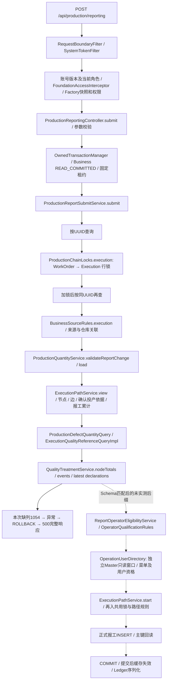
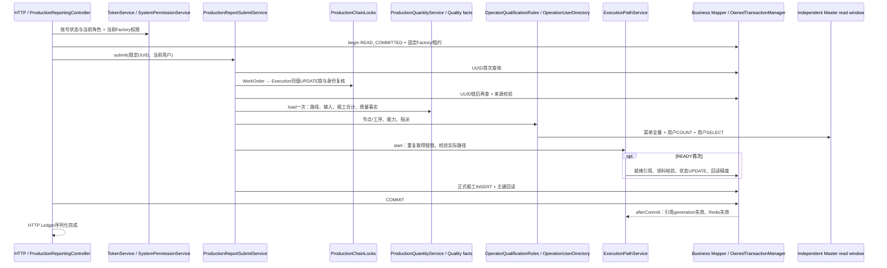

# 正式报工 SQL 调用链与重复查询专项审查

> **当前结论（V39成功补采，2026-10-18 21:10起）**：完整协议采样中，READY首次报工执行 **67条Mapper SQL＋7条事务控制＋10条驱动内部SELECT＝84条SQL**；RUNNING正常报工为 **55＋7＋7＝69条SQL**；同UUID重放为 **3＋5＝8条SQL**，未新增事实。成功请求及前三项最小方案见[第13节](#13-v39-成功请求补采2026-10-18)。第1–11节保留原失败调查的时间线，第12节保留迁移确认；其中“尚未成功补采”的状态现已解除。旧探针没有覆盖Connector/J直接发送的session变量查询，旧32条计数仅是当时观测下界，不能再用作完整协议总数。

日期：2026-10-18。范围：调查、单请求采样、只读执行计划和方案设计。**未修改生产业务代码、Druid配置、事务隔离、Flyway或权限，没有扩大并发压测。**

> 后续状态更正（20:54）：B库已由并行任务于20:30:58正式迁移至V39，本轮重新核验通过。第1–11节保留20:26失败采样证据，当前Schema阻塞已解除，详见第12节。

## 1. 结论与实际阻碍

**成功报工的完整真实Trace在20:26采样时受阻，不能给出该版本成功请求的实测SQL总数。** 当前源码要求质量新字段，采样时已确认隔离B库仅迁移至业务V38，`mes_production_defect`缺少V39定义的`defect_type_id`、`defect_type_code_snapshot`、`defect_type_name_snapshot`、`defect_type_revision`、`command_version`五列。真实MySQL返回1054；按任务“不改Flyway/不能安全创建事实则标记阻塞”的要求，没有补迁移、改SELECT、换旧JAR或跳过质量校验。

已取得当前正式HTTP入口的一次**失败边界完整Trace**：27次Mapper实际执行=27次JDBC PreparedStatement执行，2次Master、25次Business；MySQL驱动另执行5条事务控制SQL，合计32次`NativeSession.execSQL`。正式请求在质量投影失败并回滚，没有INSERT报工、没有COMMIT。**这些次数只是此失败请求，不是成功报工的总数或成功性能基线。**

原始历史845,169/588,270等应用累计值仅用于选题，本报告没有将它们除以90,100推导单次次数。另采一条只读数量投影失败Trace（14次Mapper执行）交叉验证质量入口；其耗时不与正式POST相加。

## 2. 版本、环境和保护

- HEAD：`a793e0b7de5bc6f938b8aacbb7b9624ef0ac62c6`，分支main，工作树已有18项tracked修改及5项untracked路径，含P1密码/缓存/权限代码，详情保存在私有baseline.json/before.patch。不是干净提交基线。
- 标准`mvn -B -ntp -DskipTests package`实际BUILD SUCCESS；未修改这些已有源码。新构建不可变应用SHA256：`0a54a3080bc1f0e8ba2efbb0d0477ee56b42f78b86d327af0bce6fbab3b3f5d9`。抽取并比对7个关键运行class，与当前各模块target/classes一致，包括Submit/Quantity/Path/QualityTreatment/权限/Owner/TokenFilter。
- 本轮样本使用当前dirty源码构建物，不沿用上一轮十万级性能验收的旧SHA256 JAR。因此旧耗时与本次单样本不能作等配置性能比较。
- 真实目标仍为`V23_FACTORY_B_TEST → datasource2 → 110.42.227.83:3306/mes_base_v23_factory_b_test`，LOCAL、ENABLED、无ERP。独立回环18081服务、17379 Redis；无Druid参数覆盖。关闭本轮中心自动迁移，业务未执行迁移。原用户8081/5173不重启。
- 使用已有验收身份admin100和B专用库存操作账号101，不增加角色/权限。只对新标签`TEST_SQLTRACE_20261018`资源写入，既有产品/工艺/操作能力仅引用读取。
- 当前事务内MyBatis配置明确为`localCacheScope=STATEMENT`、二级cache关闭；不能假设重复Mapper调用会被Session缓存消除。

## 3. 正式入口与调用链

实际入口：`ProductionReportingController.submit`，`POST /api/production/reporting`。`ProductionReportService`负责补录/调整/作废及流水读取，**不是这个正常报工POST的直接Service**。管理CRUD的`MesProductionExecutionServiceImpl`和`WorkOrderService`也不在本POST直接主链，执行/工单数据经共用Locks、Rules和对应Mapper读取；准备投产时另会使用管理执行服务，不能混入报工次数。

FactoryContext仅提供工厂身份，FactoryIntegrationContext提供受管模式；没有新增模式Resolver。`FactoryBusinessDataSource.begin`取得固定binding/lease并pin工厂，`verify`检查固定身份/租约；其高频Java检查本身不等于额外SQL。`OwnedTransactionManager`保留跨库Owner拒绝、挂起恢复、提交前verify及finally清理。

## 4. 采样方法与完整性

仅本地可移除Java21 javaagent，使用本机已有ByteBuddy 1.18.11，无pom/依赖或生产代码修改。探针只在精确路径+`X-Factory-Id=V23_FACTORY_B_TEST`+独立TEST采样头同时匹配时开启线程内记录，不记录请求参数、Token或密码，不改变入参、返回值、事务或错误。没有后台SQL混入请求事件。

- MyBatis `PreparedStatementHandler.query/update`：Mapper ID、BoundSql指纹、入参逐项/整体的进程内加盐哈希、返回映射值哈希、来源栈、事务标志及区间。
- JDBC `ClientPreparedStatement.execute`：27次实际执行，逐一关联MyBatis事件。不是根据SQL日志文本计数，也不是用Executor调用数冒充执行数。
- MySQL `NativeSession.execSQL`：再次核对27条映射SQL以及5条控制SQL的真正驱动执行；连接ID和catalog确认目标。不会把这两层各27相加成54。
- Druid借连接、RedisTemplate、事务begin/cleanup、Controller/参数处理及Service层只计span；对嵌套span去重。未改变Druid设置。无instrumentation error记录。
- SQL指纹来自脱敏规范化SQL；参数和结果仅哈希。相同参数/结果哈希证明本进程内已规范化映射字段值相同，**不证明隐藏InnoDB MVCC事务版本相同**。Execution没有独立revision列；WorkOrder的revision包含在整体结果指纹中，未读取DB_TRX_ID。
- 一条POST仅一次、单客户端，无重试。HTTP请求UUID固定保留；正式报工响应500，服务端requestId保存在私有HTTP记录中。

完整脱敏SQL文本、Mapper全名、来源Service/行号、顺序、参数哈希、返回哈希和时间：[trace-sanitized.json](evidence/2026-10-18-report-sql-audit/trace-sanitized.json)。下表的JDBC列采用`NativeSession.execSQL`映射到该SQL的执行区间；包含远程等待，不等于数据库CPU。

|序号|指纹前8位|Mapper ID（包名见JSON）|库|JDBC/驱动ms|MyBatis含映射ms|事务/锁|用途与审查|
|---:|---|---|---|---:|---:|---|---|
|1|`815a7711`|`SessionAccountMapper.account`|Master|19.834|21.309|事务外中心读取|授权/账号准入；保留|
|2|`85b7828f`|`SysMenuMapper.selectScopedPermissions`|Master|23.454|24.983|事务外中心读取|当前厂授权；保留|
|3|`3bdacbe7`|`MesProductionReportMapper.selectByRequestId`|Business|21.255|22.023|业务事务|幂等，加锁前；保留|
|4|`6b45cf1c`|`MesProductionExecutionMapper.selectByPrimaryKey`|Business|25.522|26.346|业务事务|锁前解析父工单身份；保留，不用锁前数据替代锁后读|
|5|`8b3ee13d`|`WorkorderMapper.updateByExampleSelective`|Business|18.789|38.931|业务事务；X行锁|工单X行锁；保留|
|6|`4a41f7d4`|`WorkorderMapper.selectByPrimaryKey`|Business|20.460|21.487|业务事务|锁后工单快照；保留|
|7|`b919a531`|`MesProductionExecutionMapper.updateByExampleSelective`|Business|24.772|44.262|业务事务；X行锁|执行X行锁；保留|
|8|`6b45cf1c`|`MesProductionExecutionMapper.selectByPrimaryKey`|Business|19.547|20.550|业务事务|锁后执行快照及父身份重验；保留|
|9|`3bdacbe7`|`MesProductionReportMapper.selectByRequestId`|Business|21.204|21.647|业务事务|幂等，加锁后；保留|
|10|`4a41f7d4`|`WorkorderMapper.selectByPrimaryKey`|Business|21.224|21.791|业务事务|来源/模式准入；可复用锁后工单，但保留来源验证|
|11|`508d6512`|`MesMaterialIssueMapper.selectByExample`|Business|21.739|23.055|业务事务|来源/仓库关联；保留；窄投影候选|
|12|`aef29a83`|`MesMaterialIssueItemMapper.selectByExample`|Business|24.943|26.349|业务事务|来源/原料仓库集合；保留；窄投影候选|
|13|`ca563c23`|`MesProductionReceiptMapper.selectByExample`|Business|21.640|22.294|业务事务|来源/成品仓库集合；保留；窄投影候选|
|14|`ce915c3f`|`WmWarehouseMapper.selectByExample`|Business|20.069|21.265|业务事务|仓库来源一致性；保留|
|15|`6b45cf1c`|`MesProductionExecutionMapper.selectByPrimaryKey`|Business|18.315|19.027|业务事务|数量投影入口身份；锁内复用候选|
|16|`6b45cf1c`|`MesProductionExecutionMapper.selectByPrimaryKey`|Business|19.825|20.535|业务事务|路径视图入口身份；锁内复用候选|
|17|`753d4a20`|`RoutingMapper.selectByExample`|Business|17.530|18.300|业务事务|工艺目录/名称/存在性；命令投影有界化候选|
|18|`862987b6`|`RoutingNodeMapper.selectByExample`|Business|18.736|19.584|业务事务|工艺节点图；保留；锁内复用候选|
|19|`95f39fc0`|`OperationMapper.selectByExample`|Business|18.880|19.720|业务事务|工序名称目录；命令投影有界化候选|
|20|`b2a8cb9b`|`MesExecutionPathMapper.selectByPrimaryKey`|Business|18.464|19.213|业务事务|实际路径状态/版本；保留|
|21|`991adf45`|`MesExecutionPathNodeMapper.selectByExample`|Business|18.213|18.843|业务事务|实际路径选择节点；保留返回完整行供后续复用|
|22|`72f7dc75`|`RoutingEdgeMapper.selectByExample`|Business|16.827|17.580|业务事务|工艺图边；保留|
|23|`39c297f8`|`ProductionQuantityMapper.inputBalance`|Business|17.517|18.399|业务事务|正式确认投产依据；保留|
|24|`991adf45`|`MesExecutionPathNodeMapper.selectByExample`|Business|18.854|19.736|业务事务|实际节点顺序/连续性；复用21完整行，不能仅复用ID跳过连续性校验|
|25|`53609dae`|`ProductionQuantityMapper.nodeTotals`|Business|19.302|20.000|业务事务|正式报工数量汇总；保留单一数量权威|
|26|`d9caf54e`|`MesQualityTreatmentMapper.selectByExample`|Business|18.377|18.968|业务事务|质量处理事实；保留；本次只加载一次|
|27|`e1f3ce31`|`MesProductionDefectMapper.selectLatest`|Business|20.556|21.027|业务事务|最新不良申报版本；保留；Schema不兼容，真实失败|

上表Master两条在业务事务外；Business25条在同一READ_COMMITTED业务事务内。Master独立资格只读窗口未到达，不能将其源码预期3条SQL计入本次2条Master实测。

事务控制的实际顺序：SQL2之后设置READ COMMITTED（18.430ms）、关闭autocommit（18.160ms）；SQL27失败后ROLLBACK（20.221ms）、恢复autocommit（18.184ms）、恢复REPEATABLE READ（16.907ms）。合计91.902ms。正式提交未发生，不能用ROLLBACK耗时替代COMMIT性能。

## 5. 单请求耗时分解与排名

服务端Valve边界825.998ms，客户端完整响应840.033ms。差值14.035ms还含探针退出后的Trace落盘和socket处理，不当作纯网络RTT。本次仅一个失败样本，不能提供P50/P95或推算成功报工加速百分比。

|阶段|本次观察|边界|
|---|---:|---|
|HTTP进入至权限preHandle结束|55.453ms|含Token/账号读取、Redis、路由恢复、Handler定位、当前厂授权；不是纯Java计算|
|参数解析及校验|19.166ms|RequestResponseBodyMethodProcessor.resolveArgument|
|借连接|8次实际外层借用，合计1.109ms|16个重载嵌套span去重为8次；该值含借用检查，纯队列等待未独立计时、只可受此区间上界约束|
|业务事务开始|39.971ms|OwnedTransactionManager.doBegin，内含借用及36.590ms隔离级别/autocommit往返，不与它们相加|
|业务Service方法|649.533ms|含锁、来源、路径、数量及失败质量读取；不是纯Java CPU|
|27条映射SQL的JDBC执行|587.204ms|ClientPreparedStatement.execute合计；MyBatis含结果映射/探针合计607.222ms，与之嵌套|
|全部32条驱动SQL|637.751ms|27条映射SQL驱动侧合计545.849ms+5条控制91.902ms；与上一行嵌套，不能相加|
|Redis|2次外层操作、1.952ms|4个嵌套execute span去重；本次为会话和绑定缓存访问|
|数据库纯行锁等待|未能独立量化|UPDATE区间同时含网络/驱动/数据库处理；不能把其全部耗时称锁等待，也不能声称0争用|
|回滚|Connection.rollback区间20.427ms|内含驱动ROLLBACK20.221ms；没有COMMIT样本|
|事务清理|35.543ms|内含恢复autocommit及隔离级别往返|
|成功响应序列化|未验证|成功返回分支未到达；错误响应已实际完整读取，不能把错误输出当Ledger序列化基线|

可互斥相加的粗分：驱动SQL637.751ms + 借连接1.109ms + Redis1.952ms + 其他Java/框架/映射/探针185.186ms = 825.998ms。最后一项是墙钟残差，不能称为CPU用时。`SystemTokenFilter.doFilterInternal`包裹整个下游，inclusive825ms不能标为授权耗时；Service、事务、SQL各层也不能重复相加。

| SQL组 |次数|驱动累计ms（本单请求）|
|---|---:|---:|
|`MesProductionExecutionMapper.selectByPrimaryKey`|4|83.209|
|`MesProductionReportMapper.selectByRequestId`|2|42.459|
|`WorkorderMapper.selectByPrimaryKey`|2|41.684|
|`MesExecutionPathNodeMapper.selectByExample`|2|37.067|
|`MesMaterialIssueItemMapper.selectByExample`|1|24.943|
|`MesProductionExecutionMapper.updateByExampleSelective`|1|24.772|
|`SysMenuMapper.selectScopedPermissions`|1|23.454|
|`MesMaterialIssueMapper.selectByExample`|1|21.739|
|`MesProductionReceiptMapper.selectByExample`|1|21.640|
|`MesProductionDefectMapper.selectLatest`|1|20.556|

同连接97591的performance_schema历史只保留最后10条，本轮没有开启/扩大consumer。已读到该请求尾部：节点读取server elapsed0.310/0.336ms，inputBalance0.604ms、nodeTotals0.487ms，质量事件0.329ms、缺列失败0.271ms；对应客户端驱动SQL约17–21ms。服务器elapsed同样不是CPU时间，可能含数据库内部等待。`LOCK_TIME`是语句的锁计时，不能直接当InnoDB行锁等待；events_waits_history未启用。最后10条不是整个27条的完整服务器剖面，不能将其合计外推全请求。

## 6. 重复SQL与十个问题逐项回答

1. **Execution读取次数：失败前实测4次。** #4锁前识别父工单，#8取得锁后身份并校验workorder_id未变，#15 Quantity.load、#16 Path.view再次载入同主键。四个参数及返回值指纹相同；前两次职责不同必须保留，后两次是锁内复用候选。匹配Schema、非重放、RUNNING、无workstation的完整分支按源码可达9次主键Mapper调用；READY首报还会因启动后持久化时间精度回读增加1次。**9/10是源码路径计数，未验证为完整成功请求JDBC次数。**
2. **WorkOrder读取次数：失败前2次。** #6 Locks.order锁后回读，#10 SourceRules.order读取同一工单，指纹一致。源码完整RUNNING路径可达6次，READY首报8次（checkReadyReferences又读工单及来源）；同样为未完成的源码计数。
3. **同值UPDATE：失败前WorkOrder1次、Execution1次。** 负责按WorkOrder→Execution顺序取得X行锁并校验存在性；保护数量判断与新增事实、状态切换及作废的串行关系，锁保持至本事务结束。成功完整路径中Submit一次、Path.start一次、requireActiveExecution内一次，共用execution锁流程共3轮，因此源码可达各3次同值UPDATE。READY检查引用还会额外锁WorkOrder及Routing。重复请求同一线程重新取得已持有的锁不增加并发互斥强度，但不能直接删除通用方法里的UPDATE；必须建立显式、不可伪造、仅当前事务有效的持锁证明后才能讨论专用内部路径。
4. **数量是否重复计算：本次load/validateReportChange各1次、nodeTotals SQL1次。** validateChange内部before/after两次calculate是纯内存数量推演，无额外SQL；不能把它们当作重复数据库加载，也不能另建数量权威或缓存报工累计。
5. **质量投影：本次nodeTotals1次，处理事件1次、最新申报1次。** 第二条失败。没有证据表明正常submit里重复加载质量投影；不能因当前无质量记录就跳过事实读取或长期缓存空集合。非空/修订/返工/待核实分布尚未实测。
6. **路径/工序：选中路径节点#21/#24同条件、同排序、同返回指纹。** Path.view把行转成ID列表，Quantity.load为检查sequence连续性又读完整行；可传递已读取的完整有序行，保留连续性和图验证。完整路径start.requireSelected还会读实际路径、节点和边；持锁后的LOCKED路径以及已发布工艺内容可作为复用候选，仍须验证所有修改入口和生命周期，不能只复用ID丢掉验证。工序名称目录不是数量计算必需字段，命令与展示读取可考虑缩小，但工序存在/启用及工艺适用性不能随之删掉。
7. **中心菜单：本次失败POST没有全量菜单查询。** 两条Master是账号/当前角色和当前厂权限。正常业务HTTP授权`SystemPermissionService.grantedFactory`使用请求内permissions，不调用menuCatalog。**源码上未到达的OperationUserDirectory.requireValid→query每次会全量读菜单并在Java分类，再PageHelper执行用户COUNT+SELECT**；这是正常报工后续资格校验会到达的全菜单来源，不能归因于FoundationAccessInterceptor。其实际成功请求次数和耗时仍需Schema匹配后采样。
8. **跨Service重复身份：存在。** #8的锁后Execution被Quantity和Path再次加载；#6工单被Source再次加载。禁止跨请求/跨厂实体缓存；若复用必须显式限定同Factory、同事务Owner和固定租约，且对象在之后状态更新时刷新/失效。
9. **同事务重复相同数据：已实测。** Execution4次、WorkOrder2次、选中节点2次的结果指纹分别一致；UUID两次都是空，但加锁前后查询保护同UUID并发重试，应保留。READ_COMMITTED允许不同SELECT看见不同已提交事实，值相同不自动构成删除依据。锁前快照不能直接升级为锁后权威；数量/质量可变事实不能按“第一次查过”缓存到后续写之后。
10. **路由/权限附加Master：本次2条。** 路由绑定命中本实例Redis缓存，事务begin/commit验证固定租约，不逐SQL查最新中心配置。冷绑定缓存、冷池准备、登录、目录缓存缺失会增加查询，本次Warm样本不能给出固定全局预算。源码资格校验独立Master只读窗口即使线程有业务事务，也不是跨库同一事务；必须保留独立connection/Owner防护，不能改成在业务事务里直接开Master事务。

## 7. 锁、事务及不变式

必须保留首次共同锁顺序WorkOrder→Execution、锁后父身份一致性、READ_COMMITTED、UUID唯一约束和锁后重查、路径LOCKED/节点顺序、正式确认投产依据、ProductionQuantityService的前后数量推演、质量待核实阻断、操作者资格和生命周期。不同入口（正常报工、补录/调整、质量处理、领料/撤销、完工/作废）都可能竞争这些资源。相同ID的SELECT只是普通快照读取，本身不能替代X锁。

`paths.start`在READY执行完整引用、确认领料和首次RUNNING状态转换；RUNNING仍验证路径并重入共用锁。它带`BusinessCacheEvict`，在真正提交后执行目录/列表/详情失效，不是本地事务可以回滚Redis的承诺。失败样本未进入start，未发生该afterCommit回调。成功提交、回调失败、缓存失效实际成本均待测。

本轮不把通用`LocalCacheScope`切回SESSION：那会改变所有事务的可见性/缓存语义，越过本任务边界。复用设计必须是命令局部、已持锁、可证明失效条件的数据传递。

## 8. 真实只读执行计划

实际MySQL8.0.40执行；完整输出：[plans.json](evidence/2026-10-18-report-sql-audit/plans.json)。SELECT使用EXPLAIN ANALYZE；UPDATE只用EXPLAIN FORMAT=JSON，**不执行EXPLAIN ANALYZE UPDATE**，避免诊断造成真实写入。

|查询|索引/估算→实际|排序/回表/偏移|本次数据库侧观察|
|---|---|---|---:|
|Execution/WorkOrder PK|常量主键访问，1→1|读取实体非索引字段需取行，无OFFSET；JSON补充计划确认PRIMARY|优化期已取常量行，执行节点<0.001ms；不是含优化阶段的完整服务器耗时|
|UUID幂等查询|唯一键，无匹配0行|无OFFSET；返回全实体用于重放核实|执行节点<0.001ms，不能当全流程数据库耗时|
|选中路径节点|idx_execution_path_order，5→5|有序索引扫描，非覆盖字段需取行；无OFFSET|0.029ms|
|工艺节点图|uk_routing_node_code按routing_id，5→5|对5行display_order/id排序；读取图字段有意义|0.056ms|
|nodeTotals，新执行0报工|路径索引+idx_report_execution_node；预计关联95.7，实际5个外连接行|临时表聚合，最终5节点，无OFFSET|0.140ms|
|nodeTotals，旧隔离执行100报工|同索引；预计95.7，实际100关联行|5次节点索引查，各20报工；无全表90,100扫描|0.363ms|
|inputBalance|idx_input_execution1→1，issue/submission/extra走主键|实际4条关联记录；状态/来源/提交事实均有业务意义|0.067ms|
|质量处理事件|idx_quality_treatment_execution，估1实际0|recorded_at/id排序，LIMIT5001、offset0；空样本不能外推5000事件|0.017ms|
|账号及角色|user/role主键、user_role覆盖索引，实际2关联行|映射聚合为1个账号对象，不能用返回对象1误称DB只取1行|0.028ms|
|当前厂权限|role3行、menu392行、role_menu联合主键|DISTINCT临时去重，输出250权限；无OFFSET|1.010ms|
|全菜单（仅源码后缀，未在POST到达）|menu全表392行，估392实际392|parent_id/order_num排序，返回宽菜单投影|0.642ms|
|WorkOrder/Execution同值UPDATE|EXPLAIN：PRIMARY range，估1行|无ANALYZE执行，不能量化实际行锁等待|只取得访问计划|
|最新质量申报|当前真实SQL无法解析缺失列|未删列或伪造兼容SQL以取得“成功计划”|1054，索引/扫描成本待Schema匹配后实测|

本POST没有深分页；来源查询LIMIT10001、质量事件LIMIT5001/最新申报LIMIT1001是有界保护，不是全链路数量。正式报工流水OFFSET页属于另一接口，本轮不拿上一轮901父单尾页成绩冒充十万深分页。主键全行读取和图查询不是自动“非必要回表”；应先确认消费者字段及重复次数。当前大部分已测计划远小于约17–25ms驱动往返，没有新增索引的证据。菜单排序392行和节点排序5行均不构成直接加索引理由。

## 9. 最小优化候选（尚未实施）

A=确定冗余可安全删除；B=请求/事务内复用；C=访问模式/索引；D=必须保留；E=证据不足。**本轮没有认定A类“可直接删除”的SQL。** 表中“预计减少”是有前提的调用数量，不是已验证收益。

|优化候选|当前调用次数|预计可减少次数|正确性风险|实施成本|优先级|
|---|---|---|---|---|---|
|B：将锁后Execution/WorkOrder显式传给Source/Quantity/Path|失败前Exec4、WO2；成功分支仅源码9/6|先限定失败前公共前缀：Exec少2、WO少1；完整分支待测|中；不得复用锁前读，必须匹配Owner/Factory/租约；READY状态更新必须刷新|中，小范围内部重载/命令上下文，不新建数量权威|P1|
|B：PathModel携带已读有序选择行供Quantity复用|选中节点2|1次（#24）|中低；保留连续sequence、相同routing、selected IDs及图完整校验；不能只传ID|低到中|P1|
|C：OperationUserDirectory的单操作者资格改有界查询/可信当前请求快捷路径|失败样本0，成功后缀源码菜单1+用户COUNT1+SELECT1|同身份请求经准入证明后最多少3条；通用单用户EXISTS方案3→1，少2；实际待测|中；与通用多用户目录/补录资格分离，保持启用账号、有效角色、当前厂业务授权；不长期缓存权限|中|P1验证，待成功Trace确认排名|
|B/C：命令路径避免只为显示名称读取工艺/工序目录|本失败样本Routing1、Operation批量1；写事务内目录不读共享缓存|最多2条候选，必须保留工艺/工序存在与适用性依据；待测|中高；不能丢引用/版本/启用状态校验|中|P2|
|C：SourceRules仓储关联只取必要ID/来源|issue/item/receipt/warehouse各1|往返暂不预计减少，只减少宽字段传输；待测|中；必须保留全部关联仓及来源矩阵|中|P2|
|B/E：持锁证明下消除start/requireActiveExecution重复获取同一行锁|实测1轮；完整RUNNING源码3轮锁|潜在少2对UPDATE及配套身份读取；**未获并发证明，不实施**|高；其他入口和持锁生命周期易破坏，禁止直接删通用UPDATE|中高|P2，先补负例|
|D：首次WorkOrder→Execution锁、锁后身份重读|实测各1更新，相关前后读|0|删除会破坏互斥/父身份验证|不实施|保留|
|D：两次UUID查询及唯一约束|2查询|0|加锁期间同UUID竞争，历史重放准入不能按当前状态拒绝|不实施|保留|
|D：inputBalance/nodeTotals/质量事实|实测1/1/两种事实各1|0|不可缓存成过期数量或吞掉待核实质量门禁|不实施|保留|
|D：事务控制/固定租约/Owner|5条驱动控制，本次无提交|0|本任务禁止改变隔离和Owner；不能以减少SET为由修改连接默认隔离|不实施|保留|
|E：增加索引、长期缓存菜单/权限、把重复检查全部删除|无支持收益证据|待测|高；不改变权限和事实边界|不实施|暂不建议|

数量依据：#15/#16两次Execution+#10一次WorkOrder+#24一次选中节点，共4条候选。它们在本失败样本的驱动耗时合计78.218ms（以脱敏Trace中这四条实际值求和为准），仅是可被消除的现有区间，不包含新验证/上下文开销，也不代表成功请求一定减少同样墙钟时间或吞吐同比增加。独立菜单/用户方案尚未在完整成功Trace实测，收益填写待测，不使用历史累计菜单耗时作为单次收益。

下一轮最小方案应先取得与当前代码匹配、已正式迁移的隔离验收环境，然后补成功RUNNING/READY、相同UUID并发/不同执行UUID冲突、同执行最后可报量竞争、报工与作废/完工/质量处理竞争、路径/工艺版本变化、操作者撤权/失能、事务回滚及提交后缓存失效测试；完成持锁和新鲜度证明后，再实施前两项局部复用。用户当前未授权本轮做这些迁移或优化，因此没有提前实施。

## 10. 测试事实、未验证及数据收尾

- 准备新隔离数据时，正式投产接口返回500，但其NOT_SUPPORTED编排分阶段事务已提交Execution902、CONFIRMED领料902、原投产UUID`534f2f8c-09ba-5bcd-ba53-92dbe9961b7f`、原料开账+20与领料-20；失败的是最后result→数量/质量投影。**不能把500宣称整次投产回滚。** 保留本地PENDING步骤及已提交事实说明，没有重试投产或换UUID。
- 原料库存1804余额0，成品零库存1805；新工单902已下达（revision1），执行902仍READY，路径LOCKED revision1。采样正式报工在INSERT之前失败，事务确实ROLLBACK；报工事实为0、start_time为空，没有质量放行/交接/完工事实。没有为了清理而删除这些不可变事实，后续须走正式处置并另行确定范围。
- 之前901个完整闭环/100,011条核心事实重新运行17项只读审计仍全部0差异，[审计结果](evidence/2026-10-18-report-sql-audit/old-facts-audit.json)。本轮新诊断资源不计入原规模，未修改任何旧报工记录。
- 构建、探针javac编译及只读SELECT计划实际执行；没有运行新的并发压测或把旧fixture测试当本次优化并发证明。没有修改Flyway、schema、角色权限、LOCAL/ERP准入、库存管理权或生产核心。
- 未验证：当前成功请求总SQL/COMMIT/成功Ledger序列化/afterCommit失效、完整RUNNING资格与启动后缀实测、冷缓存/冷池预算、非空大量质量事实与返工修订、纯数据库行锁等待、所提复用方案的并发负例，以及最新缺列SQL的成功计划。未处理JDBC EOF。

## 11. Q1 / Q2 / Q3

**Q1：一次正式报工究竟多少SQL？** 前述20:26采样未能成功完成，不能给成功总数；Schema阻塞后来已解除，见第12节，尚未补采成功Trace。本次正式POST失败实测27条Mapper/JDBC SQL（Master2、Business25），加5条驱动事务控制共32；成功后缀尚未到达，冷/热缓存和READY/RUNNING还会改变预算。需Schema匹配后的成功Trace才能定数。

**Q2：哪些最多时间和往返？** 在这条失败请求中，同Execution主键4次/83.209ms最多，其次UUID两查42.459ms、WorkOrder两查41.684ms、选中节点两查37.067ms；全部驱动SQL637.751ms，远大于相应服务器尾部单条0.1–0.6ms。不能将“同值UPDATE44ms的MyBatis区间”全部说成锁等待，亦不能将未到达的菜单查询混入排名。

**Q3：最值得先做哪三个位置？** ①持共同锁后显式复用Execution/WorkOrder，保留首次锁及锁前后身份验证；②PathModel传递完整已读有序节点给Quantity，保留顺序/图验证；③正常同身份报工的OperationUserDirectory有界资格查询，避免全菜单+COUNT+SELECT，保持当前厂权限及跨库窗口。前两项有失败前缀的实际重复证据，第三项是已定位源码后缀、待成功Trace确认收益的优先验证项。没有将任何候选写成已经安全完成的优化。

收尾：原PROD业务43张表全量快照与上一轮结束时逐字节一致；原901个闭环17项审计通过。HEAD保持不变，7个关键class与构建target一致；本轮过程中已有`docs/reviews/2026-10-09-architecture-review-actions.md`发生并行改动，未触碰或回滚，其余开始时tracked文件哈希一致。新增本专项报告及脱敏证据；临时探针/冻结请求/采样原件留在Git忽略的`.local/report-sql-audit-20261018/`，不进入生产构建。本轮自启18081后端、17379诊断Redis及先前临时启动的16379实例均已停止；三端口无监听。原用户8081（PID40599）和5173（PID12465）仍在监听。临时探针没有安装到用户服务。

## 12. Factory B V39正式迁移确认（2026-10-18 20:54）

用户本轮明确要求先将Factory B从V38正式迁移至V39。执行前重新核对，发现并行P1验收任务已于**20:30:58**通过正式Flyway执行`V39__operation_defect_types.sql`，success=1、checksum=`1265136020`、execution_time=757ms。其迁移日志及迁移前保护记录位于`.local/p1-factory-b-20261018/flyway-v39-private.log`、`before-v39-schema-private.xml`、`preservation-before-v39.json`，公开结果在`docs/reviews/evidence/2026-10-18-p1-factory-b-acceptance/results.json`。本轮没有把该并行任务的执行算作自己的新增DDL。

前轮报告生成时未及时发现这项并行迁移，阻塞状态已过时；现保留20:26真实500/27条SQL的历史证据，并更正当前状态。不能再将V38缺列作为当前继续调查的阻碍。

本轮实际完成：

- 核对真实实例UUID`21328a5f-b5fa-11ef-88d3-5254005efa1b`；Factory `V23_FACTORY_B_TEST`仍绑定数据源2、`110.42.227.83:3306/mes_base_v23_factory_b_test`，LOCAL、ENABLED、无ERP，数据源revision14。没有改模式或绑定。
- 对已迁移后的受影响表`mes_production_defect`、`operation_defect_type`及`flyway_business_schema_history`保存当前备份。该备份是本轮执行前V39状态，**不是冒称迁移前V38备份**；原迁移前证据由并行任务另行保留。
- 使用项目相同的正式业务Flyway位置`db/business`、历史表`flyway_business_schema_history`，明确target39，执行validate→migrate→validate→info；39项迁移校验通过，current=39，本轮migrationsExecuted=0。没有repair、baseline、手工补DDL、重写迁移文件或重复添加历史行。
- 首次本地验证包装器错误地将no-op结果中的空targetSchemaVersion判作失败；Flyway本身已验证成功、没有执行DDL。已改为以`info().current()`核对39并重新通过，原验证日志保留。
- 新表存在；五个新增字段类型/可空属性与V39一致，`idx_defect_type(defect_type_id)`存在；两张领域表当前均0行，未回填或改变历史质量事实。
- 启动独立18081后端/17379 Redis，通过正式API只读验证：`GET /api/production/report-quantities/executions/902`返回200、5节点、LOCKED、确认投产10；旧隔离执行901同接口200、5节点、确认投产80。原缺列错误不再发生。本轮没有重发投产、创建报工、补录质量或开展压测；GET成功不等于已经补齐成功报工SQL Trace。

脱敏确认：[factory-b-v39-confirmation.json](evidence/2026-10-18-report-sql-audit/factory-b-v39-confirmation.json)。私有当前备份、Flyway日志、版本/Schema核对及API结果位于`.local/factory-b-v39-20261018/`。未修改业务源码、连接池、权限或用户现有服务。本轮自启18081后端与17379 Redis均已退出、端口无监听，原用户8081/5173仍运行。

## 13. V39 成功请求补采（2026-10-18）

### 13.1 版本、授权、恢复及数据范围

本轮先只读确认：Factory `V23_FACTORY_B_TEST` → 数据源2 → `110.42.227.83:3306/mes_base_v23_factory_b_test`，LOCAL、ENABLED、无ERP；实例UUID与第12节一致，V39 success=1、checksum=1265136020。**本轮未运行Flyway、未重复迁移、未修改连接池或隔离配置。**

HEAD为`a793e0b7de5bc6f938b8aacbb7b9624ef0ac62c6`，main、dirty（开始时18个tracked修改及已有untracked成果）；沿用现有修改构建，不回退用户工作。`mvn -B -ntp -DskipTests package`实际成功；没有把跳过测试的打包说成测试通过。固定JAR SHA256：`0a54a3080bc1f0e8ba2efbb0d0477ee56b42f78b86d327af0bce6fbab3b3f5d9`。从该JAR解包classes/lib运行，后续只重编诊断agent，没有重建或替换业务JAR。

用户明确授权必要的最小中心配置例外后，通过正式角色API创建role103 `TEST_SQLTRACE_V39 B报工采样`（FACTORY，仅B），经正式用户角色API给101增加该角色，保留102。新角色仅2388/2394两项权限：正常报工、数量查询。原admin角色/菜单和原102定义/菜单经前后查询对比保持一致。**中心授权写入是已批准的例外；全部新业务事实只写入B。** 采样操作者是独立账号101，admin仅用于准备权限、工序能力和执行指派。

正式状态GET确认902在READY、路径LOCKED、报工0、领料902 CONFIRMED。原投产UUID `534f2f8c-09ba-5bcd-ba53-92dbe9961b7f`仍是唯一原输入，已确认投产10、stock_applied=1；原料库存1804已从20扣至0。没有重新投产、换原UUID、补扣料或删除事实。为101通过正式API配置工序1能力和节点1指派，完成902首报90101、RUNNING报工90102及原样UUID重放；均HTTP200，累计2、可报8，库存动作仍仅开账+20/投产-20。

902成功样本暴露原探针漏记driver session SELECT。本轮保留这些原件（`.local/report-sql-success-v39-20261018/TEST_SQLTRACE_V39_{READY,RUNNING,REPLAY}*`），不将其当作完整协议采样。为验证READY完整预算，另外通过正式链路准备独立标签`TEST_SQLTRACE_V39_COMPLETE_20261018`的新资源：工单905、Execution904、独立库存1809/1810、独立投产UUID与领料、指派101。**这是新增协议验收用例，未重建902。** 对904完成首报90103、RUNNING报工90104和同UUID重放；两次新报工各1，节点A累计2、可报8，原料余额0，成品余额0，无再次库存动作。四条报工事实均REPORT、operator_user_id=recorded_by=101，每个UUID恰好一条。

新样本、真实数据库事实、授权及保护校验见[证据说明](evidence/2026-10-18-report-sql-audit/success-v39/README.md)、[事实核验](evidence/2026-10-18-report-sql-audit/success-v39/facts-and-authorization.json)。诊断执行902和904保留RUNNING/未完成状态，没有为了清理删除事实或伪造闭环；它们不计入原901条完成闭环。

### 13.2 测量方法和完整性校验

仅独立本地18081实例安装临时javaagent，独立17379 Redis，正常prod Profile、迁移关闭；不注入Druid、useLocalSessionState、事务隔离等覆盖配置。Root覆盖Tomcat StandardWrapperValve内当前B、指定X-SQL-Trace的单次HTTP直至处理完响应，所有准备、登录、后续数量GET和轮询均在样本Root之外。后台刷新线程另有管理SQL，不属于当前请求，不能加进预算。

[诊断agent源码](evidence/2026-10-18-report-sql-audit/success-v39/diagnostic-agent.java.txt)使用MyBatis PreparedStatementHandler真实query/update、ClientPreparedStatement真实execute、NativeSession.execSQL、NativeSession.queryServerVariable及NativeProtocol.sendCommand（排除bridge方法）分层交叉校验。**一条SELECT只算一次，不能把这些嵌套hook各算一条。** 每个协议COM_QUERY都恰有一个NativeSession归属，Mapper执行和对应JDBC执行一一对应，无metadataError/instrumentation错误。协议只记录命令码/长度，不保留原始报文。没有从日志文本行数推断SQL次数。

特别发现：当前Connector/J 9.7.0在DML前经`ConnectionImpl.isReadOnly(true)`直接调用`queryServerVariable(@@session.transaction_read_only)`。READY有10条DML→10条额外SELECT；RUNNING有7条→7条。它们绕过MyBatis且不走execSQL，原统计会漏记；新协议计数84/69对这一点给出运行证明。**只作归因，不建议为省查询调整驱动/连接池配置。**

公开每条SQL均给出顺序、指纹、Mapper、来源调用栈、库、耗时、参数/结果哈希、物理autoCommit、校验与锁分类。参数不公开；哈希带进程盐，只在同一进程可比。equalMappedResultsAt表示已映射字段相同，**不是InnoDB DB_TRX_ID、MVCC版本或并发安全证明**。

### 13.3 成功HTTP完整计数

|样本|HTTP|Mapper＝实际PreparedStatement执行|Master/Business Mapper|控制SQL|驱动SELECT|COM_QUERY总数|全部SQL Master/Business|服务端请求墙钟 / 客户端 ms|
|---|---:|---:|---|---:|---:|---:|---|---|
|904 READY首报|200|67|5 / 62|7|10|**84**|7 / 77|2082.362 / 2105.777|
|904 RUNNING正常|200|55|5 / 50|7|7|**69**|7 / 62|1728.787 / 1743.155|
|904同UUID重放|200|3|2 / 1|5|0|**8**|2 / 6|277.065 / 283.791|

逐条可审查的完整顺序：[READY 84条](evidence/2026-10-18-report-sql-audit/success-v39/ready-sql.md)、[RUNNING 69条](evidence/2026-10-18-report-sql-audit/success-v39/running-sql.md)、[重放8条](evidence/2026-10-18-report-sql-audit/success-v39/replay-sql.md)。这些是当前路径、单并发、池/注册表已预热、无workstationId、无缺陷、存在一条节点指派时的预算，不承诺所有参数/冷启动/异常/批量接口恒定此数。

正常两条请求的7条控制语句按时序为：Business设READ COMMITTED、autocommit=false；资格独立Master窗口设READ ONLY/READ WRITE；Business COMMIT、autocommit=true、恢复REPEATABLE READ。Spring begin没有额外发送字面BEGIN；COMMIT真实执行一次，无ROLLBACK。重放只执行入口2条中心授权SQL＋1条UUID查询，仍有Business事务的5条设置/提交/恢复；不走资格、路径启动或INSERT。

成功路径图（节点名均来自真实调用栈）：

正式入口不是通用`ProductionReportService`，而是`ProductionReportSubmitService`；本次没有进入通用补录/修订Service、独立ExecutionService/WorkOrderService的HTTP CRUD写入口。锁和就绪引用辅助类直接使用Mapper。FactoryContext/Owner/租约检查在调用栈中大量出现，不代表每次执行Master SQL。

### 13.4 耗时分解与提交后证据

阶段均为单请求实际span，单位ms；以下阶段可能包含下表中的JDBC/Redis区间，**两张表不能相加**。SystemTokenFilter包裹整个请求，不能将其2081ms/1728ms误当单独鉴权成本。

|阶段|READY|RUNNING|口径|
|---|---:|---:|---|
|入口过滤、身份及授权到参数解析开始|69.795|46.517|包含2条Master SQL、Redis及MVC前置|
|参数解析/校验|8.695|0.726|resolveArgument|
|事务begin|38.838|38.924|包含连接取得与隔离/autoCommit设置|
|Service submit方法体|1870.694|1569.180|包含数量、资格、路径、锁与INSERT|
|其中数量validate/load|366.009|357.908|一次load；内含SQL|
|其中操作者目录requireValid|197.079|191.907|Master窗口/全菜单/COUNT/SELECT及Java处理|
|其中路径start|759.039|435.386|包含重锁及READY额外检查|
|事务doCommit|27.329|24.047|真实COMMIT往返，非纯DB CPU|
|afterCommit回调|12.387|2.615|已提交后的引用及Redis失效|
|事务连接清理/设置恢复|46.296|42.399|不可计为Java计算|
|响应序列化|2.897|0.925|handleReturnValue|

互斥墙钟分区采用边界区间积分：优先JDBC实际execute/未映射控制SQL，再池借用，再Redis，余量；同kind嵌套只取最外层。和分别严格等于Root墙钟：

|互斥分区|READY ms|RUNNING ms|
|---|---:|---:|
|实际JDBC execute及控制SQL区间（含嵌套driver SELECT）|1817.764|1561.622|
|池借用外层区间（9次）|1.153|1.133|
|Redis外层区间|12.995|3.671|
|其余Java/框架/结果映射/调度/探针等|250.450|162.362|
|请求墙钟|2082.362|1728.787|

更靠近MySQL的NativeSession SQL互斥区间合计1809.140/1555.139ms；它与JDBC execute区间存在包含关系，不能再加上去。池借用区间包含校验/包装等，并未单独捕获队列等待，不能声称1.1ms全是等待或证明高并发无池等待。余量未用CPU profiler分开，不能称为纯Java业务CPU。客户端额外时间还包含网络、调度及Root结束后诊断JSON落盘，不是单纯网络时延。探针广泛采集调用栈，会增加开销；本轮两点观测不是新的吞吐基准或P50。

真实COMMIT结束时间（相对Root）READY=2018.803ms，afterCommit始于2018.868ms；RUNNING=1681.820ms，回调始于1681.850ms。已观察`SpringCommitActions$1.afterCommit`、`DetailEntityCache.invalidate`及RedisTemplate回调；源码对应BusinessCacheProcessor注册的generation失效及list/detail模式清理。**evictCaptured方法体在提交前只是登记，不是已清缓存。** RUNNING中start虽不改状态仍登记同样失效；是否可缩减缓存动作未作收益/正确性结论。回调窗口未新增业务SQL，之后连接清理的SET不能归到缓存。

服务器使用已有Performance Schema statement history消费者，每线程保留10条，另开只读连接有界轮询并按物理连接及SQL匹配；未开启采样配置。READY匹配77/84、RUNNING64/69、重放8/8，漏项明确保留null，不估算补齐。匹配子集服务器elapsed累计55.754/57.667/1.947ms；它不是完整请求数据库总时间，更不是CPU。LOCK_TIME匹配累计0.189/0.187ms是table-lock口径，**不是完整InnoDB行锁等待**。未启用的waits历史无法补出纯行锁等待；本轮没有人为制造争用。

实例中菜单SQL的服务器elapsed为READY23.165ms、RUNNING32.975ms，NativeSession分别60.416/71.265ms；COMMIT服务器8.529/5.398ms，驱动27.103/23.912ms。JDBC包含远程网络、协议读取、驱动和服务器等待，不能将差值全归于网络或行锁，更不能等同数据库执行CPU。

### 13.5 重复SQL逐项回答与耗时排名

以完整Mapper顺序编号，READY与RUNNING的前49项相同。每条完整SQL和栈见对应JSON；以下分组之和不能与包含它们的上层Service耗时相加。

|Mapper组|READY次数 / JDBC ms|RUNNING次数 / JDBC ms|含义|
|---|---|---|---|
|Execution主键读取|10 / 211.075|9 / 218.405|最高的同身份读取往返数|
|WorkOrder主键读取|8 / 167.593|6 / 146.806|来源、数量、链锁及就绪检查|
|WorkOrder同值UPDATE|4 / 163.794|3 / 125.490|包含4/3条额外driver只读状态SELECT|
|Execution同值UPDATE|3 / 121.611|3 / 119.030|包含3条driver SELECT|
|选中路径节点|3 / 74.197|3 / 60.421|相同参数、结果一致|
|全量菜单|1 / 60.502|1 / 71.381|392行；只在资格窗口加载一次|
|UUID查询|2 / 40.679|2 / 90.553|锁前/锁后，不能按同结果删除|

1. **Execution为何读9/10次？** #4/#8是首轮锁前/后身份校验；#15数量load；#16路径view；#29资格node；#39/#43是start再次锁前/后；#44/#48是requireActiveExecution第三次锁前/后。READY额外#65回读状态写入后的持久化时间精度。RUNNING九次结果哈希相同；READY前九次同哈希，第十次status/start_time/update字段已变，禁止跨启动写入复用旧实体。
2. **WorkOrder为何读6/8次？** #6首锁结果；#10来源；#28数量；#41/#46两轮重复链锁；#49活动性检查。READY另#51就绪锁后回读、#52就绪来源校验。当前请求结果哈希一致，但跨Service同身份不等于可以跨事务/跨Factory缓存。
3. **同值UPDATE保护什么？** RUNNING WorkOrder #5/#40/#45、Execution #7/#42/#47；READY再加WorkOrder #50、Routing #54。首轮WorkOrder→Execution串行化数量判断、状态变化与报工，等待锁前读取可能过时，所以须锁后重读并比对parent身份；同锁竞争入口包括生产链领退料/撤销/启动/报工等。后两轮是各独立Service自身保护契约的重入，不可直接删除。UPDATE受影响行数检查和固定事务/Owner仍必须保留。原首次锁是D；重入折叠最多是B待证明，**本轮未修改任何UPDATE**。
4. **数量是否重复从DB计算？** `validateReportChange`和`load`各一次，inputBalance、nodeTotals各一次；before/after数量由同一已加载事实在Java计算。不能将两次内存计算当两次SQL，也不应新增另一数量权威。
5. **质量事实是否重载？** quality treatment事件一次（limit5001），latest declaration一次（limit1001），是两类事实，各0行；不是相同投影被加载两遍。没有本请求质量加载优化证据。非空修订/返工与超限场景仍待测。
6. **路径/工序是否重查？** selected path node #21/#24/#58（RUNNING最后#51）；Path主键#20/#57（RUNNING#50）；RoutingNode列表#18/#59（RUNNING#52）；RoutingEdge列表#22/#60（RUNNING#53）均同参数同映射结果。Operation主键#31/#32由node→operation与requireCapability→capability→operation各读一次，也是同结果。RoutingNode主键#30和已加载列表中的节点语义重叠，但SQL形状不同，不能仅靠结果总哈希判定单对象字段/版本相同。
7. **每次全量中心菜单？** 本次READY/RUNNING各执行一次392行全量selectMenuList，来源是OperationUserDirectory.query构造MenuScopePolicy后筛出170个业务权限menu ID。HTTP入口另执行scopedPermissions，不是全菜单；重放不走资格目录，所以全菜单0次。不能泛化为所有HTTP/每次重放均全查。
8. **跨Service身份重复？** Execution/WorkOrder明确存在，资格的同一系统账号还在入口account/current roles及中途OperationUserDirectory被分别验证。后者验证启用账号、有效角色、当前Factory至少一项业务授权，不等价于只检查sys_user存在；不得直接换成无条件信任userId或任意长期缓存。
9. **同一事务完全相同数据？** RUNNING Execution九读、WorkOrder六读、路径/图重复组及Operation两读映射值相同；READ_COMMITTED并不保证它们必然永远相同。锁保护、所有写入口、事务内本方状态写入及可并发变更的Operation/管理资格需分别证明。两个UUID空结果间有必要锁边界，指派两COUNT过滤条件也不同，不能合并为“重复一样的查询”。
10. **池/Factory/权限额外Master SQL？** 正常请求Master Mapper5：入口账号1＋当前Factory权限1＋资格菜单1/COUNT1/SELECT1；另有Master READ ONLY/READ WRITE控制2。当前预热路径Factory绑定/池借用/Owner检查没有附加Master SELECT。冷注册表刷新、独立后台SQL和新事务准入不由本预算代表。Master资格窗口物理autoCommit=true，即使线程transactionActive标志仍为true也没有加入Business物理事务；不能承诺跨库原子提交或逐SQL重读管理配置。

保留的UUID双查、链锁、已确认输入权威、质量投影、确切路径/工序、操作者能力/指派、正式INSERT及COMMIT均为一致性契约；本轮实际成功不构成优化后并发负例验证。

### 13.6 真实MySQL执行计划

21项只读计划全部成功，覆盖本次实际高频/高耗时SELECT和V39质量查询；对UPDATE仅`EXPLAIN FORMAT=JSON`，从未对DML执行EXPLAIN ANALYZE。[完整脱敏计划](evidence/2026-10-18-report-sql-audit/success-v39/plans.json)保留估算/实际行、loops和时间；参数从捕获Mapper及源码/当前只读目录核对，长IN列表在Performance Schema的1024字节SQL截断由完整Mapper补齐，并非把截断文本当完整SQL执行。

|SQL|计划与估算→实际|排序/覆盖/后续判断|
|---|---|---|
|Execution/WorkOrder/Operation/Path PK|单行常量读取，估算1→实际1；UPDATE普通EXPLAIN用PRIMARY、1行|ANALYZE常量行预取显示约0.0002ms，未覆盖准备/取行的全部服务器耗时；不据此声称零成本|
|selected path nodes|idx_execution_path_order，5→5，末端0.0318ms|无Sort；读取所需node字段，不建议为这5行另加覆盖索引|
|routing nodes|uk_routing_node_code前缀，5→5，0.0491ms|Sort(display_order,id)仅5行；无增加排序索引的当前证据|
|routing edges|uk_routing_edge covering，4→4，0.0184ms|已覆盖，无回表优化需求|
|报工nodeTotals|路径5行；idx_report_execution_node每节点估19.1、实平均0.4×5，结果5行|当前2条报工，小临时聚合约1.65ms；不能把旧90100条全算成此执行扫描|
|quality treatment / latest V39|idx_quality_treatment_execution / idx_defect_execution_node，外层估1→实际0；latest antijoin uk_defect_revision分支未执行|都含排序，但空集0.0186/0.0201ms，不证明大质量历史效率或应新增索引|
|全量菜单|全表扫描392→392，Sort(parent_id,order_num)，0.991ms|没有过滤条件；本次真实服务器statement另见23–33ms。优先减少返回/重复访问，不为392行直接加索引|
|资格COUNT/SELECT|sys_user指定ID常量、ur/r/rm用PRIMARY，EXISTS首个匹配即停，结果1；0.0374/0.0290ms|rm覆盖索引；不是全表用户COUNT。COUNT总数被requireValid忽略；offset=0/limit=1，无深分页成本|
|inputBalance|idx_input_execution估1→实1，再issue/submission/extra各PRIMARY单行|无全表扫描；本次4.73ms，其中issue单行约4.62ms，无证据可归因缺索引；网络另计|
|assignment/capability|节点条件用uk_execution_node_user覆盖；用户精确条件常量单行|两COUNT各自语义不同；没有扫描型瓶颈|
|入口账号/权限|用户/关联/菜单PRIMARY；权限DISTINCT小临时去重，结果9项|不是每个Factory上下文调用都扫中心库|

计划在同一真实实例另时执行，不是HTTP那一条SQL的CPU采样。计划树有Sort相当于额外排序路径，但是否磁盘filesort/落盘不能只由该文字推出；上面明确涉及的392/5/0行排序均未显示大型扫描证据。全字段实体读取的聚簇行访问是业务所需字段，不将所有“非covering”统一叫非必要回表。未添加或建议盲目添加索引。

### 13.7 优化候选、前三项与独立最小实施方案

下表的预计减少均是**下一轮成立的条件预算**，没有实施收益或捏造吞吐百分比；同一行的不同阶段/不同方案以及重叠行不能相加。收益ms取当前样本被省掉的JDBC区间作算术参考，会受网络、争用、探针及实现新成本影响，真实收益待测。

|分类/优化候选|当前调用次数（READY / RUNNING）|预计可减少次数|正确性风险及证据|实施成本|优先级|
|---|---|---|---|---|---|
|A 资格requireValid禁用无用PageHelper COUNT，保留原点查|3条资格Master SQL / 3|每次1；分别约19.213/20.319ms JDBC区间|低；total只供page返回，requireValid仅检查items。不能改普通分页页码/total或删SELECT授权条件|低|1|
|B 传递持锁Execution/WorkOrder只读视图，首阶段仅数量/资格重复读|Execution10/9，WO8/6|先省#15/#16/#29 Execution三读及#28 WO一读：4条；当前约88.594/108.713ms|中；首次锁前/后仍保留，限制同线程/Factory/固定事务租约，本事务写后失效；需所有相关写入口并发证明|中|2|
|B Quantity复用PathModel里完整有序selected rows|selected3/3|先省#24一条，约19.960/19.205ms；保留start独立校验|低到中；必须传原sequence_no/id并保留连续性/图约束，不能只拿node ID猜顺序；路径修改需同锁或已LOCKED不可改|低到中|3|
|B 更广的path/start图复用|path2/2、nodes3/3、routingNodes2/2、edges2/2|上限5条（含上行#24），READY约115.107、RUNNING99.158ms|中；start有独立契约、READY还有Routing锁，不能跳过路径启动检查或跨图版本复用|中|后续|
|C 资格目录有界EXISTS/单用户查询，减少全菜单传输|菜单+COUNT+SELECT=3/3|目标最多省2条Master访问（包含A的1条），避免392行/170个ID处理；净耗时待测|中；保留启用用户、有效角色、当前Factory业务菜单分类；不能将任意权限/错误父菜单分类当授权|中|后续|
|B Operation主键相同身份重复验证|2/2|可望1条，17.973/19.193ms|未证明安全；Operation可独立停用，READ_COMMITTED可读到变化，需明确资格观察点/变更互斥或使用合法版本快照|低到中|待并发负例|
|D WorkOrder/Execution首次锁、锁后身份重读、UUID双查|首锁各1，UUID2/2|0|必须保留；串行化数量和状态，保护并发幂等。重入UPDATE折叠仍待独立证明，不能直接删除|不实施|保留|
|D quantity/inputBalance/nodeTotals、质量两类事实|各1/1|0|单一数量权威和不可变事实；不做跨请求事实缓存|不实施|保留|
|E driver transaction_read_only查询|10/7|待测，本轮不提配置修改|当前连接/驱动保护的一部分；不以数量高就改Druid或useLocalSessionState|范围外|不实施|
|E 菜单/路由/质量排序索引、afterCommit缓存缩减|见执行计划/回调|待测|没有扫描/大数据负例/缓存并发证明，不建议现在实施|待测|不实施|

**前三项的最小落地顺序**：先独立修改资格专用query关闭COUNT（普通page保持原契约）；再用显式参数传递当前已持锁执行/工单视图，仅省表中四条读取，不删除任何UPDATE；最后让Quantity内复用完整有序path rows，只去掉它自己的第二次查表。它们在当前预算中不重叠，理论先减少6条Mapper/协议SQL：READY 67→61、84→78；RUNNING55→49、69→63。这里只是目标计数，代码未写、收益未测。不能把更广路径5条、目录2条或全部重复锁折叠再叠加为既成收益。

下一轮最低验证：使用相同正式HTTP和协议计数；保留UUID原样/异载荷冲突、锁等待后数量变化、同Execution竞争超报、WorkOrder取消与READY启动竞态、路径锁定及版本变化、工序停用/角色撤权/错误Factory、事务内本方状态写后刷新、回滚不清缓存/提交后清缓存、Owner/租约异常清理。资格事实查询必须留在原校验观察点；数量事实只在本次持锁事务内加载并由ProductionQuantityService计算，不缓存到后续请求。若证明不成立，保留原读取。此为独立最小方案，**本轮未提前实施或执行新并发测试**。

### 13.8 最终Q1 / Q2 / Q3与未验证事项

**Q1：一次成功正式报工多少SQL？** 当前完整协议实测：READY **84**（67 Mapper＋7控制＋10 driver SELECT）；RUNNING **69**（55＋7＋7）；成功同UUID重放 **8**（3＋5）。若只问业务框架可见的Mapper/JDBC execute，则为67/55/3。入口、独立Master资格、提交及连接恢复全部已包含；样本外登录/准备/数量GET/监测不包含。

**Q2：最多时间及往返在哪里？** 重复Execution/WorkOrder PK占18/15次Mapper往返，两者JDBC合计378.668/365.211ms；同值链锁各有必要DML，还引出driver只读状态SELECT，RUNNING两类锁合计244.520ms（已包含其6条driver SELECT，不能再加）。资格全菜单一次71.381ms、整套菜单/COUNT/SELECT112.779ms；单条UUID查询受时延波动影响，两查90.553ms，也不能因同为空删除。请求主要被串行JDBC远程访问占据，不能从1.7秒HTTP断言数据库CPU满载、锁等待主导或池等待主导。

**Q3：不破坏并发正确性最值得优先优化哪三处？** ①资格点查取消未使用的COUNT，保留当前工厂授权谓词；②在首轮必要链锁之后，显式传递同事务Execution/WorkOrder视图，先省4条、保留所有锁/UUID/写后刷新；③Quantity内部复用已加载的完整有序路径节点，先省1条并保留全部路径规则。②③须按上一节补齐并发证明；未经证明不删除现有检查。更广的全菜单有界查询和重复重锁合并另立后续方案。

仍未验证：冷池/冷注册表预算、持续吞吐/并发争用/纯DB CPU、完整InnoDB行锁等待、未捕获的服务器statement尾项、非空大质量修订/返工数据、优化后的正确性与实测收益。此次没有处理JDBC EOF。只读EXPLAIN和本轮成功不替代这些负例。

原901个完整闭环/100,011核心事实再次通过17项关联只读审计（全部0差异）。原PROD业务43张业务表前后全量快照SHA256均为`09b86be799cae96ba6e29ba54a4cf15ebb99e769171e27216f169fb86bca0354`（SHOW TABLES共44，排除Flyway表）；未在PROD业务库报工。旧失败Trace及原公开证据文件不覆盖，新增证据在`success-v39/`；旧manifest中报告哈希保留为历史版本，不代表当前报告。当前报告及新证据另有新manifest。

收尾：本轮自启诊断服务已停止（18081后端PID7640、17379 Redis PID4589；原探针后端PID4644亦已退出），两个诊断端口无监听。用户8081（PID40599）与5173（PID12465）继续运行。新角色103及合法测试事实保留，未删除不可变事实。`scripts/check-private-config.py`实际通过。开始时所有已有文件在报告更新前哈希均未变，未修改生产业务源码、配置、Flyway或既有测试；新增内容仅本报告第13节/顶部当前结论和独立成功证据目录，临时诊断工具保留在Git忽略目录。

收尾又检测到两份已有文档的并行变化：`docs/development/next-stage-plan.md`、`docs/reviews/2026-10-09-architecture-review-actions.md`；本轮没有写入这两个路径，未覆盖或回滚。其余已有路径除本专项报告外仍与开始时哈希一致，业务源码哈希保持不变。

## 2026-10-19 补充：ProductionChainLocks.execution 为什么使用同值 UPDATE

本次仅静态复核当前源码、既有DEV Trace并查阅MySQL官方语义，未启动服务、写库或修改业务代码。当前 `ProductionChainLocks.java:48–71` 明确使用生成Mapper的 `updateByExampleSelective`，patch只设置原id；既有真实Trace确认SQL为 `update workorder SET id=? WHERE id=?` 和 `update mes_production_execution SET id=? WHERE id=?`。它是悲观排他行锁，不是版本号CAS/乐观锁，也不是带令牌的任务抢占。正式submit外层为businessTransactionManager、READ_COMMITTED；锁保留至事务提交/回滚。该辅助类自身没有声明事务或显式事务检查，不能将它脱离外层事务独立调用并期待持锁覆盖后续逻辑。

当前单次execution调用：①普通读Execution得到workorderId；②同值UPDATE锁WorkOrder；③读WorkOrder；④同值UPDATE锁Execution；⑤锁后读Execution并复核workorderId。第一次读只为发现父身份，实际加锁顺序保持WorkOrder→Execution；若等待期间父关联变化，最后比较冲突退出。这是保护数量检查、报工新增和状态变化的互斥协议。不能把Execution的FOR UPDATE直接提到最前而反转锁顺序。

MySQL支持按主键 `SELECT ... FOR UPDATE` 同时取得当前行与排他锁，在同一显式事务、相同主键谓词下，是此处更直接表达意图的候选。保留最初Execution父身份发现，再 `WorkOrder SELECT FOR UPDATE`、`Execution SELECT FOR UPDATE` 并复核父身份，单次辅助调用可从5条Mapper SQL降至3条（减少2条）；这只是静态候选预算，不是已实现或已测收益。需要仍返回完整校验字段，不能只锁id后删去状态/关联校验。不存在行、并发作废/启动/完工、跨入口报工、父身份冲突、回滚及固定租约等负例必须通过后才替换。

源码能证明当前复用了普通生成UPDATE Mapper；未找到说明“必须使用UPDATE而不能FOR UPDATE”的设计依据，不能杜撰作者选择动机。其不足是意图隐晦、锁与读分离增加往返，且 `!=1` 的存在性判断依赖驱动返回匹配行而非实际改变行。Connector/J默认useAffectedRows=false；若切为true，同值更新可能返回0并误报不存在。UPDATE还是DML，会进入相关触发器/审计适用语义，不能未经实测就声称一定产生某数量redo/binlog或一定更慢。SELECT FOR UPDATE可消除该DML表达和更新计数依赖，但仍会等待排他锁，不自动消除热点或死锁。

多Service重复调用同一锁函数是另一个问题：即便5→3，重入仍可能重复发SQL。必须单独建立当前事务持锁与视图有效性证明，不能因为“已经锁过”就复用过期数量/质量事实。当前所有锁保留；本次只提出同锁顺序下的表达替换建议。

官方依据（2026-10-19核对）：[MySQL8.0 Locking Reads](https://dev.mysql.com/doc/refman/8.0/en/innodb-locking-reads.html)、[InnoDB语句锁范围](https://dev.mysql.com/doc/refman/8.0/en/innodb-locks-set.html)、[Connector/J useAffectedRows](https://dev.mysql.com/doc/connector-j/en/connector-j-connp-props-connection.html)。未进行本轮FOR UPDATE替换或并发等价实验，不能宣称替换已验收。
