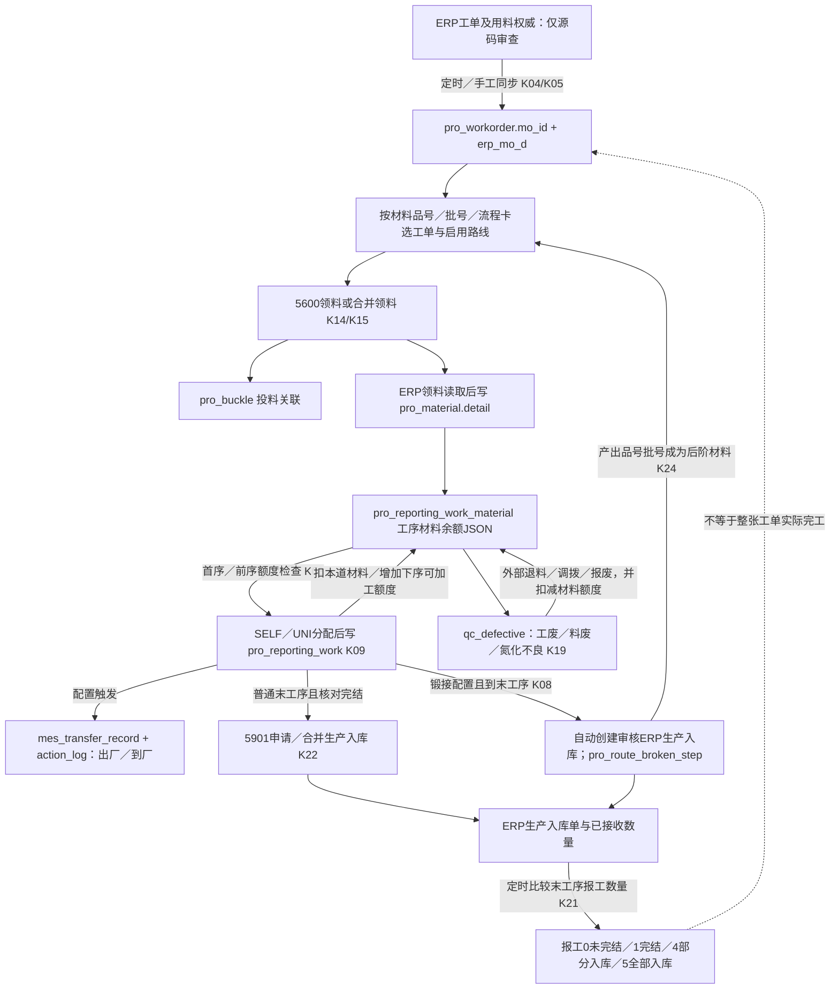

# ktg-mes 真实业务与 Base MES 历史数据迁移可行性审查

审查日期：2026-10-20（Asia/Shanghai）。范围：当前源码、指定来源/目标库的只读观测、追加导入设计。**结论：NO-GO，当前不具备实施真实生产历史 APPEND ONLY 导入的条件。** 可继续开展来源补全、受控历史导入设计和只读样板核对；本报告不批准任何数据库写入。

## 1. 审查身份、证据等级及限制

| 对象 | 本轮确认 |
| --- | --- |
| ktg-mes | `/Users/user/work/heri/ktg-mes`；`master`；HEAD `ae799d5ef9f088c49a723fdcc091e1a805beda1b` |
| 旧仓库已有修改 | `ktg-admin/src/main/resources/application.yml`，未修改、未还原；业务追踪使用当前干净 Java/XML 文件 |
| mes-base | `/Users/user/work/lixin/mes-base`；`main`；HEAD `f43f266b62ccdd8fa7dcc49b1280b34bf580634f` |
| Base已有修改 | 开始时仅 `docs/reviews/2026-10-19-production-core-performance-optimization.md`；随后并行任务修改ExecutionPathService、ProductionQuantityService、ProductionReportSubmitService及ProductionReportingHttpTest，全部保留，不属于本轮实现 |
| 来源 | `192.168.18.25:3306/prod_j2eedb`；按用户本轮明确指定，不自动选择 `j2eedb` 或其他同名库 |
| 目标 | `192.168.18.25:3306/mes_base_dev_perf_test` |
| 实例 | MySQL `8.2.0`；hostname `10dab82856fb`；server UUID `03dbc952-7403-11ef-802c-0242ac130002` |
| 目标绑定 | 中心 `mes_base_dev.mf_factory` → `mf_datasource`：Factory `TEST_DEV_PERF_20261019`，datasource `9`，双方 `ENABLED`，模式 `LOCAL` |
| 目标Schema | 45张表；业务表没有 `factory_id`；正式 `flyway_business_schema_history` V1–V39全部success=1；本轮未运行Flyway |

本轮遵守个人工程规则及两仓库 AGENTS，排除旧 `ktg-wheel`。旧 Reactor 实有 `ktg-admin/framework/system/quartz/generator/common/mes/sqlserver/wheel`，实际生产主链在 `ktg-mes`，并非另造替代模块。源码同时存在通用 RuoYi 生产模块与 ERP 驱动的流程卡生产模块；数据库证明本次数据主要属于后者。

证据顺序为旧入口及实现 → 该实现涉及的真实metadata → 业务数据查询 → Base正式实现。源库有历史任务运行日志，但没有提供其部署JAR与当前HEAD的同一性证据；**当前源码可解释行为，不等于证明所有2024–2026历史记录均由同一版本产生。** `prod_j2eedb` 作为指定数据集已确认，备份/复制时间、原ERP账套/组织和完整性未由备份清单证明。不得把这里的观测称为当前生产ERP验收。

数据库证据为只读SELECT/metadata查询；逐项原始SQL、返回值、时间和错误保存在 `.local/legacy-review-20261020/`（目录0700、数据文件0600，Git忽略）。连接凭据仅由既有私有option文件提供，不输出密码；不查询远端ERP，不调用任何业务写HTTP，不构建、不启动或重启服务。自有查询及摘要采集器设置 `TRANSACTION READ ONLY`；首次连接身份探测及复用的901审计工具仅发出SELECT。该保护不等于底层账号经验证只有SELECT权限。

查询时间分别记录于JSON的UTC `capturedAt`，本地时间加8小时。来源关键计数前后相同；各次连接并非全库统一事务快照。目标有并发压测写入，不能用单一总数声称整库被冻结。私有证据保存完整业务编号、用户快照、来源ID；公开样板使用S1/S2/S3及R/Q/I/B别名。

### 1.1 证据引用约定

`Kxx` 为旧源码、`Bxx` 为Base源码，完整文件/方法/行号见附录A。 Base审查期间出现并行优化：B03/B06/B07新增锁持有期间的LockedPath复用，仍保留路径、数量、身份和起产门禁；本轮只复核其与迁移结论相关的静态差异，不对该并行实现作构建或并发验收。source-manifest-initial.json保留首次hash，source-manifest.json及source-snapshots保存本次最终读取字节；后续代码变化需重核。`Qxx` 为本轮实际只读SQL及结果，见附录B；JSON原件可由其文件名在上述私有目录复核。样板明细不公开原始单号与人员身份。报告内“可重建”均注明是已证明、条件性建议还是未知。

## 2. 旧MES真实业务链路

旧系统不是“工单 → 报工 → 本地库存”的单一闭环。真实主链为：**ERP同步工单/用料 → 以材料品号与流程卡选单和路线 → ERP领料及MES扣料/工序材料额度 → 员工分工序报工和不良 → 普通申请入库或锻接自动中间入库 → ERP入库核对反写报工状态**。出厂/到厂交接是独立配置驱动分支；不是Base成品仓储接收。



另有[可探索源码链路图](../../.archify/workflow-ktg-mes-business-20261020-080300/ktg-business-chain.html)，来源固定到旧HEAD；图不暗示每张工单经过全部分支。图的结构、产物和浏览器自动检查已通过，未做人工逐像素美观验收。

### 2.1 逐业务入口、事务、持久化与数量规则

| 业务 | HTTP／其他正式入口与真实调用链 | 数据/状态/拒绝条件、事务及外部边界 |
| --- | --- | --- |
| 工单创建、修改、下达 | `/mes/pro/workorder` POST/PUT → `ProWorkorderServiceImpl` → `ProWorkorderMapper.xml`；ERP同步 `ErpWorkOrderServiceImpl.updateERPworkOrderToMysql*` → ERP Mapper → `saveWorkOrder` → 本地Mapper（K01–K05） | 手工创建检查编号；Controller按产品BOM×工单量生成 `pro_workorder_bom`，改产品/量则删除重建BOM。实际库全部来源PLAN且有mo_id，BOM本地表0条。ERP同步以mo_id匹配、置parent=0，复制ERP STATUS/计划/完成量并替换erp_mo_d，不证明发生MES“下达”事件。手工add/edit没有聚合事务注解覆盖整个Controller链；`saveWorkOrder`有@Transactional，但远端读取与本地写并非跨系统原子事务。 |
| 取消、关闭 | 通用DELETE `/mes/pro/workorder/{ids}`；PUT `/{workorderId}` → `dofinish`（K01） | 删除的“只准草稿”检查已注释；`dofinish`在Controller@Transactional内把任务和工单设FINISHED，无Base式质量/接收冻结。ERP主链状态由同步复制；未找到可据此转换为Base取消事实的统一ERP作废命令。该库无FINISHED行，仅1/2/3/Y。 |
| 工单、批次/子工单 | `/mes/mobile/work-report/getTicketInformation`、旧web `/mes/pro/reportingWork/workorder` → `getAfterItemAndLot` / 工单查询（K06/K07/K24） | 本地工单PK是bigint；报工的workorder_id实际上按ERP mo_id字符串查询，不可按数值PK关联。xtransfer_no形成真实加工批次分组，工单batch_code不是权威Execution。parent_id全0，不能虚构子工单树；上下游另见断阶/扣料。 |
| BOM、工单需求 | 手工BOM如上；ERP主链 `ErpModMapper` / `erp_mo_d` + OAPI `MoD`（K04/K05/K08/K15） | 报工用qtyPer=ERP需领量÷计划量（5位HALF_UP），从JSON acceptedQty÷qtyPer取最小可报量；不是简单照搬本地BOM。erp_mo_d为同步镜像，不是带版本的历史需求冻结。 |
| 领料、补料 | POST `/mes/oapi/issueReceipt/insert5600/{docNo}/{itemCode}/{itemLotCode}/{qty}`及 `IssueReceiptServiceImpl.insertDocNo5600Merge`（K14–K17/K31） | 验证同材料/流程卡不能投不同工单、未完结才允许投料；先插pro_buckle，再创建ERP单；单项异常会删本地扣料，合并方法有@Transactional并调用ERP。ERP响应经 `OApiResponseUtils` 解析；确认受开关控制。报工准备 `updateMaterial` 读取ERP领料，按issue_doc_no去重写pro_material及首序材料JSON。不能把pro_buckle本身当可信“已实际出库”。 |
| 补料名义入口的限制 | POST `/qc/defective/supplementMaterial/...` → `QcDefectiveServiceImpl.supplementMaterial`（K18/K19） | 当前方法仅遍历校验正数/物料/工单，没有实际新增领料/库存动作；不能凭名称声称完成补料。合并领料支持主配件的源码，但真实JSON均单材料。当前定位链未发现5650实际调用，不沿用旧记忆补入。 |
| 退料、工料废 | `/mes/oapi/issueReceipt/insert5704/...`、`insert5705/...`；POST `/qc/defective`、`/scrap` → `QcDefectiveServiceImpl` → QcMapper/材料Mapper + ERP退料/调拨/报废（K18–K20） | 5705工废、5704料废、5700氮化不良；校验工单2/3、非SUPPLIER、工艺启用、用户工艺权限和材料额度。新流程可能创建570x、1601、1F05/1602并审核；部分方法有@Transactional，主 `insertQcDefective` 的@Transactional已注释，不能声称全链本地回滚，更不能覆盖外部副作用。 |
| 工艺顺序与流程卡 | route/product映射 → `ProRouteProcessMapper.findPreProcess/findNextProcess`（K13）；报工Service + Manager（K08/K09/K12） | 顺序按同route的order_num前后最近项，不按同名字段猜序。每次报工按当前启用路线/产品关联查工序，无Base确切版本及锁定Path证据。材料余额JSON按工单编号+卡号+router_id+process_id维护，下一序额度由报工推进。 |
| 员工报工、修改 | POST `/mes/mobile/work-report/add` → `preVerify` → SELF/UNI → Manager.executeInsert；web `/mes/pro/reportingWork`、`/mobile`；PUT `/quantity`，DELETE `/{recordId}`（K06–K12） | SELF取登录sys_user，UNI至少2名、不重复、各自有工艺权限，总量均分，保留舍入余数；每人报工量相加才是一次加工量，不能人数倍增。首序需材料及ERP用料行数校验，后序需前序材料；正数且不超min(acceptedQty/qtyPer)。SELF事务通过代理调用；UNI外层没有同样注解，逐executeInsert有事务；Controller还有JVM intern锁，不等于跨节点幂等。 |
| 时间、数量修改历史 | Manager设置create_time=new Date，create_by当前账号，保存工艺/人员名称和单价金额；管理员updateQuantity/delete及forcedFinish（K09/K10） | 修改限未完结、不可使前序低于后序；updateQuantity原位改报工/材料余额；删除原位恢复额度；forcedFinish把剩余材料置完结。无完整不可变修改事件链。历史目前只可保留最终行及可得快照，不能重造所有曾发生的修改。计件金额不是Base生产数量事实。 |
| 不良、返工 | QcDefective及人员/责任人关联（K19/K20）；工序材料减少 | 旧不良数量是指定物料的不良，主配件/qtyPer会影响换算；责任工序不必等于发现工序。status=1表示已转报废，不是质量放行或返工通过。该库没有证实可迁入Base返工轮次、返修恢复、核实事件的独立事件链；不从同序多次报工猜返工。 |
| 成品、半成品入库 | 普通 `/mes/oapi/moReceiptRequistion/insert5901`、`mergeInsertDocNo5901`；移动 `/mes/mobile/in-bound-requests/createMoReceiptRequisition`；锻接末序自动入库（K08/K22/K23/K33） | 普通创建/审核/合并发生于ERP，pro_receipt_merge只是本地追踪候选。锻接在SELF报工事务内调用ERP并写断阶before/after品号批次、数量、入库单号。HTTP成功和本地事务成功不构成ERP数量/库存已验证；本轮未访问ERP。 |
| 生产库存与ERP | `taskService.verifyNumberChangeStatus` → `MoReceiptManager`查询ERP → `ProReportingWorkMapper`更新状态/日期（K21/K11） | 按工单+产品+流程卡分组，使用process_code计算挑末序，ERP acceptedQty小于末序报工则4，相等则5并记transactionDate；锻接前后状态另有特定路线分支。状态4/5是任务派生快照，不是本地库存凭证。该库wm_material_stock/wm_transaction等为空。 |
| 出厂/到厂交接 | `/mes/mobile/transfer/confirm`、`/receiveBatch`、`/order/outConfirm`、`/order/receiveConfirm` → TransferApplicationServiceImpl → Facade/Adapter → MesTransferRecord/ActionLog Mapper（K25–K28） | 读取角色/场景配置，条件更新旧状态、检查受影响行数，写当前用户/时间的动作日志；部分业务入口@Transactional。它承载工序物流/出入场，不可冒充Base“质量放行后的成品生产交接＋仓库入账”。 |
| 一个工单成品作另一工单原料 | 锻接写pro_route_broken_step，后续getAfterItemAndLot改用after品号/批次找工单，再经pro_buckle投料（K08/K24/K15） | 关系需before/after、入库引用、后阶扣料、产品/数量共同证实。相同品号或parent_id不足为证；S3已有实际证据，但仍缺ERP完整收发账。 |

### 2.2 同步任务与状态权威

`sys_job`启用配置和`sys_job_log`实际运行记录分别核实（Q11/Q12）。工单同步成功日志15,470次、失败20次；入库核对成功1,010次、失败12次；报工与ERP匹配成功711次、失败6次。最后成功日志分别到2026-10-18。日志成功不证明每张相关单据处理正确，更不证明此刻调度服务运行。

工单 `status=1/2/3/Y` 的真实字典是“未生产/已发料/生产中/已完工”；通用PREPARE/FINISHED能力与这些值并存。报工 `0/1/2/3/4/5` 是“未完结/完结/可结算/已结算/部分入库/全部入库”，与工单状态不是同一状态机（K34、Q04/Q10）。**finish_date从PLAN_COMPLETE_DATE映射，request_date从PLAN_START_DATE映射；不得把它们当真实完成/创建时间（K05）。**

## 3. 真实数据统计与异常

以下均为本轮COUNT或条件聚合，不采用information_schema.TABLE_ROWS估计值。

### 3.1 核心数据量

| 来源表 | 精确行数（Q01） |
| --- | --- |
| pro_workorder | 1822 |
| pro_reporting_work | 170484 |
| pro_reporting_work_material | 143361 |
| pro_buckle | 12528 |
| pro_material | 12759 |
| qc_defective | 17297 |
| pro_route_broken_step | 1185 |
| pro_feedback | 0 |
| pro_trans_order | 0 |
| pro_workrecord | 0 |
| pro_task | 8 |
| pro_workorder_bom | 0 |
| wm_material_stock | 0 |
| wm_transaction | 0 |
| wm_product_recpt | 0 |
| wm_rt_issue | 0 |
| pro_inbound_confirm | 0 |
| pro_material_issue_confirm | 0 |
| pro_receipt_merge | 0 |
| erp_mo_d | 100943 |


来源主数据 `md_item=25,208`、`pro_route=63`、`pro_process=840`，各自编码去重数等于行数（Q23）；这不等于与Base同名编码语义一致。报工170,484行，863个ERP工单身份，12,425个工单/流程卡/路线组合（Q03）。当前工单1822行与报工863个身份之间存在严重历史缺口。

### 3.2 工单状态、实际报工覆盖

| 工单状态 | 来源类型 | 工单数 | 有报工工单 | 报工行数 | 单工单最大次数 | 多批工单数 |
| --- | --- | --- | --- | --- | --- | --- |
| 3 | WORK_CENTER | 853 | 40 | 3931 | 303 | 39 |
| 2 | WORK_CENTER | 44 | 13 | 225 | 34 | 10 |
| 3 | SUPPLIER | 109 | 0 | 0 | 0 | 0 |
| 1 | WORK_CENTER | 569 | 0 | 0 | 0 | 0 |
| 1 | SUPPLIER | 123 | 0 | 0 | 0 | 0 |
| Y | WORK_CENTER | 102 | 0 | 0 | 0 | 0 |
| Y | SUPPLIER | 22 | 0 | 0 | 0 | 0 |


工单状态合计：1=692，2=44，3=962，Y=124。没有一个parent_id非0；全部PLAN、有mo_id、产品ID非0；1822行create_time全部NULL，finish_date全部有值但为计划时间（Q04/Q06）。Y的124张全部没有当前可关联报工；**不能把它们当有完整真实加工证据的正常完成样板**。

### 3.3 报工状态与不良

| status | SELF行数 | UNI行数 | 合计 |
| --- | --- | --- | --- |
| 0 | 1464 | 140 | 1604 |
| 1 | 732 | 82 | 814 |
| 4 | 121 | 24 | 145 |
| 5 | 154164 | 13757 | 167921 |


同一张工单可跨不同报工状态，不能把分组中的orders或batches直接相加成去重总数。SELF/UNI是记录归属方式，不是不同生产流程。跨所有工序求SUM不是最终产量；样板S1三道各2400合计7200，产出仍2400。

| type | status | is_return | 行数 | 数量合计（物料口径） | 有报废单号 | 有报废时间 |
| --- | --- | --- | --- | --- | --- | --- |
| 5700 | 1 | Y | 2 | 19.000000 | 0 | 0 |
| 5704 | 0 | NULL | 2 | 5.000000 | 0 | 0 |
| 5704 | 0 | Y | 16 | 143.000000 | 0 | 0 |
| 5704 | 1 | NULL | 3247 | 60218.000000 | 3247 | 1864 |
| 5704 | 1 | Y | 3204 | 99734.000000 | 3204 | 3204 |
| 5705 | 0 | NULL | 2 | 2.000000 | 0 | 0 |
| 5705 | 0 | Y | 53 | 232.000000 | 0 | 0 |
| 5705 | 1 | NULL | 5522 | 33912.000000 | 5522 | 2844 |
| 5705 | 1 | Y | 5249 | 36659.000000 | 5249 | 5249 |


不良总17,297条：5700=2，5704=6,469，5705=10,826。is_return为Y或NULL必须原样保留；NULL不强行改N。“已转报废”保留引用和快照，不能据此宣称远端现仍有效，不能生成Base质量放行。（Q05、K19/K34）

### 3.4 关联、版本、时间的迁移阻断

| 核查 | 结果 | 含义与处置 |
| --- | --- | --- |
| 报工找不到mo_id工单 | 166,328 / 170,484；涉及810 / 863个报工工单身份（Q06/Q07） | 97.56%报工当前无头单；按工单编号补查也同样缺失，不是换JOIN字段就能解决。不造工单、不用复制表猜头单；来源补齐前C。 |
| 已关联报工工单 | 53个工单、4,156行报工（Q07及Q08） | 只占有可核实头单的候选范围；不等于全部可导入。 |
| 报工当前路线/节点缺失 | route缺失4,065行，route+process节点缺失4,085行（Q06/Q09） | 仅有名称/工序编号不能恢复确切历史工艺版本，拒绝强绑当前路线。 |
| 不良/需求镜像缺头单 | 不良16,936行；erp_mo_d 97,807行（Q07） | 不以相同产品归并到在库新工单。 |
| 扣料/领料镜像缺工单编号 | pro_buckle 12,073；pro_material 12,323（Q13） | 不能生成当前正式Input额度。 |
| 报工材料JSON | 空JSON=0；重复复合身份=0；报工找不到对应余额=8；负acceptedQty=6项（Q13/Q24） | 负数分别-10/-19/-2/-1/-1/-3；均隔离，不截0或重写来源。余额是最终可变投影，不是每次投料事件。 |
| 工艺唯一性 | 当前(route_id,order_num)重复0；工单编号重复0（Q06） | 仅当前结构无此冲突，不证明历史未改工艺。 |
| 时间/身份 | 报工非正数0、缺create_time或user_id=0、空流程卡0；报工人员找不到旧sys_user=0（Q06/Q09） | 旧人员ID仍不能直接复用为Base中心用户ID；时间字段仍需区分实际加工与录入。 |
| 入库时间倒置 | 状态5无入库时间=0，但all_into_store_time早于报工create_time=10,495行（Q09） | ERP交易时间、补录或历史修改等均是候选原因，未证明唯一原因；保留原时区/精度并隔离检查，不按单字段强行排序补事实。 |
| 报工修改 | update_time非空61行（Q09） | 仅说明当前留有更新时间，不能证明只有61次修改或恢复删除历史。 |
| 断阶 | 1,185行都有inbound_doc_no；145行before_work_id空；仅65行关联当前前阶头单（Q14） | 保留已知before/after及引用，不扩展为完整库存谱系。 |
| 锻接配置 | forge_joining_flag为1的路线2条、0的61条（Q22） | 使用tinyint真实值，不与字符串Y比较。 |
| 多材料 | pro_material.detail和工序材料JSON中长度>1均为0（Q15） | 源码支持主配件分支，但本数据集未证明真实多材料使用；不据此扩大Base范围。 |
| 领料镜像种类 | 5600=12,680，5705=73，5704=6；其中5600缺create_time=6,097（Q16） | 这张表混有退料引用，不能所有行都当正向领料。 |
| 交接 | mes_transfer_record=2,358：RECEIVED=2,357、WAIT_OUT=1；动作5,499：OUT_CONFIRM=2,750、ARRIVE_FACTORY=2,749（Q17） | 真实物流交接存在；不能因为pro_trans_order为空就声称旧系统没交接。样板S1–S3按其工单身份未查到交接记录，不替其补造。 |

真实数量可用于证明样本，但没有完整账套/时间范围清单说明当前头单为何缺失。同步过滤、数据清理、复制范围等仅为待查原因；本轮不归因于某个任务，也不认定原生产库事实丢失。

## 4. Base正式业务能力及语义对照

### 4.1 正式模型与持久化

Base现有核心由 `WorkOrderService`、`ProductionExecutionRules`、`ExecutionPathService`、`ProductionInputService`、`ProductionReportSubmitService/ProductionReportService`、`ProductionQuantityService`、质量三Service、`ProductionReceiptService`、`WarehouseAcceptanceService`、`ProductionCompletionService`、`LocalStockService`组成。它不是逐表CRUD即可成立的闭环。

| 正式业务／HTTP | Service、持久化及前置条件 |
| --- | --- |
| `/api/production/workorder`；`/{id}/actions/release` | B01→WorkorderMapper/XML；create只允许当前LOCAL，source不可客户端改成EXTERNAL；release校验真实主数据/路线及revision。外部计划只经syncExternal与SyncCoordinator可信写入。 |
| `/api/production/mes-production-execution`及`/api/production/executions/{id}/path`、`actions/select-path/start` | B02/B03→mes_production_execution、mes_execution_path/node；创建只能READY、start/end空；WorkOrder/产品/确切Routing引用固定。起产需RELEASED、合法锁定Path、可信CONFIRMED领料及submission/外部生效证据。 |
| `/api/production/input`及`calculate/preview` | B04/B05→mes_production_scan_identity、mes_material_issue/input/item/submission/erp_extra；稳定UUID冻结请求hash，计算单材料和批次库存，事务准备后经既有提交链确认；LOCAL真实扣库存，EXTERNAL需权威查询/命令；失败/UNKNOWN不自动重建。 |
| `/api/production/reporting` | B07→MesProductionReportMapper；用户为当前可信登录人员；能力/派工、锁定Path和额度实时校验；request_id唯一、同payload重放；report_time/create_time均服务端now，不能把迁移账号当旧操作者。 |
| `/api/production/reports/supplements`、`/{id}/adjustments/void` | B08保留显式operatorUserId、reportTime和理由；create_time/recorded_by仍取当前。已有管理员历史补录能力，不能概括成“Base完全不支持历史发生时间”；但仍需当前真实Execution、source、锁定Path和数量规则，不能替代全域历史导入。 |
| `/api/production/report-quantities/executions/{id}` | B06/B20只认可信InputBalance和锁定Path节点的报工＋有效不良/恢复；普通查询不以当前模式猜来源。输入→本序报工→有效不良→下序可加工逐节点计算；前序不足/待核实不良阻止正向推进。 |
| 不良申报、处置、放行 | B09/B10/B11→mes_production_defect、mes_quality_treatment、mes_quality_release；申报版本链、确认/返工/恢复各有独立事实；放行是按当前basis_hash明确授权的累计数量。旧status=已转报废不等于这些事实。 |
| `/api/production/receipts` | B12→mes_production_receipt；仅运行中执行、真实仓库来源匹配、锁定路径及可信质量放行额度；交接采用不可变增量/逆向。 |
| `/api/wm/production-acceptances/receipts/{id}` | B13→mes_warehouse_acceptance＋B15→wm_stock_action/wm_inventory；原交接待收量、质量依据有效、当前LOCAL；同事务真实入库。本轮未对ERP仓储接收能力作成功声明。 |
| `/api/production/executions/{id}/closure`、`actions/complete` | B14→mes_execution_completion；RUNNING、无未决领料、质量安全且放行依据有效、末序有效产出=净交接=净接收，写冻结快照及终态。 |
| LOCAL/ERP边界 | B16/B17读取FactoryIntegrationSnapshot/Context/Registry；WorkOrder/Warehouse持久化来源，当前mode不匹配拒绝；历史重放/恢复按原provider/binding。每厂最多一个ERP；不存在从历史ERP事实自动转LOCAL的合法捷径。 |
| 历史只读 | B18及LegacyBatchHistoryController只解释已退休production_batch/batch_route_node，并验证头单存在；不是ktg流程卡/报工/质量/库存的通用历史导入或投影。 |

HTTP路由及Controller→Service调用点见B22–B33；路由以当前Controller为准。Base按Factory独立业务库隔离，业务表不保存factory_id；中心用户/权限、固定事务租约和跨库拒绝由基础设施负责。中心库源用户不能原PK移入业务表冒充已授权人员。普通查询用注入Mapper及只读事务；跨库身份校验使用既有受控metadata窗口，不新增第三会话工厂。

Flyway依据：V16执行、V23实际路径/提交事实、V25报工不可变账、V26不良账、V27请求UUID、V28交接、V29单材料Input/扫码、V32质量处置、V33管理员指纹、V34库存动作、V35质量放行/接收/完工、V36来源隔离、V37作废。目标实际触发器拒绝报工、不良、质量、交接、接收、完工和库存动作的UPDATE/DELETE（Q20）。本轮不禁用或改写。

当前生产源码中 `WarehouseErpAdapter` 正式实现仅找到LocalWarehouseErpService；E10现有链主要为MO/CMS Query/Read候选验证及B19同步Writer。缺可验证ERP出入库命令适配器，不能把SDK接口存在视为Base已支持旧系统全部5600/5901/5A00/退废闭环。本轮不访问ERP、不改模式，不新增补偿要求。

### 4.2 最关键的数量与身份差异

1. **旧报工量与Base加工完成量不天然同义。** 旧报工减少本道材料并把该加工量贡献给下一序；旧不良另外减少物料额度。Base本序有效产出按 `reported - (directDefect - recovered)` 等规则推导。旧报工中若已反映损耗后的良品量，再按原值导入并重复扣不良，会二次扣损（K09/K19、B06）。只能按每序证据确定gross/good/material-unit和不良影响节点，必要时保留原历史口径C；不得一律“旧报工＋旧不良”制造未记录的人员加工事实。
2. **旧统一报工为多人分量记录。** 分配后的各行之和才是加工总量；可保留每人最终数量与原时间，无法还原缺失的共同命令UUID。Base正式扫码身份是product/material/lot字节精确组合的永久绑定，不含旧工单/route；旧相同卡号不可直接当新唯一身份（B21）。本数据集按product_code/item_code/material_xtransfer_no分组跨工单复用数为0（Q26），因此它目前是规则兼容风险，不是已发现的跨单冲突。
3. **旧工艺是可变主数据，Base是确切Routing和选定Path。** 可从报工工序存在性和当时快照证明“做过这些工序”，不能从当前order_num自动证明当时完整路径、跳过节点和版本；同序多次不等于返工轮次。
4. **旧已入库状态不等于Base放行、交接、接收、完工四种事实。** 旧任务直接从ERP入库反写报工状态；未记录质检放行签字、Base交接人或库位的记录不得补造。
5. **ERP来源不得伪装LOCAL。** 来源工单全PLAN且mo_id有真实ERP关联，目标工厂却为LOCAL。有数据归档需求不等于授权业务来源转换；当前Service正向处理会冲突。只读历史的来源/provenance与是否允许当前生产必须明确表达。
6. **时间、人员、修改链不同。** 旧create_time多为录入时间，all_into_store_time为ERP交易时间；工单finish_date是计划。必须保存原值及“时间语义/可信度”，有证据才赋为Base实际发生时间。旧姓名快照保留，身份不明时不得绑定迁移管理员。旧已删/改前的报工无法由最终表生成不可变调整历史。

## 5. 业务覆盖及迁移方式矩阵

A=现有正式Service可合法重建；B=需受控历史导入；C=证据不足仅保留历史；D=现有领域/规则暂不表达。**表中B表示未来能力需求，不表示当前已经有可用导入器。** A仅限无历史副作用的真正同义对象，非对整张生产工单的通行证。

| 旧MES业务 | ktg实现 | 真实证据 | Base对应 | 差异 | 迁移方式 |
| --- | --- | --- | --- | --- | --- |
| 产品/单位/工序主数据 | MdItem/ProProcess与K05/K13 | Q23；S1–S3均有需求与工序 | Material/Unit/Operation正式Service | 编码、规格、单位换算、状态和人员权限需审核；不静默复用同码 | A候选：审核后新ID/命名空间创建；未形成全量逐项准入清单 |
| 工艺路线 | K13及ProRouteService | 63条当前路线；历史引用65个route ID，部分已缺 | Routing/节点/边/版本 | 旧可变route≠历史确切Routing | 当前确有可用定义的全新主数据A候选；历史版本B或C |
| ERP计划工单 | K04/K05 | 1822 PLAN工单，124 Y无报工 | B01.syncExternal/WorkOrder | 当前LOCAL、原ERP绑定未核实、创建时间缺失 | B；不调LOCAL create伪装来源；缺头单C |
| 父子工单 | K01 | parent全0 | 一个WorkOrder可多Execution | 没有真实父子样本 | C（无证据，不补关系）；若未来确需工单拆分规则另设计D |
| 流程卡多批次 | K06/K08/K09 | 12425组合，S2八批 | Execution＋Identity＋Path | 旧卡号不等于永久scan identity、无冻结路径 | B；缺路线/身份C |
| 投料、已领料 | K14–K17/K31 | 12528扣料、12759混合材料记录 | MaterialIssue＋ProductionInput | 扣料≠ERP生效凭证；LOCAL重放真扣库存 | 已有真实来源快照B，未证实部分C；绝非直接A |
| 补料/主配件 | K15/K19 | 当前JSON多材料样本0；名义补料方法只校验 | MATERIAL_SUPPLEMENT；单材料正式Input | 不能把增加材料量当新增产出 | 真实可证记录B；未发生/未证明C；多材料正式投产扩展D按需求再启动 |
| 工序加工与人员报工 | K06–K13 | 170484行，SELF/UNI | B07/B08/B06 | 旧数量口径、旧人员/时间、无原幂等及改前值 | B；管理员supplement仅在完整合法链已成立时局部复用；孤儿等C |
| 不良、工废/料废/退料 | K18–K20 | 17297条、人员关联及ERP引用 | B09/B10 | 物料单位、发现/责任工序、报废与恢复语义不同 | B/C；不得自动创建放行/返工恢复 |
| 返工 | 未发现可证明独立返工事件链 | 多次报工不能证明返工 | QualityTreatment返工/恢复 | Base可表达新返工，来源事件证据缺失 | C；不是Base必须新增返工引擎D |
| 出厂/到厂 | K25–K28 | 2358记录/5499动作 | ProductionReceipt等不是同义对象 | 物流交接与成品交接/入库不同 | C保留动作；确需现场延续才单独D，不能直接生成接收 |
| 普通入库申请/入库 | K22/K23/K21 | pro_receipt_merge与wm_product_recpt均0，但167921报工status5 | B12/B13/B14 | 仅派生状态，无完整ERP单据行/质量签批/余额 | C为主；取得权威行证据后仅相应事实B |
| 锻接中间产出→后阶用料 | K08/K24 | 1185断阶，S3有6组后阶扣料匹配 | 执行产出/原料批次，可用现有核心承载分别的事实 | 缺统一显式跨工单谱系及历史入出库证明 | 关系B/C；当前自动锻接ERP业务D，不为只读历史复制流程 |
| 正式完工 | K01/K21 | Y124无报工；S1–S3仍3 | B14冻结闭环 | 不能从旧Y/5生成BaseCOMPLETE、release/receipt/acceptance | C；仅完整可信事实未来经历史政策B |
| 权威库存 | ERP；旧WM模块空 | wm_material_stock/transaction=0 | B15为LOCAL唯一写者 | 无余额/完整动作，目标已有库存不可动 | C；未来盘点/期初另立授权任务，不回放历史收发 |

无证据支持“把全部旧真实生产数据按现有正式Service顺序重建”这一方案。可复用的是业务校验/只读投影/经过准入的主数据创建；当前已发生生产事实不能为通过新门禁而重新执行。

## 6. 三组真实迁移样板

选样实际SQL见私有 `normal_batch_candidates.json`、`candidates_v2.json`、`broken_candidates_fast.json`，明细在 `S1/S2/S3-*.json`。样板映射表另存私有 `sample-aliases.json`，公开报告无完整业务编号/姓名。`full_completed_candidates.json`严格筛选“当前头单存在、至少两工序、全部报工5、ERP完成量≥计划且无不良”返回0；Y完工头单也无报工。因此不能满足第一类“整张正常已完工工单”的完整实证，以下S1诚实降为已完成批次。

### 6.1 S1 — 已完成的三工序批次：首选最小样板

来源头单计划22176.00、ERP镜像完成量7190.00，工单状态`3`（生产中）。当前关联4批、12条SELF报工、1条不良、4条扣料、4条材料镜像、12条工序材料余额；原工单/产品/人员编号仅见私有映射。

| 批次别名 | 报工行数 | 报工当前状态×行数 | 当前末节点报工量 | 该批不良量（物料单位） |
| --- | --- | --- | --- | --- |
| S1-B01 | 3 | 5×3 | 2400 | 0 |
| S1-B02 | 3 | 5×3 | 2400 | 0 |
| S1-B03 | 4 | 5×4 | 2390 | 10 |
| S1-B04 | 2 | 0×2 | 0 | 0 |

选中批次B01的工序与数量时间线如下。N01…按当前源码order_num排序；这是当前路线候选序，实际报工存在由原记录证明，历史版本仍需额外确认。时间为原create_time，不能自动升级为实际开工时刻。

| 节点别名 | order_num | 报工条数 | 数量合计 | 原记录时间 | 独立不良事实 |
| --- | --- | --- | --- | --- | --- |
| N01 | 1 | 1 | 2400 | 2026-10-04 13:22:46 | 无 |
| N02 | 2 | 1 | 2400 | 2026-10-05 15:47:12 | 无 |
| N03 | 3 | 1 | 2400 | 2026-10-07 07:45:39 | 无 |

**已证明链路**：原扣料记录（S1-K002）2026-10-04 11:21:37、材料镜像（S1-I001）2026-10-04 13:22:42，其JSON为单材料qtyPer=1、acceptedQty=2400；随后3序各2400，总报工7200但最终产出仅2400。3条当前status=5，all_into_store_time均2026-10-07 00:00:00，其中末序录入在同日07:45:39之后。该批无不良；整单另一批存在10件工废，另有未完结批，所以不把整单称正常完工。

**预期Base对象**：一个带原ERP来源证据的历史WorkOrder引用、B01对应的历史Execution、3个有证据的节点和3条原始报工；保留材料及入库状态证据。真正冻结Routing须先确认历史版本。不能由3条status5生成QualityRelease、ProductionReceipt、WarehouseAcceptance或ExecutionCompletion，也不能凭镜像创建当前LOCAL扣料。

**无法还原/继续操作**：原工单创建时间、真实质量放行人、仓库接收人/库位、完整ERP入库行、历史路线版本与全部修改链未证明。推荐B01先做只读样板；当前不具备继续正式加工许可。最小兼容为来源Mapping、只读历史详情/报工/路径证据与缺失前置说明。

### 6.2 S2 — 八批、十八工序、多次报工与不良

来源头单计划10368.00、ERP镜像完成量3151.00，工单状态`3`（生产中）。当前关联8批、145条SELF报工、17条不良、8条扣料、8条材料镜像、144条工序材料余额；原工单/产品/人员编号仅见私有映射。

| 批次别名 | 报工行数 | 报工当前状态×行数 | 当前末节点报工量 | 该批不良量（物料单位） |
| --- | --- | --- | --- | --- |
| S2-B01 | 18 | 5×18 | 396 | 4 |
| S2-B02 | 19 | 5×19 | 394 | 6 |
| S2-B03 | 18 | 5×18 | 381 | 19 |
| S2-B04 | 18 | 5×18 | 396 | 4 |
| S2-B05 | 18 | 5×18 | 398 | 2 |
| S2-B06 | 18 | 5×18 | 396 | 4 |
| S2-B07 | 18 | 5×18 | 399 | 1 |
| S2-B08 | 18 | 5×18 | 391 | 9 |

选中批次B01的工序与数量时间线如下。N01…按当前源码order_num排序；这是当前路线候选序，实际报工存在由原记录证明，历史版本仍需额外确认。时间为原create_time，不能自动升级为实际开工时刻。

| 节点别名 | order_num | 报工条数 | 数量合计 | 原记录时间 | 独立不良事实 |
| --- | --- | --- | --- | --- | --- |
| N01 | 1 | 1 | 400 | 2026-10-04 09:56:10 | 无 |
| N02 | 2 | 1 | 396 | 2026-10-06 10:58:54 | 5705:4 @ 2026-10-06 11:17:20 |
| N03 | 3 | 1 | 396 | 2026-10-06 17:24:29 | 无 |
| N04 | 4 | 1 | 396 | 2026-10-06 17:24:35 | 无 |
| N05 | 5 | 1 | 396 | 2026-10-06 17:24:42 | 无 |
| N06 | 6 | 1 | 396 | 2026-10-06 20:47:35 | 无 |
| N07 | 7 | 1 | 396 | 2026-10-06 21:25:47 | 无 |
| N08 | 8 | 1 | 396 | 2026-10-06 21:25:53 | 无 |
| N09 | 9 | 1 | 396 | 2026-10-07 07:37:06 | 无 |
| N10 | 10 | 1 | 396 | 2026-10-07 07:44:55 | 无 |
| N11 | 11 | 1 | 396 | 2026-10-07 07:46:36 | 无 |
| N12 | 12 | 1 | 396 | 2026-10-07 09:12:03 | 无 |
| N13 | 13 | 1 | 396 | 2026-10-07 09:51:43 | 无 |
| N14 | 14 | 1 | 396 | 2026-10-07 12:35:56 | 无 |
| N15 | 15 | 1 | 396 | 2026-10-07 13:01:42 | 无 |
| N16 | 16 | 1 | 396 | 2026-10-07 13:01:59 | 无 |
| N17 | 17 | 1 | 396 | 2026-10-08 10:48:42 | 无 |
| N18 | 18 | 1 | 396 | 2026-10-09 07:32:13 | 无 |

**已证明链路**：8批均以400件投入，18工序、145条SELF报工；一批某序拆成两次报工，其余工序也有各自时间，不能压成一条“完成记录”。17条不良物料数合计49，八批末序合计3151，与当前ERP完成量3151相符。这是数值一致证据，不等于ERP现存单据已查询。全部报工status5，但工单仍为3、计划10368，未完成整单。

**数量语义的直接反例**：B01首序400、第二序报工396，另有第二序工废4件，后续每序均396。若直接向Base写report=396再写同节点defect=4，Base有效产出会变392，使下序396不合法；不能为凑数额外虚构“员工加工4件”的报工。旧物料损耗口径与新加工/不良口径必须先明确转换政策，不满足时原样只读C。该不良申报时间晚于相应报工，亦不能以时间排序重放来消除语义差异。

**预期Base对象/步骤**：一个历史工单、8个独立历史执行身份，按证实路径保存145条原人员/数量记录和17条独立不良及原退废引用；转换先核对每批材料→工序→最终量，再验证新数量投影。正式Service补录只能在这些语义和前置已成立时局部复用，当前不直接重放。原退废单号、时点、责任工序保留，质量核实/放行/返工恢复不补造；当前仅只读。

### 6.3 S3 — 锻接中间入库、后阶用料与报废

来源头单计划39160.00、ERP镜像完成量8993.00，工单状态`3`（生产中）。当前关联10批、75条SELF报工、2条不良、10条扣料、10条材料镜像、79条工序材料余额；原工单/产品/人员编号仅见私有映射。

| 批次别名 | 报工行数 | 报工当前状态×行数 | 当前末节点报工量 | 该批不良量（物料单位） |
| --- | --- | --- | --- | --- |
| S3-B01 | 10 | 5×10 | 1496 | 4 |
| S3-B02 | 10 | 5×10 | 1500 | 0 |
| S3-B03 | 10 | 0×10 | 1499 | 1 |
| S3-B04 | 10 | 0×10 | 1498 | 0 |
| S3-B05 | 10 | 0×10 | 1500 | 0 |
| S3-B06 | 10 | 0×10 | 1500 | 0 |
| S3-B07 | 7 | 0×7 | 0 | 0 |
| S3-B08 | 4 | 0×4 | 0 | 0 |
| S3-B09 | 3 | 0×3 | 0 | 0 |
| S3-B10 | 1 | 0×1 | 0 | 0 |

选中批次B01的工序与数量时间线如下。N01…按当前源码order_num排序；这是当前路线候选序，实际报工存在由原记录证明，历史版本仍需额外确认。时间为原create_time，不能自动升级为实际开工时刻。

| 节点别名 | order_num | 报工条数 | 数量合计 | 原记录时间 | 独立不良事实 |
| --- | --- | --- | --- | --- | --- |
| N01 | 1 | 1 | 1500 | 2026-10-04 11:30:36 | 无 |
| N02 | 2 | 1 | 1500 | 2026-10-04 12:12:01 | 无 |
| N03 | 3 | 1 | 1500 | 2026-10-04 12:21:21 | 无 |
| N04 | 4 | 1 | 1496 | 2026-10-10 10:24:29 | 5705:4 @ 2026-10-06 14:07:52 |
| N05 | 5 | 1 | 1496 | 2026-10-10 10:34:04 | 无 |
| N06 | 6 | 1 | 1496 | 2026-10-10 10:34:26 | 无 |
| N07 | 7 | 1 | 1496 | 2026-10-10 12:12:27 | 无 |
| N08 | 8 | 1 | 1496 | 2026-10-10 13:08:56 | 无 |
| N09 | 9 | 1 | 1496 | 2026-10-10 13:54:27 | 无 |
| N10 | 10 | 1 | 1496 | 2026-10-10 14:40:37 | 无 |

**已证明链路**：该工单10批、75条报工、工废两条合计5；已形成6条断阶入库映射。B01投入1500，前三序各1500，第四至第十序各1496；第四序有工废4，保存了退料来源与报废引用。2026-10-10 14:40:41断阶记录存1496及5A00引用；同一变换后物料/批次在14:58:18被后阶工单S3-D01扣料1496，14:58:47出现该后阶首序1496报工。不是仅凭“同物料”猜关系。六组断阶数量分别1496、1500、1499、1500、1498、1500，均有对应后阶扣料（S3-downstream.json）。

后阶B01另有4条真实报工：1496→1380→1380→1380，2026-10-10至12日；2026-10-13有同物料同节点料废116、已转报废及1602引用，数值满足1496−116=1380。报废晚于报工时间，不能由源当前表伪造此前曾发生的质量核实/放行事件。上阶报工status5的入库时间为2026-10-13，断阶记录在10日已有入库引用，两种日期应原样保留并核实，不能自动统一。

**预期Base对象/步骤**：S3前阶与D01后阶各自工单/执行及已证实路径，独立材料、报工、不良历史；来源关系连接“变换前物料/卡→中间产物批→后阶消耗”，来源单号只作证据。先保存6组来源关系，再核对每组数量和目标物料Mapping，最后只读联查。不得在已有目标库存上再收1496又扣1496，也不自动执行旧ERP命令。

**不能还原/继续操作**：缺远端单据行、当时库存期初/仓库/库位、完整质量放行及最终接收；当前工单仍3，其中有不良未转报废/未完结批。现有Base没有等价的自动锻接ERP步骤；仅为只读谱系无需复制这套流程。历史版本、人员与数量解释补齐前，不允许继续操作。


### 6.4 对三个样板的统一迁移步骤（设计，未执行）

1. 冻结来源库标识、抽取时点、选中主键集合和逐行payload hash；核对头单/材料/路线/报工/不良/外部引用完整性。不能把同单其他批次悄悄丢弃后宣称整单迁移。
2. 显式映射产品/单位/工序及历史用户；人员快照可读但不授予当前权限。对每个工序记录“当时顺序已证实/当前顺序候选/未知”，只有已证实部分进入权威Path。
3. 分拆“历史只读对象”和“可继续生产对象”的准入结果；来源仍标ERP历史，不能因目标LOCAL而改写为本地产生。S1/S2/S3默认只读，未证明可以继续操作。
4. 导入已证明的原始数量/时间/关系，以原始口径保留；逐序验证Base投影不会二次扣不良。对缺失投产/放行/接收只记录缺失，不创建对应权威事实。
5. 使用只读详情/路径/流水查询比较；任何异常整组拒绝或保持不可见的预备批次。只有正式完成审核的对象进入已发布历史视图。
6. 以后若要求继续加工，另行核实实际在制、原ERP身份/绑定、剩余物料/当前授权/完整路径；不能将历史归档的成功视为复工许可，不自动重放历史领料/库存。

## 7. 正式Service与历史导入的边界

### 7.1 可以复用的部分

- 已审核、无库存副作用的主数据Service与真实Mapping/引用规则；物料、单位、工序及新建冻结工艺需新ID、不改已有主数据。当前编码碰撞查询为0（Q18），但还需长度、大小写/空格、规格/单位及未来竞争检查，不能把0当长期保证。
- `ProductionReportService.supplement`已接受历史reportTime/操作者；在**合法来源、真实Input、确切Path、已映射用户及一致数量**成立时可作为局部写入手段。不适合逐条重放所有旧报工：历史原始命令、时间可信度、已修改事实和缺失前置均未解决。
- `ProductionQuantityService`、质量核对、闭环summary和正式只读查询可用作转换结果的业务对账，但不能为使它们返回无差异而制造Input、Release或Acceptance。

### 7.2 必须专用、且最小化的历史能力

建议在现有领域旁补**来源登记/ID映射/批次清单与严格只读历史解释**，复用现有WorkOrder/Execution/Report/Quality查询语义，避免复制第二套可写生产核心。先形成设计并单独评审，当前不创建表/接口。

| 最小缺口 | 需要补充的契约 | 不应做的事 |
| --- | --- | --- |
| 持久化来源ID与幂等登记 | 来源实例+schema+原工厂/账套证据+表+主键+源版本hash→目标新ID；抽取/转换版本、批次、原行摘要、拒绝理由、操作者和发布状态 | 仅靠内存映射/本地CSV或编码前缀作为幂等；把旧PK直接塞目标 |
| 来源与“只读/可继续”分开表达 | 复用LOCAL/EXTERNAL可信来源及原provider/binding，历史证据不足只读；读取不触发新业务来源准入，不需要伪造CONFIRMED/LOCKED才能查看 | 增加全局模式Resolver、竞争YAML入口；历史EXTERNAL改LOCAL；把所有历史标RUNNING |
| 时间与人员可信度 | 原始录入/ERP交易/计划日期分别保留；可确认才是occurredAt；历史姓名、原用户标识与当前映射区分；recordedAt记真实导入时间 | 迁移账号冒充旧员工；导入时间冒充生产时间；按当前目录名称补历史姓名 |
| 工艺历史解释 | 已证实的执行节点/顺序及证据，精确映射到新冻结版本；未知部分明确不可继续；不修改被现事实引用的Routing | 当前路线复制后宣称当时路径；缺工序用相近名称补齐 |
| 数量/质量口径 | 原加工/良品/物料不良及单位分开保存来源；完整证明后才能投影到当前数量权威；不能表达的仅作为来源历史附件/只读记录 | 添加“跳过数量校验”开关；用调整报工捏造无操作者的gross量；返工/放行补事实 |
| 外部/上下游关系 | 保存已证实ERP单据号、原状态快照/未知、断阶关系及后阶消耗候选；当前库存权威不变 | 根据入库状态自动入账、自动补偿ERP或自动重跑5600/5A00 |

现有报工列表B08.page还会调用B06.requireReadableExecutionNode，要求存在可验证路径节点；它没有为了读取而计算当前可变额度，但也不是缺路径历史记录的通用查询入口。

如果当前领域表无法在不伪造约束的条件下表达记录，应先保留带来源的历史只读记录/附件，不能直接写一份“完整但虚假”的Execution。现有LegacyBatchHistoryQuery只解释Base已退休Batch；可复用其只读隔离思路，不能把任意ktg流程卡硬塞production_batch。是否需要额外历史投影，由样板设计验证后决定，不先建平行Domain。

## 8. APPEND ONLY、冲突与恢复设计

本节为后续实现契约，**本轮未新增/执行任何DML或DDL**。

### 8.1 追加与标识

来源持久化自然键建议为 `(source_instance_id, source_schema, verified_source_scope, entity_type, source_pk)`，版本记录另用 `source_row_hash / extraction_id / transform_version`。同一实体不同版本共享来源身份，不能把每次导入当新实体。目标ID由目标分配；来源ID仅保留在受控映射，不在业务表增加factory_id。

目标Factory通过中心绑定固定，导入事务仍使用businessTransactionManager和固定租约；映射若放业务库则随库隔离，需记录原Scope语义；跨Factory不复用映射。中心批次管理与业务写不承诺原子提交，优先把本Factory发布状态与事实放同一业务事务，跨库仅独立只读核对。

原工单编号、物料编码、流程卡原样保留于来源证据；目标展示编码使用经长度/字符集校验的命名空间或明确审批的新编码，冲突不能静默append随机后缀再丢原编号。现有编码0碰撞不意味着现有主键/UUID可复用。新请求UUID按受控迁移命名空间+source identity+事件类型生成稳定UUID，创建前核对已有request_id指纹；碰撞拒绝、永不覆盖。

### 8.2 来源变化与二次运行

| 情形 | 行为 |
| --- | --- |
| 同来源身份、同hash/同转换版本且已COMMITTED | 返回原映射及验证结果；业务新增数0 |
| PREPARED/FAILED，中断且事务未提交 | 按冻结清单和原UUID重新校验后继续；不重发可能已发送的外部命令 |
| 事实已提交，批次应答/索引丢失 | 以业务库同事务写入的来源登记/请求UUID找回并返回；不能重新创建 |
| 同来源主键内容变化 | 默认CONFLICT；如业务需要增量版本，新增源版本及差异说明，由专门审核策略决定目标可读版本；不UPDATE旧目标事实 |
| 来源新增行 | 纳入新extract版本、去重后追加；明示其与旧批次关系，不凭update_time水位漏掉无时间行 |
| 来源删除/回滚 | 保留已入事实，追加差异/撤销候选证据，不物理删目标；正式业务撤销要走已授权规则且保留原身份 |
| 转换规则版本变化 | 先dry-run比较；同原事件不重复产生另一份目标事实；必要的新表达须审核/版本化，不能覆盖历史 |
| 部分工单缺引用 | 整个依赖组件拒绝/待核实；不能一半可操作、一半空引用。孤立来源原文可留未发布历史包 |

### 8.3 事务、库存与外部副作用

按“一个工单/Execution依赖组件”做有界事务，先主数据Mapping、再明确引用、再事实/登记原子发布。不可把所有17万报工放一个长事务，也不可仅靠HTTP调用成功标记批次完成。唯一约束和条件抢占负责跨节点幂等；租约/令牌失效后停止，沿用现有同步协调思想，不引入JVM全局锁。

只读历史默认**库存变化=0、ERP调用=0**。原库存、stock_action和901事实均不可更新。若某记录确需权威历史库存账，先补足账套、单据行、期初、单位和全时序及切换政策，再另立有界任务；不从旧任务派生状态回放收发。不禁触发器，不通过SET FOREIGN_KEY_CHECKS等绕过规则，不将历史入库重复记入当前可用库存。

## 9. 真实验收设计与本轮保护证据

### 9.1 本轮真实检查

原901从既有私有journal/workload复制为本轮独立只读审计输入，执行 `scripts/performance/audit-production-chain.py`，未调用该工具的负载生成器。结果：17项bad=0，核心事实100,011，预期成品90,080。清单为报工90,100、Input901、放行901、交接1,802、接收1,802、完工901、库存动作3,604。该工具的 `fullAcceptanceComplete=true` **仅针对原901基线**，不是ktg迁移验收或整个目标库并发验收。

逐PK摘要保护窗口为 2026-10-20T00:05:32.544774+00:00 至 2026-10-20T00:08:58.767346+00:00（UTC，各表独立只读连接）。共45表、保护集合138,650行，**既有行删除0、既有行内容变化0**；窗口内另有25行并发新增，未计为本轮写入。新行包括2条报工、2条库存动作及独立执行/领料/路径等，来源是运行中的其他任务；本轮未发出业务写请求。不能仅凭摘要将新增行归因到具体HTTP请求，若要排除其他写者须另约独占窗口。

| 表 | 保护行数 | 新增 | 既有变化 | 既有删除 |
| --- | --- | --- | --- | --- |
| mes_execution_assignment | 4684 | 1 | 0 | 0 |
| mes_execution_completion | 903 | 0 | 0 | 0 |
| mes_execution_path | 1081 | 1 | 0 | 0 |
| mes_execution_path_node | 5347 | 5 | 0 | 0 |
| mes_material_issue | 1082 | 1 | 0 | 0 |
| mes_material_issue_erp_extra | 1082 | 1 | 0 | 0 |
| mes_material_issue_input | 1081 | 1 | 0 | 0 |
| mes_material_issue_item | 1082 | 1 | 0 | 0 |
| mes_material_issue_submission | 1081 | 1 | 0 | 0 |
| mes_production_execution | 1081 | 1 | 0 | 0 |
| mes_production_receipt | 1808 | 0 | 0 | 0 |
| mes_production_report | 102821 | 2 | 0 | 0 |
| mes_production_scan_identity | 1081 | 1 | 0 | 0 |
| mes_quality_release | 905 | 0 | 0 | 0 |
| mes_warehouse_acceptance | 1806 | 0 | 0 | 0 |
| mes_workorder_material | 1081 | 1 | 0 | 0 |
| wm_inventory | 2164 | 2 | 0 | 0 |
| wm_stock_action | 3974 | 2 | 0 | 0 |
| wm_stock_document | 1087 | 1 | 0 | 0 |
| wm_stock_document_line | 1087 | 1 | 0 | 0 |
| workorder | 1082 | 1 | 0 | 0 |
| workorder_erp_extra | 1082 | 1 | 0 | 0 |


原始只读审计输出、逐项SQL和两次逐行摘要均保存在私有证据中；全表核查包括后续压测增加的全部表，而不只ID<=901。结束前再次执行901审计，17项仍全部通过，结果与首次逐项相同；首次另存 `original901-audit-before.json`。无数据库写命令、迁移、服务操作和Git发布。

### 9.2 后续实施前/后的必过验收

| 验收层 | 可执行标准 |
| --- | --- |
| 来源一致性 | 冻结抽取清单；每表COUNT/PK集合/hash；工单mo_id/编号/产品/单位、报工人/原时间/工序/卡号、不良类型/影响/责任节点、断阶入库及后阶消耗逐条可追溯。头单缺失、路径不明和负余额进入拒绝清单。 |
| 目标业务一致性 | 新ID映射全覆盖且不与原事实冲突；WorkOrder/Execution关系、确定路径顺序和每序数量符合原语义；加工/良品/不良不能重复扣减；历史不明状态清晰显示，不生成为COMPLETE。 |
| 现存数据保护 | 在确定的保护时点记录45表所有既有PK的逐行hash/受影响主数据引用和原901 journal；原901两次17项审计0差异，100011不变；逐行检查所有保护集合无UPDATE/DELETE，新增必须属于迁移清单或明确的并发任务。 |
| 幂等 | 同一批次原样第二次执行：新增事实=0、mapping不变、数量不增加、库存动作=0、ERP请求=0；并发两次仅一方提交。 |
| 源变化 | 原主键改量/改工序/删除、历史无update_time、同码不同语义，均输出明确冲突/新版本结果；不能静默覆盖。 |
| 中断恢复 | 在准备、事务写入、commit后应答前分别中断；重试能找到原映射，无双写；发布前失败对象不进入可继续生产列表。 |
| 正式只读接口 | 用目标Factory既有授权会话GET工单详情/graph/allocation、执行Path、reports、report-quantities、quality/history、receipts、closure；比对来源字段和数量。记录实际HTTP状态、payload和Factory，不能以SQL计数代替API。 |
| 历史缺前置 | 只读历史仍能查看其来源报工/路径证据与缺失说明；禁止要求制造Input/Release/Acceptance才允许读取。当前接口不支持的返回方式先设计验证，不先把读取成功当已实现。 |
| 业务可继续 | 仅有充分实际在制、当前来源/ERP binding、可用物料、确切路径/数量/质量/授权证据的独立清单进入继续操作测试；普通历史对象一律写入被拒绝。 |
| 隔离/权限 | 同ID在另一Factory无权读/写；缺Scope、失效绑定、源模式不匹配、无迁移权限、UUID不同payload、缺主数据全部拒绝；中心/业务事务混用拒绝。 |
| 库存/外部副作用 | 只读历史导入前后受保护库存逐行hash相同，wm_stock_action不新增本迁移动作，外部调用审计0；不以“ERP成功返回HTTP200”替代业务状态验证。 |

本轮没有导入对象，未对“迁移后正式HTTP/UI”作已通过声明；也没有运行Java构建/单元测试冒充数据迁移验收。

## 10. 分阶段实施建议及最小补充顺序

1. **P0来源补全/范围冻结。** 明确prod_j2eedb快照来源/原账套/原Factory/时间范围；补齐810个报工mo身份的头单及缺失历史路线证据；解释124完工头单无报工与历史孤儿的范围关系。只读补证即可开展，不触碰目标事实。
2. **P1历史契约设计。** 用S1单个完整三序批次先定义来源Mapping、只读/可操作区分、原时间/人员、路径可信度及无库存副作用方案；决定哪些现有事实表可以真实复用、哪些只保留历史证据。先设计，不先新增大量兼容字段。
3. **P2受控导入能力。** 单独获授权后实现最小来源登记/批次幂等、只读投影及严格准入；新增Schema走新的Flyway，保护既有迁移；不改已发布V1–V39，不更改Factory模式或ERP绑定。
4. **P3一批只读样板。** 先S1一批、再S2多批/多人、不良，最后S3断阶关系；每阶段验收上节全部保护/幂等/负例。没有真实质检/接收事件就不要求产生假的生产闭环。
5. **P4分批历史追加。** 基于已核准清单/拒绝清单和依赖组件分批，公布可追溯率及C类数量；未满足条件的保持来源历史，不与当前库存混账。
6. **P5可继续生产另行决策。** 真实在制复核、ERP权威读取/模式边界及切换流程单独授权；不将历史迁移变成LOCAL→ERP模式迁移或跨系统自动补偿。

多材料、自动锻接ERP业务、计件工资和出厂到厂流程若要在Base继续运行，应分别立业务需求；本次只读历史的数据并不证明必须一次性重建这些可写功能。

## 11. 最终八问与准入结论

| 问题 | 回答 |
| --- | --- |
| Q1真实生产链路 | ERP计划/用料同步→扣料和ERP领料→流程卡材料额度→SELF/UNI分工序报工＋独立物料不良→普通入库申请或锻接自动中间入库→ERP入库核对反写报工状态；有独立出厂/到厂物流分支。通用pro_feedback/WM闭环在此数据集为空。 |
| Q2Base覆盖范围 | 单材料计划/执行、精确路径、正式投产、人员报工/幂等、数量权威、质量处置/放行、LOCAL交接接收完工/库存及来源隔离已有；缺ktg受控历史导入/来源登记、证据不足历史读取解释、原跨工单谱系；当前真实ERP交易链不完整。 |
| Q3可通过正式Service迁移什么 | 审核无冲突的主数据为A候选；合法完整链中的历史报工可局部复用管理员supplement。没有一张历史生产工单已证明可整单用现有Service无副作用重建；目标LOCAL不能create伪装旧ERP来源。 |
| Q4为何需要专用历史导入 | 原身份/人员/时间/状态与当前请求不同，旧流水可变、Path/Input/Release/Acceptance证据不齐，重放会扣现存库存或调用ERP；必须B/C分级且留来源hash/mapping、不可重写历史。 |
| Q5能否还原实际工艺、报工、不良、完工、库存 | 能部分还原加工记录/人员快照/实际出现的工序、不良/断阶及后阶材料关系；不能整体还原确切历史版本、所有修改、真实完工和完整库存账。对S1能证明一批3序2400，不等于整单完工；S2/S3见样板。 |
| Q6阻碍迁移的设计缺口 | 有：受控来源ID映射/批次恢复、只读历史与当前可操作边界、时间/身份可信度、旧数量口径及历史Path解释、外部/上下游关系证据。多数是迁移/只读解释契约，不需另造生产核心；缺来源头单也不能靠Base扩字段解决。 |
| Q7推荐首张/哪些记录 | S1的单个无不良完整批次为最小样板：私有别名S1-B01及其一条扣料、一条5600镜像、3条报工、3个工序材料余额、当前3节点路线和头单/需求引用。不是整张已完工工单；全ID见受控sample-aliases和S1明细，后续扩展S2/S3。 |
| Q8能进入实际APPEND ONLY吗 | **NO-GO。** 目标绑定已核实且原901审计通过只是环境/保护前提。来源孤儿、工艺版本/数量口径、LOCAL/EXTERNAL边界、真实历史导入/幂等/只读契约及迁移后API验收均未闭合。完成P0/P1/P2并单独通过样板准入后再评估CONDITIONAL GO；本轮不实施迁移。 |

### 11.1 剩余问题逐项分级

| 等级 | 问题 | 对实际迁移的影响 |
| --- | --- | --- |
| 阻断 | 166328报工缺头单及路线丢失 | 禁止全量权威导入；不把孤儿自动合并 |
| 阻断 | 目标LOCAL与历史ERP来源不相容 | 禁止走本地新业务重建；需历史只读与来源契约 |
| 阻断 | 尚无已验证来源mapping/事务发布/幂等历史导入器 | 无法保证二次运行不重复、不覆盖和中断恢复 |
| 阻断 | 报工/物料不良口径、历史工艺版本未逐批证明 | 不能宣称当前数量/Path权威正确 |
| 限制 | 旧库存账/质量放行/接收/完工事实不足 | 只能只读历史；不得制造完整闭环；不阻止先设计只读展示 |
| 限制 | 当前HEAD不等于已证明历史部署版本、快照清单缺失 | 保留解释边界，冻结来源后再确定发布范围 |
| 观测限制 | 目标有并发压测 | 必须按保护PK集/不可变账摘要对账，不能承诺整个库总数恒定 |

## 附录A. 已读取源码与方法索引

以下路径指向真实工作区；行号按本轮当前文件。源码SHA256及方法锚点另存私有source-manifest.json。K文件均不在旧仓库dirty列表，B文件本轮未主动修改，但B03/B06/B07在审查中被并行任务修改；已复读差异、冻结最终读取字节，不能等同干净HEAD。

| ID | 文件 | 方法/SQL锚点 |
| --- | --- | --- |
| K01 | [ktg-mes/src/main/java/com/ktg/mes/pro/controller/ProWorkorderController.java](/Users/user/work/heri/ktg-mes/ktg-mes/src/main/java/com/ktg/mes/pro/controller/ProWorkorderController.java:127) | AjaxResult add L127; AjaxResult edit L150; AjaxResult dofinish L280 |
| K02 | [ktg-mes/src/main/java/com/ktg/mes/pro/service/impl/ProWorkorderServiceImpl.java](/Users/user/work/heri/ktg-mes/ktg-mes/src/main/java/com/ktg/mes/pro/service/impl/ProWorkorderServiceImpl.java:78) | int insertProWorkorder L78; int updateProWorkorder L98 |
| K03 | [ktg-mes/src/main/resources/mapper/pro/ProWorkorderMapper.xml](/Users/user/work/heri/ktg-mes/ktg-mes/src/main/resources/mapper/pro/ProWorkorderMapper.xml:153) | id="insertProWorkorder" L153; id="updateProWorkorder" L227; id="selectProWorkorderByWorkorderMoId" L129 |
| K04 | [ktg-mes/src/main/java/com/ktg/mes/erp/service/impl/ErpWorkOrderServiceImpl.java](/Users/user/work/heri/ktg-mes/ktg-mes/src/main/java/com/ktg/mes/erp/service/impl/ErpWorkOrderServiceImpl.java:66) | void updateERPworkOrderToMysql L66; void saveWorkOrder L126 |
| K05 | [ktg-mes/src/main/resources/mapper/erp/ErpWorkOrderMapper.xml](/Users/user/work/heri/ktg-mes/ktg-mes/src/main/resources/mapper/erp/ErpWorkOrderMapper.xml:6) | id="ErpWorkOrderResult" L6; id="selectErpWorkOrder" L28 |
| K06 | [ktg-mes/src/main/java/com/ktg/mes/controller/mobile/WorkReportController.java](/Users/user/work/heri/ktg-mes/ktg-mes/src/main/java/com/ktg/mes/controller/mobile/WorkReportController.java:40) | @RequestMapping L40; AjaxResult mobileAdd L68; AjaxResult getWorkorder L95 |
| K07 | [ktg-mes/src/main/java/com/ktg/mes/controller/web/WorkReportController.java](/Users/user/work/heri/ktg-mes/ktg-mes/src/main/java/com/ktg/mes/controller/web/WorkReportController.java:54) | @RequestMapping L54; AjaxResult editQuantity L286; AjaxResult forcedFinish L643 |
| K08 | [ktg-mes/src/main/java/com/ktg/mes/service/mobile/impl/WorkReportMobileServiceImpl.java](/Users/user/work/heri/ktg-mes/ktg-mes/src/main/java/com/ktg/mes/service/mobile/impl/WorkReportMobileServiceImpl.java:93) | AjaxResult saveSelfWorkReport L93; AjaxResult saveUniWorkReport L104; quantityVerity( L113; Map<String, Object> preVerify L93 |
| K09 | [ktg-mes/src/main/java/com/ktg/mes/manager/impl/WorkReportMobileManagerImpl.java](/Users/user/work/heri/ktg-mes/ktg-mes/src/main/java/com/ktg/mes/manager/impl/WorkReportMobileManagerImpl.java:127) | void executeInsert L127; void executeMaterial L219 |
| K10 | [ktg-mes/src/main/java/com/ktg/mes/pro/service/impl/ProReportingWorkServiceImpl.java](/Users/user/work/heri/ktg-mes/ktg-mes/src/main/java/com/ktg/mes/pro/service/impl/ProReportingWorkServiceImpl.java:761) | int deleteProReportingWork L761; AjaxResult updateQuantity L891; AjaxResult forcedFinish L1825; AjaxResult settlement L1236 |
| K11 | [ktg-mes/src/main/resources/mapper/pro/ProReportingWorkMapper.xml](/Users/user/work/heri/ktg-mes/ktg-mes/src/main/resources/mapper/pro/ProReportingWorkMapper.xml:114) | id="insertProReportingWork" L114; id="updateStatus" L253; id="updateStatusAndStoreDateByItemAndLot" L263 |
| K12 | [ktg-mes/src/main/resources/mapper/pro/ProReportingWorkMaterialMapper.xml](/Users/user/work/heri/ktg-mes/ktg-mes/src/main/resources/mapper/pro/ProReportingWorkMaterialMapper.xml:36) | id="insertMaterial" L36; id="updateMaterial" L44 |
| K13 | [ktg-mes/src/main/resources/mapper/pro/ProRouteProcessMapper.xml](/Users/user/work/heri/ktg-mes/ktg-mes/src/main/resources/mapper/pro/ProRouteProcessMapper.xml:87) | id="findPreProcess" L87; id="findNextProcess" L103; id="selectProcessByItemCodeAndId" L218 |
| K14 | [ktg-mes/src/main/java/com/ktg/mes/erpapi/controller/IssueReceiptController.java](/Users/user/work/heri/ktg-mes/ktg-mes/src/main/java/com/ktg/mes/erpapi/controller/IssueReceiptController.java:33) | @RequestMapping L33; AjaxResult insertDocNo5600 L64; AjaxResult insertDocNo5704 L95 |
| K15 | [ktg-mes/src/main/java/com/ktg/mes/erpapi/service/impl/IssueReceiptServiceImpl.java](/Users/user/work/heri/ktg-mes/ktg-mes/src/main/java/com/ktg/mes/erpapi/service/impl/IssueReceiptServiceImpl.java:903) | void updateMaterial L903; void insertDocNo5600( L1151; void insertDocNo5600Merge L1187; List<IssueReceipt> docNo570x L418 |
| K16 | [ktg-mes/src/main/java/com/ktg/mes/pro/service/impl/ProBuckleServiceImpl.java](/Users/user/work/heri/ktg-mes/ktg-mes/src/main/java/com/ktg/mes/pro/service/impl/ProBuckleServiceImpl.java:123) | Long insertBuckle L123; checkSameDocCodeBuckle L66 |
| K17 | [ktg-mes/src/main/resources/mapper/pro/ProBuckleMapper.xml](/Users/user/work/heri/ktg-mes/ktg-mes/src/main/resources/mapper/pro/ProBuckleMapper.xml:64) | id="insertSelective" L64; id="selectBuckleListByBuckle" L175 |
| K18 | [ktg-mes/src/main/java/com/ktg/mes/qc/controller/QcDefectiveController.java](/Users/user/work/heri/ktg-mes/ktg-mes/src/main/java/com/ktg/mes/qc/controller/QcDefectiveController.java:56) | @RequestMapping L56; AjaxResult add L147; AjaxResult scrap L195; AjaxResult supplementMaterial L392 |
| K19 | [ktg-mes/src/main/java/com/ktg/mes/qc/service/impl/QcDefectiveServiceImpl.java](/Users/user/work/heri/ktg-mes/ktg-mes/src/main/java/com/ktg/mes/qc/service/impl/QcDefectiveServiceImpl.java:147) | void partAndMainMaterialInsertQcDefective L147; int insertQcDefective L407; AjaxResult scrap(List L922; void supplementMaterial L1017 |
| K20 | [ktg-mes/src/main/resources/mapper/qc/QcDefectiveMapper.xml](/Users/user/work/heri/ktg-mes/ktg-mes/src/main/resources/mapper/qc/QcDefectiveMapper.xml:102) | id="insertQcDefective" L102; id="updateQcDefectivesStatus" L217 |
| K21 | [ktg-mes/src/main/java/com/ktg/mes/timedtask/service/impl/TaskServiceImpl.java](/Users/user/work/heri/ktg-mes/ktg-mes/src/main/java/com/ktg/mes/timedtask/service/impl/TaskServiceImpl.java:195) | void verifyNumberChangeStatus L195; void ProReportingWorkERPTask L932; void proReportingWorkBuckleTask L1755 |
| K22 | [ktg-mes/src/main/java/com/ktg/mes/erpapi/service/impl/OapiMoReceiptRequistionServiceImpl.java](/Users/user/work/heri/ktg-mes/ktg-mes/src/main/java/com/ktg/mes/erpapi/service/impl/OapiMoReceiptRequistionServiceImpl.java:92) | List<MoReceiptRequistion> insertDocNo5901 L92; void mergeInsertDocNo5901 L240 |
| K23 | [ktg-mes/src/main/java/com/ktg/mes/manager/impl/MoReceiptManagerImpl.java](/Users/user/work/heri/ktg-mes/ktg-mes/src/main/java/com/ktg/mes/manager/impl/MoReceiptManagerImpl.java:112) | addMoReceiptAndConfirm L112; selectMoReceiptByProductCodeLotCodeAndTicketsType L75 |
| K24 | [ktg-mes/src/main/java/com/ktg/mes/pro/service/impl/RouteBrokenStepServiceImpl.java](/Users/user/work/heri/ktg-mes/ktg-mes/src/main/java/com/ktg/mes/pro/service/impl/RouteBrokenStepServiceImpl.java:28) | String[] getAfterItemAndLot L28; BigDecimal selectStorageNumber L45 |
| K25 | [ktg-mes/src/main/java/com/ktg/mes/controller/mobile/TransferController.java](/Users/user/work/heri/ktg-mes/ktg-mes/src/main/java/com/ktg/mes/controller/mobile/TransferController.java:23) | @RequestMapping L23; AjaxResult confirm L61; AjaxResult orderReceiveConfirm L81 |
| K26 | [ktg-mes/src/main/java/com/ktg/mes/service/transfer/impl/TransferApplicationServiceImpl.java](/Users/user/work/heri/ktg-mes/ktg-mes/src/main/java/com/ktg/mes/service/transfer/impl/TransferApplicationServiceImpl.java:135) | void confirmTransfer( L135; void confirmTransferOrderReceive L191; TransferCheckResult checkReportPermission L285 |
| K27 | [ktg-mes/src/main/java/com/ktg/mes/service/transfer/action/adapter/TransferOrderReceiveConfirmAdapter.java](/Users/user/work/heri/ktg-mes/ktg-mes/src/main/java/com/ktg/mes/service/transfer/action/adapter/TransferOrderReceiveConfirmAdapter.java:86) | TransferActionResult execute L86 |
| K28 | [ktg-mes/src/main/resources/mapper/md/MesTransferRecordMapper.xml](/Users/user/work/heri/ktg-mes/ktg-mes/src/main/resources/mapper/md/MesTransferRecordMapper.xml:1) | 文件入口 L1 |
| K29 | [ktg-mes/src/main/java/com/ktg/mes/pro/controller/ProFeedbackController.java](/Users/user/work/heri/ktg-mes/ktg-mes/src/main/java/com/ktg/mes/pro/controller/ProFeedbackController.java:226) | AjaxResult execute L226 |
| K30 | [ktg-mes/src/main/java/com/ktg/mes/wm/controller/WmProductRecptController.java](/Users/user/work/heri/ktg-mes/ktg-mes/src/main/java/com/ktg/mes/wm/controller/WmProductRecptController.java:183) | AjaxResult execute L183 |
| K31 | [ktg-mes/src/main/resources/mapper/pro/ProMaterialMapper.xml](/Users/user/work/heri/ktg-mes/ktg-mes/src/main/resources/mapper/pro/ProMaterialMapper.xml:57) | id="insertProMaterial" L57 |
| K32 | [ktg-mes/src/main/resources/mapper/pro/RouteBrokenStepMapper.xml](/Users/user/work/heri/ktg-mes/ktg-mes/src/main/resources/mapper/pro/RouteBrokenStepMapper.xml:44) | id="insert" L44; id="selectAll" L153 |
| K33 | [ktg-mes/src/main/java/com/ktg/mes/erpapi/service/impl/MoReceiptServiceImpl.java](/Users/user/work/heri/ktg-mes/ktg-mes/src/main/java/com/ktg/mes/erpapi/service/impl/MoReceiptServiceImpl.java:144) | MoReceipt addMoReceiptAndConfirm L144 |
| K34 | [ktg-mes/src/main/java/com/ktg/mes/enumeration/DicEnums.java](/Users/user/work/heri/ktg-mes/ktg-mes/src/main/java/com/ktg/mes/enumeration/DicEnums.java:50) | MES_FEEDBACK_STATUS_PARTIAL L50; DEFECTIVE_TYPE_LF L43 |
| B01 | [mes-business/src/main/java/dev/mesbase/business/production/service/WorkOrderService.java](/Users/user/work/lixin/mes-base/mes-business/src/main/java/dev/mesbase/business/production/service/WorkOrderService.java:175) | Detail create L175; Detail syncExternal L198; Detail release L339 |
| B02 | [mes-business/src/main/java/dev/mesbase/business/production/service/ProductionExecutionRules.java](/Users/user/work/lixin/mes-base/mes-business/src/main/java/dev/mesbase/business/production/service/ProductionExecutionRules.java:85) | void initialize L85; void checkReadyReferences L114 |
| B03 | [mes-business/src/main/java/dev/mesbase/business/production/service/ExecutionPathService.java](/Users/user/work/lixin/mes-base/mes-business/src/main/java/dev/mesbase/business/production/service/ExecutionPathService.java:199) | void confirm L199; private MesProductionExecutionEntity start L223 |
| B04 | [mes-business/src/main/java/dev/mesbase/business/production/service/ProductionInputService.java](/Users/user/work/lixin/mes-base/mes-business/src/main/java/dev/mesbase/business/production/service/ProductionInputService.java:143) | Result submit L143; Prepared prepare L152 |
| B05 | [mes-business/src/main/java/dev/mesbase/business/production/service/ProductionInputSupplyService.java](/Users/user/work/lixin/mes-base/mes-business/src/main/java/dev/mesbase/business/production/service/ProductionInputSupplyService.java:92) | PRODUCTION_SINGLE_MATERIAL_REQUIRED L92; Calculation calculate L79 |
| B06 | [mes-business/src/main/java/dev/mesbase/business/production/service/ProductionQuantityService.java](/Users/user/work/lixin/mes-base/mes-business/src/main/java/dev/mesbase/business/production/service/ProductionQuantityService.java:100) | ExecutionQuantity load(Long executionId, MesProductionExecutionEntity L100; ExecutionQuantity calculate L215; String positiveReportBlockReason L252 |
| B07 | [mes-business/src/main/java/dev/mesbase/business/production/service/ProductionReportSubmitService.java](/Users/user/work/lixin/mes-base/mes-business/src/main/java/dev/mesbase/business/production/service/ProductionReportSubmitService.java:102) | MesProductionReportEntity submit L102 |
| B08 | [mes-business/src/main/java/dev/mesbase/business/production/service/ProductionReportService.java](/Users/user/work/lixin/mes-base/mes-business/src/main/java/dev/mesbase/business/production/service/ProductionReportService.java:67) | MesProductionReportEntity supplement L67; MesProductionReportEntity adjust L96; MesProductionReportEntity voidOriginalReport L111 |
| B09 | [mes-business/src/main/java/dev/mesbase/business/quality/service/ProductionDefectService.java](/Users/user/work/lixin/mes-base/mes-business/src/main/java/dev/mesbase/business/quality/service/ProductionDefectService.java:216) | Result declare L216; Result create L109 |
| B10 | [mes-business/src/main/java/dev/mesbase/business/quality/service/QualityTreatmentService.java](/Users/user/work/lixin/mes-base/mes-business/src/main/java/dev/mesbase/business/quality/service/QualityTreatmentService.java:209) | Details execute L209; ReleaseBasis releaseBasis L159 |
| B11 | [mes-business/src/main/java/dev/mesbase/business/quality/service/QualityReleaseService.java](/Users/user/work/lixin/mes-base/mes-business/src/main/java/dev/mesbase/business/quality/service/QualityReleaseService.java:67) | State state L67; MesQualityReleaseEntity execute L116 |
| B12 | [mes-business/src/main/java/dev/mesbase/business/production/service/ProductionReceiptService.java](/Users/user/work/lixin/mes-base/mes-business/src/main/java/dev/mesbase/business/production/service/ProductionReceiptService.java:99) | MesProductionReceiptEntity receive L99 |
| B13 | [mes-business/src/main/java/dev/mesbase/business/wm/service/WarehouseAcceptanceService.java](/Users/user/work/lixin/mes-base/mes-business/src/main/java/dev/mesbase/business/wm/service/WarehouseAcceptanceService.java:99) | MesWarehouseAcceptanceEntity accept L99; private void local L191 |
| B14 | [mes-business/src/main/java/dev/mesbase/business/production/service/ProductionCompletionService.java](/Users/user/work/lixin/mes-base/mes-business/src/main/java/dev/mesbase/business/production/service/ProductionCompletionService.java:84) | Summary summary L84; MesExecutionCompletionEntity complete L92 |
| B15 | [mes-business/src/main/java/dev/mesbase/business/wm/service/LocalStockService.java](/Users/user/work/lixin/mes-base/mes-business/src/main/java/dev/mesbase/business/wm/service/LocalStockService.java:193) | void issue L193; WmStockActionEntity receiveProduct L232 |
| B16 | [mes-business/src/main/java/dev/mesbase/business/production/service/BusinessSourceRules.java](/Users/user/work/lixin/mes-base/mes-business/src/main/java/dev/mesbase/business/production/service/BusinessSourceRules.java:74) | void current L74; void localCreation L80; void execution L173 |
| B17 | [mes-business/src/main/java/dev/mesbase/business/integration/warehouse/WarehouseIntegration.java](/Users/user/work/lixin/mes-base/mes-business/src/main/java/dev/mesbase/business/integration/warehouse/WarehouseIntegration.java:35) | Mode configuredMode L35; Selection selection L76; WarehouseErpAdapter adapter L111 |
| B18 | [mes-business/src/main/java/dev/mesbase/business/production/service/LegacyBatchHistoryQuery.java](/Users/user/work/lixin/mes-base/mes-business/src/main/java/dev/mesbase/business/production/service/LegacyBatchHistoryQuery.java:33) | Detail detail L33 |
| B19 | [mes-admin/src/main/java/dev/mesbase/server/integration/e10/DigiwinE10SyncWriter.java](/Users/user/work/lixin/mes-base/mes-admin/src/main/java/dev/mesbase/server/integration/e10/DigiwinE10SyncWriter.java:29) | Item write L29 |
| B20 | [mes-business/src/main/resources/dev/mesbase/business/production/dao/ProductionQuantityMapper.xml](/Users/user/work/lixin/mes-base/mes-business/src/main/resources/dev/mesbase/business/production/dao/ProductionQuantityMapper.xml:4) | id="nodeTotals" L4; id="inputBalance" L43 |
| B21 | [mes-business/src/main/java/dev/mesbase/business/production/domain/ProductionScanCode.java](/Users/user/work/lixin/mes-base/mes-business/src/main/java/dev/mesbase/business/production/domain/ProductionScanCode.java:28) | String key L28; String encode L24 |
| B22 | [mes-business/src/main/java/dev/mesbase/business/production/controller/WorkOrderController.java](/Users/user/work/lixin/mes-base/mes-business/src/main/java/dev/mesbase/business/production/controller/WorkOrderController.java:28) | HTTP route L28 |
| B23 | [mes-business/src/main/java/dev/mesbase/business/production/controller/MesProductionExecutionController.java](/Users/user/work/lixin/mes-base/mes-business/src/main/java/dev/mesbase/business/production/controller/MesProductionExecutionController.java:35) | HTTP route L35 |
| B24 | [mes-business/src/main/java/dev/mesbase/business/production/controller/ExecutionActionController.java](/Users/user/work/lixin/mes-base/mes-business/src/main/java/dev/mesbase/business/production/controller/ExecutionActionController.java:49) | HTTP route L49 |
| B25 | [mes-business/src/main/java/dev/mesbase/business/production/controller/ProductionInputController.java](/Users/user/work/lixin/mes-base/mes-business/src/main/java/dev/mesbase/business/production/controller/ProductionInputController.java:24) | HTTP route L24 |
| B26 | [mes-business/src/main/java/dev/mesbase/business/production/controller/ProductionReportController.java](/Users/user/work/lixin/mes-base/mes-business/src/main/java/dev/mesbase/business/production/controller/ProductionReportController.java:28) | HTTP route L28 |
| B27 | [mes-business/src/main/java/dev/mesbase/business/production/controller/ProductionReportingController.java](/Users/user/work/lixin/mes-base/mes-business/src/main/java/dev/mesbase/business/production/controller/ProductionReportingController.java:27) | HTTP route L27 |
| B28 | [mes-business/src/main/java/dev/mesbase/business/quality/controller/ProductionDefectV2Controller.java](/Users/user/work/lixin/mes-base/mes-business/src/main/java/dev/mesbase/business/quality/controller/ProductionDefectV2Controller.java:21) | HTTP route L21 |
| B29 | [mes-business/src/main/java/dev/mesbase/business/quality/controller/QualityTreatmentController.java](/Users/user/work/lixin/mes-base/mes-business/src/main/java/dev/mesbase/business/quality/controller/QualityTreatmentController.java:22) | HTTP route L22 |
| B30 | [mes-business/src/main/java/dev/mesbase/business/quality/controller/QualityReleaseController.java](/Users/user/work/lixin/mes-base/mes-business/src/main/java/dev/mesbase/business/quality/controller/QualityReleaseController.java:19) | HTTP route L19 |
| B31 | [mes-business/src/main/java/dev/mesbase/business/production/controller/ProductionReceiptController.java](/Users/user/work/lixin/mes-base/mes-business/src/main/java/dev/mesbase/business/production/controller/ProductionReceiptController.java:31) | HTTP route L31 |
| B32 | [mes-business/src/main/java/dev/mesbase/business/wm/controller/WarehouseAcceptanceController.java](/Users/user/work/lixin/mes-base/mes-business/src/main/java/dev/mesbase/business/wm/controller/WarehouseAcceptanceController.java:18) | HTTP route L18 |
| B33 | [mes-business/src/main/java/dev/mesbase/business/production/controller/ProductionCompletionController.java](/Users/user/work/lixin/mes-base/mes-business/src/main/java/dev/mesbase/business/production/controller/ProductionCompletionController.java:16) | HTTP route L16 |

## 附录B. 实际只读SQL、结果与私有证据索引

下列SQL已实际执行；原始JSON保留capturedAt/SQL/exit/rows，可复核统计和错误边界。公开SQL仅含聚合/结构查询，不公开样板完整单号与人员。所有业务结论须结合附录A，不能单凭列名或SQL关联推断状态机。

### Q01 — `counts.json`

实查时间（UTC）：`2026-10-19T23:58:56.730097+00:00`；exit=0。

```sql
SELECT 'pro_workorder' t,COUNT(*) n FROM prod_j2eedb.pro_workorder
UNION ALL SELECT 'pro_reporting_work',COUNT(*) FROM prod_j2eedb.pro_reporting_work
UNION ALL SELECT 'pro_reporting_work_material',COUNT(*) FROM prod_j2eedb.pro_reporting_work_material
UNION ALL SELECT 'pro_buckle',COUNT(*) FROM prod_j2eedb.pro_buckle
UNION ALL SELECT 'pro_material',COUNT(*) FROM prod_j2eedb.pro_material
UNION ALL SELECT 'qc_defective',COUNT(*) FROM prod_j2eedb.qc_defective
UNION ALL SELECT 'pro_route_broken_step',COUNT(*) FROM prod_j2eedb.pro_route_broken_step
UNION ALL SELECT 'pro_feedback',COUNT(*) FROM prod_j2eedb.pro_feedback
UNION ALL SELECT 'pro_trans_order',COUNT(*) FROM prod_j2eedb.pro_trans_order
UNION ALL SELECT 'pro_workrecord',COUNT(*) FROM prod_j2eedb.pro_workrecord
UNION ALL SELECT 'pro_task',COUNT(*) FROM prod_j2eedb.pro_task
UNION ALL SELECT 'pro_workorder_bom',COUNT(*) FROM prod_j2eedb.pro_workorder_bom
UNION ALL SELECT 'wm_material_stock',COUNT(*) FROM prod_j2eedb.wm_material_stock
UNION ALL SELECT 'wm_transaction',COUNT(*) FROM prod_j2eedb.wm_transaction
UNION ALL SELECT 'wm_product_recpt',COUNT(*) FROM prod_j2eedb.wm_product_recpt
UNION ALL SELECT 'wm_rt_issue',COUNT(*) FROM prod_j2eedb.wm_rt_issue
UNION ALL SELECT 'pro_inbound_confirm',COUNT(*) FROM prod_j2eedb.pro_inbound_confirm
UNION ALL SELECT 'pro_material_issue_confirm',COUNT(*) FROM prod_j2eedb.pro_material_issue_confirm
UNION ALL SELECT 'pro_receipt_merge',COUNT(*) FROM prod_j2eedb.pro_receipt_merge
UNION ALL SELECT 'erp_mo_d',COUNT(*) FROM prod_j2eedb.erp_mo_d;
```

| t | n |
| --- | --- |
| pro_workorder | 1822 |
| pro_reporting_work | 170484 |
| pro_reporting_work_material | 143361 |
| pro_buckle | 12528 |
| pro_material | 12759 |
| qc_defective | 17297 |
| pro_route_broken_step | 1185 |
| pro_feedback | 0 |
| pro_trans_order | 0 |
| pro_workrecord | 0 |
| pro_task | 8 |
| pro_workorder_bom | 0 |
| wm_material_stock | 0 |
| wm_transaction | 0 |
| wm_product_recpt | 0 |
| wm_rt_issue | 0 |
| pro_inbound_confirm | 0 |
| pro_material_issue_confirm | 0 |
| pro_receipt_merge | 0 |
| erp_mo_d | 100943 |

### Q02 — `schema.json`

实查时间（UTC）：`2026-10-19T23:58:39.684369+00:00`；exit=0。

```sql
SELECT table_name,column_name,column_type,is_nullable,column_key,column_default,column_comment
FROM information_schema.columns WHERE table_schema='prod_j2eedb' AND table_name IN ('pro_workorder','pro_reporting_work','pro_reporting_work_material','pro_buckle','pro_material','pro_route','pro_route_process','pro_route_broken_step','qc_defective','qc_defective_user','pro_task','erp_mo_d','pro_receipt_merge') ORDER BY table_name,ordinal_position;
```

结果共265列metadata；关键列如下，完整类型/nullable/key/default/comment见私有JSON。

| 表 | 列 | 类型 | 可空 | 键 | 数据库注释 |
| --- | --- | --- | --- | --- | --- |
| pro_reporting_work | workorder_id | varchar(64) | NO | NULL | 生产工单id |
| pro_reporting_work | reporting_work_quantity | decimal(16,6) | NO | NULL | 报工数量 |
| pro_reporting_work | create_time | datetime | YES | NULL | 创建时间 |
| pro_reporting_work | user_id | bigint | NO | NULL | 用户id |
| pro_reporting_work | all_into_store_time | datetime | YES | NULL | 完全入库时间 |
| pro_reporting_work_material | material | json | NO | NULL | 物料信息 |
| pro_route_broken_step | inbound_doc_no | varchar(64) | YES | NULL | 入库单单号 |
| pro_route_broken_step | before_work_id | varchar(64) | YES | NULL | 前工单id |
| pro_route_process | order_num | int | YES | NULL | 序号 |
| pro_workorder | workorder_id | bigint | NO | PRI | 工单ID |
| pro_workorder | quantity | double(14,2) | NO | NULL | 生产数量 |
| pro_workorder | finish_date | datetime | YES | NULL | 完成时间 |
| pro_workorder | status | varchar(64) | YES | NULL | 单据状态 |
| pro_workorder | mo_id | varchar(39) | NO | UNI | ERP订单id |
| qc_defective | type | char(4) | NO | NULL | 类型 |
| qc_defective | quantity | decimal(16,6) | NO | NULL | 数量 |
| qc_defective | status | char(1) | NO | NULL | 状态 |

### Q03 — `report_population.json`

实查时间（UTC）：`2026-10-20T00:02:37.010814+00:00`；exit=0。

```sql
SELECT COUNT(*) n,COUNT(DISTINCT workorder_id) orders,COUNT(DISTINCT workorder_id,xtransfer_no) order_cards,COUNT(DISTINCT workorder_id,xtransfer_no,route_id) execution_candidates,COUNT(DISTINCT route_id) routes,COUNT(DISTINCT process_id) processes,SUM(reporting_work_type='UNI') unified_rows FROM prod_j2eedb.pro_reporting_work;
```

| n | orders | order_cards | execution_candidates | routes | processes | unified_rows |
| --- | --- | --- | --- | --- | --- | --- |
| 170484 | 863 | 12425 | 12425 | 65 | 770 | 14003 |

### Q04 — `workorder_states.json`

实查时间（UTC）：`2026-10-19T23:58:56.943677+00:00`；exit=0。

```sql
SELECT status,order_source,attr2,COUNT(*) n,SUM(parent_id<>0) child_orders,SUM(product_id=0) zero_product,SUM(mo_id IS NULL OR mo_id='') missing_mo,SUM(finish_date IS NOT NULL) finish_dates,MIN(create_time) first_created,MAX(create_time) last_created FROM prod_j2eedb.pro_workorder GROUP BY status,order_source,attr2 ORDER BY n DESC;
```

| status | order_source | attr2 | n | child_orders | zero_product | missing_mo | finish_dates | first_created | last_created |
| --- | --- | --- | --- | --- | --- | --- | --- | --- | --- |
| 3 | PLAN | WORK_CENTER | 853 | 0 | 0 | 0 | 853 | NULL | NULL |
| 1 | PLAN | WORK_CENTER | 569 | 0 | 0 | 0 | 569 | NULL | NULL |
| 1 | PLAN | SUPPLIER | 123 | 0 | 0 | 0 | 123 | NULL | NULL |
| 3 | PLAN | SUPPLIER | 109 | 0 | 0 | 0 | 109 | NULL | NULL |
| Y | PLAN | WORK_CENTER | 102 | 0 | 0 | 0 | 102 | NULL | NULL |
| 2 | PLAN | WORK_CENTER | 44 | 0 | 0 | 0 | 44 | NULL | NULL |
| Y | PLAN | SUPPLIER | 22 | 0 | 0 | 0 | 22 | NULL | NULL |

### Q05 — `defect_states.json`

实查时间（UTC）：`2026-10-19T23:59:17.609075+00:00`；exit=0。

```sql
SELECT type,status,is_return,COUNT(*) n,COUNT(DISTINCT workorder_id) orders,SUM(quantity) qty,SUM(scrap_code IS NOT NULL AND scrap_code<>'') scrap_refs,SUM(scrap_time IS NOT NULL) scrap_times,MIN(create_time) first_time,MAX(create_time) last_time FROM prod_j2eedb.qc_defective GROUP BY type,status,is_return;
```

| type | status | is_return | n | orders | qty | scrap_refs | scrap_times | first_time | last_time |
| --- | --- | --- | --- | --- | --- | --- | --- | --- | --- |
| 5700 | 1 | Y | 2 | 2 | 19.000000 | 0 | 0 | 2026-06-30 07:49:12 | 2026-07-01 07:47:01 |
| 5704 | 0 | NULL | 2 | 1 | 5.000000 | 0 | 0 | 2024-05-20 14:38:27 | 2024-05-20 14:40:55 |
| 5704 | 0 | Y | 16 | 8 | 143.000000 | 0 | 0 | 2026-09-02 15:20:25 | 2026-10-17 16:16:18 |
| 5704 | 1 | NULL | 3247 | 343 | 60218.000000 | 3247 | 1864 | 2024-04-03 10:49:16 | 2025-08-30 14:53:50 |
| 5704 | 1 | Y | 3204 | 402 | 99734.000000 | 3204 | 3204 | 2025-09-01 14:14:39 | 2026-10-16 13:50:07 |
| 5705 | 0 | NULL | 2 | 1 | 2.000000 | 0 | 0 | 2024-05-20 14:37:21 | 2024-05-20 14:38:59 |
| 5705 | 0 | Y | 53 | 21 | 232.000000 | 0 | 0 | 2026-09-02 15:20:11 | 2026-10-17 15:17:26 |
| 5705 | 1 | NULL | 5522 | 344 | 33912.000000 | 5522 | 2844 | 2024-04-02 13:45:49 | 2025-08-30 15:53:46 |
| 5705 | 1 | Y | 5249 | 450 | 36659.000000 | 5249 | 5249 | 2025-09-01 09:34:00 | 2026-10-17 09:57:15 |

### Q06 — `integrity.json`

实查时间（UTC）：`2026-10-19T23:59:16.439098+00:00`；exit=0。

```sql
SELECT (SELECT COUNT(*) FROM prod_j2eedb.pro_reporting_work r LEFT JOIN prod_j2eedb.pro_workorder w ON w.mo_id=r.workorder_id WHERE w.workorder_id IS NULL) reports_missing_mo,(SELECT COUNT(*) FROM prod_j2eedb.pro_reporting_work r JOIN prod_j2eedb.pro_workorder w ON w.mo_id=r.workorder_id WHERE w.workorder_code<>r.workorder_code) report_code_mismatch,(SELECT COUNT(*) FROM prod_j2eedb.pro_reporting_work r LEFT JOIN prod_j2eedb.pro_route_process p ON p.route_id=r.route_id AND p.process_id=r.process_id WHERE p.record_id IS NULL) missing_current_route_node,(SELECT COUNT(*) FROM (SELECT workorder_code FROM prod_j2eedb.pro_workorder GROUP BY workorder_code HAVING COUNT(*)>1) x) duplicate_order_codes,(SELECT COUNT(*) FROM prod_j2eedb.pro_reporting_work WHERE reporting_work_quantity<=0) nonpositive_reports,(SELECT COUNT(*) FROM prod_j2eedb.pro_reporting_work WHERE create_time IS NULL OR user_id IS NULL) missing_time_or_user,(SELECT COUNT(*) FROM prod_j2eedb.pro_workorder WHERE create_time IS NULL) orders_missing_create,(SELECT COUNT(*) FROM (SELECT route_id,order_num FROM prod_j2eedb.pro_route_process GROUP BY route_id,order_num HAVING COUNT(*)>1) x) duplicate_route_order;
```

| reports_missing_mo | report_code_mismatch | missing_current_route_node | duplicate_order_codes | nonpositive_reports | missing_time_or_user | orders_missing_create | duplicate_route_order |
| --- | --- | --- | --- | --- | --- | --- | --- |
| 166328 | 0 | 4085 | 0 | 0 | 0 | 1822 | 0 |

### Q07 — `identity_gaps.json`

实查时间（UTC）：`2026-10-19T23:59:31.547936+00:00`；exit=0。

```sql
SELECT (SELECT COUNT(DISTINCT workorder_id) FROM prod_j2eedb.pro_reporting_work) report_mo_ids,(SELECT COUNT(DISTINCT r.workorder_id) FROM prod_j2eedb.pro_reporting_work r LEFT JOIN prod_j2eedb.pro_workorder w ON w.mo_id=r.workorder_id WHERE w.workorder_id IS NULL) orphan_mo_ids,(SELECT COUNT(*) FROM prod_j2eedb.pro_reporting_work r LEFT JOIN prod_j2eedb.pro_workorder w ON w.workorder_code=r.workorder_code WHERE w.workorder_id IS NULL) reports_missing_code,(SELECT COUNT(*) FROM prod_j2eedb.pro_reporting_work r JOIN prod_j2eedb.pro_workorder w ON w.workorder_code=r.workorder_code WHERE w.mo_id<>r.workorder_id) same_code_different_mo,(SELECT COUNT(*) FROM prod_j2eedb.qc_defective q LEFT JOIN prod_j2eedb.pro_workorder w ON w.mo_id=q.workorder_id WHERE w.workorder_id IS NULL) defects_missing_mo,(SELECT COUNT(*) FROM prod_j2eedb.erp_mo_d d LEFT JOIN prod_j2eedb.pro_workorder w ON w.mo_id=d.mo_id WHERE w.workorder_id IS NULL) bom_missing_mo;
```

| report_mo_ids | orphan_mo_ids | reports_missing_code | same_code_different_mo | defects_missing_mo | bom_missing_mo |
| --- | --- | --- | --- | --- | --- |
| 863 | 810 | 166328 | 0 | 16936 | 97807 |

### Q08 — `per_order_status.json`

实查时间（UTC）：`2026-10-19T23:59:17.218646+00:00`；exit=0。

```sql
SELECT w.status,w.attr2,COUNT(*) orders,SUM(COALESCE(r.n,0)>0) with_reports,SUM(COALESCE(r.n,0)) reports,MAX(COALESCE(r.n,0)) max_reports,SUM(COALESCE(r.batches,0)>1) multi_batch_orders FROM prod_j2eedb.pro_workorder w LEFT JOIN (SELECT workorder_id,COUNT(*) n,COUNT(DISTINCT xtransfer_no) batches FROM prod_j2eedb.pro_reporting_work GROUP BY workorder_id) r ON r.workorder_id=w.mo_id GROUP BY w.status,w.attr2;
```

| status | attr2 | orders | with_reports | reports | max_reports | multi_batch_orders |
| --- | --- | --- | --- | --- | --- | --- |
| 3 | WORK_CENTER | 853 | 40 | 3931 | 303 | 39 |
| 2 | WORK_CENTER | 44 | 13 | 225 | 34 | 10 |
| 3 | SUPPLIER | 109 | 0 | 0 | 0 | 0 |
| 1 | WORK_CENTER | 569 | 0 | 0 | 0 | 0 |
| 1 | SUPPLIER | 123 | 0 | 0 | 0 | 0 |
| Y | WORK_CENTER | 102 | 0 | 0 | 0 | 0 |
| Y | SUPPLIER | 22 | 0 | 0 | 0 | 0 |

### Q09 — `report_time_integrity.json`

实查时间（UTC）：`2026-10-20T00:01:33.381726+00:00`；exit=0。

```sql
SELECT SUM(all_into_store_time IS NULL AND status='5') stored_without_date,SUM(all_into_store_time<create_time) stored_before_report,SUM(update_time IS NOT NULL) updated_rows,SUM(user_id NOT IN (SELECT user_id FROM prod_j2eedb.sys_user)) user_no_current_account,SUM(xtransfer_no='') empty_card,SUM(route_id NOT IN (SELECT route_id FROM prod_j2eedb.pro_route)) missing_route FROM prod_j2eedb.pro_reporting_work;
```

| stored_without_date | stored_before_report | updated_rows | user_no_current_account | empty_card | missing_route |
| --- | --- | --- | --- | --- | --- |
| 0 | 10495 | 61 | 0 | 0 | 4065 |

### Q10a — `source_dictionary.json`

实查时间（UTC）：`2026-10-20T00:00:35.375292+00:00`；exit=0。

```sql
SELECT dict_type,dict_value,dict_label FROM prod_j2eedb.sys_dict_data WHERE dict_type REGEXP '(workorder|feedback|reporting|defective)' ORDER BY dict_type,dict_sort;
```

| dict_type | dict_value | dict_label |
| --- | --- | --- |
| mes_feedback_status | 0 | 未完结 |
| mes_feedback_status | 1 | 已完结 |
| mes_feedback_status | 2 | 可结算 |
| mes_feedback_status | 3 | 已结算 |
| mes_feedback_status | 5 | 完全入库 |
| mes_feedback_status | 4 | 部分入库 |
| mes_feedback_type | SELF | 自行报工 |
| mes_feedback_type | UNI | 统一报工 |
| mes_workorder_sourcetype | ORDER | 客户订单 |
| mes_workorder_sourcetype | STORE | 库存备货 |
| mes_workorder_sourcetype | PLAN | ERP生产计划 |
| qc_defective_remark | 原因 | 原因1 |
| qc_defective_remark | 其他 | 其他 |
| qc_defective_status | 0 | 未转报废 |
| qc_defective_status | 1 | 已转报废 |
| qc_defective_type | 5700 | 氮化不良 |
| qc_defective_type | 5705 | 工废 |
| qc_defective_type | 5704 | 料废 |

### Q10b — `workorder_status_dictionary.json`

实查时间（UTC）：`2026-10-20T00:01:03.017981+00:00`；exit=0。

```sql
SELECT dict_type,dict_value,dict_label FROM prod_j2eedb.sys_dict_data WHERE dict_type LIKE '%order%status%' OR dict_type LIKE '%erp%status%' OR dict_type LIKE '%mo%status%';
```

| dict_type | dict_value | dict_label |
| --- | --- | --- |
| sys_common_status | 0 | 成功 |
| sys_common_status | 1 | 失败 |
| mes_order_status | PREPARE | 草稿 |
| mes_order_status | CONFIRMED | 已确认 |
| mes_order_status | APPROVING | 审批中 |
| mes_order_status | APPROVED | 已审批 |
| mes_order_status | FINISHED | 已完成 |
| mes_order_status | 1 | 未生产 |
| mes_order_status | 2 | 已发料 |
| mes_order_status | 3 | 生产中 |
| mes_order_status | Y | 已完工 |
| mes_order_status | y | 指定完工 |
| mes_wmorder_status | Y | 已审核 |
| mes_wmorder_status | N | 未审核 |
| mes_wmorder_status | V | 作废 |

### Q11 — `source_jobs.json`

实查时间（UTC）：`2026-10-20T00:00:35.070109+00:00`；exit=0。

```sql
SELECT job_id,job_name,invoke_target,cron_expression,status FROM prod_j2eedb.sys_job ORDER BY job_id;
```

| job_id | 调用目标 | cron | status |
| --- | --- | --- | --- |
| 1 | ryTask.ryNoParams | 0/10 * * * * ? | 1 |
| 2 | ryTask.ryParams('ry') | 0/15 * * * * ? | 1 |
| 3 | ryTask.ryMultipleParams('ry', true, 2000L, 316.50D, 100) | 0/20 * * * * ? | 1 |
| 100 | erpItemService.updateERPItemToMysql() | 0 0 7 * * ? | 0 |
| 101 | planNeedService.run(false) | 6 6 0 L 1/1 ? | 0 |
| 102 | erpBomService.updateERPBomToMysql() | 0 5 7 * * ? | 0 |
| 103 | personnelFilesService.updatePersonnelFilesToSysUser() | 1 1 2 * * ? | 0 |
| 104 | erpWorkOrderService.updateERPworkOrderToMysql() | 0 15 7-20 * * ? | 0 |
| 105 | taskService.fullErpWorkOrderToMysql() | 0 0 3 * * ? | 0 |
| 106 | erpSupplierService.updateERPSupplierToMysql() | 0 0 0 1 1 ? | 1 |
| 107 | planNeedService.run(false) | 6 6 0 * * ? | 0 |
| 109 | taskService.verifyNumberChangeStatus() | 0 30 23 * * ? | 0 |
| 110 | taskService.sendEmailByOverdue() | 0 50 2 * * ? | 0 |
| 111 | taskService.erpAntirustCycle() | 0 31 2 * * ? | 0 |
| 112 | taskService.writePalletData() | 1 30 1 1 * ? | 0 |
| 113 | taskService.sendPalletEmail() | 0 2 23 L * ? | 0 |
| 114 | taskService.syncAssignWork() | 0 0 4 * * ? | 0 |
| 116 | taskService.sendProcessChangeInfo | 0 0 7 * * ? | 0 |
| 120 | taskService.ProReportingWorkERPTask() | 0 30 5 * * ? | 0 |
| 121 | taskService.proReportingWorkBuckleTask() | 0 0 6 * * ? | 0 |
| 122 | taskService.analysisMaterialsScrap() | 30 30 5 * * ? | 0 |
| 123 | taskService.proReportingWorkMaterialDateVerify() | 0 0 5 * * ? | 1 |
| 124 | taskService.updateProRouteProduct() | * 1-2 * * * ? | 1 |
| 125 | taskService.selectLotCodeNotEqualXtransferNo() | 0 30 11,16 * * ? | 0 |
| 126 | taskService.proProcessPriceChangeTask() | 0 2 0 * * ? | 0 |

### Q12 — `job_run_stats.json`

实查时间（UTC）：`2026-10-20T00:05:45.416667+00:00`；exit=0。

```sql
SELECT job_name,status,COUNT(*) n,MIN(create_time) first_time,MAX(create_time) last_time FROM prod_j2eedb.sys_job_log WHERE job_name IN ('erp工单同步','每天校验修改入库状态','报工表和ERP数据匹配') GROUP BY job_name,status;
```

| job_name | status | n | first_time | last_time |
| --- | --- | --- | --- | --- |
| erp工单同步 | 0 | 15470 | 2023-12-22 11:15:02 | 2026-10-18 20:15:00 |
| erp工单同步 | 1 | 20 | 2024-01-02 09:15:11 | 2026-10-10 08:15:02 |
| 每天校验修改入库状态 | 0 | 1010 | 2024-06-07 15:02:09 | 2026-10-18 23:30:19 |
| 每天校验修改入库状态 | 1 | 12 | 2025-01-08 10:48:05 | 2026-10-10 08:56:55 |
| 报工表和ERP数据匹配 | 0 | 711 | 2025-04-26 09:18:11 | 2026-10-18 05:32:40 |
| 报工表和ERP数据匹配 | 1 | 6 | 2025-05-07 15:13:53 | 2025-08-29 07:34:48 |

### Q13 — `material_integrity.json`

实查时间（UTC）：`2026-10-20T00:01:32.282589+00:00`；exit=0。

```sql
SELECT (SELECT COUNT(*) FROM prod_j2eedb.pro_buckle b LEFT JOIN prod_j2eedb.pro_workorder w ON w.workorder_code=b.material_doc_no WHERE w.workorder_id IS NULL) buckle_missing_order,(SELECT COUNT(*) FROM prod_j2eedb.pro_material m LEFT JOIN prod_j2eedb.pro_workorder w ON w.workorder_code=m.doc_no WHERE w.workorder_id IS NULL) material_missing_order,(SELECT COUNT(*) FROM (SELECT workorder_code,xtransfer_no,router_id,process_id,COUNT(*) n FROM prod_j2eedb.pro_reporting_work_material GROUP BY workorder_code,xtransfer_no,router_id,process_id HAVING n>1) x) duplicate_material_identity,(SELECT COUNT(*) FROM prod_j2eedb.pro_reporting_work_material WHERE material IS NULL OR JSON_LENGTH(material)=0) empty_material_json,(SELECT COUNT(*) FROM prod_j2eedb.pro_reporting_work_material m JOIN JSON_TABLE(m.material,'$[*]' COLUMNS(qtyPer DECIMAL(24,9) PATH '$.qtyPer' NULL ON ERROR,acceptedQty DECIMAL(24,9) PATH '$.acceptedQty' NULL ON ERROR)) j WHERE j.qtyPer IS NULL OR j.qtyPer<=0 OR j.acceptedQty<0) invalid_material_items,(SELECT COUNT(*) FROM prod_j2eedb.pro_reporting_work r LEFT JOIN prod_j2eedb.pro_reporting_work_material m ON m.workorder_code=r.workorder_code AND m.xtransfer_no=r.xtransfer_no AND m.router_id=r.route_id AND m.process_id=r.process_id WHERE m.record_id IS NULL) reports_missing_balance;
```

| buckle_missing_order | material_missing_order | duplicate_material_identity | empty_material_json | invalid_material_items | reports_missing_balance |
| --- | --- | --- | --- | --- | --- |
| 12073 | 12323 | 0 | 0 | 6 | 8 |

### Q14 — `broken_summary.json`

实查时间（UTC）：`2026-10-20T00:00:34.739741+00:00`；exit=0。

```sql
SELECT COUNT(*) n,SUM(w.workorder_id IS NOT NULL) linked_before_order,SUM(b.inbound_doc_no IS NOT NULL AND b.inbound_doc_no<>'') inbound_refs,SUM(b.before_work_id IS NULL OR b.before_work_id='') missing_before_id,MIN(b.create_time) first_time,MAX(b.create_time) last_time FROM prod_j2eedb.pro_route_broken_step b LEFT JOIN prod_j2eedb.pro_workorder w ON w.mo_id=b.before_work_id;
```

| n | linked_before_order | inbound_refs | missing_before_id | first_time | last_time |
| --- | --- | --- | --- | --- | --- |
| 1185 | 65 | 1185 | 145 | 2024-09-11 15:48:52 | 2026-10-17 07:38:21 |

### Q15 — `material_complexity_v2.json`

实查时间（UTC）：`2026-10-20T00:09:54.297462+00:00`；exit=0。

```sql
SELECT (SELECT COUNT(*) FROM prod_j2eedb.pro_material WHERE JSON_LENGTH(detail)>1) multi_material_documents,(SELECT COUNT(*) FROM prod_j2eedb.pro_reporting_work_material WHERE JSON_LENGTH(material)>1) multi_material_balances,(SELECT COUNT(*) FROM prod_j2eedb.pro_buckle WHERE quantity<=0) nonpositive_buckle,(SELECT COUNT(*) FROM prod_j2eedb.pro_route WHERE forge_joining_flag=1) split_routes,(SELECT COUNT(*) FROM prod_j2eedb.pro_reporting_work WHERE status NOT IN ('0','1','2','3','4','5')) unknown_report_status,(SELECT COUNT(*) FROM prod_j2eedb.qc_defective WHERE quantity<=0) nonpositive_defects;
```

| multi_material_documents | multi_material_balances | nonpositive_buckle | split_routes | unknown_report_status | nonpositive_defects |
| --- | --- | --- | --- | --- | --- |
| 0 | 0 | 0 | 2 | 0 | 0 |

### Q16 — `issue_types.json`

实查时间（UTC）：`2026-10-20T00:01:32.492038+00:00`；exit=0。

```sql
SELECT SUBSTRING_INDEX(issue_doc_no,'-',1) doc_type,COUNT(*) n,SUM(create_time IS NULL) missing_time,MIN(create_time) first_time,MAX(create_time) last_time FROM prod_j2eedb.pro_material GROUP BY SUBSTRING_INDEX(issue_doc_no,'-',1);
```

| doc_type | n | missing_time | first_time | last_time |
| --- | --- | --- | --- | --- |
| 5600 | 12680 | 6097 | 2025-09-01 13:54:53 | 2026-10-18 16:46:21 |
| 5705 | 73 | 0 | 2026-06-26 14:00:48 | 2026-08-01 16:23:45 |
| 5704 | 6 | 0 | 2026-07-10 13:43:51 | 2026-07-25 09:12:46 |

### Q17a — `transfer_counts.json`

实查时间（UTC）：`2026-10-20T00:01:42.354578+00:00`；exit=0。

```sql
SELECT 'mes_transfer_record' t,COUNT(*) n FROM prod_j2eedb.mes_transfer_record
UNION ALL SELECT 'mes_transfer_action_log',COUNT(*) FROM prod_j2eedb.mes_transfer_action_log
UNION ALL SELECT 'pro_inbound_receipt_confirm',COUNT(*) FROM prod_j2eedb.pro_inbound_receipt_confirm
UNION ALL SELECT 'qc_defective_user',COUNT(*) FROM prod_j2eedb.qc_defective_user
UNION ALL SELECT 'qc_defective_responsible_user',COUNT(*) FROM prod_j2eedb.qc_defective_responsible_user;
```

| t | n |
| --- | --- |
| mes_transfer_record | 2358 |
| mes_transfer_action_log | 5499 |
| pro_inbound_receipt_confirm | 0 |
| qc_defective_user | 19119 |
| qc_defective_responsible_user | 8183 |

### Q17b — `transfer_states.json`

实查时间（UTC）：`2026-10-20T00:02:05.092223+00:00`；exit=0。

```sql
SELECT 'record' kind,status state,COUNT(*) n,SUM(del_flag='0') visible,SUM(receive_time IS NOT NULL) with_receive_time FROM prod_j2eedb.mes_transfer_record GROUP BY status
UNION ALL SELECT action_type,arrival_status,COUNT(*),SUM(del_flag='0'),SUM(action_time IS NOT NULL) FROM prod_j2eedb.mes_transfer_action_log GROUP BY action_type,arrival_status;
```

| kind | state | n | visible | with_receive_time |
| --- | --- | --- | --- | --- |
| record | RECEIVED | 2357 | 2357 | 2357 |
| record | WAIT_OUT | 1 | 1 | 0 |
| OUT_CONFIRM | 1 | 2750 | 2750 | 2750 |
| ARRIVE_FACTORY | NULL | 2749 | 2749 | 2749 |

### Q18 — `target_collisions.json`

实查时间（UTC）：`2026-10-20T00:02:05.675972+00:00`；exit=0。

```sql
SELECT (SELECT COUNT(*) FROM prod_j2eedb.pro_workorder w JOIN mes_base_dev_perf_test.workorder t ON t.code=w.workorder_code) same_workorder_code,(SELECT COUNT(*) FROM prod_j2eedb.md_item s JOIN mes_base_dev_perf_test.material t ON t.code=s.item_code) same_material_code,(SELECT COUNT(*)
FROM information_schema.columns WHERE table_schema='mes_base_dev_perf_test' AND column_name='factory_id') business_factory_columns,(SELECT COUNT(*)
FROM information_schema.tables WHERE table_schema='mes_base_dev_perf_test') target_tables;
```

| same_workorder_code | same_material_code | business_factory_columns | target_tables |
| --- | --- | --- | --- |
| 0 | 0 | 0 | 45 |

### Q19 — `server_binding.json`

实查时间（UTC）：`2026-10-20T00:09:54.438480+00:00`；exit=0。

```sql
SELECT @@server_uuid server_uuid,@@hostname hostname,@@version version,@@port port,f.factory_id,f.factory_code,f.runtime_mode,f.status factory_status,f.datasource_id,d.db_host,d.db_port,d.db_name,d.status datasource_status FROM mes_base_dev.mf_factory f JOIN mes_base_dev.mf_datasource d USING(datasource_id) WHERE d.db_name='mes_base_dev_perf_test';
```

| server_uuid | hostname | version | port | factory_id | factory_code | runtime_mode | factory_status | datasource_id | db_host | db_port | db_name | datasource_status |
| --- | --- | --- | --- | --- | --- | --- | --- | --- | --- | --- | --- | --- |
| 03dbc952-7403-11ef-802c-0242ac130002 | 10dab82856fb | 8.2.0 | 3306 | TEST_DEV_PERF_20261019 | TEST_DEV_PERF_20261019 | LOCAL | ENABLED | 9 | 192.168.18.25 | 3306 | mes_base_dev_perf_test | ENABLED |

### Q20 — `target_guards.json`

实查时间（UTC）：`2026-10-20T00:01:03.257466+00:00`；exit=0。

```sql
SELECT trigger_name,event_manipulation,event_object_table,action_statement
FROM information_schema.triggers WHERE trigger_schema='mes_base_dev_perf_test' ORDER BY event_object_table,trigger_name;
```

| 触发器 | 事件 | 表 |
| --- | --- | --- |
| mes_execution_completion_no_delete | DELETE | mes_execution_completion |
| mes_execution_completion_no_update | UPDATE | mes_execution_completion |
| mes_defect_no_delete | DELETE | mes_production_defect |
| mes_defect_no_update | UPDATE | mes_production_defect |
| mes_receipt_execution_guard | DELETE | mes_production_execution |
| mes_receipt_no_delete | DELETE | mes_production_receipt |
| mes_receipt_no_update | UPDATE | mes_production_receipt |
| mes_report_no_delete | DELETE | mes_production_report |
| mes_report_no_update | UPDATE | mes_production_report |
| mes_quality_release_no_delete | DELETE | mes_quality_release |
| mes_quality_release_no_update | UPDATE | mes_quality_release |
| mes_quality_treatment_no_delete | DELETE | mes_quality_treatment |
| mes_quality_treatment_no_update | UPDATE | mes_quality_treatment |
| mes_warehouse_acceptance_no_delete | DELETE | mes_warehouse_acceptance |
| mes_warehouse_acceptance_no_update | UPDATE | mes_warehouse_acceptance |
| mes_workorder_cancellation_no_delete | DELETE | mes_workorder_cancellation |
| mes_workorder_cancellation_no_update | UPDATE | mes_workorder_cancellation |
| wm_stock_action_no_delete | DELETE | wm_stock_action |
| wm_stock_action_no_update | UPDATE | wm_stock_action |
| wm_warehouse_source_immutable | UPDATE | wm_warehouse |
| workorder_source_immutable | UPDATE | workorder |

原action_statement均保留于私有JSON；不修改触发器。

### Q21 — `flyway.json`

实查时间（UTC）：`2026-10-20T00:01:03.393114+00:00`；exit=0。

```sql
SELECT version,description,success FROM mes_base_dev_perf_test.flyway_business_schema_history ORDER BY installed_rank;
```

| version | description | success |
| --- | --- | --- |
| 1 | simple business master data | 1 |
| 2 | simple business capabilities | 1 |
| 3 | operation routing | 1 |
| 4 | routing operation instruction snapshot | 1 |
| 5 | production resource | 1 |
| 6 | remove personnel projection | 1 |
| 7 | remove early quality tables | 1 |
| 8 | warehouse inventory | 1 |
| 9 | routing graph | 1 |
| 10 | retire routing step | 1 |
| 11 | material issue | 1 |
| 12 | material issue quantity precision | 1 |
| 13 | workorder batch route | 1 |
| 14 | workorder database scope | 1 |
| 15 | remove business factory columns | 1 |
| 16 | production execution | 1 |
| 17 | remove duplicate master data tables | 1 |
| 18 | material issue void | 1 |
| 19 | local void external effect | 1 |
| 20 | material issue erp extra | 1 |
| 21 | workorder external extra | 1 |
| 22 | unverified legacy erp provider | 1 |
| 23 | production core v1 | 1 |
| 24 | operation user execution assignment | 1 |
| 25 | production report ledger | 1 |
| 26 | production defect | 1 |
| 27 | production report request | 1 |
| 28 | production receipt | 1 |
| 29 | single material production input | 1 |
| 30 | inventory material lot grain | 1 |
| 31 | production scan material lookup | 1 |
| 32 | quality treatment facts | 1 |
| 33 | admin report command fingerprint | 1 |
| 34 | local stock action | 1 |
| 35 | local production closure | 1 |
| 36 | business source isolation | 1 |
| 37 | workorder cancellation | 1 |
| 38 | local stock documents | 1 |
| 39 | operation defect types | 1 |

### Q22 — `route_flags.json`

实查时间（UTC）：`2026-10-20T00:02:48.026516+00:00`；exit=0。

```sql
SELECT forge_joining_flag,COUNT(*) n FROM prod_j2eedb.pro_route GROUP BY forge_joining_flag;
```

| forge_joining_flag | n |
| --- | --- |
| 0 | 61 |
| 1 | 2 |

### Q23 — `source_master_stats.json`

实查时间（UTC）：`2026-10-20T00:02:15.423501+00:00`；exit=0。

```sql
SELECT 'md_item' t,COUNT(*) n,COUNT(DISTINCT item_code) codes FROM prod_j2eedb.md_item
UNION ALL SELECT 'pro_route',COUNT(*),COUNT(DISTINCT route_code) FROM prod_j2eedb.pro_route
UNION ALL SELECT 'pro_process',COUNT(*),COUNT(DISTINCT process_code) FROM prod_j2eedb.pro_process;
```

| t | n | codes |
| --- | --- | --- |
| md_item | 25208 | 25208 |
| pro_route | 63 | 63 |
| pro_process | 840 | 840 |

### Q24 — `invalid_material_details.json`

实查时间（UTC）：`2026-10-20T00:05:13.077797+00:00`；exit=0。

```sql
SELECT m.record_id,m.workorder_code,m.xtransfer_no,m.router_id,m.process_id,j.qtyPer,j.acceptedQty FROM prod_j2eedb.pro_reporting_work_material m JOIN JSON_TABLE(m.material,'$[*]' COLUMNS(qtyPer DECIMAL(24,9) PATH '$.qtyPer' NULL ON ERROR,acceptedQty DECIMAL(24,9) PATH '$.acceptedQty' NULL ON ERROR)) j WHERE j.qtyPer IS NULL OR j.qtyPer<=0 OR j.acceptedQty<0;
```

结果6行，acceptedQty分别-10、-19、-2、-1、-1、-3，qtyPer均1；原工单号/流程卡/主键只在私有JSON保存。

### Q25 — `full_completed_candidates.json`

实查时间（UTC）：`2026-10-20T00:01:02.883780+00:00`；exit=0。

```sql
WITH r AS (SELECT workorder_id,COUNT(*) reports,COUNT(DISTINCT xtransfer_no) batches,COUNT(DISTINCT process_id) processes,SUM(status<>'5') not_all_stored FROM prod_j2eedb.pro_reporting_work GROUP BY workorder_id) SELECT w.workorder_id,w.workorder_code,w.status,w.quantity,w.quantity_produced,r.reports,r.batches,r.processes FROM prod_j2eedb.pro_workorder w JOIN r ON r.workorder_id=w.mo_id WHERE r.processes>=2 AND r.not_all_stored=0 AND w.quantity_produced>=w.quantity AND NOT EXISTS (SELECT 1 FROM prod_j2eedb.qc_defective q WHERE q.workorder_id=w.mo_id);
```

结果：0行。

### Q26 — `sample_single_material_route_identity.json`

实查时间（UTC）：`2026-10-20T00:09:19.105670+00:00`；exit=0。

```sql
SELECT COUNT(*) identities, SUM(n>1) reused_across_order FROM (SELECT b.product_code,b.item_code,b.material_xtransfer_no,COUNT(DISTINCT b.material_doc_no) n FROM prod_j2eedb.pro_buckle b GROUP BY b.product_code,b.item_code,b.material_xtransfer_no) x;
```

| identities | reused_across_order |
| --- | --- |
| 12379 | 0 |

### Q27 — `source_counts_end.json`

实查时间（UTC）：`2026-10-20T00:05:45.896194+00:00`；exit=0。

```sql
SELECT 'pro_workorder' t,COUNT(*) n FROM prod_j2eedb.pro_workorder
UNION ALL SELECT 'pro_reporting_work',COUNT(*) FROM prod_j2eedb.pro_reporting_work
UNION ALL SELECT 'qc_defective',COUNT(*) FROM prod_j2eedb.qc_defective
UNION ALL SELECT 'pro_material',COUNT(*) FROM prod_j2eedb.pro_material
UNION ALL SELECT 'pro_buckle',COUNT(*) FROM prod_j2eedb.pro_buckle;
```

| t | n |
| --- | --- |
| pro_workorder | 1822 |
| pro_reporting_work | 170484 |
| qc_defective | 17297 |
| pro_material | 12759 |
| pro_buckle | 12528 |

### Q28 — `target_counts_before.json`

实查时间（UTC）：`2026-10-20T00:01:25.599818+00:00`；exit=0。

```sql
SELECT 'workorder' t,COUNT(*) n FROM mes_base_dev_perf_test.workorder
UNION ALL SELECT 'mes_production_execution',COUNT(*) FROM mes_base_dev_perf_test.mes_production_execution
UNION ALL SELECT 'mes_production_report',COUNT(*) FROM mes_base_dev_perf_test.mes_production_report
UNION ALL SELECT 'mes_material_issue_input',COUNT(*) FROM mes_base_dev_perf_test.mes_material_issue_input
UNION ALL SELECT 'mes_quality_release',COUNT(*) FROM mes_base_dev_perf_test.mes_quality_release
UNION ALL SELECT 'mes_production_receipt',COUNT(*) FROM mes_base_dev_perf_test.mes_production_receipt
UNION ALL SELECT 'mes_warehouse_acceptance',COUNT(*) FROM mes_base_dev_perf_test.mes_warehouse_acceptance
UNION ALL SELECT 'mes_execution_completion',COUNT(*) FROM mes_base_dev_perf_test.mes_execution_completion
UNION ALL SELECT 'wm_stock_action',COUNT(*) FROM mes_base_dev_perf_test.wm_stock_action
UNION ALL SELECT 'mes_production_defect',COUNT(*) FROM mes_base_dev_perf_test.mes_production_defect;
```

| t | n |
| --- | --- |
| workorder | 1068 |
| mes_production_execution | 1067 |
| mes_production_report | 101514 |
| mes_material_issue_input | 1067 |
| mes_quality_release | 905 |
| mes_production_receipt | 1808 |
| mes_warehouse_acceptance | 1806 |
| mes_execution_completion | 903 |
| wm_stock_action | 3946 |
| mes_production_defect | 11 |


### B.1 样板私有查询及结果完整性

- `S1/S2/S3-order/reports/defects/materials/buckle/balances/bom/broken.json`：每个文件保留实际WHERE（源主键/mo_id/工单号）和完整返回。选样不是新造数据。
- `sample-routes.json`：路线9/13/62当前节点及order_num；`S3-downstream.json`：6组变换后物料/批次的后阶扣料及头单关联。
- `sample-aliases.json`：公开别名→源真实主键/编号/用户快照；`sample-analysis.json`：按卡/节点聚合、时间线与口径核对。
- `target-rows-before/after.json`：逐表、逐PK SHA256；`target-row-comparison.json`：并发新增/保护集变化；`original901-audit/`：901映射输入、本轮17项审计SQL/结果。
- 早期选样SQL曾因使用MySQL保留字stored作别名失败，已在candidates_v2修正；旧查询返回空/报错均保留，未作为真实0样本。早期forge_joining_flag与字符串Y比较会触发数值转换，已弃用该字段结果，以Q22的0/1统计为准。

## 附录C. 交付与未验证边界

本轮新建此报告第1–11节及附录A–C，新增源码链路图和私有只读证据。未修改业务代码、配置或Flyway；未执行数据库DML/DDL、迁移、外部ERP操作、账号/Factory创建、模式切换、服务重启、提交/推送/部署。既有性能报告和旧application.yml保留。文档链接/来源锚点、JSON解析、只读SQL清单、git diff --check及原901审计为本轮检查；迁移后HTTP/UI、历史导入幂等及实际库存权威验收尚未发生。
